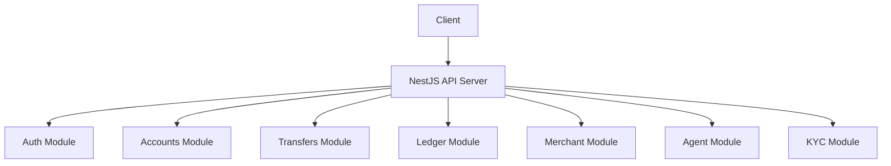
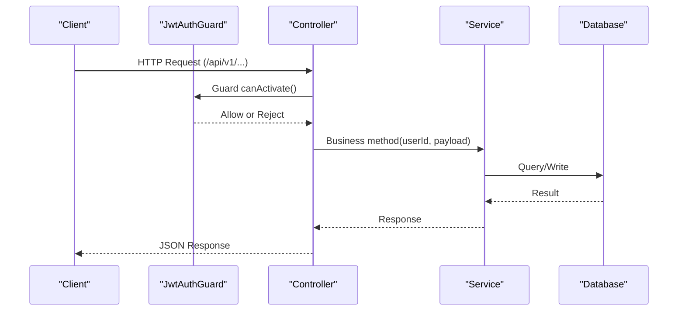
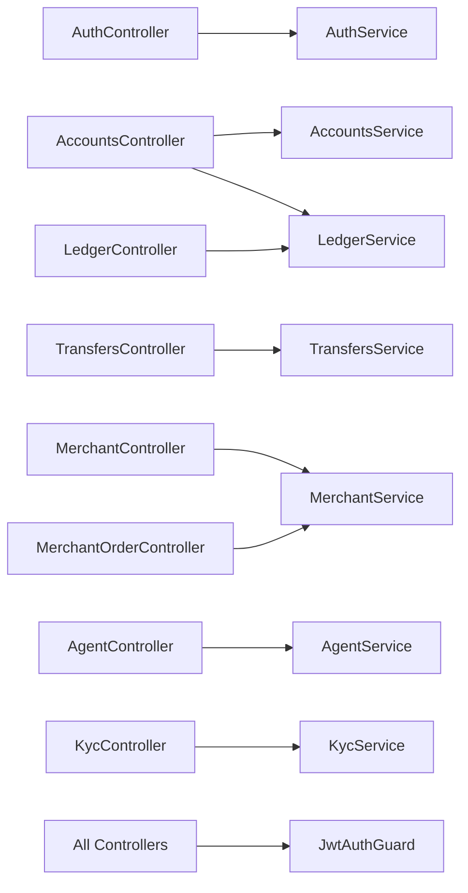

# API Reference

<cite>
**Referenced Files in This Document**
- [main.ts](file://backend/src/main.ts)
- [app.module.ts](file://backend/src/app.module.ts)
- [jwt-auth.guard.ts](file://backend/src/common/guards/jwt-auth.guard.ts)
- [auth.controller.ts](file://backend/src/auth/auth.controller.ts)
- [auth.dto.ts](file://backend/src/auth/dto/auth.dto.ts)
- [accounts.controller.ts](file://backend/src/accounts/accounts.controller.ts)
- [transfers.controller.ts](file://backend/src/transfers/transfers.controller.ts)
- [transfers.dto.ts](file://backend/src/transfers/dto/transfers.dto.ts)
- [ledger.controller.ts](file://backend/src/ledger/ledger.controller.ts)
- [merchant.controller.ts](file://backend/src/merchant/merchant.controller.ts)
- [merchant-order.controller.ts](file://backend/src/merchant/merchant-order.controller.ts)
- [merchant.dto.ts](file://backend/src/merchant/dto/merchant.dto.ts)
- [agent.controller.ts](file://backend/src/agent/agent.controller.ts)
- [agent.dto.ts](file://backend/src/agent/dto/agent.dto.ts)
- [kyc.controller.ts](file://backend/src/kyc/kyc.controller.ts)
- [kyc.dto.ts](file://backend/src/kyc/kyc.dto.ts)
- [configuration.ts](file://backend/src/config/configuration.ts)
</cite>

## Table of Contents
1. [Introduction](#introduction)
2. [Project Structure](#project-structure)
3. [Core Components](#core-components)
4. [Architecture Overview](#architecture-overview)
5. [Detailed Component Analysis](#detailed-component-analysis)
6. [Dependency Analysis](#dependency-analysis)
7. [Performance Considerations](#performance-considerations)
8. [Troubleshooting Guide](#troubleshooting-guide)
9. [Conclusion](#conclusion)
10. [Appendices](#appendices)

## Introduction
This document provides comprehensive API documentation for the Vireo Finance backend REST endpoints. It covers authentication, account management, transfers, ledger operations, merchant onboarding and settlement, KYC workflows, and AI agent tooling. Each endpoint group includes HTTP methods, URL patterns, request/response schemas, authentication requirements, error handling, and client usage guidance.

The API is versioned under a global prefix and uses JSON payloads with strict validation. Authentication is enforced via JWT Bearer tokens for protected routes.

## Project Structure
The backend is a NestJS application that:
- Sets a global API version prefix
- Applies global validation
- Registers feature modules (Auth, Accounts, Transfers, Ledger, Merchant, Agent, KYC, etc.)

**Diagram sources**
- [main.ts:7-21](file://backend/src/main.ts#L7-L21)
- [app.module.ts:21-45](file://backend/src/app.module.ts#L21-L45)

**Section sources**
- [main.ts:7-21](file://backend/src/main.ts#L7-L21)
- [app.module.ts:21-45](file://backend/src/app.module.ts#L21-L45)

## Core Components
- Global configuration and environment variables define base URL, port, JWT settings, OTP TTL, Redis, payment provider, risk limits, and notifications.
- Authentication guard validates Bearer tokens and attaches user context to requests.
- Controllers expose REST endpoints grouped by domain.
- DTOs enforce input validation rules for all endpoints.

Key implementation references:
- Global prefix and validation: [main.ts:7-21](file://backend/src/main.ts#L7-L21)
- JWT guard: [jwt-auth.guard.ts:10-30](file://backend/src/common/guards/jwt-auth.guard.ts#L10-L30)
- Configuration model: [configuration.ts:1-53](file://backend/src/config/configuration.ts#L1-L53)

**Section sources**
- [main.ts:7-21](file://backend/src/main.ts#L7-L21)
- [jwt-auth.guard.ts:10-30](file://backend/src/common/guards/jwt-auth.guard.ts#L10-L30)
- [configuration.ts:1-53](file://backend/src/config/configuration.ts#L1-L53)

## Architecture Overview
High-level flow for authenticated operations:
- Client sends HTTP requests to /api/v1/<domain>.
- JwtAuthGuard intercepts protected routes, verifies JWT, and injects user context.
- Controller delegates to service layer for business logic and persistence.

**Diagram sources**
- [jwt-auth.guard.ts:13-29](file://backend/src/common/guards/jwt-auth.guard.ts#L13-L29)
- [auth.controller.ts:11-48](file://backend/src/auth/auth.controller.ts#L11-L48)

## Detailed Component Analysis

### Authentication API
Base path: /api/v1/auth

Endpoints:
- POST /register
  - Auth: Public
  - Request body schema: RegisterDto
    - phone: string (pattern: optional leading +, 10–15 digits)
    - name: string (length 2–120)
    - handle?: string (optional; pattern: 3–20 alphanumeric or underscores)
  - Response: Registration result (implementation-defined)
  - Errors: Validation errors for invalid fields

- POST /otp/request
  - Auth: Public
  - Request body schema: OtpRequestDto
    - phone: string (pattern: optional leading +, 10–15 digits)
  - Response: OTP dispatch status

- POST /otp/verify
  - Auth: Public
  - Request body schema: OtpVerifyDto
    - phone: string (pattern: optional leading +, 10–15 digits)
    - code: string (length 6)
  - Response: Token issuance or verification result

- GET /me
  - Auth: Required (Bearer token)
  - Response: Current user profile

- POST /devices
  - Auth: Required (Bearer token)
  - Request body schema: RegisterDeviceDto
    - publicKey: string
    - platform: enum DevicePlatform
    - algorithm?: enum SignatureAlgorithm (optional)
    - attestationToken?: string (optional)
  - Response: Device registration result

- GET /devices
  - Auth: Required (Bearer token)
  - Response: List of devices for current user

- POST /devices/:id/revoke
  - Auth: Required (Bearer token)
  - Path params: id (string)
  - Response: Revocation result

Authentication details:
- Protected endpoints require Authorization: Bearer <token>.
- Invalid or missing tokens return Unauthorized.

Example request/response schemas:
- Register request: { "phone": "+1234567890", "name": "Jane Doe", "handle": "janedoe" }
- OTP verify request: { "phone": "+1234567890", "code": "123456" }
- Register device request: { "publicKey": "...", "platform": "ios", "algorithm": "ecdsa-p256" }

Error codes and messages:
- 400 Bad Request: Validation failures per DTO constraints
- 401 Unauthorized: Missing or invalid Bearer token

**Section sources**
- [auth.controller.ts:11-48](file://backend/src/auth/auth.controller.ts#L11-L48)
- [auth.dto.ts:7-52](file://backend/src/auth/dto/auth.dto.ts#L7-L52)
- [jwt-auth.guard.ts:13-29](file://backend/src/common/guards/jwt-auth.guard.ts#L13-L29)

### Accounts API
Base path: /api/v1/accounts

Endpoints:
- GET /me
  - Auth: Required (Bearer token)
  - Response schema:
    - accountId: string
    - currency: string
    - balance: string (minor units formatted)
    - held: string (minor units formatted)
    - available: string (minor units formatted)
    - virtualAccount: object | null
      - accountNumber: string
      - bankName: string
      - status: string

Notes:
- Combines wallet info, ledger balances, and virtual account details.

**Section sources**
- [accounts.controller.ts:8-35](file://backend/src/accounts/accounts.controller.ts#L8-L35)

### Transfers API
Base path: /api/v1/transfers

Endpoints:
- POST /drafts
  - Auth: Required (Bearer token)
  - Request body schema: CreateTransferDraftDto
    - type: enum TransferType (INTERNAL | BANK | MERCHANT)
    - amount: string (positive decimal up to 2 places)
    - idempotencyKey: string (length 8–120)
    - deviceId: string (UUID)
    - recipientUserId?: string (UUID)
    - recipientPhone?: string (length 10–15)
    - recipientHandle?: string (length 3–20)
    - bankCode?: string (length 2–16)
    - accountNumber?: string (length 6–32)
    - orderReference?: string
  - Response: Draft creation result

- POST /:id/submit
  - Auth: Required (Bearer token)
  - Path params: id (string)
  - Request body schema: SubmitTransferDto
    - signature: string
  - Response: Submission result

- GET /
  - Auth: Required (Bearer token)
  - Query params: limit?: number (default 50)
  - Response: List of transfers for current user

- GET /:id
  - Auth: Required (Bearer token)
  - Path params: id (string)
  - Response: Transfer details

Validation notes:
- Amount must match a positive decimal with up to two decimal places.
- Idempotency key prevents duplicate processing.

**Section sources**
- [transfers.controller.ts:12-34](file://backend/src/transfers/transfers.controller.ts#L12-L34)
- [transfers.dto.ts:6-53](file://backend/src/transfers/dto/transfers.dto.ts#L6-L53)

### Ledger API
Base path: /api/v1/ledger

Endpoints:
- GET /balance
  - Auth: Required (Bearer token)
  - Query params: accountId (required)
  - Response: Balance object (implementation-defined)

- GET /entries
  - Auth: Required (Bearer token)
  - Query params:
    - accountId (required)
    - limit?: number (default 50)
  - Response: Paginated entries list

Error handling:
- Missing accountId returns an error indicating it is required.

**Section sources**
- [ledger.controller.ts:11-32](file://backend/src/ledger/ledger.controller.ts#L11-L32)

### Merchant API
Base path: /api/v1/merchants

Endpoints:
- POST /
  - Auth: Required (Bearer token)
  - Request body schema: OnboardMerchantDto
    - businessName: string (length 2–160)
    - handle: string (length 3–60; alphanumeric or underscores)
    - settlementBankCode?: string (length 2–16)
    - settlementAccountNumber?: string (length 6–32)
  - Response: Onboarding result

- GET /me
  - Auth: Required (Bearer token)
  - Response: Merchant profile

- GET /dashboard
  - Auth: Required (Bearer token)
  - Response: Dashboard summary

- GET /orders
  - Auth: Required (Bearer token)
  - Response: Orders list

- POST /orders
  - Auth: Required (Bearer token)
  - Request body schema: CreateOrderDto
    - amount: string (positive decimal up to 2 places)
    - note?: string (length 1–255)
    - expiresInSeconds?: number (minimum 30)
  - Response: Order creation result

- GET /settlements
  - Auth: Required (Bearer token)
  - Response: Settlements list

- POST /settlements
  - Auth: Required (Bearer token)
  - Request body schema: SettleDto
    - amount?: string (positive decimal up to 2 places)
  - Response: Settlement initiation result

Additional endpoint:
- GET /merchant-orders/:reference
  - Auth: Required (Bearer token)
  - Path params: reference (string)
  - Response: Order details by reference

**Section sources**
- [merchant.controller.ts:12-45](file://backend/src/merchant/merchant.controller.ts#L12-L45)
- [merchant-order.controller.ts:10-13](file://backend/src/merchant/merchant-order.controller.ts#L10-L13)
- [merchant.dto.ts:6-47](file://backend/src/merchant/dto/merchant.dto.ts#L6-L47)

### KYC API
Base path: /api/v1/kyc

Endpoints:
- POST /submit
  - Auth: Required (Bearer token)
  - Request body schema: SubmitKycDto
    - provider: string (pattern: 2–40 chars; letters, numbers, underscores, hyphens)
    - payload?: string (length 1–5000)
  - Response: Submission result

- GET /me
  - Auth: Required (Bearer token)
  - Response: User KYC status

- GET /pending
  - Auth: Required (Bearer token)
  - Response: Pending KYC records

- PATCH /:id/verify
  - Auth: Required (Bearer token)
  - Path params: id (string)
  - Request body schema: VerifyKycDto
    - status: enum KycStatus
    - tier?: string (length 1–500)
    - reason?: string (length 1–500)
  - Response: Verification result

**Section sources**
- [kyc.controller.ts:11-33](file://backend/src/kyc/kyc.controller.ts#L11-L33)
- [kyc.dto.ts:6-49](file://backend/src/kyc/kyc.dto.ts#L6-L49)

### AI Agent API
Base path: /api/v1/agent

Endpoints:
- POST /sessions
  - Auth: Required (Bearer token)
  - Response: Session creation result

- GET /sessions
  - Auth: Required (Bearer token)
  - Response: Sessions list for current user

- GET /sessions/:id/calls
  - Auth: Required (Bearer token)
  - Path params: id (string)
  - Response: Tool calls list for session

- POST /tools
  - Auth: Required (Bearer token)
  - Request body schema: RunAgentToolDto
    - sessionId?: string (UUID)
    - tool: enum AGENT_TOOLS (get_balance | list_transactions | validate_recipient | create_transfer_draft | create_payment_request | explain_fee)
    - input: object (arbitrary key-value pairs)
  - Response: Tool execution result

Supported tools:
- get_balance
- list_transactions
- validate_recipient
- create_transfer_draft
- create_payment_request
- explain_fee

**Section sources**
- [agent.controller.ts:12-30](file://backend/src/agent/agent.controller.ts#L12-L30)
- [agent.dto.ts:3-26](file://backend/src/agent/dto/agent.dto.ts#L3-L26)

## Dependency Analysis
Controllers depend on services and guards:
- JwtAuthGuard enforces authentication across protected controllers.
- Controllers delegate to services for business logic and data access.
- DTOs provide consistent validation across endpoints.

**Diagram sources**
- [auth.controller.ts:11-48](file://backend/src/auth/auth.controller.ts#L11-L48)
- [accounts.controller.ts:8-35](file://backend/src/accounts/accounts.controller.ts#L8-L35)
- [transfers.controller.ts:12-34](file://backend/src/transfers/transfers.controller.ts#L12-L34)
- [ledger.controller.ts:11-32](file://backend/src/ledger/ledger.controller.ts#L11-L32)
- [merchant.controller.ts:12-45](file://backend/src/merchant/merchant.controller.ts#L12-L45)
- [merchant-order.controller.ts:10-13](file://backend/src/merchant/merchant-order.controller.ts#L10-L13)
- [agent.controller.ts:12-30](file://backend/src/agent/agent.controller.ts#L12-L30)
- [kyc.controller.ts:11-33](file://backend/src/kyc/kyc.controller.ts#L11-L33)
- [jwt-auth.guard.ts:13-29](file://backend/src/common/guards/jwt-auth.guard.ts#L13-L29)

**Section sources**
- [auth.controller.ts:11-48](file://backend/src/auth/auth.controller.ts#L11-L48)
- [accounts.controller.ts:8-35](file://backend/src/accounts/accounts.controller.ts#L8-L35)
- [transfers.controller.ts:12-34](file://backend/src/transfers/transfers.controller.ts#L12-L34)
- [ledger.controller.ts:11-32](file://backend/src/ledger/ledger.controller.ts#L11-L32)
- [merchant.controller.ts:12-45](file://backend/src/merchant/merchant.controller.ts#L12-L45)
- [merchant-order.controller.ts:10-13](file://backend/src/merchant/merchant-order.controller.ts#L10-L13)
- [agent.controller.ts:12-30](file://backend/src/agent/agent.controller.ts#L12-L30)
- [kyc.controller.ts:11-33](file://backend/src/kyc/kyc.controller.ts#L11-L33)
- [jwt-auth.guard.ts:13-29](file://backend/src/common/guards/jwt-auth.guard.ts#L13-L29)

## Performance Considerations
- Use idempotency keys when creating transfer drafts to avoid duplicate processing.
- Limit pagination using query parameters where supported (e.g., transfers list, ledger entries).
- Prefer minimal payloads and only include optional fields when necessary.
- Cache read-heavy data at the client side when appropriate (e.g., dashboard summaries).

[No sources needed since this section provides general guidance]

## Troubleshooting Guide
Common issues and resolutions:
- 401 Unauthorized: Ensure Authorization header is set to Bearer token. Validate token expiration and correctness.
- 400 Bad Request: Check DTO validation rules (patterns, lengths, enums). Correct malformed inputs.
- Missing required query parameters: For ledger endpoints, always include accountId.

Security headers:
- Authorization: Bearer <token> for protected endpoints.

Operational tips:
- Log request IDs and correlate with server logs for debugging.
- Validate client-side before sending to reduce round-trips.

**Section sources**
- [jwt-auth.guard.ts:13-29](file://backend/src/common/guards/jwt-auth.guard.ts#L13-L29)
- [ledger.controller.ts:11-32](file://backend/src/ledger/ledger.controller.ts#L11-L32)

## Conclusion
The Vireo Finance API provides a secure, validated, and modular REST surface for personal finance, merchant operations, KYC workflows, and AI-driven banking tools. Clients should adhere to the documented schemas, use Bearer tokens for protected routes, and implement robust error handling and retry strategies.

[No sources needed since this section summarizes without analyzing specific files]

## Appendices

### Versioning Strategy
- Global API version prefix: /api/v1
- All endpoints are served under this prefix.

**Section sources**
- [main.ts:7-21](file://backend/src/main.ts#L7-L21)

### Rate Limiting
- No explicit rate limiting middleware is configured in the analyzed code.
- Implement rate limiting at the gateway or application level if required.

[No sources needed since this section provides general guidance]

### Security Headers
- Authorization: Bearer <token> for protected endpoints.
- Enforce HTTPS in production and configure CORS appropriately.

**Section sources**
- [jwt-auth.guard.ts:13-29](file://backend/src/common/guards/jwt-auth.guard.ts#L13-L29)

### Client Implementation Guidelines and SDK Usage Patterns
- Base URL: http(s)://host/api/v1
- Authentication:
  - Obtain tokens via OTP verification flow.
  - Attach Authorization: Bearer <token> to all protected requests.
- Error handling:
  - Handle 400 for validation errors and 401 for auth failures.
- Idempotency:
  - Provide unique idempotencyKey for transfer draft creation.
- Pagination:
  - Use limit query parameter where supported.

[No sources needed since this section provides general guidance]