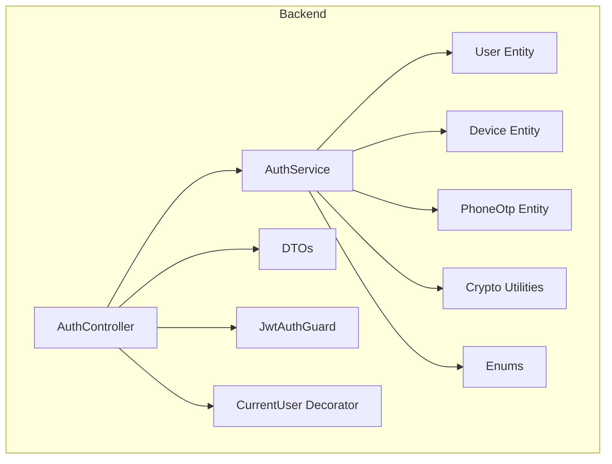
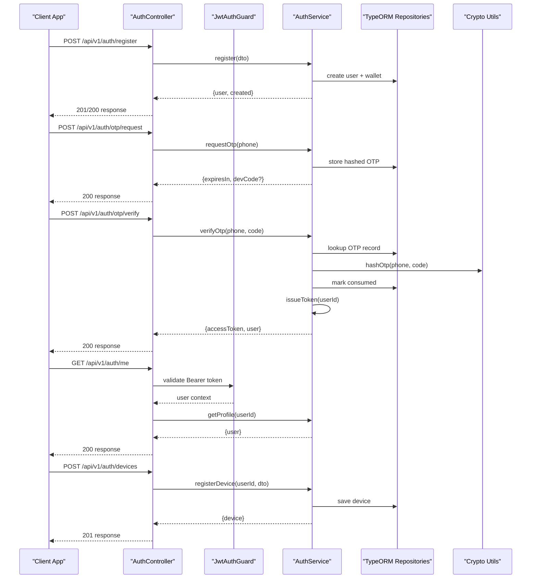
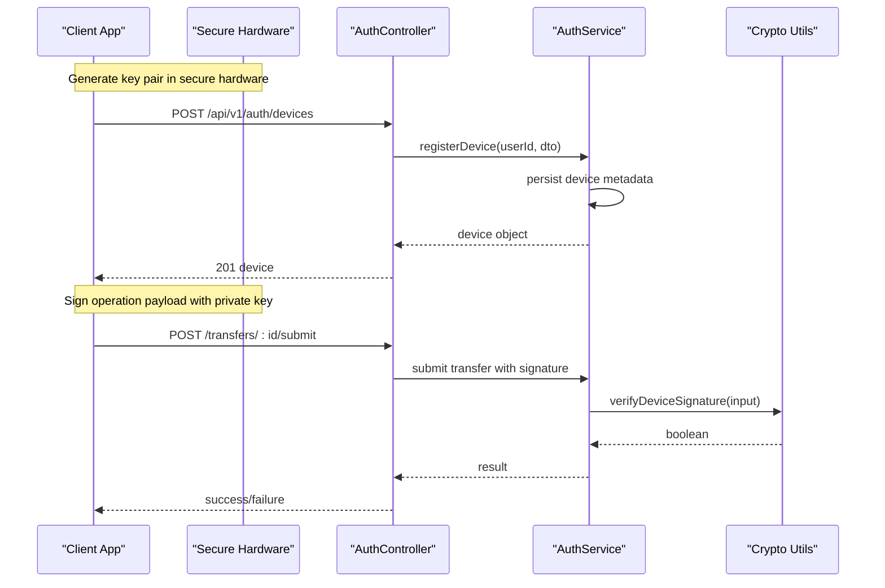
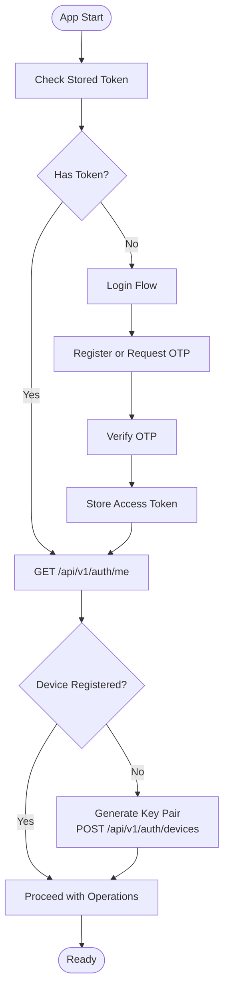
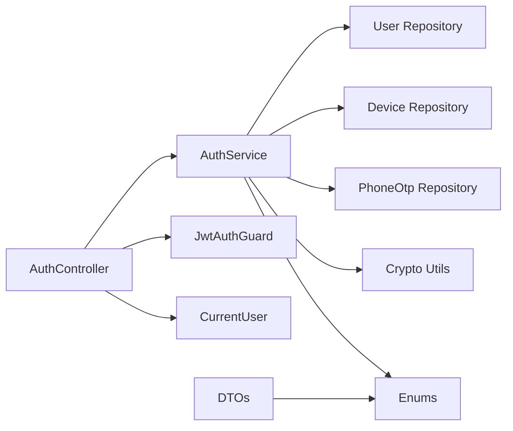

# Authentication Endpoints

<cite>
**Referenced Files in This Document**
- [auth.controller.ts](file://backend/src/auth/auth.controller.ts)
- [auth.service.ts](file://backend/src/auth/auth.service.ts)
- [auth.dto.ts](file://backend/src/auth/dto/auth.dto.ts)
- [device.entity.ts](file://backend/src/auth/device.entity.ts)
- [phone-otp.entity.ts](file://backend/src/auth/phone-otp.entity.ts)
- [jwt-auth.guard.ts](file://backend/src/common/guards/jwt-auth.guard.ts)
- [current-user.decorator.ts](file://backend/src/common/decorators/current-user.decorator.ts)
- [crypto.ts](file://backend/src/common/crypto.ts)
- [enums.ts](file://backend/src/common/enums.ts)
- [user.entity.ts](file://backend/src/users/user.entity.ts)
- [api.ts (personal)](file://personal/src/api.ts)
- [AuthContext.tsx (personal)](file://personal/src/contexts/AuthContext.tsx)
</cite>

## Table of Contents
1. [Introduction](#introduction)
2. [Project Structure](#project-structure)
3. [Core Components](#core-components)
4. [Architecture Overview](#architecture-overview)
5. [Detailed Component Analysis](#detailed-component-analysis)
6. [Dependency Analysis](#dependency-analysis)
7. [Performance Considerations](#performance-considerations)
8. [Troubleshooting Guide](#troubleshooting-guide)
9. [Conclusion](#conclusion)
10. [Appendices](#appendices)

## Introduction
This document provides comprehensive API documentation for the authentication subsystem, covering:
- User registration
- OTP request and verification flows
- Profile retrieval
- Device management operations
- JWT-based authentication requirements
- Error responses
- Security considerations
- Biometric signature verification flow and device enrollment process
- Client implementation examples for token management and device workflows

The backend is implemented with NestJS, using TypeORM entities for persistence and a JWT guard for protected routes. The personal client demonstrates how to manage tokens and call authenticated endpoints.

## Project Structure
Authentication-related code resides under the auth module and shared common utilities:
- Controllers define REST endpoints
- Services implement business logic
- DTOs validate requests
- Entities model database tables
- Guards enforce JWT authentication
- Crypto utilities provide hashing and signature verification helpers
- Enums define allowed values for platforms, algorithms, and statuses

**Diagram sources**
- [auth.controller.ts:7-48](file://backend/src/auth/auth.controller.ts#L7-L48)
- [auth.service.ts:24-177](file://backend/src/auth/auth.service.ts#L24-L177)
- [auth.dto.ts:7-52](file://backend/src/auth/dto/auth.dto.ts#L7-L52)
- [device.entity.ts:4-34](file://backend/src/auth/device.entity.ts#L4-L34)
- [phone-otp.entity.ts:3-26](file://backend/src/auth/phone-otp.entity.ts#L3-L26)
- [jwt-auth.guard.ts:9-30](file://backend/src/common/guards/jwt-auth.guard.ts#L9-L30)
- [current-user.decorator.ts:8-13](file://backend/src/common/decorators/current-user.decorator.ts#L8-L13)
- [crypto.ts:68-83](file://backend/src/common/crypto.ts#L68-L83)
- [enums.ts:13-26](file://backend/src/common/enums.ts#L13-L26)

**Section sources**
- [auth.controller.ts:7-48](file://backend/src/auth/auth.controller.ts#L7-L48)
- [auth.service.ts:24-177](file://backend/src/auth/auth.service.ts#L24-L177)
- [auth.dto.ts:7-52](file://backend/src/auth/dto/auth.dto.ts#L7-L52)
- [device.entity.ts:4-34](file://backend/src/auth/device.entity.ts#L4-L34)
- [phone-otp.entity.ts:3-26](file://backend/src/auth/phone-otp.entity.ts#L3-L26)
- [jwt-auth.guard.ts:9-30](file://backend/src/common/guards/jwt-auth.guard.ts#L9-L30)
- [current-user.decorator.ts:8-13](file://backend/src/common/decorators/current-user.decorator.ts#L8-L13)
- [crypto.ts:68-83](file://backend/src/common/crypto.ts#L68-L83)
- [enums.ts:13-26](file://backend/src/common/enums.ts#L13-L26)

## Core Components
- AuthController: Exposes public and protected endpoints for registration, OTP, profile, and device management.
- AuthService: Implements user lifecycle, OTP generation and verification, device enrollment and revocation, and JWT issuance.
- DTOs: Validate phone numbers, codes, device metadata, and optional attestation tokens.
- JwtAuthGuard: Enforces Bearer token presence and validates JWT payload.
- CurrentUser Decorator: Injects authenticated user context into controllers.
- Crypto Utilities: Provide HMAC hashing for OTP storage and signature verification for device-bound operations.
- Entities: Model users, devices, and OTP records.

**Section sources**
- [auth.controller.ts:7-48](file://backend/src/auth/auth.controller.ts#L7-L48)
- [auth.service.ts:24-177](file://backend/src/auth/auth.service.ts#L24-L177)
- [auth.dto.ts:7-52](file://backend/src/auth/dto/auth.dto.ts#L7-L52)
- [jwt-auth.guard.ts:9-30](file://backend/src/common/guards/jwt-auth.guard.ts#L9-L30)
- [current-user.decorator.ts:8-13](file://backend/src/common/decorators/current-user.decorator.ts#L8-L13)
- [crypto.ts:68-83](file://backend/src/common/crypto.ts#L68-L83)
- [device.entity.ts:4-34](file://backend/src/auth/device.entity.ts#L4-L34)
- [phone-otp.entity.ts:3-26](file://backend/src/auth/phone-otp.entity.ts#L3-L26)

## Architecture Overview
The authentication architecture follows a layered approach:
- Controller layer handles HTTP routing and input binding
- Service layer encapsulates business logic and data access
- Guard layer enforces JWT authentication on protected routes
- Data layer persists entities via TypeORM repositories
- Crypto utilities support secure OTP handling and biometric signature verification

**Diagram sources**
- [auth.controller.ts:11-48](file://backend/src/auth/auth.controller.ts#L11-L48)
- [auth.service.ts:39-172](file://backend/src/auth/auth.service.ts#L39-L172)
- [jwt-auth.guard.ts:13-29](file://backend/src/common/guards/jwt-auth.guard.ts#L13-L29)
- [crypto.ts:68-83](file://backend/src/common/crypto.ts#L68-L83)

## Detailed Component Analysis

### Authentication Endpoints

#### Register User
- Method: POST
- Path: /api/v1/auth/register
- Authentication: None
- Request body schema:
  - phone: string, pattern ^\+?[0-9]{10,15}$
  - name: string, length 2–120
  - handle: optional string, pattern ^[a-zA-Z0-9_]{3,20}$
- Response:
  - user: object containing id, phone, handle, name, kycTier, status, createdAt
  - created: boolean indicating whether a new user was created
- Notes:
  - If user already exists, returns existing user with created=false
  - Creates an internal wallet and attempts virtual account provisioning

Example request:
{
  "phone": "+1234567890",
  "name": "Jane Doe",
  "handle": "janedoe"
}

Example response:
{
  "user": {
    "id": "uuid",
    "phone": "+1234567890",
    "handle": "janedoe",
    "name": "Jane Doe",
    "kycTier": 0,
    "status": "active",
    "createdAt": "2024-01-01T00:00:00Z"
  },
  "created": true
}

Error responses:
- Validation errors from DTO constraints
- Internal server errors during wallet or virtual account creation

Security considerations:
- Phone normalization ensures consistent formatting
- Handle uniqueness enforced at database level

**Section sources**
- [auth.controller.ts:11-14](file://backend/src/auth/auth.controller.ts#L11-L14)
- [auth.service.ts:39-71](file://backend/src/auth/auth.service.ts#L39-L71)
- [auth.dto.ts:7-20](file://backend/src/auth/dto/auth.dto.ts#L7-L20)
- [user.entity.ts:11-38](file://backend/src/users/user.entity.ts#L11-L38)

#### Request OTP
- Method: POST
- Path: /api/v1/auth/otp/request
- Authentication: None
- Request body schema:
  - phone: string, pattern ^\+?[0-9]{10,15}$
- Response:
  - expiresIn: number (seconds)
  - devCode: optional string (only in non-production environments)
- Behavior:
  - Validates user existence and active status
  - Generates a random 6-digit code
  - Stores a hashed version of the code tied to the phone number
  - Returns TTL and optionally the plain code in development

Example request:
{
  "phone": "+1234567890"
}

Example response:
{
  "expiresIn": 300,
  "devCode": "123456"
}

Error responses:
- Not found if user does not exist
- Unauthorized if user is not active

Security considerations:
- OTP code is never stored in plaintext; only a hashed value is persisted
- Rate limiting is not explicitly implemented here; consider adding throttling

**Section sources**
- [auth.controller.ts:16-19](file://backend/src/auth/auth.controller.ts#L16-L19)
- [auth.service.ts:73-98](file://backend/src/auth/auth.service.ts#L73-L98)
- [auth.dto.ts:22-26](file://backend/src/auth/dto/auth.dto.ts#L22-L26)
- [phone-otp.entity.ts:3-26](file://backend/src/auth/phone-otp.entity.ts#L3-L26)

#### Verify OTP
- Method: POST
- Path: /api/v1/auth/otp/verify
- Authentication: None
- Request body schema:
  - phone: string, pattern ^\+?[0-9]{10,15}$
  - code: string, length exactly 6
- Response:
  - accessToken: JWT string
  - user: object containing id, phone, handle, name, kycTier, status, createdAt
- Behavior:
  - Looks up the latest unconsumed OTP record for the phone
  - Validates expiration and attempt limits
  - Compares provided code against stored hash
  - Marks OTP as consumed upon success
  - Issues a JWT token with subject set to user id

Example request:
{
  "phone": "+1234567890",
  "code": "123456"
}

Example response:
{
  "accessToken": "eyJhbGciOi...",
  "user": {
    "id": "uuid",
    "phone": "+1234567890",
    "handle": "janedoe",
    "name": "Jane Doe",
    "kycTier": 0,
    "status": "active",
    "createdAt": "2024-01-01T00:00:00Z"
  }
}

Error responses:
- Bad request for invalid/expired OTP or too many attempts
- Not found if user is missing after OTP consumption

Security considerations:
- Uses HMAC-SHA256 to compare OTPs securely
- Attempts counter prevents brute-force attacks

**Section sources**
- [auth.controller.ts:21-24](file://backend/src/auth/auth.controller.ts#L21-L24)
- [auth.service.ts:100-127](file://backend/src/auth/auth.service.ts#L100-L127)
- [auth.dto.ts:28-36](file://backend/src/auth/dto/auth.dto.ts#L28-L36)
- [phone-otp.entity.ts:3-26](file://backend/src/auth/phone-otp.entity.ts#L3-L26)
- [crypto.ts:27-29](file://backend/src/common/crypto.ts#L27-L29)

#### Get Profile
- Method: GET
- Path: /api/v1/auth/me
- Authentication: Required (Bearer JWT)
- Headers:
  - Authorization: Bearer <token>
- Response:
  - user: object containing id, phone, handle, name, kycTier, status, createdAt
- Behavior:
  - Validates JWT and extracts userId
  - Retrieves user profile and returns public fields

Example headers:
Authorization: Bearer eyJhbGciOi...

Example response:
{
  "user": {
    "id": "uuid",
    "phone": "+1234567890",
    "handle": "janedoe",
    "name": "Jane Doe",
    "kycTier": 0,
    "status": "active",
    "createdAt": "2024-01-01T00:00:00Z"
  }
}

Error responses:
- Unauthorized if token is missing or invalid
- Not found if user does not exist

Security considerations:
- JWT payload contains sub (userId); deviceId may be present when issued with device context

**Section sources**
- [auth.controller.ts:26-30](file://backend/src/auth/auth.controller.ts#L26-L30)
- [auth.service.ts:162-168](file://backend/src/auth/auth.service.ts#L162-L168)
- [jwt-auth.guard.ts:13-29](file://backend/src/common/guards/jwt-auth.guard.ts#L13-L29)
- [current-user.decorator.ts:8-13](file://backend/src/common/decorators/current-user.decorator.ts#L8-L13)

#### Register Device
- Method: POST
- Path: /api/v1/auth/devices
- Authentication: Required (Bearer JWT)
- Headers:
  - Authorization: Bearer <token>
- Request body schema:
  - publicKey: string (Base64-encoded SPKI DER public key)
  - platform: enum DevicePlatform (ios | android)
  - algorithm: optional enum SignatureAlgorithm (ed25519 | es256), defaults to ed25519
  - attestationToken: optional string (for attestation verification)
- Response:
  - device: object containing id, platform, algorithm, attestationState, status, createdAt
- Behavior:
  - Saves device metadata including public key and platform
  - Sets attestation state based on presence of attestation token
  - Marks device as active

Example request:
{
  "publicKey": "BASE64_ENCODED_SPKI_DER_KEY",
  "platform": "android",
  "algorithm": "ed25519",
  "attestationToken": "optional_attestation_token"
}

Example response:
{
  "id": "uuid",
  "platform": "android",
  "algorithm": "ed25519",
  "attestationState": "provided",
  "status": "active",
  "createdAt": "2024-01-01T00:00:00Z"
}

Error responses:
- Validation errors for invalid enums or missing fields
- Internal server errors during persistence

Security considerations:
- Public key must be valid SPKI DER encoded and Base64-safe
- Algorithm defaults to ed25519 for strong security

**Section sources**
- [auth.controller.ts:32-36](file://backend/src/auth/auth.controller.ts#L32-L36)
- [auth.service.ts:129-141](file://backend/src/auth/auth.service.ts#L129-L141)
- [auth.dto.ts:38-52](file://backend/src/auth/dto/auth.dto.ts#L38-L52)
- [device.entity.ts:4-34](file://backend/src/auth/device.entity.ts#L4-L34)
- [enums.ts:13-26](file://backend/src/common/enums.ts#L13-L26)

#### List Devices
- Method: GET
- Path: /api/v1/auth/devices
- Authentication: Required (Bearer JWT)
- Headers:
  - Authorization: Bearer <token>
- Response:
  - Array of device objects with id, platform, algorithm, attestationState, status, createdAt
- Behavior:
  - Returns all devices belonging to the authenticated user, ordered by creation time descending

Example headers:
Authorization: Bearer eyJhbGciOi...

Example response:
[
  {
    "id": "uuid",
    "platform": "android",
    "algorithm": "ed25519",
    "attestationState": "provided",
    "status": "active",
    "createdAt": "2024-01-01T00:00:00Z"
  }
]

Error responses:
- Unauthorized if token is missing or invalid

**Section sources**
- [auth.controller.ts:38-42](file://backend/src/auth/auth.controller.ts#L38-L42)
- [auth.service.ts:143-149](file://backend/src/auth/auth.service.ts#L143-L149)

#### Revoke Device
- Method: POST
- Path: /api/v1/auth/devices/:id/revoke
- Authentication: Required (Bearer JWT)
- Headers:
  - Authorization: Bearer <token>
- URL parameters:
  - id: string (device UUID)
- Response:
  - device: object reflecting revoked status and revokedAt timestamp
- Behavior:
  - Finds the device by id and ownership by current user
  - Sets status to revoked and records revokedAt timestamp

Example headers:
Authorization: Bearer eyJhbGciOi...

Example response:
{
  "id": "uuid",
  "platform": "android",
  "algorithm": "ed25519",
  "attestationState": "provided",
  "status": "revoked",
  "revokedAt": "2024-01-01T01:00:00Z",
  "createdAt": "2024-01-01T00:00:00Z"
}

Error responses:
- Not found if device does not belong to the user
- Unauthorized if token is missing or invalid

**Section sources**
- [auth.controller.ts:44-48](file://backend/src/auth/auth.controller.ts#L44-L48)
- [auth.service.ts:151-160](file://backend/src/auth/auth.service.ts#L151-L160)

### Biometric Signature Verification Flow and Device Enrollment

Biometric signatures are used to bind critical operations to a specific device’s secure hardware. The flow involves:
- Device enrollment: Client generates a key pair in secure hardware and registers the public key with the server
- Server stores the public key and algorithm metadata
- For sensitive operations, client signs a canonicalized payload using the private key
- Server verifies the signature using the stored public key and algorithm

**Diagram sources**
- [auth.controller.ts:32-36](file://backend/src/auth/auth.controller.ts#L32-L36)
- [auth.service.ts:129-141](file://backend/src/auth/auth.service.ts#L129-L141)
- [crypto.ts:68-83](file://backend/src/common/crypto.ts#L68-L83)

Key points:
- Public keys are Base64-encoded SPKI DER strings
- Algorithms supported: ed25519, es256
- Canonical JSON ensures deterministic payload hashing across clients and servers
- Signature verification uses Node.js crypto.verify with appropriate parameters per algorithm

**Section sources**
- [device.entity.ts:13-21](file://backend/src/auth/device.entity.ts#L13-L21)
- [crypto.ts:37-83](file://backend/src/common/crypto.ts#L37-L83)
- [enums.ts:23-26](file://backend/src/common/enums.ts#L23-L26)

### Client Implementation Examples

Token Management:
- Set token globally on the Axios instance
- Clear token on logout
- Persist token in secure storage and inject it into requests

Device Registration Workflow:
- After successful OTP verification, generate a key pair in secure hardware
- Register the device with the server including public key, platform, algorithm, and optional attestation token
- Use the registered device id for subsequent operations requiring device-bound signatures

**Diagram sources**
- [api.ts (personal):15-21](file://personal/src/api.ts#L15-L21)
- [api.ts (personal):23-51](file://personal/src/api.ts#L23-L51)
- [AuthContext.tsx (personal):20-39](file://personal/src/contexts/AuthContext.tsx#L20-L39)

**Section sources**
- [api.ts (personal):1-95](file://personal/src/api.ts#L1-L95)
- [AuthContext.tsx (personal):1-55](file://personal/src/contexts/AuthContext.tsx#L1-L55)

## Dependency Analysis
The authentication system has clear separation of concerns:
- Controllers depend on services and guards
- Services depend on repositories, config, and crypto utilities
- Guards depend on JWT service
- DTOs rely on class-validator and enums
- Entities rely on TypeORM decorators and enums

**Diagram sources**
- [auth.controller.ts:1-48](file://backend/src/auth/auth.controller.ts#L1-L48)
- [auth.service.ts:1-37](file://backend/src/auth/auth.service.ts#L1-L37)
- [auth.dto.ts:1-52](file://backend/src/auth/dto/auth.dto.ts#L1-L52)
- [jwt-auth.guard.ts:1-30](file://backend/src/common/guards/jwt-auth.guard.ts#L1-L30)
- [crypto.ts:1-84](file://backend/src/common/crypto.ts#L1-L84)
- [enums.ts:1-121](file://backend/src/common/enums.ts#L1-L121)

**Section sources**
- [auth.controller.ts:1-48](file://backend/src/auth/auth.controller.ts#L1-L48)
- [auth.service.ts:1-37](file://backend/src/auth/auth.service.ts#L1-L37)
- [auth.dto.ts:1-52](file://backend/src/auth/dto/auth.dto.ts#L1-L52)
- [jwt-auth.guard.ts:1-30](file://backend/src/common/guards/jwt-auth.guard.ts#L1-L30)
- [crypto.ts:1-84](file://backend/src/common/crypto.ts#L1-L84)
- [enums.ts:1-121](file://backend/src/common/enums.ts#L1-L121)

## Performance Considerations
- OTP hashing uses HMAC-SHA256 which is efficient and secure
- Database queries are indexed on phone and userId to optimize lookups
- JWT verification is handled by @nestjs/jwt with async methods
- Avoid unnecessary logging in production paths to reduce overhead
- Consider implementing rate limiting on OTP endpoints to prevent abuse

[No sources needed since this section provides general guidance]

## Troubleshooting Guide
Common issues and resolutions:
- Missing bearer token: Ensure Authorization header is set correctly with Bearer scheme
- Invalid or expired token: Refresh token or re-authenticate via OTP flow
- OTP invalid or expired: Request a new OTP and ensure timely verification within TTL
- Too many OTP attempts: Wait for cooldown or contact support if locked out
- Device not found: Confirm device id belongs to the authenticated user
- Signature verification failures: Ensure canonical JSON and correct algorithm are used

**Section sources**
- [jwt-auth.guard.ts:13-29](file://backend/src/common/guards/jwt-auth.guard.ts#L13-L29)
- [auth.service.ts:100-127](file://backend/src/auth/auth.service.ts#L100-L127)
- [auth.service.ts:151-160](file://backend/src/auth/auth.service.ts#L151-L160)
- [crypto.ts:68-83](file://backend/src/common/crypto.ts#L68-L83)

## Conclusion
The authentication subsystem provides a robust foundation for user registration, OTP-based login, profile retrieval, and device management. It leverages JWT for session management and supports biometric signature verification for enhanced security. Clients should manage tokens securely, enroll devices with proper key pairs, and use canonicalized payloads for reliable signature verification.

[No sources needed since this section summarizes without analyzing specific files]

## Appendices

### Security Considerations
- Always transmit over HTTPS
- Store tokens securely on the client side
- Validate and sanitize inputs using DTOs
- Use strong algorithms (ed25519 recommended) for device signatures
- Implement rate limiting and monitoring for OTP endpoints
- Rotate secrets and configure environment variables properly

[No sources needed since this section provides general guidance]