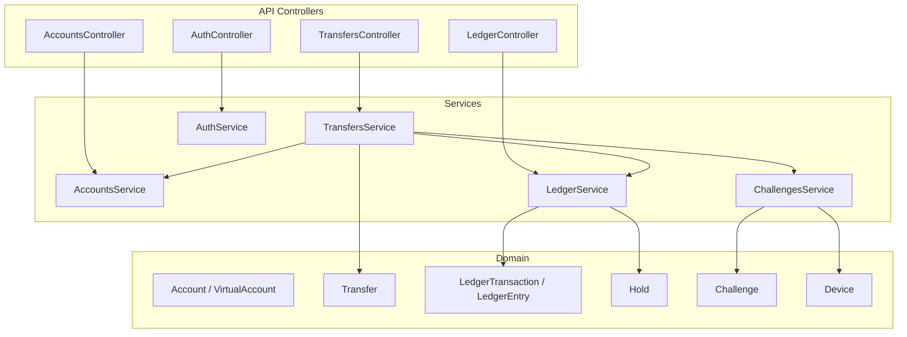
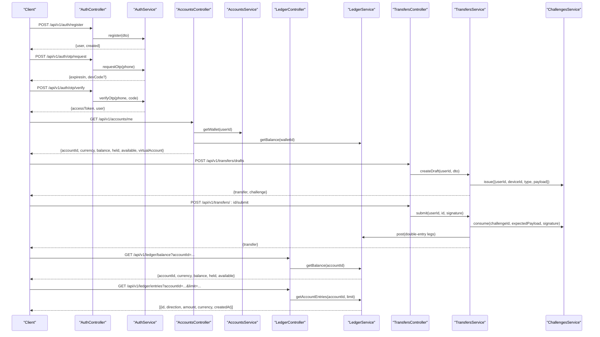
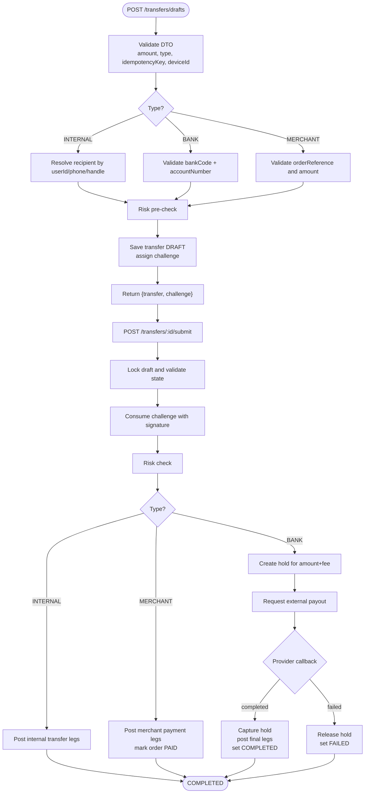
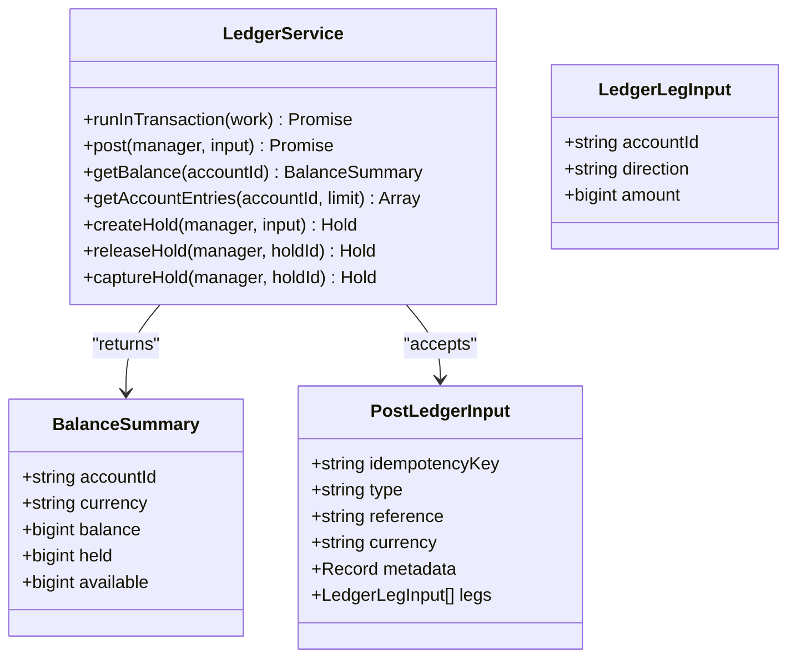
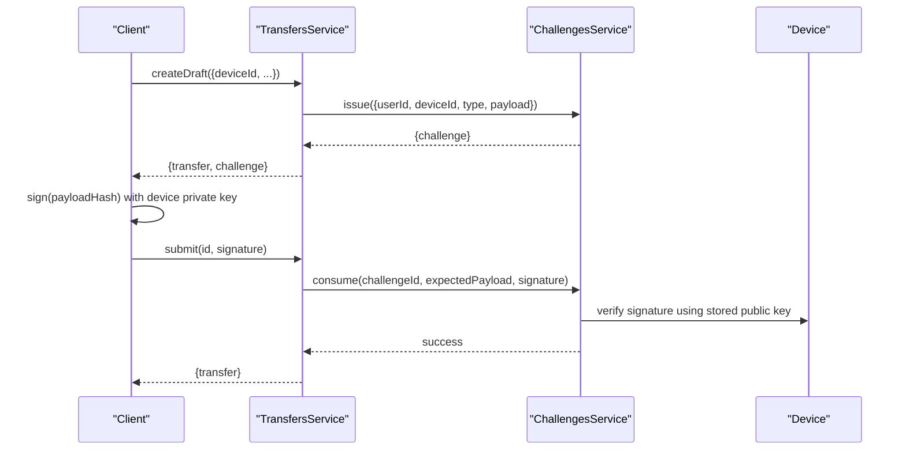
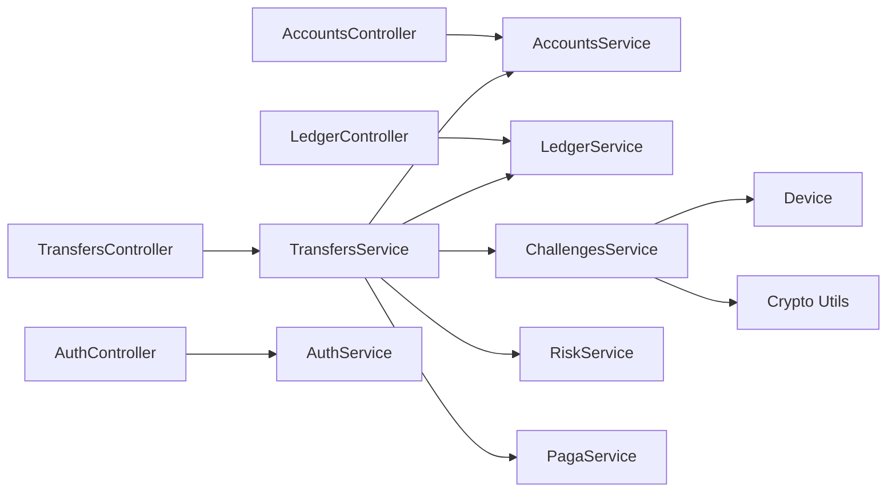

# Financial Operations Endpoints

<cite>
**Referenced Files in This Document**
- [accounts.controller.ts](file://backend/src/accounts/accounts.controller.ts)
- [accounts.service.ts](file://backend/src/accounts/accounts.service.ts)
- [transfers.controller.ts](file://backend/src/transfers/transfers.controller.ts)
- [transfers.service.ts](file://backend/src/transfers/transfers.service.ts)
- [ledger.controller.ts](file://backend/src/ledger/ledger.controller.ts)
- [ledger.service.ts](file://backend/src/ledger/ledger.service.ts)
- [auth.controller.ts](file://backend/src/auth/auth.controller.ts)
- [auth.service.ts](file://backend/src/auth/auth.service.ts)
- [challenges.service.ts](file://backend/src/challenges/challenges.service.ts)
- [crypto.ts](file://backend/src/common/crypto.ts)
- [enums.ts](file://backend/src/common/enums.ts)
- [constants.ts](file://backend/src/common/constants.ts)
- [money.ts](file://backend/src/database/money.ts)
- [transfers.dto.ts](file://backend/src/transfers/dto/transfers.dto.ts)
- [auth.dto.ts](file://backend/src/auth/dto/auth.dto.ts)
</cite>

## Table of Contents
1. [Introduction](#introduction)
2. [Project Structure](#project-structure)
3. [Core Components](#core-components)
4. [Architecture Overview](#architecture-overview)
5. [Detailed Component Analysis](#detailed-component-analysis)
6. [Dependency Analysis](#dependency-analysis)
7. [Performance Considerations](#performance-considerations)
8. [Troubleshooting Guide](#troubleshooting-guide)
9. [Conclusion](#conclusion)

## Introduction
This document provides comprehensive API documentation for financial operations, including account management, transfer processing, and ledger queries. It covers:
- Account creation and management endpoints
- Virtual account operations and balance queries
- Transaction history retrieval
- Transfer processing (internal transfers, external payments via bank payouts, merchant payments)
- Transfer status tracking and hold/reserve management
- Ledger query endpoints for double-entry accounting data, auditing, and balance verification
- Challenge-response authentication mechanism for sensitive financial operations
- Security best practices for handling monetary transactions

The system uses JWT-based access control with a device-bound challenge-response flow to authorize high-value or sensitive actions such as creating and submitting transfers.

## Project Structure
The backend is organized by feature modules:
- Accounts: wallet and virtual account lifecycle
- Transfers: draft-and-submit workflow with risk checks and external payout integration
- Ledger: double-entry posting, holds, balances, and entries
- Auth: registration, OTP login, device management, and JWT issuance
- Challenges: secure challenge issuance and consumption with device signature verification
- Common: shared enums, constants, crypto utilities
- Database: money formatting and validation helpers

**Diagram sources**
- [accounts.controller.ts:1-37](file://backend/src/accounts/accounts.controller.ts#L1-L37)
- [transfers.controller.ts:1-36](file://backend/src/transfers/transfers.controller.ts#L1-L36)
- [ledger.controller.ts:1-34](file://backend/src/ledger/ledger.controller.ts#L1-L34)
- [auth.controller.ts:1-50](file://backend/src/auth/auth.controller.ts#L1-L50)
- [accounts.service.ts:1-104](file://backend/src/accounts/accounts.service.ts#L1-L104)
- [transfers.service.ts:1-652](file://backend/src/transfers/transfers.service.ts#L1-L652)
- [ledger.service.ts:1-341](file://backend/src/ledger/ledger.service.ts#L1-L341)
- [auth.service.ts:1-209](file://backend/src/auth/auth.service.ts#L1-L209)
- [challenges.service.ts:1-126](file://backend/src/challenges/challenges.service.ts#L1-L126)

**Section sources**
- [accounts.controller.ts:1-37](file://backend/src/accounts/accounts.controller.ts#L1-L37)
- [transfers.controller.ts:1-36](file://backend/src/transfers/transfers.controller.ts#L1-L36)
- [ledger.controller.ts:1-34](file://backend/src/ledger/ledger.controller.ts#L1-L34)
- [auth.controller.ts:1-50](file://backend/src/auth/auth.controller.ts#L1-L50)

## Core Components
- AccountsService: creates wallets and merchant balance accounts, manages virtual accounts, and retrieves account details.
- TransfersService: implements the draft-and-submit transfer workflow, validates recipients, applies risk checks, posts double-entry ledger transactions, and integrates with external payout providers.
- LedgerService: provides idempotent double-entry posting, balance derivation, entry listing, and hold management (create, capture, release).
- AuthService: handles user registration, OTP request/verify, device registration, and JWT token issuance.
- ChallengesService: issues short-lived challenges bound to payloads and devices; consumes them with cryptographic signature verification.

Key behaviors:
- Monetary values are represented in minor units internally and formatted for APIs using consistent parsing/formatting utilities.
- All write paths use database transactions and pessimistic locks to ensure consistency.
- Sensitive operations require a signed challenge tied to the initiating device.

**Section sources**
- [accounts.service.ts:1-104](file://backend/src/accounts/accounts.service.ts#L1-L104)
- [transfers.service.ts:1-652](file://backend/src/transfers/transfers.service.ts#L1-L652)
- [ledger.service.ts:1-341](file://backend/src/ledger/ledger.service.ts#L1-L341)
- [auth.service.ts:1-209](file://backend/src/auth/auth.service.ts#L1-L209)
- [challenges.service.ts:1-126](file://backend/src/challenges/challenges.service.ts#L1-L126)
- [money.ts:1-34](file://backend/src/database/money.ts#L1-L34)

## Architecture Overview
The financial API follows a layered architecture:
- Controllers expose REST endpoints and enforce JWT authentication.
- Services encapsulate business logic, orchestrate domain services, and interact with repositories.
- The ledger enforces double-entry accounting rules and atomicity.
- Challenges provide an additional authorization layer for sensitive operations.

**Diagram sources**
- [auth.controller.ts:1-50](file://backend/src/auth/auth.controller.ts#L1-L50)
- [auth.service.ts:1-209](file://backend/src/auth/auth.service.ts#L1-L209)
- [accounts.controller.ts:1-37](file://backend/src/accounts/accounts.controller.ts#L1-L37)
- [accounts.service.ts:1-104](file://backend/src/accounts/accounts.service.ts#L1-L104)
- [ledger.controller.ts:1-34](file://backend/src/ledger/ledger.controller.ts#L1-L34)
- [ledger.service.ts:1-341](file://backend/src/ledger/ledger.service.ts#L1-L341)
- [transfers.controller.ts:1-36](file://backend/src/transfers/transfers.controller.ts#L1-L36)
- [transfers.service.ts:1-652](file://backend/src/transfers/transfers.service.ts#L1-L652)
- [challenges.service.ts:1-126](file://backend/src/challenges/challenges.service.ts#L1-L126)

## Detailed Component Analysis

### Authentication and Device Management
Endpoints:
- POST /api/v1/auth/register
  - Purpose: Register a new user and create a wallet. Optionally provision a virtual account.
  - Request body schema: see auth.dto.ts
  - Response: user profile and whether it was newly created
- POST /api/v1/auth/otp/request
  - Purpose: Request a one-time password for login
  - Request body schema: see auth.dto.ts
  - Response: expiration TTL and optional development code
- POST /api/v1/auth/otp/verify
  - Purpose: Verify OTP and receive a JWT access token
  - Request body schema: see auth.dto.ts
  - Response: accessToken and user profile
- POST /api/v1/auth/devices (JWT required)
  - Purpose: Register a device with public key and platform metadata
  - Request body schema: see auth.dto.ts
  - Response: device metadata
- GET /api/v1/auth/devices (JWT required)
  - Purpose: List registered devices
  - Response: array of device metadata
- POST /api/v1/auth/devices/:id/revoke (JWT required)
  - Purpose: Revoke a device so it cannot be used for challenges
  - Response: updated device metadata

Validation rules:
- Phone numbers must match the defined pattern and are normalized server-side.
- Handles are optional and constrained to alphanumeric plus underscores within a length range.
- Device registration requires a public key and platform enum; algorithm and attestation token are optional.

Security notes:
- OTP codes are hashed before storage and have attempt limits.
- JWT tokens are issued upon successful OTP verification.
- Devices store public keys and algorithms used to verify challenge signatures.

**Section sources**
- [auth.controller.ts:1-50](file://backend/src/auth/auth.controller.ts#L1-L50)
- [auth.service.ts:1-209](file://backend/src/auth/auth.service.ts#L1-L209)
- [auth.dto.ts:1-53](file://backend/src/auth/dto/auth.dto.ts#L1-L53)

### Account Management
Endpoints:
- GET /api/v1/accounts/me (JWT required)
  - Purpose: Retrieve current user’s wallet account, balance summary, and virtual account details
  - Response fields: accountId, currency, balance, held, available, virtualAccount
  - Behavior: fetches wallet, derives balance from ledger, returns active virtual account if present

Business logic:
- Wallet creation occurs during user registration.
- Virtual accounts are provisioned via external provider and linked to the user’s wallet.

Error handling:
- If no wallet exists for the user, a not found error is raised.
- If no active virtual account exists, the field is null.

**Section sources**
- [accounts.controller.ts:1-37](file://backend/src/accounts/accounts.controller.ts#L1-L37)
- [accounts.service.ts:1-104](file://backend/src/accounts/accounts.service.ts#L1-L104)
- [ledger.service.ts:180-208](file://backend/src/ledger/ledger.service.ts#L180-L208)

### Transfer Processing
Endpoints:
- POST /api/v1/transfers/drafts
  - Purpose: Create a transfer draft and issue a challenge for authorization
  - Request body schema: see transfers.dto.ts
  - Response: transfer object and challenge object
- POST /api/v1/transfers/:id/submit
  - Purpose: Submit a draft transfer with a device-signed challenge
  - Request body schema: see transfers.dto.ts
  - Response: transfer object
- GET /api/v1/transfers (JWT required)
  - Purpose: List recent transfers for the authenticated user
  - Query parameters: limit (optional, default 50, capped at 100)
  - Response: array of transfer objects
- GET /api/v1/transfers/:id (JWT required)
  - Purpose: Get a specific transfer by ID
  - Response: transfer object

Transfer types and constraints:
- Internal transfers: recipient resolved by userId, phone, or handle; cannot transfer to self.
- Bank transfers: require bankCode and accountNumber; validated via external service; incurs a fixed fee; status transitions to PENDING while awaiting provider callback.
- Merchant payments: require orderReference; order must be open and not expired; amount must match; payment marks order as paid.

Challenge-response flow:
- Draft creation issues a challenge bound to the transfer payload and device.
- Submission consumes the challenge with a signature over the payload hash.
- Challenge consumption verifies device status, payload hash match, expiry, and signature validity.

Risk checks:
- Pre-checks run during draft creation and again before execution to enforce policy constraints.

External integrations:
- Bank payouts are initiated after holding funds; completion or failure updates transfer status and posts final ledger entries.

**Diagram sources**
- [transfers.controller.ts:1-36](file://backend/src/transfers/transfers.controller.ts#L1-L36)
- [transfers.service.ts:54-191](file://backend/src/transfers/transfers.service.ts#L54-L191)
- [transfers.service.ts:193-217](file://backend/src/transfers/transfers.service.ts#L193-L217)
- [transfers.service.ts:238-363](file://backend/src/transfers/transfers.service.ts#L238-L363)
- [transfers.service.ts:382-487](file://backend/src/transfers/transfers.service.ts#L382-L487)
- [challenges.service.ts:39-111](file://backend/src/challenges/challenges.service.ts#L39-L111)

**Section sources**
- [transfers.controller.ts:1-36](file://backend/src/transfers/transfers.controller.ts#L1-L36)
- [transfers.service.ts:1-652](file://backend/src/transfers/transfers.service.ts#L1-L652)
- [transfers.dto.ts:1-54](file://backend/src/transfers/dto/transfers.dto.ts#L1-L54)
- [challenges.service.ts:1-126](file://backend/src/challenges/challenges.service.ts#L1-L126)

### Ledger Queries and Double-Entry Accounting
Endpoints:
- GET /api/v1/ledger/balance?accountId=... (JWT required)
  - Purpose: Retrieve derived balance, held amount, and available amount for an account
  - Validation: accountId is required
  - Response: {accountId, currency, balance, held, available}
- GET /api/v1/ledger/entries?accountId=...&limit=... (JWT required)
  - Purpose: Retrieve recent ledger entries for an account
  - Validation: accountId is required; limit defaults to 50 and is capped at 100
  - Response: array of entries with id, direction, amount, currency, createdAt

Double-entry posting guarantees:
- Transactions must have at least two legs and be balanced (sum debits equals sum credits).
- Amounts must be positive; zero-amount transactions are rejected.
- Accounts must be active; insufficient balance or insufficient available balance (considering holds) are rejected.
- Idempotency is enforced via idempotencyKey on posted transactions.

Holds:
- Holds reserve available balance without moving funds until captured or released.
- Capture converts a hold into a settled state; release frees the reservation.

**Diagram sources**
- [ledger.service.ts:17-45](file://backend/src/ledger/ledger.service.ts#L17-L45)
- [ledger.service.ts:86-178](file://backend/src/ledger/ledger.service.ts#L86-L178)
- [ledger.service.ts:180-231](file://backend/src/ledger/ledger.service.ts#L180-L231)
- [ledger.service.ts:233-280](file://backend/src/ledger/ledger.service.ts#L233-L280)

**Section sources**
- [ledger.controller.ts:1-34](file://backend/src/ledger/ledger.controller.ts#L1-L34)
- [ledger.service.ts:1-341](file://backend/src/ledger/ledger.service.ts#L1-L341)

### Challenge-Response Authentication Mechanism
Purpose:
- Provide strong authorization for sensitive financial operations by binding a short-lived challenge to a client device and requiring a cryptographic signature over the action payload.

Flow:
- Issue: Server creates a challenge with a nonce, payload hash, and expiry time, associated with a specific device and user.
- Consume: Client signs the payload hash with its device private key and submits the signature along with the challenge ID and expected payload. Server verifies device status, payload hash match, expiry, and signature.

Security properties:
- Payload hashing ensures deterministic canonicalization across clients and servers.
- Signature verification supports multiple algorithms based on device configuration.
- Challenges are single-use and expire quickly.

**Diagram sources**
- [transfers.service.ts:177-190](file://backend/src/transfers/transfers.service.ts#L177-L190)
- [transfers.service.ts:510-536](file://backend/src/transfers/transfers.service.ts#L510-L536)
- [challenges.service.ts:39-111](file://backend/src/challenges/challenges.service.ts#L39-L111)
- [crypto.ts:42-83](file://backend/src/common/crypto.ts#L42-L83)

**Section sources**
- [challenges.service.ts:1-126](file://backend/src/challenges/challenges.service.ts#L1-L126)
- [crypto.ts:1-84](file://backend/src/common/crypto.ts#L1-L84)
- [transfers.service.ts:177-190](file://backend/src/transfers/transfers.service.ts#L177-L190)
- [transfers.service.ts:510-536](file://backend/src/transfers/transfers.service.ts#L510-L536)

## Dependency Analysis
Key dependencies between components:
- Controllers depend on services for business logic and on guards/decorators for authentication.
- TransfersService depends on AccountsService, LedgerService, ChallengesService, RiskService, and external PagaService.
- LedgerService performs low-level database operations and enforces accounting invariants.
- ChallengesService depends on Device entities and crypto utilities.

**Diagram sources**
- [transfers.controller.ts:1-36](file://backend/src/transfers/transfers.controller.ts#L1-L36)
- [transfers.service.ts:1-652](file://backend/src/transfers/transfers.service.ts#L1-L652)
- [accounts.controller.ts:1-37](file://backend/src/accounts/accounts.controller.ts#L1-L37)
- [ledger.controller.ts:1-34](file://backend/src/ledger/ledger.controller.ts#L1-L34)
- [auth.controller.ts:1-50](file://backend/src/auth/auth.controller.ts#L1-L50)
- [challenges.service.ts:1-126](file://backend/src/challenges/challenges.service.ts#L1-L126)
- [crypto.ts:1-84](file://backend/src/common/crypto.ts#L1-L84)

**Section sources**
- [transfers.service.ts:1-652](file://backend/src/transfers/transfers.service.ts#L1-L652)
- [accounts.service.ts:1-104](file://backend/src/accounts/accounts.service.ts#L1-L104)
- [ledger.service.ts:1-341](file://backend/src/ledger/ledger.service.ts#L1-L341)
- [challenges.service.ts:1-126](file://backend/src/challenges/challenges.service.ts#L1-L126)

## Performance Considerations
- Use pagination and limits on list endpoints to avoid large result sets.
- Prefer batch operations where possible; the ledger batches account locking and net/held computation.
- Avoid unnecessary recomputation by leveraging derived balances and cached lookups at the controller level when appropriate.
- External integrations (e.g., payout providers) should be handled asynchronously where feasible to reduce request latency.

[No sources needed since this section provides general guidance]

## Troubleshooting Guide
Common errors and resolutions:
- Insufficient balance or insufficient available balance:
  - Occurs when a transaction would make the account negative or below held amounts.
  - Resolution: Ensure sufficient available balance or adjust holds.
- Unbalanced ledger transaction:
  - Occurs when total debits do not equal total credits.
  - Resolution: Correct leg amounts and directions.
- Challenge expired or already used:
  - Occurs when a client submits a stale or consumed challenge.
  - Resolution: Request a new challenge and resubmit promptly.
- Invalid device signature:
  - Occurs when the signature does not match the device’s public key or payload hash.
  - Resolution: Verify signing process and ensure correct payload hash.
- Unsupported transfer type:
  - Occurs when an invalid or unsupported type is provided.
  - Resolution: Use one of the supported types: internal, bank, merchant.
- Missing required fields:
  - For bank transfers, bankCode and accountNumber are required.
  - For merchant payments, orderReference is required and must match the order amount.
- Not found errors:
  - For accounts, transfers, challenges, or orders that do not exist or are not accessible by the user.

Operational tips:
- Always include idempotency keys for drafts and ledger postings to prevent duplicate processing.
- Monitor transfer statuses and reconcile with external provider callbacks.
- Log and track risk check outcomes for auditability.

**Section sources**
- [ledger.service.ts:86-178](file://backend/src/ledger/ledger.service.ts#L86-L178)
- [ledger.service.ts:233-280](file://backend/src/ledger/ledger.service.ts#L233-L280)
- [challenges.service.ts:63-111](file://backend/src/challenges/challenges.service.ts#L63-L111)
- [transfers.service.ts:91-142](file://backend/src/transfers/transfers.service.ts#L91-L142)
- [transfers.service.ts:238-363](file://backend/src/transfers/transfers.service.ts#L238-L363)

## Conclusion
The financial operations API provides robust account management, transfer processing, and ledger querying capabilities with strong security controls. The challenge-response mechanism ensures that sensitive actions are authorized by verified devices. Double-entry accounting and hold management maintain financial integrity, while risk checks and external integrations support real-world payment flows. Adhering to the documented schemas, validation rules, and security best practices will help ensure reliable and secure financial transactions.

[No sources needed since this section summarizes without analyzing specific files]