# Authentication & Security

<cite>
**Referenced Files in This Document**
- [auth.controller.ts](file://backend/src/auth/auth.controller.ts)
- [auth.service.ts](file://backend/src/auth/auth.service.ts)
- [jwt-auth.guard.ts](file://backend/src/common/guards/jwt-auth.guard.ts)
- [crypto.ts](file://backend/src/common/crypto.ts)
- [device.entity.ts](file://backend/src/auth/device.entity.ts)
- [phone-otp.entity.ts](file://backend/src/auth/phone-otp.entity.ts)
- [challenges.service.ts](file://backend/src/challenges/challenges.service.ts)
- [challenge.entity.ts](file://backend/src/challenges/challenge.entity.ts)
- [user.entity.ts](file://backend/src/users/user.entity.ts)
- [enums.ts](file://backend/src/common/enums.ts)
- [configuration.ts](file://backend/src/config/configuration.ts)
- [env.validation.ts](file://backend/src/config/env.validation.ts)
- [RegisterScreen.tsx](file://personal/src/screens/RegisterScreen.tsx)
- [OtpVerifyScreen.tsx](file://personal/src/screens/OtpVerifyScreen.tsx)
</cite>

## Table of Contents
1. Introduction
2. Project Structure
3. Core Components
4. Architecture Overview
5. Detailed Component Analysis
6. Dependency Analysis
7. Performance Considerations
8. Troubleshooting Guide
9. Conclusion

## Introduction
This document explains the authentication and security subsystem, focusing on:
- JWT-based authentication flow
- Device enrollment and management
- Biometric signature verification via device keys
- Challenge-response system for sensitive operations
- Security guards, decorators, and request validation
- Cryptographic utilities for hashing, HMAC, and signature verification
- Token lifecycle management and protection against common vulnerabilities
- Relationships between users, devices, and authentication tokens

The backend is implemented in NestJS with TypeORM entities, while the personal mobile app demonstrates user registration and OTP verification flows.

## Project Structure
The authentication and security features span several modules:
- Auth module: controllers, services, DTOs, and entities for users, devices, and OTPs
- Common module: cryptographic utilities, enums, and JWT guard
- Challenges module: challenge issuance and consumption with device signature verification
- Config module: environment configuration and validation
- Personal app screens: UI flows for registration and OTP verification

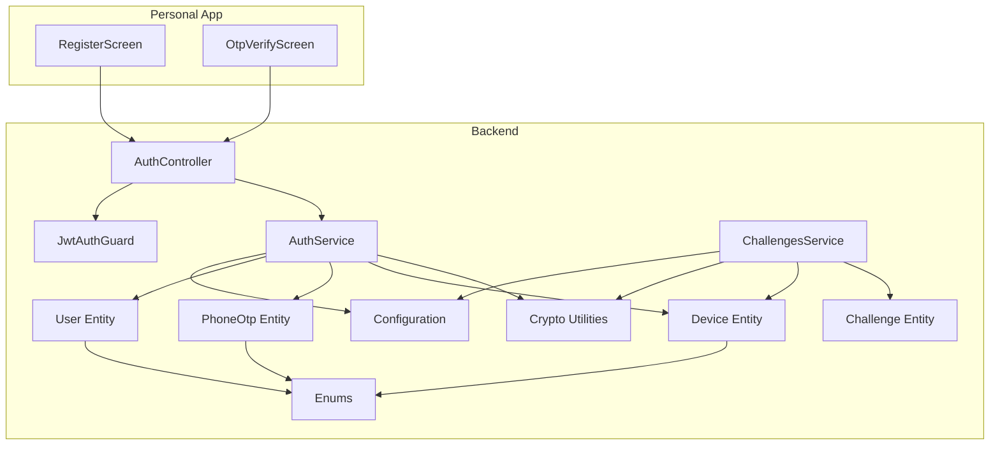

**Diagram sources**
- [auth.controller.ts:1-49](file://backend/src/auth/auth.controller.ts#L1-L49)
- [auth.service.ts:25-177](file://backend/src/auth/auth.service.ts#L25-L177)
- [jwt-auth.guard.ts:10-30](file://backend/src/common/guards/jwt-auth.guard.ts#L10-L30)
- [challenges.service.ts:32-125](file://backend/src/challenges/challenges.service.ts#L32-L125)
- [challenge.entity.ts:4-40](file://backend/src/challenges/challenge.entity.ts#L4-L40)
- [device.entity.ts:4-34](file://backend/src/auth/device.entity.ts#L4-L34)
- [phone-otp.entity.ts:3-26](file://backend/src/auth/phone-otp.entity.ts#L3-L26)
- [user.entity.ts:11-38](file://backend/src/users/user.entity.ts#L11-L38)
- [crypto.ts:11-83](file://backend/src/common/crypto.ts#L11-L83)
- [enums.ts:13-26](file://backend/src/common/enums.ts#L13-L26)
- [configuration.ts:65-86](file://backend/src/config/configuration.ts#L65-L86)
- [RegisterScreen.tsx:16-31](file://personal/src/screens/RegisterScreen.tsx#L16-L31)
- [OtpVerifyScreen.tsx:15-42](file://personal/src/screens/OtpVerifyScreen.tsx#L15-L42)

**Section sources**
- [auth.controller.ts:1-49](file://backend/src/auth/auth.controller.ts#L1-L49)
- [auth.service.ts:25-177](file://backend/src/auth/auth.service.ts#L25-L177)
- [jwt-auth.guard.ts:10-30](file://backend/src/common/guards/jwt-auth.guard.ts#L10-L30)
- [challenges.service.ts:32-125](file://backend/src/challenges/challenges.service.ts#L32-L125)
- [device.entity.ts:4-34](file://backend/src/auth/device.entity.ts#L4-L34)
- [phone-otp.entity.ts:3-26](file://backend/src/auth/phone-otp.entity.ts#L3-L26)
- [user.entity.ts:11-38](file://backend/src/users/user.entity.ts#L11-L38)
- [crypto.ts:11-83](file://backend/src/common/crypto.ts#L11-L83)
- [enums.ts:13-26](file://backend/src/common/enums.ts#L13-L26)
- [configuration.ts:65-86](file://backend/src/config/configuration.ts#L65-L86)
- [RegisterScreen.tsx:16-31](file://personal/src/screens/RegisterScreen.tsx#L16-L31)
- [OtpVerifyScreen.tsx:15-42](file://personal/src/screens/OtpVerifyScreen.tsx#L15-L42)

## Core Components
- AuthController: exposes endpoints for registration, OTP request/verify, profile retrieval, and device management. Protected routes use JwtAuthGuard.
- AuthService: implements user registration, OTP generation and verification, device enrollment/listing/revoke, profile retrieval, and JWT token issuance. Uses crypto utilities to hash OTPs and integrates with accounts and external payment services.
- JwtAuthGuard: validates Bearer tokens, extracts userId and optional deviceId from payload, and attaches user context to requests.
- ChallengesService: issues challenges bound to a specific device and payload, enforces TTL and single-use semantics, and verifies device signatures over the canonicalized payload hash.
- Crypto utilities: provide SHA-256/SHA-512 hashing, HMAC, random nonce generation, safe string comparison, deterministic JSON canonicalization, and device signature verification supporting ED25519 and ES256.
- Entities: User, Device, PhoneOtp, and Challenge define data models and constraints used by auth and challenge flows.
- Enums: standardize statuses, platforms, algorithms, and types across the subsystem.
- Configuration: centralizes secrets and timeouts (JWT secret, OTP TTL, challenge TTL), with production validation for required variables.

**Section sources**
- [auth.controller.ts:1-49](file://backend/src/auth/auth.controller.ts#L1-L49)
- [auth.service.ts:25-177](file://backend/src/auth/auth.service.ts#L25-L177)
- [jwt-auth.guard.ts:10-30](file://backend/src/common/guards/jwt-auth.guard.ts#L10-L30)
- [challenges.service.ts:32-125](file://backend/src/challenges/challenges.service.ts#L32-L125)
- [crypto.ts:11-83](file://backend/src/common/crypto.ts#L11-L83)
- [device.entity.ts:4-34](file://backend/src/auth/device.entity.ts#L4-L34)
- [phone-otp.entity.ts:3-26](file://backend/src/auth/phone-otp.entity.ts#L3-L26)
- [user.entity.ts:11-38](file://backend/src/users/user.entity.ts#L11-L38)
- [challenge.entity.ts:4-40](file://backend/src/challenges/challenge.entity.ts#L4-L40)
- [enums.ts:13-26](file://backend/src/common/enums.ts#L13-L26)
- [configuration.ts:65-86](file://backend/src/config/configuration.ts#L65-L86)

## Architecture Overview
The authentication architecture combines phone-based OTP login with device-bound cryptographic signatures for high-assurance actions.

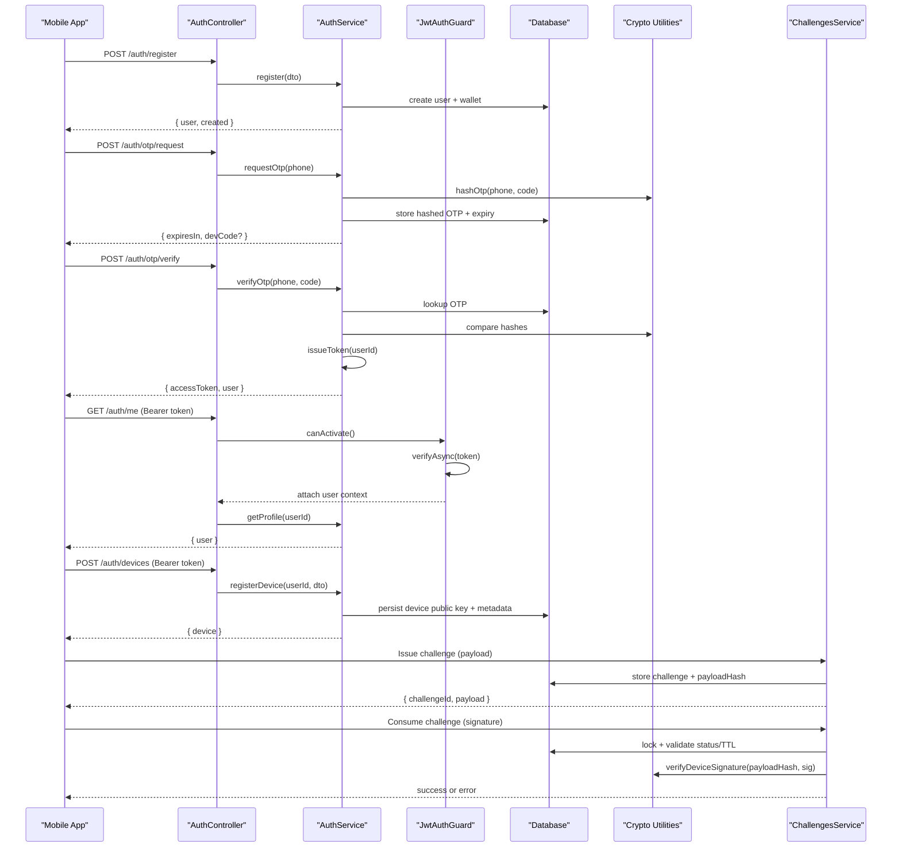

**Diagram sources**
- [auth.controller.ts:11-48](file://backend/src/auth/auth.controller.ts#L11-L48)
- [auth.service.ts:39-177](file://backend/src/auth/auth.service.ts#L39-L177)
- [jwt-auth.guard.ts:13-29](file://backend/src/common/guards/jwt-auth.guard.ts#L13-L29)
- [challenges.service.ts:39-110](file://backend/src/challenges/challenges.service.ts#L39-L110)
- [crypto.ts:68-83](file://backend/src/common/crypto.ts#L68-L83)

## Detailed Component Analysis

### JWT-Based Authentication Flow
- Registration: The client calls the registration endpoint; the service creates a user and associated wallet, optionally provisions a virtual account, and returns user info. No token is issued here unless the client expects immediate login behavior.
- OTP Request: The service normalizes the phone, ensures the user exists and is active, generates a numeric code, stores a server-side HMAC of the code using a secret derived from configuration, and returns expiration details. In development, the raw code may be returned for convenience.
- OTP Verification: The service retrieves the latest unconsumed OTP, checks expiry and attempt limits, compares stored HMAC with the provided code, marks it consumed, and issues a JWT containing the user ID.
- Profile Access: Protected endpoints require a valid Bearer token. The guard verifies the token, extracts userId and optional deviceId, and attaches them to the request context.

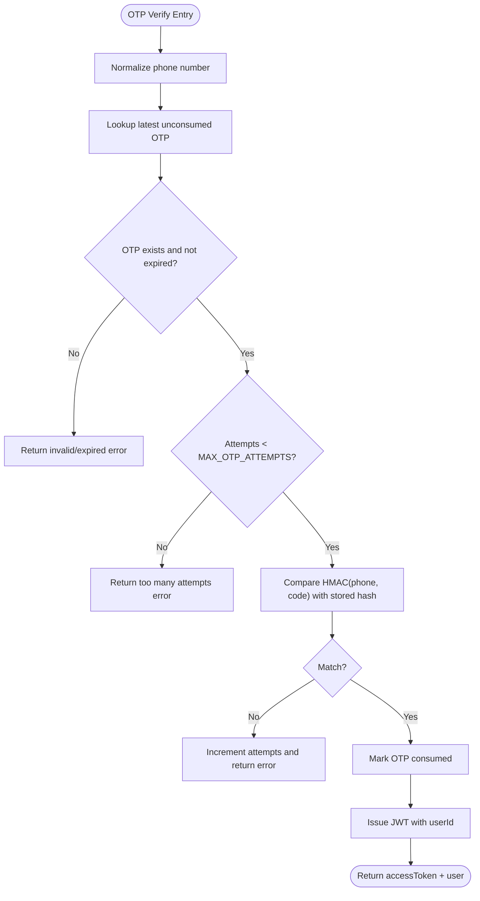

**Diagram sources**
- [auth.service.ts:100-127](file://backend/src/auth/auth.service.ts#L100-L127)
- [auth.service.ts:174-177](file://backend/src/auth/auth.service.ts#L174-L177)

**Section sources**
- [auth.controller.ts:11-24](file://backend/src/auth/auth.controller.ts#L11-L24)
- [auth.service.ts:39-127](file://backend/src/auth/auth.service.ts#L39-L127)
- [jwt-auth.guard.ts:13-29](file://backend/src/common/guards/jwt-auth.guard.ts#L13-L29)

### Device Enrollment and Management
- Registration: Clients submit a base64-encoded SPKI DER public key, platform, algorithm, and optional attestation token. The service persists the device record with default algorithm and active status.
- Listing: Clients can list all devices belonging to the authenticated user.
- Revocation: Clients can revoke a device, marking it revoked with a timestamp.

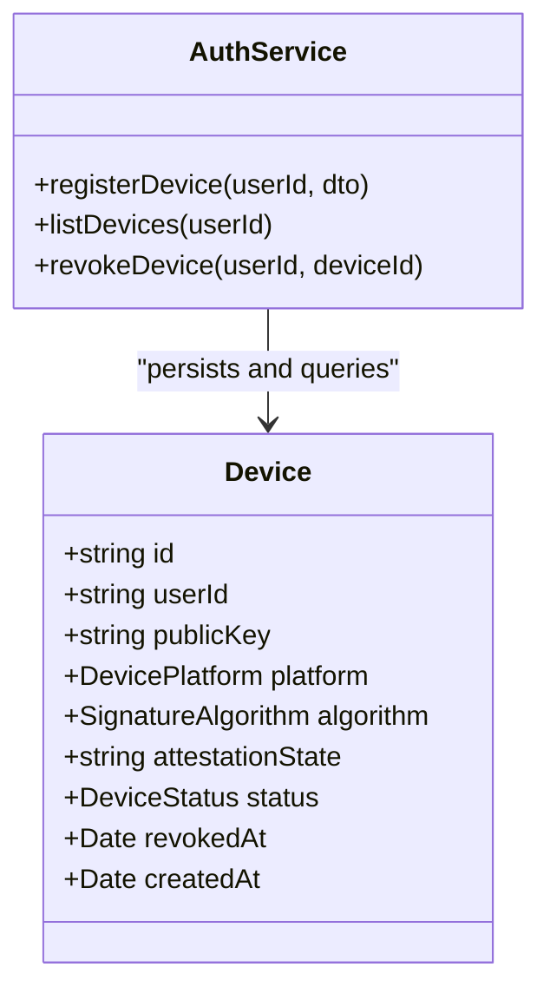

**Diagram sources**
- [device.entity.ts:4-34](file://backend/src/auth/device.entity.ts#L4-L34)
- [auth.service.ts:129-160](file://backend/src/auth/auth.service.ts#L129-L160)

**Section sources**
- [auth.controller.ts:32-48](file://backend/src/auth/auth.controller.ts#L32-L48)
- [auth.service.ts:129-160](file://backend/src/auth/auth.service.ts#L129-L160)
- [device.entity.ts:4-34](file://backend/src/auth/device.entity.ts#L4-L34)

### Biometric Signature Verification
- Device Keys: Devices generate asymmetric keys in secure hardware and register their public keys with the server.
- Signing: For sensitive operations, clients sign a server-provided payload hash using their private key.
- Verification: The server reconstructs the canonicalized payload hash and verifies the signature using the stored public key and algorithm (ED25519 or ES256).

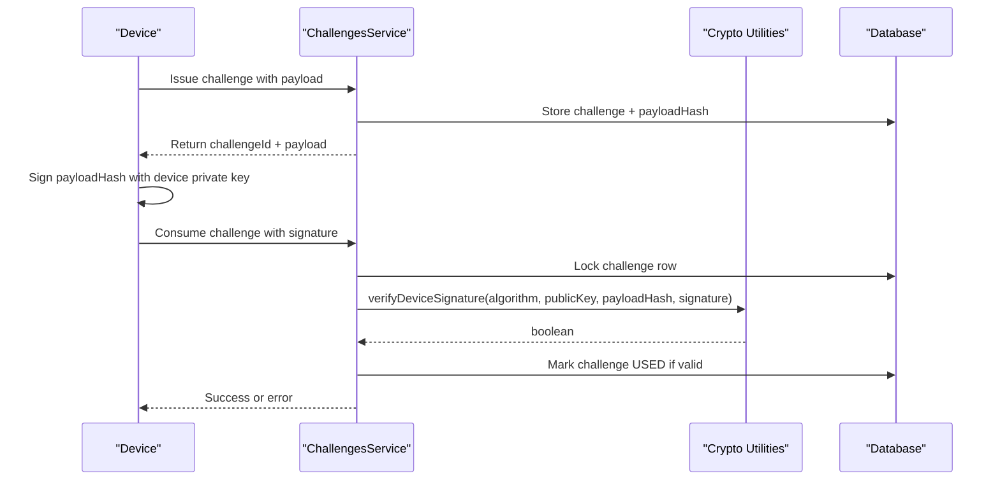

**Diagram sources**
- [challenges.service.ts:39-110](file://backend/src/challenges/challenges.service.ts#L39-L110)
- [crypto.ts:68-83](file://backend/src/common/crypto.ts#L68-L83)

**Section sources**
- [challenges.service.ts:39-110](file://backend/src/challenges/challenges.service.ts#L39-L110)
- [crypto.ts:68-83](file://backend/src/common/crypto.ts#L68-L83)
- [device.entity.ts:13-21](file://backend/src/auth/device.entity.ts#L13-L21)

### Challenge-Response System Implementation
- Issuance: The server binds a challenge to a specific user and device, computes a canonicalized payload hash, stores the payload and hash, sets a TTL, and assigns a unique nonce.
- Consumption: The server locks the challenge row, validates ownership, type, status, and expiry, recomputes the expected payload hash, verifies the device signature, and marks the challenge as used.

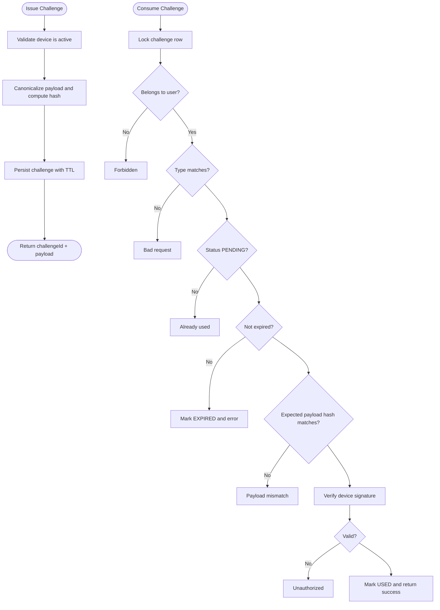

**Diagram sources**
- [challenges.service.ts:39-110](file://backend/src/challenges/challenges.service.ts#L39-L110)

**Section sources**
- [challenges.service.ts:39-110](file://backend/src/challenges/challenges.service.ts#L39-L110)
- [challenge.entity.ts:4-40](file://backend/src/challenges/challenge.entity.ts#L4-L40)

### Security Guards, Decorators, and Request Validation
- Guards: JwtAuthGuard enforces Bearer token presence, validates the token, and attaches user context including optional deviceId.
- Decorators: Current-user decorator injects the authenticated user into controller methods.
- DTO Validation: Class-validator decorators enforce phone format, handle patterns, code length, device platform, and algorithm enum values.

```mermaid
classDiagram
class JwtAuthGuard {
+canActivate(context) bool
}
class RegisterDto {
+string phone
+string name
+string handle
}
class OtpRequestDto {
+string phone
}
class OtpVerifyDto {
+string phone
+string code
}
class RegisterDeviceDto {
+string publicKey
+DevicePlatform platform
+SignatureAlgorithm algorithm
+string attestationToken
}
JwtAuthGuard --> "validates" AccessTokenPayload
RegisterDto --> "validated by" class-validator
OtpRequestDto --> "validated by" class-validator
OtpVerifyDto --> "validated by" class-validator
RegisterDeviceDto --> "validated by" class-validator
```

**Diagram sources**
- [jwt-auth.guard.ts:10-30](file://backend/src/common/guards/jwt-auth.guard.ts#L10-L30)
- [auth.dto.ts:7-52](file://backend/src/auth/dto/auth.dto.ts#L7-L52)

**Section sources**
- [jwt-auth.guard.ts:10-30](file://backend/src/common/guards/jwt-auth.guard.ts#L10-L30)
- [auth.dto.ts:7-52](file://backend/src/auth/dto/auth.dto.ts#L7-L52)

### Cryptographic Utilities
- Hashing: SHA-256 and SHA-512 hex encodings.
- HMAC: Base64 and hex variants for OTP hashing and other MAC computations.
- Nonce: Random 32-byte hex nonce generation for challenges.
- Safe Comparison: Timing-safe equality check for secrets and tokens.
- Canonical JSON: Deterministic serialization with sorted keys for consistent hashing.
- Signature Verification: Supports ED25519 and ES256 with SPKI DER public keys.

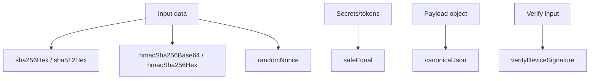

**Diagram sources**
- [crypto.ts:11-83](file://backend/src/common/crypto.ts#L11-L83)

**Section sources**
- [crypto.ts:11-83](file://backend/src/common/crypto.ts#L11-L83)

### Concrete Examples

#### User Registration Flow
- Mobile app collects phone, name, and optional handle.
- Calls registration endpoint; backend creates user and wallet, optionally provisions virtual account, and returns user info.
- If a token is present in response, the app logs the user in.

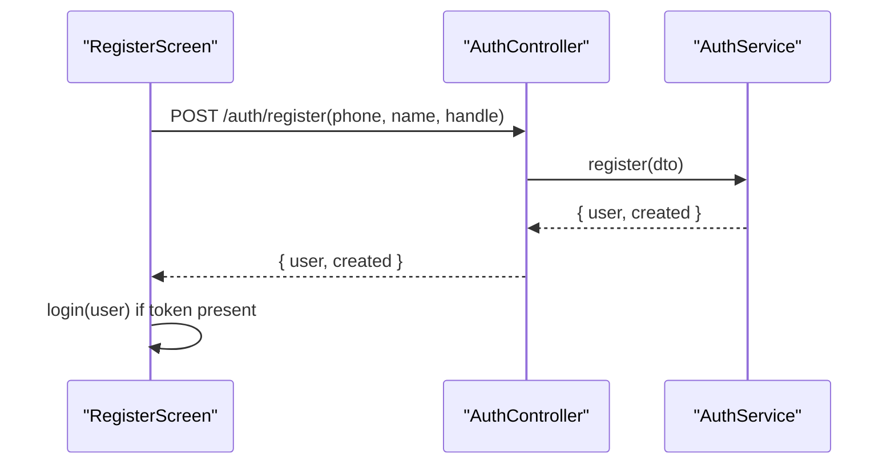

**Diagram sources**
- [RegisterScreen.tsx:16-31](file://personal/src/screens/RegisterScreen.tsx#L16-L31)
- [auth.controller.ts:11-14](file://backend/src/auth/auth.controller.ts#L11-L14)
- [auth.service.ts:39-71](file://backend/src/auth/auth.service.ts#L39-L71)

**Section sources**
- [RegisterScreen.tsx:16-31](file://personal/src/screens/RegisterScreen.tsx#L16-L31)
- [auth.controller.ts:11-14](file://backend/src/auth/auth.controller.ts#L11-L14)
- [auth.service.ts:39-71](file://backend/src/auth/auth.service.ts#L39-L71)

#### Login via OTP Verification
- Mobile app requests OTP; backend stores hashed OTP and returns expiration.
- User enters code; backend verifies, marks OTP consumed, and issues JWT.
- App stores token and uses it for protected requests.

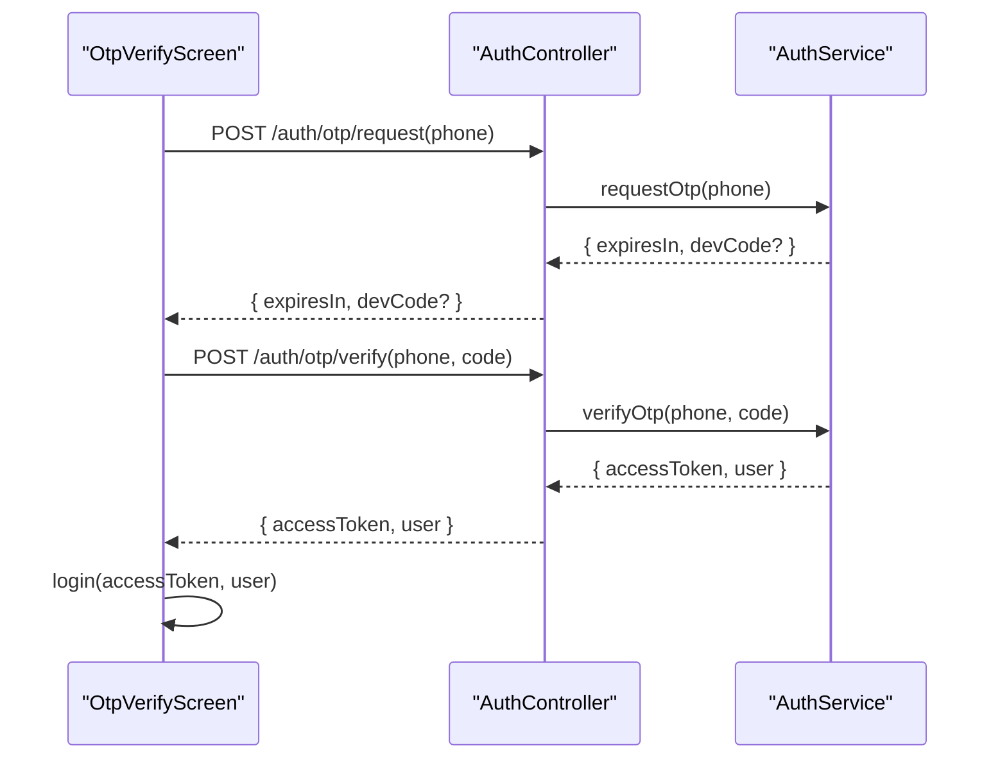

**Diagram sources**
- [OtpVerifyScreen.tsx:15-42](file://personal/src/screens/OtpVerifyScreen.tsx#L15-L42)
- [auth.controller.ts:16-24](file://backend/src/auth/auth.controller.ts#L16-L24)
- [auth.service.ts:73-127](file://backend/src/auth/auth.service.ts#L73-L127)

**Section sources**
- [OtpVerifyScreen.tsx:15-42](file://personal/src/screens/OtpVerifyScreen.tsx#L15-L42)
- [auth.controller.ts:16-24](file://backend/src/auth/auth.controller.ts#L16-L24)
- [auth.service.ts:73-127](file://backend/src/auth/auth.service.ts#L73-L127)

#### Device Key Management
- After login, the app registers a device with its public key and platform.
- The backend persists the device record and returns public metadata.
- Users can list and revoke devices.

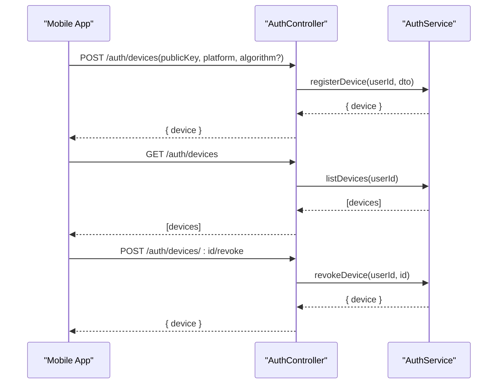

**Diagram sources**
- [auth.controller.ts:32-48](file://backend/src/auth/auth.controller.ts#L32-L48)
- [auth.service.ts:129-160](file://backend/src/auth/auth.service.ts#L129-L160)

**Section sources**
- [auth.controller.ts:32-48](file://backend/src/auth/auth.controller.ts#L32-L48)
- [auth.service.ts:129-160](file://backend/src/auth/auth.service.ts#L129-L160)

#### OTP Verification Process
- OTP codes are never stored in plaintext; only an HMAC of phone+code is persisted.
- Attempt limits and expiration protect against brute-force attacks.
- Successful verification yields a JWT for subsequent requests.

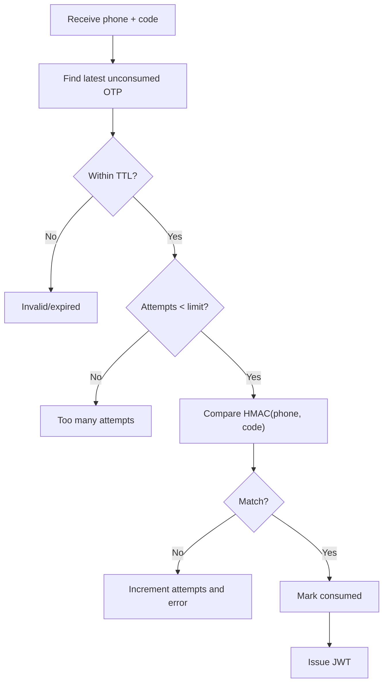

**Diagram sources**
- [auth.service.ts:100-127](file://backend/src/auth/auth.service.ts#L100-L127)
- [auth.service.ts:174-177](file://backend/src/auth/auth.service.ts#L174-L177)

**Section sources**
- [auth.service.ts:100-127](file://backend/src/auth/auth.service.ts#L100-L127)
- [auth.service.ts:174-177](file://backend/src/auth/auth.service.ts#L174-L177)

## Dependency Analysis
The following diagram shows how components depend on each other within the authentication and security subsystem.

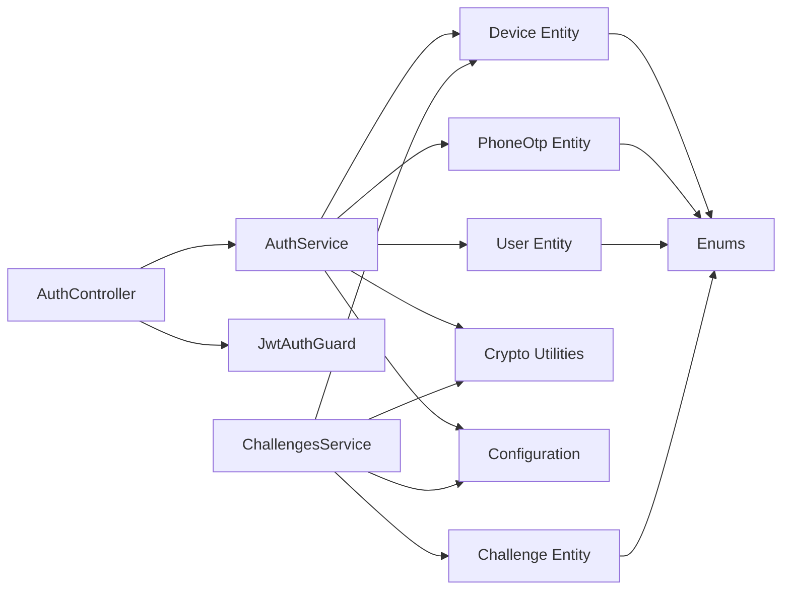

**Diagram sources**
- [auth.controller.ts:1-49](file://backend/src/auth/auth.controller.ts#L1-L49)
- [auth.service.ts:25-177](file://backend/src/auth/auth.service.ts#L25-L177)
- [jwt-auth.guard.ts:10-30](file://backend/src/common/guards/jwt-auth.guard.ts#L10-L30)
- [challenges.service.ts:32-125](file://backend/src/challenges/challenges.service.ts#L32-L125)
- [device.entity.ts:4-34](file://backend/src/auth/device.entity.ts#L4-L34)
- [phone-otp.entity.ts:3-26](file://backend/src/auth/phone-otp.entity.ts#L3-L26)
- [user.entity.ts:11-38](file://backend/src/users/user.entity.ts#L11-L38)
- [challenge.entity.ts:4-40](file://backend/src/challenges/challenge.entity.ts#L4-L40)
- [crypto.ts:11-83](file://backend/src/common/crypto.ts#L11-L83)
- [enums.ts:13-26](file://backend/src/common/enums.ts#L13-L26)
- [configuration.ts:65-86](file://backend/src/config/configuration.ts#L65-L86)

**Section sources**
- [auth.controller.ts:1-49](file://backend/src/auth/auth.controller.ts#L1-L49)
- [auth.service.ts:25-177](file://backend/src/auth/auth.service.ts#L25-L177)
- [jwt-auth.guard.ts:10-30](file://backend/src/common/guards/jwt-auth.guard.ts#L10-L30)
- [challenges.service.ts:32-125](file://backend/src/challenges/challenges.service.ts#L32-L125)
- [device.entity.ts:4-34](file://backend/src/auth/device.entity.ts#L4-L34)
- [phone-otp.entity.ts:3-26](file://backend/src/auth/phone-otp.entity.ts#L3-L26)
- [user.entity.ts:11-38](file://backend/src/users/user.entity.ts#L11-L38)
- [challenge.entity.ts:4-40](file://backend/src/challenges/challenge.entity.ts#L4-L40)
- [crypto.ts:11-83](file://backend/src/common/crypto.ts#L11-L83)
- [enums.ts:13-26](file://backend/src/common/enums.ts#L13-L26)
- [configuration.ts:65-86](file://backend/src/config/configuration.ts#L65-L86)

## Performance Considerations
- Database locking: Challenge consumption uses pessimistic write locks to prevent race conditions during concurrent verification attempts.
- Short-lived tokens and challenges: OTP and challenge TTLs reduce exposure windows; configure appropriate durations based on operational needs.
- Efficient hashing: HMAC and SHA-256 are computationally efficient; avoid unnecessary re-hashing by caching canonical payloads where appropriate.
- Minimal payload exposure: Only necessary fields are returned in responses; sensitive data like public keys are not included in public device listings beyond identifiers and metadata.

[No sources needed since this section provides general guidance]

## Troubleshooting Guide
Common issues and resolutions:
- Missing bearer token: Ensure Authorization header is set to "Bearer <token>".
- Invalid or expired token: Refresh tokens or re-authenticate via OTP; verify token signing secret configuration.
- OTP invalid or expired: Confirm the code has not expired and has not been consumed; check attempt limits.
- Too many OTP attempts: Wait for cooldown or request a new OTP after a delay.
- Device not found or revoked: Verify device registration and status; revoke and re-enroll if necessary.
- Challenge payload mismatch: Ensure the client signs the exact payload hash computed by the server using canonical JSON.
- Invalid device signature: Confirm the device’s private key corresponds to the registered public key and that the correct algorithm is used.

**Section sources**
- [jwt-auth.guard.ts:13-29](file://backend/src/common/guards/jwt-auth.guard.ts#L13-L29)
- [auth.service.ts:73-127](file://backend/src/auth/auth.service.ts#L73-L127)
- [auth.service.ts:129-160](file://backend/src/auth/auth.service.ts#L129-L160)
- [challenges.service.ts:63-110](file://backend/src/challenges/challenges.service.ts#L63-L110)

## Conclusion
The authentication and security subsystem combines phone-based OTP login with device-bound cryptographic signatures to provide robust access control. JWTs authenticate sessions, while challenges ensure high-assurance authorization for sensitive operations. Proper configuration of secrets and TTLs, along with careful handling of OTPs and device keys, mitigates common vulnerabilities. The design emphasizes minimal exposure of sensitive data, deterministic payload hashing, and strict state transitions for challenges and OTPs.

[No sources needed since this section summarizes without analyzing specific files]