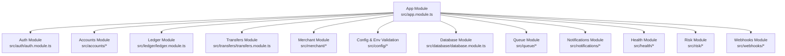
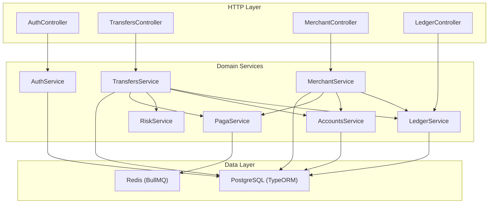
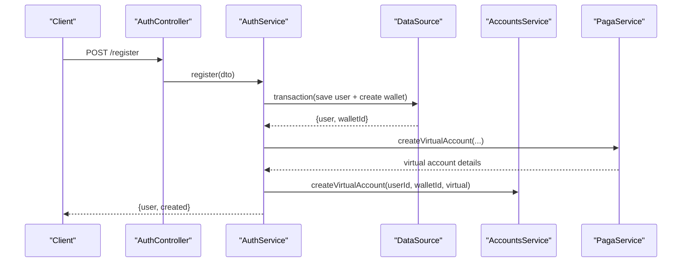
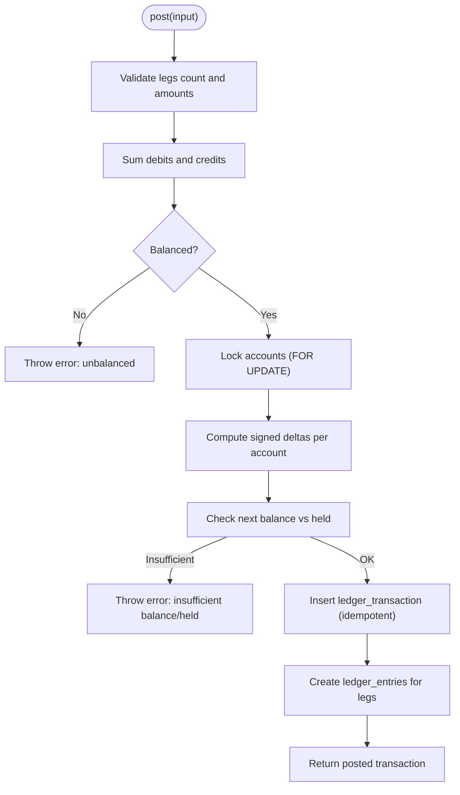
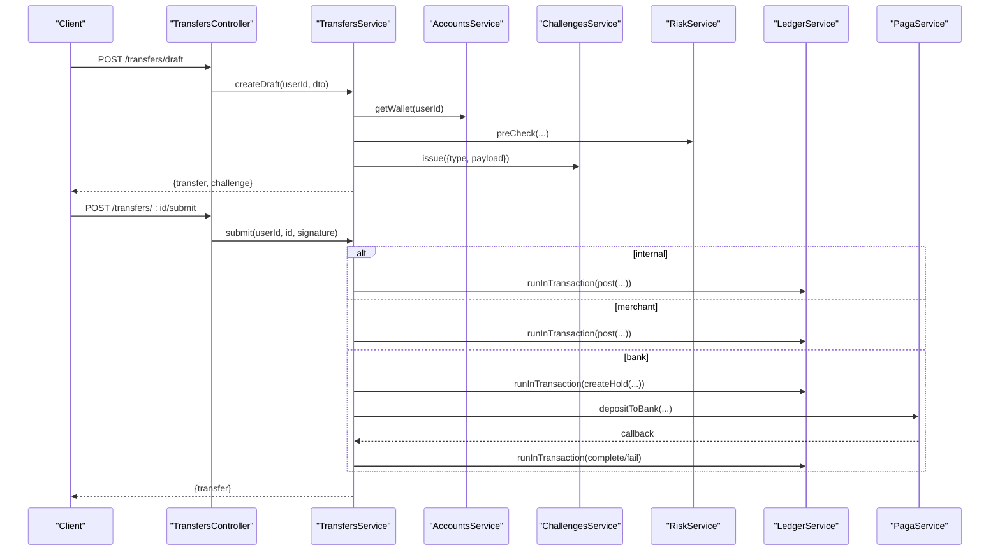
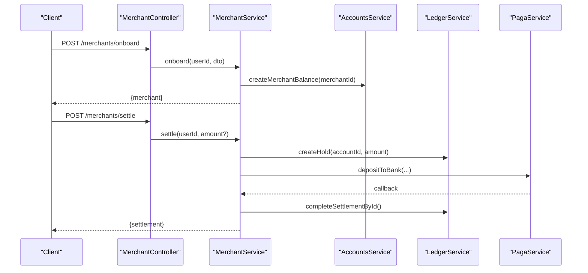
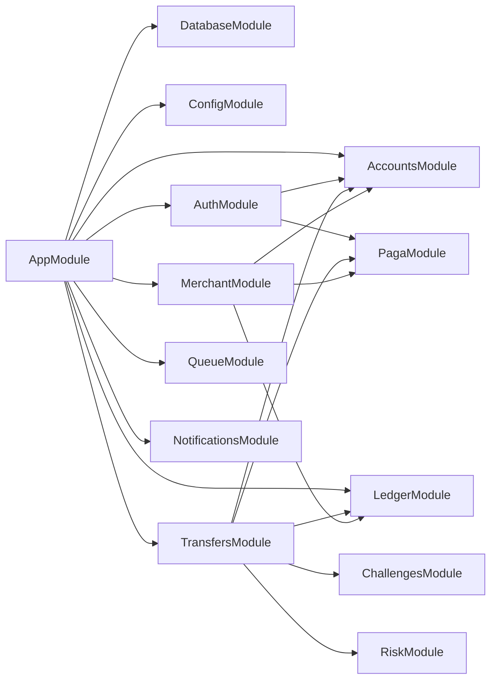

# Backend Architecture

<cite>
**Referenced Files in This Document**
- [main.ts](file://backend/src/main.ts)
- [app.module.ts](file://backend/src/app.module.ts)
- [package.json](file://backend/package.json)
- [configuration.ts](file://backend/src/config/configuration.ts)
- [env.validation.ts](file://backend/src/config/env.validation.ts)
- [database.config.ts](file://backend/src/database/database.config.ts)
- [database.module.ts](file://backend/src/database/database.module.ts)
- [data-source.ts](file://backend/src/database/data-source.ts)
- [auth.module.ts](file://backend/src/auth/auth.module.ts)
- [auth.service.ts](file://backend/src/auth/auth.service.ts)
- [accounts.service.ts](file://backend/src/accounts/accounts.service.ts)
- [ledger.module.ts](file://backend/src/ledger/ledger.module.ts)
- [ledger.service.ts](file://backend/src/ledger/ledger.service.ts)
- [transfers.module.ts](file://backend/src/transfers/transfers.module.ts)
- [transfers.service.ts](file://backend/src/transfers/transfers.service.ts)
- [merchant.service.ts](file://backend/src/merchant/merchant.service.ts)
</cite>

## Table of Contents
1. [Introduction](#introduction)
2. [Project Structure](#project-structure)
3. [Core Components](#core-components)
4. [Architecture Overview](#architecture-overview)
5. [Detailed Component Analysis](#detailed-component-analysis)
6. [Dependency Analysis](#dependency-analysis)
7. [Performance Considerations](#performance-considerations)
8. [Troubleshooting Guide](#troubleshooting-guide)
9. [Conclusion](#conclusion)

## Introduction
This document explains the backend architecture of the Vireo Finance application, focusing on its NestJS-based modular design and domain-driven organization. The system implements a double-entry ledger with account management, transfer processing, merchant services, authentication (including biometric device registration), and supporting infrastructure such as configuration, database access, and queue processing. It emphasizes service composition, dependency injection, idempotency, transactional integrity, and security best practices.

## Project Structure
The backend is organized into feature modules under src/, each encapsulating controllers, services, entities, and DTOs for a specific domain. Cross-cutting concerns like configuration, database access, and common utilities are centralized.

**Diagram sources**
- [app.module.ts:21-43](file://backend/src/app.module.ts#L21-L43)

**Section sources**
- [app.module.ts:1-45](file://backend/src/app.module.ts#L1-L45)
- [main.ts:7-21](file://backend/src/main.ts#L7-L21)

## Core Components
- Application bootstrap and global configuration
  - Bootstrap sets CORS, raw body parsing, global API prefix, and validation pipeline.
  - Configuration is loaded via @nestjs/config with environment validation for production.
- Database layer
  - TypeORM DataSource configured through a global module; migrations enabled; SSL support configurable.
- Authentication
  - JWT-based auth with OTP flow and device registration for biometric challenges.
- Accounts
  - Wallet and merchant balance accounts creation and lookup.
- Ledger
  - Double-entry posting with idempotency, pessimistic account locking, holds, and balance derivation.
- Transfers
  - Internal, bank, and merchant transfers with challenge-based authorization and risk checks.
- Merchant
  - Onboarding, orders, dashboard, settlements, and callback handling.

**Section sources**
- [main.ts:7-21](file://backend/src/main.ts#L7-L21)
- [configuration.ts:1-122](file://backend/src/config/configuration.ts#L1-L122)
- [env.validation.ts:1-11](file://backend/src/config/env.validation.ts#L1-L11)
- [database.config.ts:5-22](file://backend/src/database/database.config.ts#L5-L22)
- [database.module.ts:6-16](file://backend/src/database/database.module.ts#L6-L16)
- [auth.module.ts:13-34](file://backend/src/auth/auth.module.ts#L13-L34)
- [accounts.service.ts:9-104](file://backend/src/accounts/accounts.service.ts#L9-L104)
- [ledger.module.ts:9-15](file://backend/src/ledger/ledger.module.ts#L9-L15)
- [ledger.service.ts:72-341](file://backend/src/ledger/ledger.service.ts#L72-L341)
- [transfers.module.ts:17-30](file://backend/src/transfers/transfers.module.ts#L17-L30)
- [transfers.service.ts:40-652](file://backend/src/transfers/transfers.service.ts#L40-L652)
- [merchant.service.ts:30-384](file://backend/src/merchant/merchant.service.ts#L30-L384)

## Architecture Overview
The system follows a layered, module-per-domain approach with clear separation between HTTP endpoints, business logic, and data persistence. Services compose lower-level capabilities (e.g., TransfersService composes AccountsService, LedgerService, RiskService, PagaService). Transactions and idempotency ensure financial correctness.

**Diagram sources**
- [app.module.ts:21-43](file://backend/src/app.module.ts#L21-L43)
- [auth.module.ts:13-34](file://backend/src/auth/auth.module.ts#L13-L34)
- [transfers.module.ts:17-30](file://backend/src/transfers/transfers.module.ts#L17-L30)
- [ledger.module.ts:9-15](file://backend/src/ledger/ledger.module.ts#L9-L15)
- [database.module.ts:6-16](file://backend/src/database/database.module.ts#L6-L16)

## Detailed Component Analysis

### Authentication and Biometric Device Management
- Responsibilities
  - User registration with wallet creation and optional virtual account provisioning.
  - Phone OTP issuance and verification with hashed storage and attempt limits.
  - Device registration for biometric challenges, listing, and revocation.
  - JWT token issuance.
- Security considerations
  - OTP codes are stored as HMAC hashes using a secret from configuration.
  - In development, OTP code may be returned for convenience; disabled in production.
  - Device records capture platform, algorithm, attestation state, and status.

**Diagram sources**
- [auth.service.ts:39-71](file://backend/src/auth/auth.service.ts#L39-L71)
- [accounts.service.ts:17-29](file://backend/src/accounts/accounts.service.ts#L17-L29)

**Section sources**
- [auth.service.ts:24-177](file://backend/src/auth/auth.service.ts#L24-L177)
- [auth.module.ts:13-34](file://backend/src/auth/auth.module.ts#L13-L34)

### Financial Operations: Double-Entry Ledger and Account Management
- Responsibilities
  - Post balanced transactions with idempotency keys and reference metadata.
  - Lock accounts pessimistically to derive authoritative balances within a transaction.
  - Manage holds (create, release, capture) to reserve funds during pending operations.
  - Provide balance summaries and recent entries per account.
- Key patterns
  - Idempotent transaction insertion via unique idempotencyKey.
  - Balance derivation from ledger entries rather than persisted counters.
  - Consistent sign conventions based on account type.

**Diagram sources**
- [ledger.service.ts:86-178](file://backend/src/ledger/ledger.service.ts#L86-L178)
- [ledger.service.ts:294-339](file://backend/src/ledger/ledger.service.ts#L294-L339)

**Section sources**
- [ledger.service.ts:72-341](file://backend/src/ledger/ledger.service.ts#L72-L341)
- [accounts.service.ts:9-104](file://backend/src/accounts/accounts.service.ts#L9-L104)
- [ledger.module.ts:9-15](file://backend/src/ledger/ledger.module.ts#L9-L15)

### Transfer Processing
- Responsibilities
  - Create transfer drafts with recipient resolution (internal, bank, merchant).
  - Enforce risk pre-checks and issue challenges bound to transfer payloads.
  - Execute transfers atomically with ledger postings and hold management for external payouts.
  - Handle provider callbacks to complete or fail bank transfers.
- Flow highlights
  - Draft creation validates inputs, resolves recipients, computes fees, and persists draft + challenge.
  - Submission consumes the challenge, performs risk checks, and posts ledger entries.
  - Bank transfers use holds and integrate with Paga payout flows.

**Diagram sources**
- [transfers.service.ts:54-217](file://backend/src/transfers/transfers.service.ts#L54-L217)
- [transfers.service.ts:238-363](file://backend/src/transfers/transfers.service.ts#L238-L363)
- [transfers.service.ts:382-487](file://backend/src/transfers/transfers.service.ts#L382-L487)

**Section sources**
- [transfers.service.ts:40-652](file://backend/src/transfers/transfers.service.ts#L40-L652)
- [transfers.module.ts:17-30](file://backend/src/transfers/transfers.module.ts#L17-L30)

### Merchant Services
- Responsibilities
  - Onboard merchants, create settlement accounts, manage orders, and provide dashboards.
  - Initiate settlements with holds and integrate with Paga payout flows.
  - Handle settlement callbacks to complete or fail settlements.
- Integration points
  - Uses AccountsService for merchant balance accounts.
  - Uses LedgerService for holds and postings.
  - Uses PagaService for bank deposits.

**Diagram sources**
- [merchant.service.ts:42-67](file://backend/src/merchant/merchant.service.ts#L42-L67)
- [merchant.service.ts:160-224](file://backend/src/merchant/merchant.service.ts#L160-L224)
- [merchant.service.ts:261-313](file://backend/src/merchant/merchant.service.ts#L261-L313)

**Section sources**
- [merchant.service.ts:30-384](file://backend/src/merchant/merchant.service.ts#L30-L384)

## Dependency Analysis
- Module composition
  - AppModule imports all feature modules, enabling cross-module dependencies.
  - DatabaseModule is global, providing TypeORM repositories across modules.
  - AuthModule depends on AccountsModule and PagaModule; exposes AuthService.
  - TransfersModule depends on AccountsModule, LedgerModule, ChallengesModule, RiskModule, and PagaModule.
- External integrations
  - PagaService integrates with external payment rails (bank validations, payouts).
  - BullMQ and Redis are used for queue processing (configured via package dependencies and QueueModule).

**Diagram sources**
- [app.module.ts:21-43](file://backend/src/app.module.ts#L21-L43)
- [auth.module.ts:13-34](file://backend/src/auth/auth.module.ts#L13-L34)
- [transfers.module.ts:17-30](file://backend/src/transfers/transfers.module.ts#L17-L30)

**Section sources**
- [app.module.ts:1-45](file://backend/src/app.module.ts#L1-L45)
- [auth.module.ts:13-34](file://backend/src/auth/auth.module.ts#L13-L34)
- [transfers.module.ts:17-30](file://backend/src/transfers/transfers.module.ts#L17-L30)

## Performance Considerations
- Database performance
  - Use pessimistic locks for critical sections (account rows and holds) to avoid race conditions.
  - Derive balances from ledger entries to maintain consistency and reduce write amplification.
  - Keep queries minimal and targeted; leverage indexed columns where applicable.
- Transaction boundaries
  - Encapsulate multi-step financial operations within single transactions to ensure atomicity.
- Idempotency
  - Use idempotency keys for ledger transactions to safely retry requests without duplication.
- Configuration and environment
  - Centralize configuration with strong typing and validation to prevent runtime misconfigurations.
- Queues and async workloads
  - Offload long-running tasks (reconciliation, notifications) to queues powered by BullMQ and Redis.

[No sources needed since this section provides general guidance]

## Troubleshooting Guide
- Common errors and handling
  - Unbalanced ledger transactions: Ensure debit equals credit and amount > 0.
  - Insufficient balance or available balance: Verify current balance minus held funds before posting.
  - Invalid or expired OTP: Check attempts, expiration, and hash comparison.
  - Transfer not found or wrong status: Validate transfer lifecycle and ownership.
  - Merchant order not found or expired: Confirm order existence and status before payment.
- Debugging tips
  - Enable TypeORM logging for errors, warnings, and migrations.
  - Review environment variables for missing required fields in production.
  - Inspect logs around virtual account provisioning failures and external provider callbacks.

**Section sources**
- [env.validation.ts:1-11](file://backend/src/config/env.validation.ts#L1-L11)
- [database.config.ts:5-22](file://backend/src/database/database.config.ts#L5-L22)
- [ledger.service.ts:86-178](file://backend/src/ledger/ledger.service.ts#L86-L178)
- [auth.service.ts:73-127](file://backend/src/auth/auth.service.ts#L73-L127)
- [transfers.service.ts:193-217](file://backend/src/transfers/transfers.service.ts#L193-L217)
- [merchant.service.ts:112-122](file://backend/src/merchant/merchant.service.ts#L112-L122)

## Conclusion
The Vireo Finance backend leverages NestJS’s modular architecture and dependency injection to implement a robust, secure financial system. The double-entry ledger ensures accounting integrity, while holds and idempotency protect against partial failures and retries. Authentication integrates OTP and biometric device management, and merchant services provide end-to-end order and settlement workflows. Configuration, database access, and queue processing are centralized for maintainability and scalability.