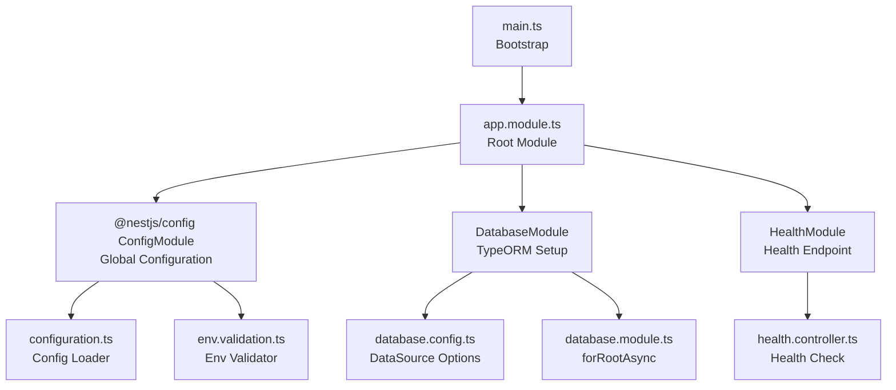
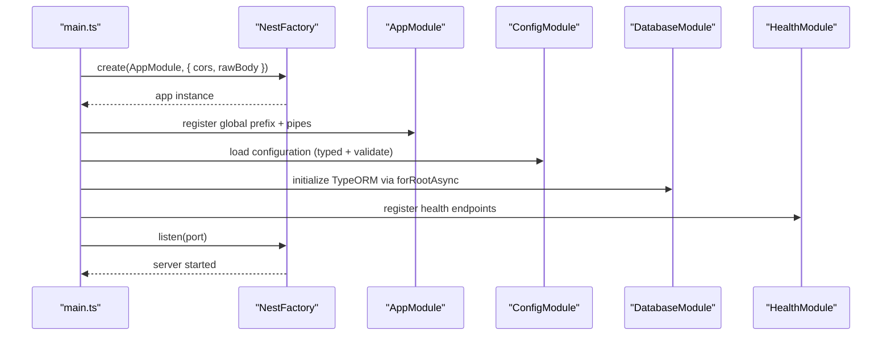
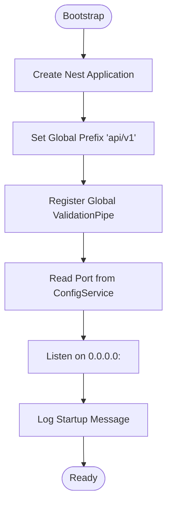
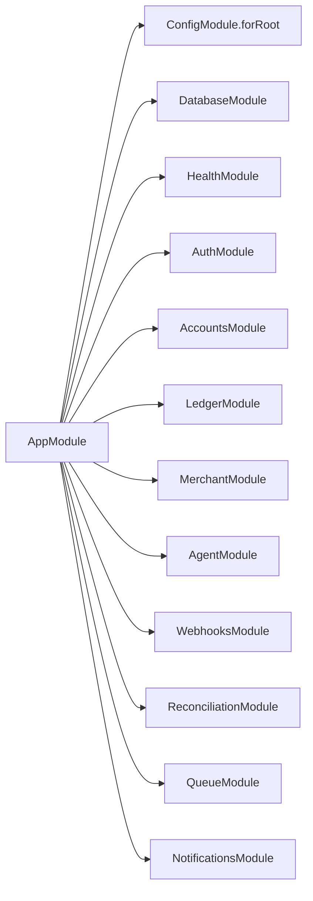
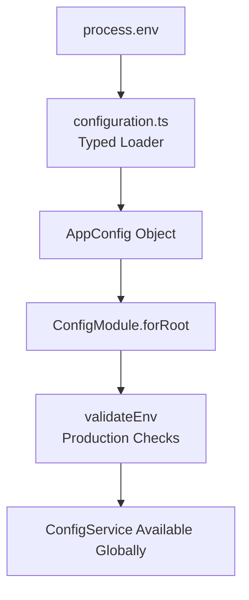
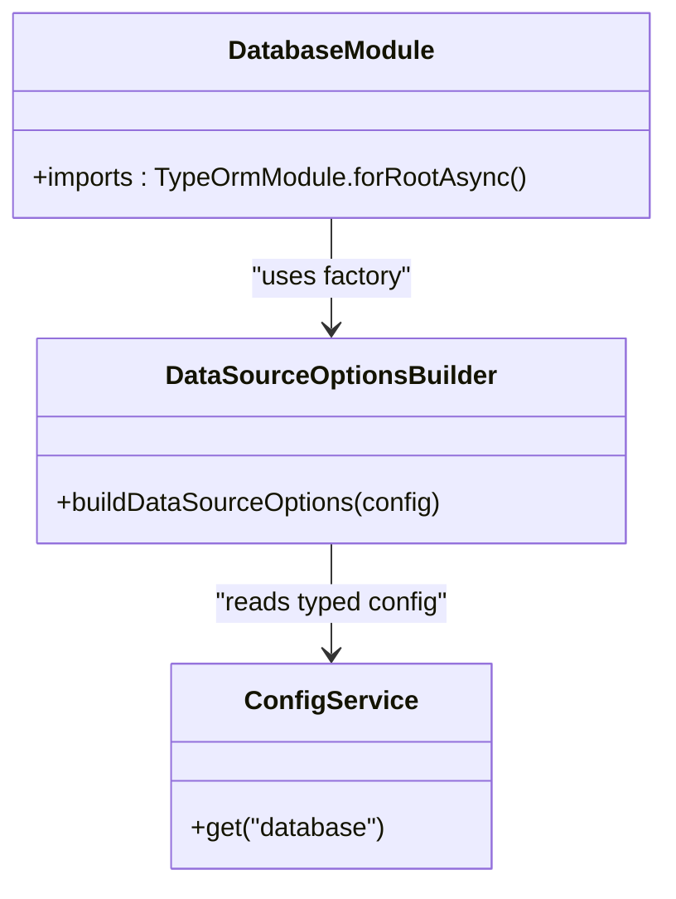
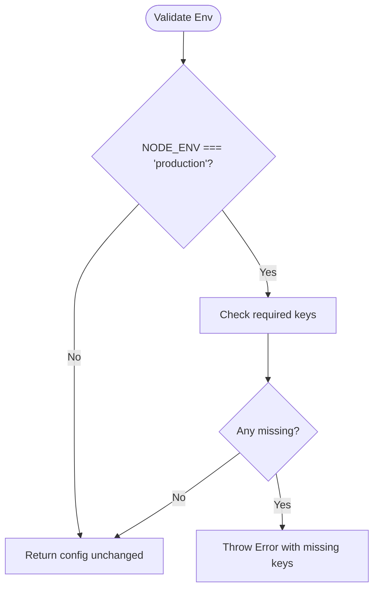
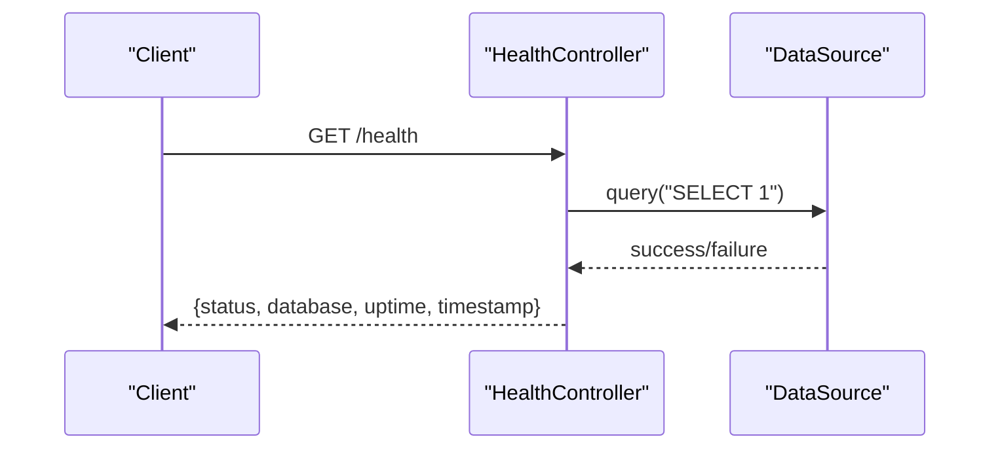
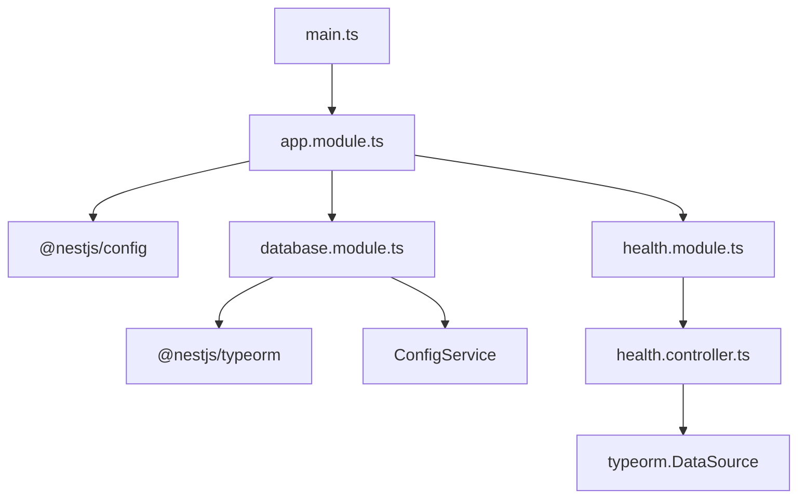

# Core Infrastructure

<cite>
**Referenced Files in This Document**
- [main.ts](file://backend/src/main.ts)
- [app.module.ts](file://backend/src/app.module.ts)
- [configuration.ts](file://backend/src/config/configuration.ts)
- [env.validation.ts](file://backend/src/config/env.validation.ts)
- [database.config.ts](file://backend/src/database/database.config.ts)
- [data-source.ts](file://backend/src/database/data-source.ts)
- [database.module.ts](file://backend/src/database/database.module.ts)
- [health.controller.ts](file://backend/src/health/health.controller.ts)
- [health.module.ts](file://backend/src/health/health.module.ts)
</cite>

## Table of Contents
1. [Introduction](#introduction)
2. [Project Structure](#project-structure)
3. [Core Components](#core-components)
4. [Architecture Overview](#architecture-overview)
5. [Detailed Component Analysis](#detailed-component-analysis)
6. [Dependency Analysis](#dependency-analysis)
7. [Performance Considerations](#performance-considerations)
8. [Troubleshooting Guide](#troubleshooting-guide)
9. [Conclusion](#conclusion)

## Introduction
This section documents the core infrastructure of the NestJS application, focusing on bootstrap and configuration. It explains how the application initializes, composes modules, sets up dependency injection, manages environment configuration with @nestjs/config, connects to the database via TypeORM, validates environment variables, configures global behavior (prefixing, validation), exposes health checks, and outlines production deployment considerations including logging and monitoring.

## Project Structure
The core infrastructure spans a small set of files that orchestrate application startup, module composition, configuration loading, database setup, and health reporting:

- Application entrypoint and bootstrap
- Root module composition and feature modules
- Environment configuration loader and validator
- Database connection options and module registration
- Health check controller and module

**Diagram sources**
- [main.ts:7-21](file://backend/src/main.ts#L7-L21)
- [app.module.ts:21-45](file://backend/src/app.module.ts#L21-L45)
- [configuration.ts:65-121](file://backend/src/config/configuration.ts#L65-L121)
- [env.validation.ts:1-11](file://backend/src/config/env.validation.ts#L1-L11)
- [database.config.ts:5-22](file://backend/src/database/database.config.ts#L5-L22)
- [database.module.ts:6-16](file://backend/src/database/database.module.ts#L6-L16)
- [health.controller.ts:5-25](file://backend/src/health/health.controller.ts#L5-L25)

**Section sources**
- [main.ts:1-25](file://backend/src/main.ts#L1-L25)
- [app.module.ts:1-46](file://backend/src/app.module.ts#L1-L46)

## Core Components
- Bootstrap and global configuration: The application entrypoint creates the Nest application, enables CORS, sets a global API prefix, registers a global validation pipe, reads the port from configuration, and starts the HTTP server.
- Root module composition: The root module wires together configuration, database, and feature modules using Nest’s DI container.
- Configuration management: A typed configuration loader maps environment variables to a strongly-typed AppConfig object; an environment validator enforces required variables in production.
- Database connection: TypeORM is configured through a factory that consumes the typed configuration, enabling migrations, entity discovery, and logging.
- Health endpoint: A simple controller probes the database and returns status, uptime, and timestamp.

**Section sources**
- [main.ts:7-21](file://backend/src/main.ts#L7-L21)
- [app.module.ts:21-45](file://backend/src/app.module.ts#L21-L45)
- [configuration.ts:1-121](file://backend/src/config/configuration.ts#L1-L121)
- [env.validation.ts:1-11](file://backend/src/config/env.validation.ts#L1-L11)
- [database.config.ts:5-22](file://backend/src/database/database.config.ts#L5-L22)
- [database.module.ts:6-16](file://backend/src/database/database.module.ts#L6-L16)
- [health.controller.ts:5-25](file://backend/src/health/health.controller.ts#L5-L25)

## Architecture Overview
The runtime flow begins at the bootstrap function, which constructs the Nest application and applies global settings before listening for requests. The root module composes all feature modules and initializes the configuration system and database layer.

**Diagram sources**
- [main.ts:7-21](file://backend/src/main.ts#L7-L21)
- [app.module.ts:21-45](file://backend/src/app.module.ts#L21-L45)
- [database.module.ts:6-16](file://backend/src/database/database.module.ts#L6-L16)
- [health.module.ts:4-7](file://backend/src/health/health.module.ts#L4-L7)

## Detailed Component Analysis

### Application Bootstrap and Global Configuration
- Creates the Nest application with CORS enabled and raw body parsing.
- Sets a global route prefix for all controllers.
- Registers a global ValidationPipe that whitelists DTO fields, forbids non-whitelisted properties, and transforms payloads.
- Reads the server port from the configuration service and binds it to all interfaces.
- Logs a startup message indicating the base URL and versioned API path.

**Diagram sources**
- [main.ts:7-21](file://backend/src/main.ts#L7-L21)

**Section sources**
- [main.ts:7-21](file://backend/src/main.ts#L7-L21)

### Module Composition and Dependency Injection
- The root module imports the global configuration module with a typed configuration loader and an environment validator.
- It also imports the database module and all feature modules (auth, accounts, ledger, merchant, etc.).
- The DI container resolves dependencies across modules based on these imports.

**Diagram sources**
- [app.module.ts:21-45](file://backend/src/app.module.ts#L21-L45)

**Section sources**
- [app.module.ts:21-45](file://backend/src/app.module.ts#L21-L45)

### Environment Configuration Management (@nestjs/config)
- Typed configuration loader exports a function returning an AppConfig object, mapping environment variables to strongly-typed fields such as database, JWT, Redis, Paga integrations, risk limits, and notification toggles.
- Helper utilities parse integers and booleans safely with defaults.
- The configuration is loaded globally by ConfigModule.forRoot with the typed loader and a custom validator.

**Diagram sources**
- [configuration.ts:65-121](file://backend/src/config/configuration.ts#L65-L121)
- [env.validation.ts:1-11](file://backend/src/config/env.validation.ts#L1-L11)
- [app.module.ts:23-27](file://backend/src/app.module.ts#L23-L27)

**Section sources**
- [configuration.ts:1-121](file://backend/src/config/configuration.ts#L1-L121)
- [env.validation.ts:1-11](file://backend/src/config/env.validation.ts#L1-L11)
- [app.module.ts:23-27](file://backend/src/app.module.ts#L23-L27)

### Database Connection Setup with TypeORM
- DatabaseModule uses TypeOrmModule.forRootAsync to build DataSourceOptions via a factory that consumes ConfigService.
- buildDataSourceOptions reads the typed database configuration and returns TypeORM options including host, port, credentials, SSL, entities, migrations, migration table name, synchronize flag, and logging levels.
- An alternative standalone data source file exists for CLI or external scripts, reading directly from process.env.

**Diagram sources**
- [database.module.ts:6-16](file://backend/src/database/database.module.ts#L6-L16)
- [database.config.ts:5-22](file://backend/src/database/database.config.ts#L5-L22)

**Section sources**
- [database.module.ts:6-16](file://backend/src/database/database.module.ts#L6-L16)
- [database.config.ts:5-22](file://backend/src/database/database.config.ts#L5-L22)
- [data-source.ts:7-20](file://backend/src/database/data-source.ts#L7-L20)

### Environment Validation Strategy
- In production, the validator ensures critical variables are present (e.g., JWT secret, database host, user, and database name).
- If any required variable is missing, it throws an error during configuration loading, preventing the application from starting with incomplete configuration.

**Diagram sources**
- [env.validation.ts:1-11](file://backend/src/config/env.validation.ts#L1-L11)

**Section sources**
- [env.validation.ts:1-11](file://backend/src/config/env.validation.ts#L1-L11)

### Health Check Endpoints
- HealthController exposes a GET /health endpoint that queries the database to determine connectivity.
- Returns a JSON payload with overall status ("ok" or "degraded"), database state, process uptime, and ISO timestamp.
- HealthModule registers the controller.

**Diagram sources**
- [health.controller.ts:5-25](file://backend/src/health/health.controller.ts#L5-L25)
- [health.module.ts:4-7](file://backend/src/health/health.module.ts#L4-L7)

**Section sources**
- [health.controller.ts:5-25](file://backend/src/health/health.controller.ts#L5-L25)
- [health.module.ts:4-7](file://backend/src/health/health.module.ts#L4-L7)

## Dependency Analysis
The following diagram shows key runtime dependencies among core infrastructure components:

**Diagram sources**
- [main.ts:7-21](file://backend/src/main.ts#L7-L21)
- [app.module.ts:21-45](file://backend/src/app.module.ts#L21-L45)
- [database.module.ts:6-16](file://backend/src/database/database.module.ts#L6-L16)
- [health.module.ts:4-7](file://backend/src/health/health.module.ts#L4-L7)
- [health.controller.ts:5-25](file://backend/src/health/health.controller.ts#L5-L25)

**Section sources**
- [main.ts:7-21](file://backend/src/main.ts#L7-L21)
- [app.module.ts:21-45](file://backend/src/app.module.ts#L21-L45)
- [database.module.ts:6-16](file://backend/src/database/database.module.ts#L6-L16)
- [health.module.ts:4-7](file://backend/src/health/health.module.ts#L4-L7)
- [health.controller.ts:5-25](file://backend/src/health/health.controller.ts#L5-L25)

## Performance Considerations
- Database connection pooling: TypeORM’s default PostgreSQL driver uses a connection pool. Ensure pool size aligns with your database capacity and expected concurrency. Tune pool settings if needed based on workload characteristics.
- Entity and migration scanning: The configuration scans directories for entities and migrations. Keep entity paths precise to avoid unnecessary filesystem traversal overhead.
- Logging verbosity: Logging is configured to include errors, warnings, and migrations. In high-throughput environments, consider adjusting log levels to reduce I/O overhead.
- Request validation: The global ValidationPipe adds transformation and validation overhead. Use DTOs judiciously and avoid overly complex transformations in hot paths.
- SSL connections: Enabling SSL incurs cryptographic overhead. Use TLS termination at the edge when possible and ensure certificates are properly managed.

[No sources needed since this section provides general guidance]

## Troubleshooting Guide
- Application fails to start due to missing environment variables in production:
  - The environment validator throws an error when required variables are absent. Verify that all required variables are set before deploying to production.
- Database connectivity issues:
  - Confirm host, port, username, password, database name, and SSL flags match your database configuration.
  - Inspect TypeORM logs for connection errors and migration failures.
- Health endpoint reports degraded status:
  - The health endpoint indicates database connectivity problems. Check database availability, credentials, and network policies.
- Unexpected request validation errors:
  - The global ValidationPipe rejects non-whitelisted fields. Ensure incoming payloads conform to DTO schemas.

**Section sources**
- [env.validation.ts:1-11](file://backend/src/config/env.validation.ts#L1-L11)
- [database.config.ts:5-22](file://backend/src/database/database.config.ts#L5-L22)
- [health.controller.ts:5-25](file://backend/src/health/health.controller.ts#L5-L25)
- [main.ts:10-16](file://backend/src/main.ts#L10-L16)

## Conclusion
The core infrastructure establishes a robust foundation for the NestJS application:
- Bootstrap applies global middleware and prefixes, then listens on a configurable port.
- The root module composes feature modules and initializes configuration and database layers.
- Environment configuration is strongly typed and validated, ensuring safe operation in production.
- TypeORM is configured via a factory consuming the typed configuration, enabling migrations and controlled logging.
- A health endpoint provides operational visibility into database connectivity and process uptime.

For production readiness, ensure environment variables are correctly provisioned, monitor database performance and connection pools, and integrate structured logging and observability tools aligned with your platform.

[No sources needed since this section summarizes without analyzing specific files]