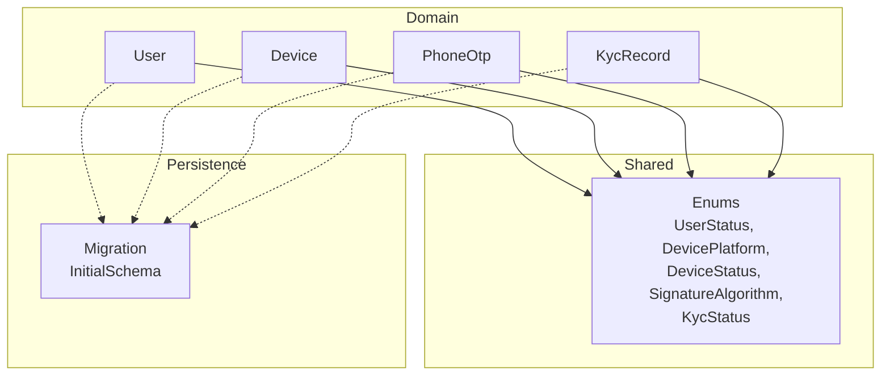
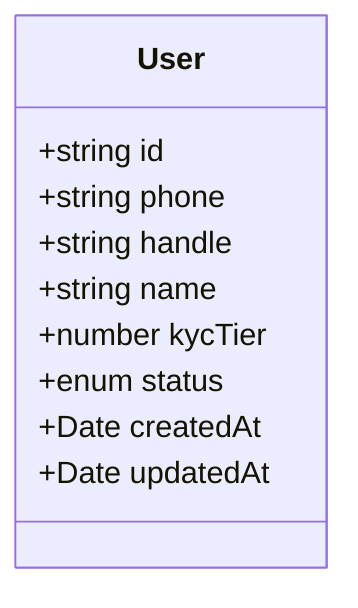
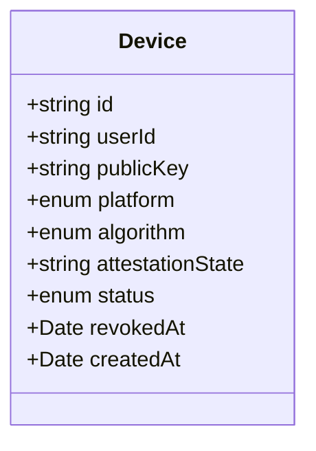
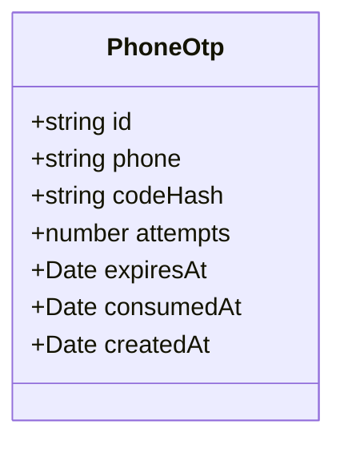
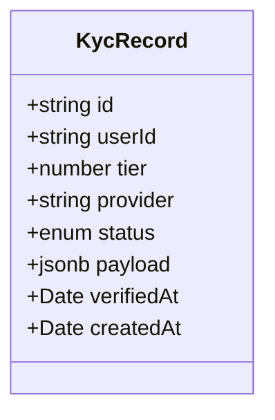
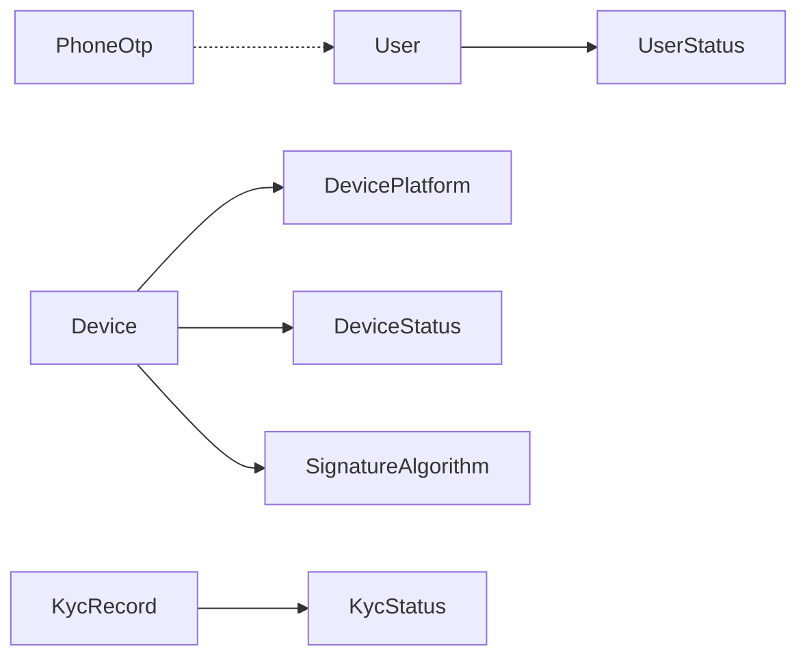

# Core Entities

<cite>
**Referenced Files in This Document**
- [user.entity.ts](file://backend/src/users/user.entity.ts)
- [device.entity.ts](file://backend/src/auth/device.entity.ts)
- [phone-otp.entity.ts](file://backend/src/auth/phone-otp.entity.ts)
- [kyc-record.entity.ts](file://backend/src/kyc/kyc-record.entity.ts)
- [enums.ts](file://backend/src/common/enums.ts)
- [1700000000000-InitialSchema.ts](file://backend/src/migrations/1700000000000-InitialSchema.ts)
</cite>

## Table of Contents
1. [Introduction](#introduction)
2. [Project Structure](#project-structure)
3. [Core Components](#core-components)
4. [Architecture Overview](#architecture-overview)
5. [Detailed Component Analysis](#detailed-component-analysis)
6. [Dependency Analysis](#dependency-analysis)
7. [Performance Considerations](#performance-considerations)
8. [Troubleshooting Guide](#troubleshooting-guide)
9. [Conclusion](#conclusion)

## Introduction
This document describes the core data model for foundational entities: Users, Devices, and Phone OTP. It explains field definitions, data types, constraints, indexing strategies, and relationships that support phone-based authentication, biometric device enrollment with cryptographic key storage, and one-time password verification flows. KYC tiering is also covered as it directly influences user capabilities and status management.

## Project Structure
The core entities are defined using TypeORM decorators and enforced via a database migration. The relevant files are organized by feature:
- User entity under users
- Device and Phone OTP entities under auth
- KYC record entity under kyc
- Shared enums under common
- Database schema enforcement under migrations



**Diagram sources**
- [user.entity.ts:11-38](file://backend/src/users/user.entity.ts#L11-L38)
- [device.entity.ts:4-34](file://backend/src/auth/device.entity.ts#L4-L34)
- [phone-otp.entity.ts:3-26](file://backend/src/auth/phone-otp.entity.ts#L3-L26)
- [kyc-record.entity.ts:4-30](file://backend/src/kyc/kyc-record.entity.ts#L4-L30)
- [enums.ts:1-26](file://backend/src/common/enums.ts#L1-L26)
- [1700000000000-InitialSchema.ts:32-80](file://backend/src/migrations/1700000000000-InitialSchema.ts#L32-L80)

**Section sources**
- [user.entity.ts:11-38](file://backend/src/users/user.entity.ts#L11-L38)
- [device.entity.ts:4-34](file://backend/src/auth/device.entity.ts#L4-L34)
- [phone-otp.entity.ts:3-26](file://backend/src/auth/phone-otp.entity.ts#L3-L26)
- [kyc-record.entity.ts:4-30](file://backend/src/kyc/kyc-record.entity.ts#L4-L30)
- [enums.ts:1-26](file://backend/src/common/enums.ts#L1-L26)
- [1700000000000-InitialSchema.ts:32-80](file://backend/src/migrations/1700000000000-InitialSchema.ts#L32-L80)

## Core Components
This section summarizes the three primary entities and their roles:
- User: Represents an account holder with phone-based identity, optional handle, name, KYC tier, and lifecycle status.
- Device: Captures enrolled devices with public keys and platform metadata to enable biometric challenges and secure operations.
- Phone OTP: Stores hashed one-time codes tied to phone numbers for verification workflows.

Key responsibilities:
- Authentication: Phone OTP verifies ownership of a phone number; User ties identity to phone.
- Authorization and Security: Device stores cryptographic keys used in challenge-response flows.
- Compliance and Limits: KYC tier on User controls capability levels; KYC records track provider verifications.

**Section sources**
- [user.entity.ts:11-38](file://backend/src/users/user.entity.ts#L11-L38)
- [device.entity.ts:4-34](file://backend/src/auth/device.entity.ts#L4-L34)
- [phone-otp.entity.ts:3-26](file://backend/src/auth/phone-otp.entity.ts#L3-L26)
- [kyc-record.entity.ts:4-30](file://backend/src/kyc/kyc-record.entity.ts#L4-L30)

## Architecture Overview
The following diagram shows how the core entities relate at the data layer and how they participate in authentication and security flows.

```mermaid
erDiagram
USERS {
uuid id PK
varchar phone UK
varchar handle UK_null
varchar name
smallint kycTier
enum status
timestamptz createdAt
timestamptz updatedAt
}
PHONE_OTPS {
uuid id PK
varchar phone
varchar codeHash
smallint attempts
timestamptz expiresAt
timestamptz consumedAt
timestamptz createdAt
}
DEVICES {
uuid id PK
uuid userId FK
text publicKey
enum platform
enum algorithm
varchar attestationState
enum status
timestamptz revokedAt
timestamptz createdAt
}
KYC_RECORDS {
uuid id PK
uuid userId FK
smallint tier
varchar provider
enum status
jsonb payload
timestamptz verifiedAt
timestamptz createdAt
}
USERS ||--o{ DEVICES : "has many"
USERS ||--o{ KYC_RECORDS : "has many"
USERS ||--o{ PHONE_OTPS : "verification per phone"
```

**Diagram sources**
- [user.entity.ts:11-38](file://backend/src/users/user.entity.ts#L11-L38)
- [device.entity.ts:4-34](file://backend/src/auth/device.entity.ts#L4-L34)
- [phone-otp.entity.ts:3-26](file://backend/src/auth/phone-otp.entity.ts#L3-L26)
- [kyc-record.entity.ts:4-30](file://backend/src/kyc/kyc-record.entity.ts#L4-L30)
- [1700000000000-InitialSchema.ts:32-80](file://backend/src/migrations/1700000000000-InitialSchema.ts#L32-L80)

## Detailed Component Analysis

### User Entity
Purpose:
- Central identity for phone-based accounts.
- Tracks optional social-style handle, display name, KYC tier, and lifecycle status.

Fields and semantics:
- id: UUID primary key.
- phone: Unique identifier for phone-based authentication; unique index enforces uniqueness.
- handle: Optional unique alias; partial unique index ensures uniqueness only when present.
- name: Display name.
- kycTier: Numeric tier controlling capabilities (e.g., transaction limits).
- status: Lifecycle state from a controlled set.
- createdAt, updatedAt: Audit timestamps.

Constraints and indexes:
- phone: UNIQUE constraint via index.
- handle: Partial UNIQUE index where handle IS NOT NULL.
- Status values are constrained by an enum type.

Relationships:
- One-to-many with Devices (enrolled devices).
- One-to-many with KYC records (verification history).
- Used by Phone OTP for verification linkage by phone string.

Indexing strategy:
- phone: UNIQUE index for fast lookup and uniqueness.
- handle: Partial UNIQUE index to avoid collisions among non-null handles.

Operational notes:
- Default status is active.
- KYC tier starts at zero and can be increased upon successful verification.

**Section sources**
- [user.entity.ts:11-38](file://backend/src/users/user.entity.ts#L11-L38)
- [1700000000000-InitialSchema.ts:32-45](file://backend/src/migrations/1700000000000-InitialSchema.ts#L32-L45)
- [enums.ts:1-5](file://backend/src/common/enums.ts#L1-L5)

#### Class Diagram: User


**Diagram sources**
- [user.entity.ts:11-38](file://backend/src/users/user.entity.ts#L11-L38)

### Device Entity
Purpose:
- Records biometric-capable devices and their stored public keys for cryptographic challenge-response flows.

Fields and semantics:
- id: UUID primary key.
- userId: Foreign reference to User.
- publicKey: Base64-encoded SPKI DER public key generated on-device.
- platform: Device OS (iOS or Android).
- algorithm: Signature algorithm (Ed25519 or ES256), default Ed25519.
- attestationState: State describing device attestation outcome.
- status: Active or revoked.
- revokedAt: Timestamp when device was revoked.
- createdAt: Creation timestamp.

Constraints and indexes:
- userId: Indexed for efficient queries by user.
- algorithm defaults to Ed25519.
- status constrained by enum.

Relationships:
- Belongs to User (many devices per user).
- Used in challenge flows requiring device-bound signatures.

Indexing strategy:
- userId index supports lookups such as listing a user’s enrolled devices.

Operational notes:
- Revoking a device sets revokedAt and changes status to revoked.
- Public key storage enables server-side verification of device-generated signatures.

**Section sources**
- [device.entity.ts:4-34](file://backend/src/auth/device.entity.ts#L4-L34)
- [1700000000000-InitialSchema.ts:57-68](file://backend/src/migrations/1700000000000-InitialSchema.ts#L57-L68)
- [enums.ts:13-26](file://backend/src/common/enums.ts#L13-L26)

#### Class Diagram: Device


**Diagram sources**
- [device.entity.ts:4-34](file://backend/src/auth/device.entity.ts#L4-L34)

### Phone OTP Entity
Purpose:
- Manages one-time passwords sent to phones for verification during registration or login.

Fields and semantics:
- id: UUID primary key.
- phone: Phone number associated with the OTP.
- codeHash: Hashed OTP code (never store plaintext).
- attempts: Number of failed verification attempts.
- expiresAt: Expiration time for the OTP.
- consumedAt: Time when OTP was successfully consumed.
- createdAt: Creation timestamp.

Constraints and indexes:
- phone: Indexed for quick retrieval by phone number.
- attempts: Counter to enforce rate limiting and lockout policies.
- expiresAt: Enforced expiration policy.

Relationships:
- Linked to User by phone string during verification flows.

Indexing strategy:
- phone index optimizes lookup by phone for sending and verifying OTPs.

Operational notes:
- On successful verification, mark consumedAt and prevent reuse.
- Increment attempts on failures and enforce lockout thresholds.

**Section sources**
- [phone-otp.entity.ts:3-26](file://backend/src/auth/phone-otp.entity.ts#L3-L26)
- [1700000000000-InitialSchema.ts:46-55](file://backend/src/migrations/1700000000000-InitialSchema.ts#L46-L55)

#### Class Diagram: PhoneOtp


**Diagram sources**
- [phone-otp.entity.ts:3-26](file://backend/src/auth/phone-otp.entity.ts#L3-L26)

### KYC Record Entity
Purpose:
- Tracks individual KYC verification submissions, including provider details, status, and results.

Fields and semantics:
- id: UUID primary key.
- userId: Reference to the User being verified.
- tier: Target or achieved KYC tier.
- provider: External KYC provider identifier.
- status: Pending, verified, or rejected.
- payload: Provider-specific result payload.
- verifiedAt: Timestamp when verification completed.
- createdAt: Creation timestamp.

Constraints and indexes:
- userId: Indexed for querying all records for a user.
- status constrained by enum.

Relationships:
- Belongs to User; multiple records per user over time.

Operational notes:
- Successful verification may update User.kycTier accordingly.

**Section sources**
- [kyc-record.entity.ts:4-30](file://backend/src/kyc/kyc-record.entity.ts#L4-L30)
- [1700000000000-InitialSchema.ts:70-80](file://backend/src/migrations/1700000000000-InitialSchema.ts#L70-L80)
- [enums.ts:7-11](file://backend/src/common/enums.ts#L7-L11)

#### Class Diagram: KycRecord


**Diagram sources**
- [kyc-record.entity.ts:4-30](file://backend/src/kyc/kyc-record.entity.ts#L4-L30)

## Dependency Analysis
Entity relationships and shared dependencies:
- User depends on UserStatus enum.
- Device depends on DevicePlatform, DeviceStatus, and SignatureAlgorithm enums.
- Phone OTP has no enum dependency but participates in flows involving User.
- KycRecord depends on KycStatus enum.
- Migration defines DB-level enums and indexes matching the entities.



**Diagram sources**
- [user.entity.ts:9-31](file://backend/src/users/user.entity.ts#L9-L31)
- [device.entity.ts:2-27](file://backend/src/auth/device.entity.ts#L2-L27)
- [phone-otp.entity.ts:3-26](file://backend/src/auth/phone-otp.entity.ts#L3-L26)
- [kyc-record.entity.ts:2-20](file://backend/src/kyc/kyc-record.entity.ts#L2-L20)
- [enums.ts:1-26](file://backend/src/common/enums.ts#L1-L26)

**Section sources**
- [user.entity.ts:9-31](file://backend/src/users/user.entity.ts#L9-L31)
- [device.entity.ts:2-27](file://backend/src/auth/device.entity.ts#L2-L27)
- [phone-otp.entity.ts:3-26](file://backend/src/auth/phone-otp.entity.ts#L3-L26)
- [kyc-record.entity.ts:2-20](file://backend/src/kyc/kyc-record.entity.ts#L2-L20)
- [enums.ts:1-26](file://backend/src/common/enums.ts#L1-L26)

## Performance Considerations
Indexing and query optimization:
- Users.phone: UNIQUE index for fast and safe phone lookups.
- Users.handle: Partial UNIQUE index reduces collision checks and improves performance for non-null handles.
- Devices.userId: Index accelerates retrieving all devices for a user.
- PhoneOtps.phone: Index speeds up OTP lookup by phone during verification.
- KycRecords.userId: Index supports fetching all KYC records for a user.

Data integrity and safety:
- Use hashed OTP codes (codeHash) instead of storing plaintext.
- Enforce OTP expiration via expiresAt and consumption via consumedAt to prevent replay attacks.
- Track attempts to implement lockout policies.
- Use device revocation (status and revokedAt) to invalidate compromised devices promptly.

Storage considerations:
- Public keys are stored as base64-encoded strings; ensure adequate size handling.
- KYC payloads are JSONB; consider adding application-level validation to keep payloads predictable.

[No sources needed since this section provides general guidance]

## Troubleshooting Guide
Common issues and resolutions:
- Duplicate phone registration:
  - Cause: Attempting to create a User with an existing phone.
  - Resolution: Check for existing User.phone before insert; handle unique constraint errors.
- Handle collisions:
  - Cause: Inserting duplicate non-null handles.
  - Resolution: Validate handle uniqueness prior to creation; handle partial unique index violations.
- OTP not found or expired:
  - Cause: Missing PhoneOtps.phone entry or expiresAt passed.
  - Resolution: Resend OTP if within allowed attempts; clear consumedAt only on reissue per policy.
- Too many OTP attempts:
  - Cause: attempts exceeded threshold.
  - Resolution: Lock out temporarily and require re-issuance after cooldown.
- Device not enrolled or revoked:
  - Cause: Missing Devices.userId or status=revoked.
  - Resolution: Re-enroll device; verify attestationState and algorithm compatibility.

**Section sources**
- [1700000000000-InitialSchema.ts:32-80](file://backend/src/migrations/1700000000000-InitialSchema.ts#L32-L80)
- [phone-otp.entity.ts:8-25](file://backend/src/auth/phone-otp.entity.ts#L8-L25)
- [device.entity.ts:9-30](file://backend/src/auth/device.entity.ts#L9-L30)

## Conclusion
The core data model centers on three tightly integrated entities:
- User anchors identity and KYC tiering.
- Device secures operations through cryptographic key storage and platform metadata.
- Phone OTP enables secure, ephemeral verification tied to phone numbers.

Indexes and constraints ensure performance and integrity across authentication, authorization, and compliance workflows. Proper handling of OTP expiration, attempt limits, and device revocation is essential for robust security.

[No sources needed since this section summarizes without analyzing specific files]