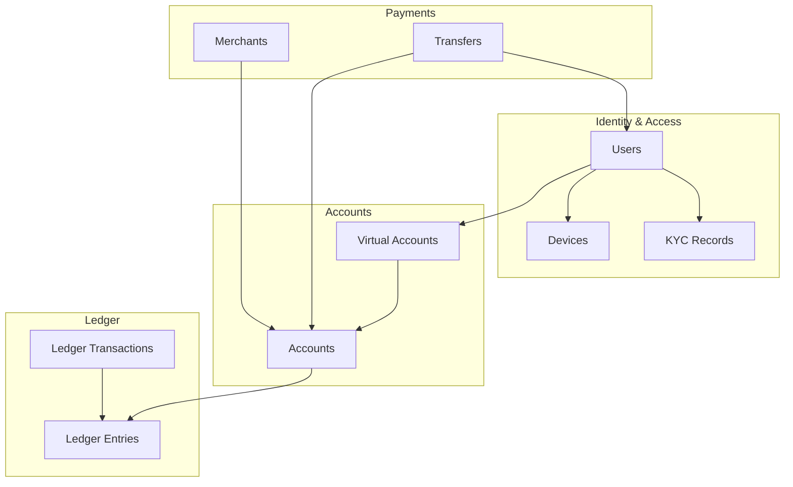
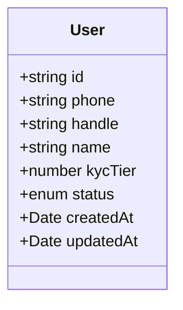
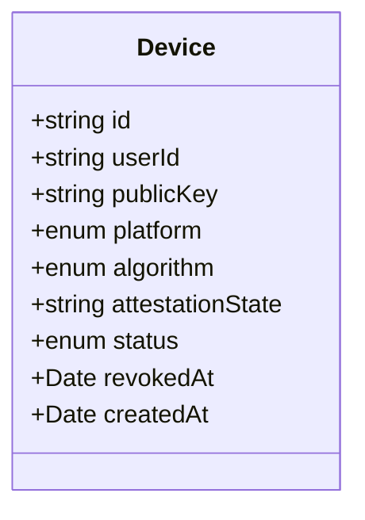
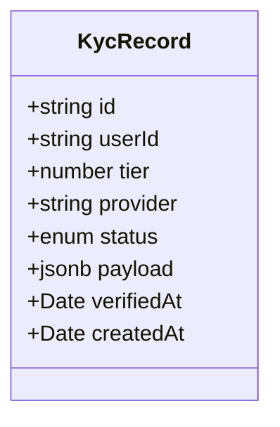
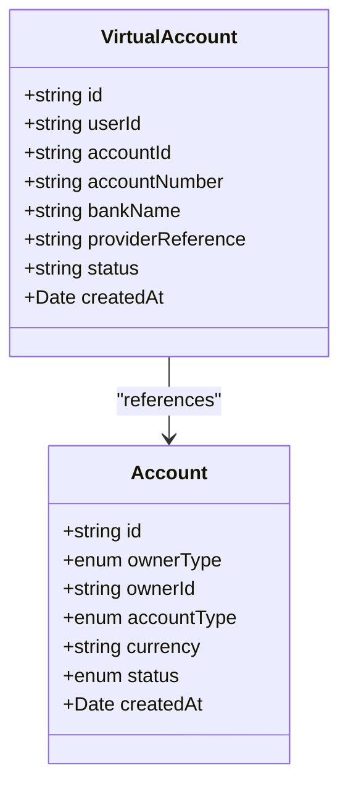
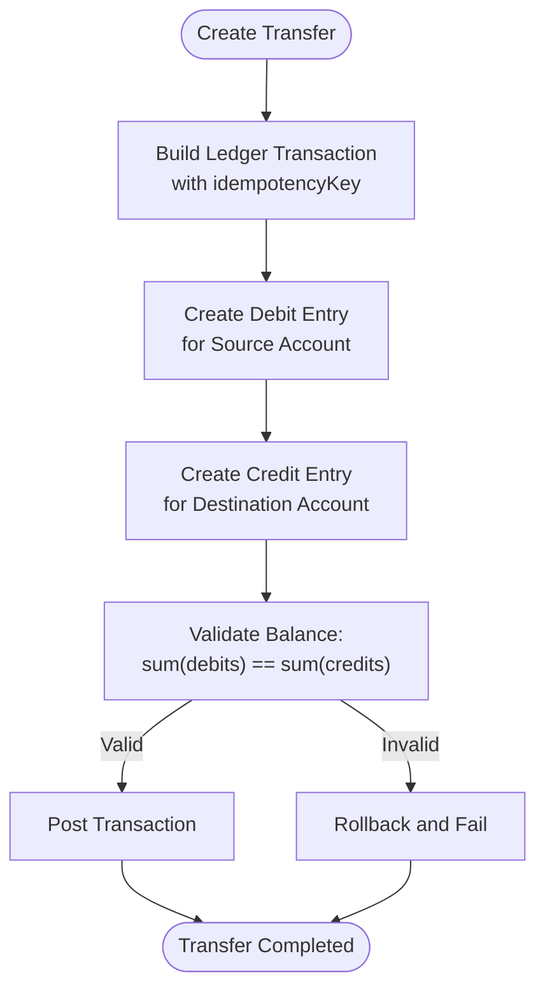
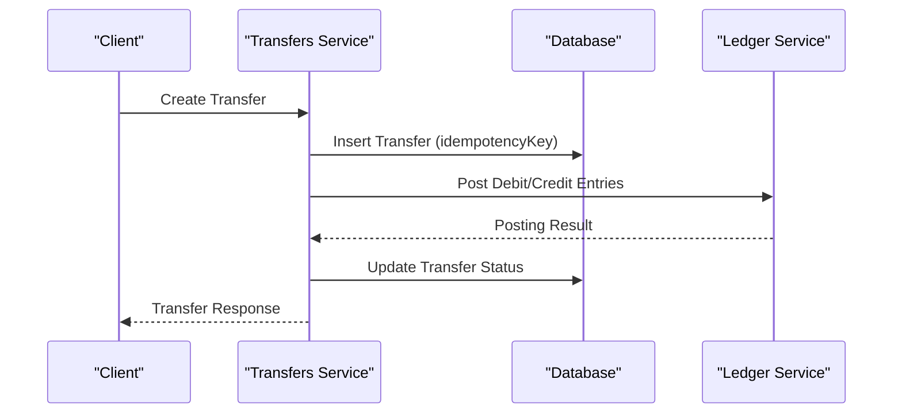
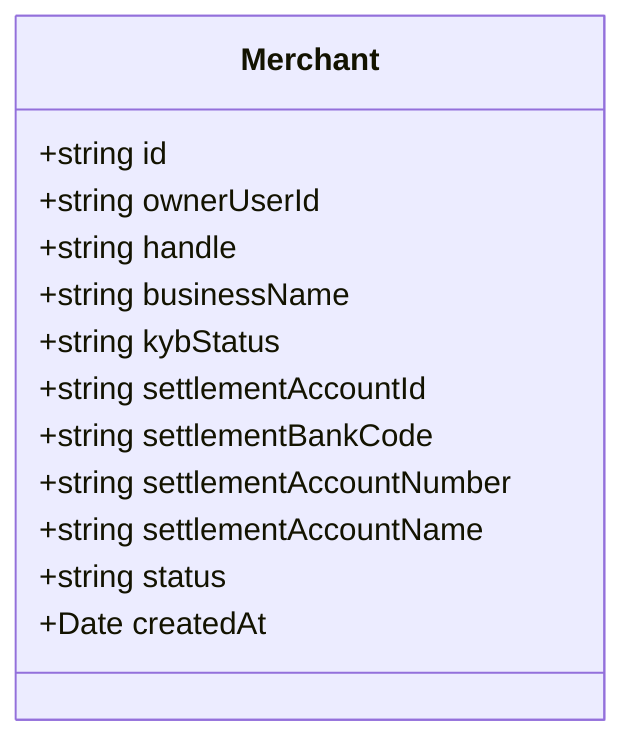
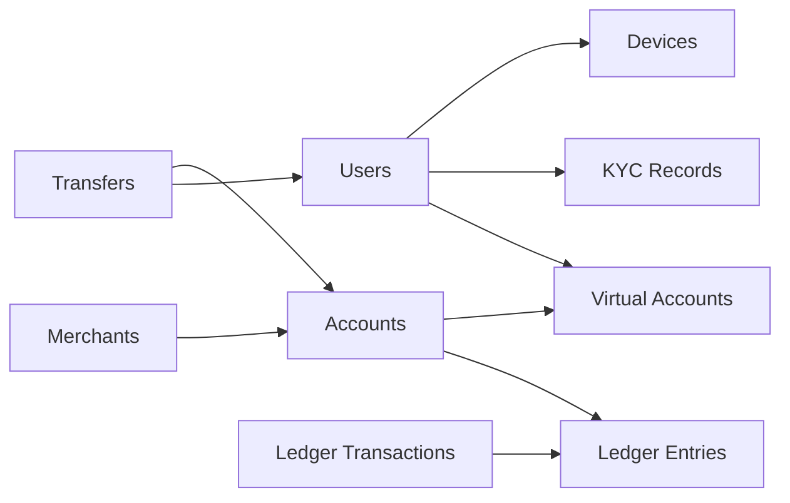

# Database Schema

<cite>
**Referenced Files in This Document**
- [InitialSchema.ts](file://backend/src/migrations/1700000000000-InitialSchema.ts)
- [user.entity.ts](file://backend/src/users/user.entity.ts)
- [device.entity.ts](file://backend/src/auth/device.entity.ts)
- [account.entity.ts](file://backend/src/accounts/account.entity.ts)
- [virtual-account.entity.ts](file://backend/src/accounts/virtual-account.entity.ts)
- [ledger-entry.entity.ts](file://backend/src/ledger/ledger-entry.entity.ts)
- [ledger-transaction.entity.ts](file://backend/src/ledger/ledger-transaction.entity.ts)
- [transfer.entity.ts](file://backend/src/transfers/transfer.entity.ts)
- [kyc-record.entity.ts](file://backend/src/kyc/kyc-record.entity.ts)
- [merchant.entity.ts](file://backend/src/merchant/merchant.entity.ts)
- [enums.ts](file://backend/src/common/enums.ts)
- [money.ts](file://backend/src/database/money.ts)
</cite>

## Table of Contents
1. [Introduction](#introduction)
2. [Project Structure](#project-structure)
3. [Core Components](#core-components)
4. [Architecture Overview](#architecture-overview)
5. [Detailed Component Analysis](#detailed-component-analysis)
6. [Dependency Analysis](#dependency-analysis)
7. [Performance Considerations](#performance-considerations)
8. [Troubleshooting Guide](#troubleshooting-guide)
9. [Conclusion](#conclusion)
10. [Appendices](#appendices)

## Introduction
This document describes the Vireo Finance database schema and data model. It focuses on core financial entities: Users, Devices, Accounts (including Virtual Accounts), Ledger Entries, Transfers, Merchants, and KYC Records. It explains primary and foreign keys, indexes, constraints, double-entry accounting rules, validation policies, referential integrity, lifecycle considerations, and security requirements as implemented or implied by the codebase.

## Project Structure
The database schema is defined primarily through a TypeORM migration that creates tables, enums, indexes, and constraints. Entity classes mirror these tables and provide application-level type safety. Additional domain modules include transfers, merchants, and KYC records. Money values are represented as integers in minor units with parsing/formatting utilities.



**Diagram sources**
- [InitialSchema.ts:32-268](file://backend/src/migrations/1700000000000-InitialSchema.ts#L32-L268)
- [user.entity.ts:11-38](file://backend/src/users/user.entity.ts#L11-L38)
- [device.entity.ts:4-34](file://backend/src/auth/device.entity.ts#L4-L34)
- [account.entity.ts:4-27](file://backend/src/accounts/account.entity.ts#L4-L27)
- [virtual-account.entity.ts:3-30](file://backend/src/accounts/virtual-account.entity.ts#L3-L30)
- [ledger-transaction.entity.ts:4-27](file://backend/src/ledger/ledger-transaction.entity.ts#L4-L27)
- [ledger-entry.entity.ts:4-28](file://backend/src/ledger/ledger-entry.entity.ts#L4-L28)
- [transfer.entity.ts:11-75](file://backend/src/transfers/transfer.entity.ts#L11-L75)
- [merchant.entity.ts:3-39](file://backend/src/merchant/merchant.entity.ts#L3-L39)
- [kyc-record.entity.ts:4-30](file://backend/src/kyc/kyc-record.entity.ts#L4-L30)

**Section sources**
- [InitialSchema.ts:1-320](file://backend/src/migrations/1700000000000-InitialSchema.ts#L1-L320)
- [enums.ts:1-121](file://backend/src/common/enums.ts#L1-L121)

## Core Components
This section summarizes each entity’s purpose, key fields, and integrity rules.

- Users
  - Purpose: Identity for platform users.
  - Keys: Primary key id; unique index on phone; partial unique index on handle when not null.
  - Constraints: Status enum; kycTier smallint; timestamps.
  - References: None directly from this table.

- Devices
  - Purpose: Device-bound cryptographic identity per user.
  - Keys: Primary key id; index on userId.
  - Constraints: Platform and algorithm enums; status enum; attestationState string; revokedAt timestamp.
  - References: userId references users.id.

- KYC Records
  - Purpose: Verification records per user.
  - Keys: Primary key id; index on userId.
  - Constraints: Tier smallint; provider string; status enum; payload jsonb; verifiedAt timestamp.
  - References: userId references users.id.

- Accounts
  - Purpose: Financial accounts for users, merchants, and system.
  - Keys: Primary key id; composite index on (ownerType, ownerId).
  - Constraints: ownerType and accountType enums; currency code; status enum.
  - References: None directly from this table.

- Virtual Accounts
  - Purpose: Bank-facing virtual account numbers mapped to internal accounts and users.
  - Keys: Primary key id; unique index on accountNumber; index on userId.
  - Constraints: accountId references accounts.id; bankName and providerReference strings; status string; createdAt timestamp.
  - References: userId references users.id; accountId references accounts.id.

- Ledger Transactions
  - Purpose: Atomic grouping of ledger entries representing a business event.
  - Keys: Primary key id; unique index on idempotencyKey.
  - Constraints: type enum; reference string; status string; metadata jsonb; createdAt timestamp.
  - References: None directly from this table.

- Ledger Entries
  - Purpose: Double-entry debits and credits against accounts.
  - Keys: Primary key id; index on transactionId; composite index on (accountId, createdAt).
  - Constraints: direction enum; amount bigint > 0; currency code; createdAt timestamp.
  - References: transactionId references ledger_transactions.id; accountId references accounts.id.

- Transfers
  - Purpose: High-level payment operations between accounts or external parties.
  - Keys: Primary key id; unique index on idempotencyKey; index on sourceAccountId; index on pagaReference.
  - Constraints: type and status enums; nullable source/destination accounts; optional challengeId; recipient details; amount > 0; fee default 0; currency; failureReason; metadata; updatedAt timestamp.
  - References: Optional links to accounts and users; no enforced FKs at DB level.

- Merchants
  - Purpose: Merchant profiles and settlement configuration.
  - Keys: Primary key id; unique index on handle; index on ownerUserId.
  - Constraints: kybStatus string; settlement account fields; status string; createdAt timestamp.
  - References: Optional ownerUserId references users.id; settlementAccountId is not enforced as FK at DB level.

**Section sources**
- [user.entity.ts:11-38](file://backend/src/users/user.entity.ts#L11-L38)
- [device.entity.ts:4-34](file://backend/src/auth/device.entity.ts#L4-L34)
- [kyc-record.entity.ts:4-30](file://backend/src/kyc/kyc-record.entity.ts#L4-L30)
- [account.entity.ts:4-27](file://backend/src/accounts/account.entity.ts#L4-L27)
- [virtual-account.entity.ts:3-30](file://backend/src/accounts/virtual-account.entity.ts#L3-L30)
- [ledger-transaction.entity.ts:4-27](file://backend/src/ledger/ledger-transaction.entity.ts#L4-L27)
- [ledger-entry.entity.ts:4-28](file://backend/src/ledger/ledger-entry.entity.ts#L4-L28)
- [transfer.entity.ts:11-75](file://backend/src/transfers/transfer.entity.ts#L11-L75)
- [merchant.entity.ts:3-39](file://backend/src/merchant/merchant.entity.ts#L3-L39)
- [InitialSchema.ts:32-268](file://backend/src/migrations/1700000000000-InitialSchema.ts#L32-L268)

## Architecture Overview
The financial architecture centers on a double-entry ledger. Each transfer or business event creates one ledger transaction containing balanced debit and credit ledger entries. Accounts represent balances; virtual accounts bridge to banking rails; merchants receive settlements into configured accounts.

```mermaid
erDiagram
USERS {
uuid id PK
varchar phone UK
varchar handle UK_null
varchar name
smallint kycTier
enum status
timestamptz createdAt
timestamptz updatedAt
}
DEVICES {
uuid id PK
uuid userId FK
text publicKey
enum platform
enum algorithm
varchar attestationState
enum status
timestamptz revokedAt
timestamptz createdAt
}
KYC_RECORDS {
uuid id PK
uuid userId FK
smallint tier
varchar provider
enum status
jsonb payload
timestamptz verifiedAt
timestamptz createdAt
}
ACCOUNTS {
uuid id PK
enum ownerType
uuid ownerId
enum accountType
varchar currency
enum status
timestamptz createdAt
}
VIRTUAL_ACCOUNTS {
uuid id PK
uuid userId FK
uuid accountId FK
varchar accountNumber UK
varchar bankName
varchar providerReference
varchar status
timestamptz createdAt
}
LEDGER_TRANSACTIONS {
uuid id PK
varchar idempotencyKey UK
enum type
varchar reference
varchar status
jsonb metadata
timestamptz createdAt
}
LEDGER_ENTRIES {
uuid id PK
uuid transactionId FK
uuid accountId FK
enum direction
bigint amount
varchar currency
timestamptz createdAt
}
TRANSFERS {
uuid id PK
varchar idempotencyKey UK
enum type
enum status
uuid sourceAccountId
uuid destinationAccountId
uuid challengeId
uuid initiatedByUserId
varchar recipientPhone
varchar recipientBankCode
varchar recipientAccountNumber
varchar recipientName
bigint amount
bigint fee
varchar currency
varchar pagaReference
varchar failureReason
jsonb metadata
timestamptz createdAt
timestamptz updatedAt
}
MERCHANTS {
uuid id PK
uuid ownerUserId
varchar handle UK
varchar businessName
varchar kybStatus
uuid settlementAccountId
varchar settlementBankCode
varchar settlementAccountNumber
varchar settlementAccountName
varchar status
timestamptz createdAt
}
USERS ||--o{ DEVICES : "has many"
USERS ||--o{ KYC_RECORDS : "has many"
USERS ||--o{ VIRTUAL_ACCOUNTS : "owns"
ACCOUNTS ||--o{ LEDGER_ENTRIES : "has many"
LEDGER_TRANSACTIONS ||--o{ LEDGER_ENTRIES : "contains"
TRANSFERS }o--|| ACCOUNTS : "source"
TRANSFERS }o--|| ACCOUNTS : "destination"
TRANSFERS }o--|| USERS : "initiated by"
MERCHANTS ||--o{ ACCOUNTS : "settlement account"
```

**Diagram sources**
- [InitialSchema.ts:32-268](file://backend/src/migrations/1700000000000-InitialSchema.ts#L32-L268)
- [enums.ts:1-121](file://backend/src/common/enums.ts#L1-L121)

## Detailed Component Analysis

### Users
- Primary Key: id (uuid)
- Unique Indexes: phone; handle (partial where handle IS NOT NULL)
- Fields: phone, handle, name, kycTier, status, createdAt, updatedAt
- Integrity: Status constrained by enum; handle uniqueness conditional on non-null.



**Diagram sources**
- [user.entity.ts:11-38](file://backend/src/users/user.entity.ts#L11-L38)

**Section sources**
- [user.entity.ts:11-38](file://backend/src/users/user.entity.ts#L11-L38)
- [InitialSchema.ts:32-44](file://backend/src/migrations/1700000000000-InitialSchema.ts#L32-L44)

### Devices
- Primary Key: id (uuid)
- Indexes: userId
- Fields: userId, publicKey, platform, algorithm, attestationState, status, revokedAt, createdAt
- Integrity: Enums for platform, algorithm, status; revokedAt nullable.



**Diagram sources**
- [device.entity.ts:4-34](file://backend/src/auth/device.entity.ts#L4-L34)

**Section sources**
- [device.entity.ts:4-34](file://backend/src/auth/device.entity.ts#L4-L34)
- [InitialSchema.ts:57-68](file://backend/src/migrations/1700000000000-InitialSchema.ts#L57-L68)

### KYC Records
- Primary Key: id (uuid)
- Indexes: userId
- Fields: userId, tier, provider, status, payload, verifiedAt, createdAt
- Integrity: Status enum; payload jsonb; verifiedAt nullable.



**Diagram sources**
- [kyc-record.entity.ts:4-30](file://backend/src/kyc/kyc-record.entity.ts#L4-L30)

**Section sources**
- [kyc-record.entity.ts:4-30](file://backend/src/kyc/kyc-record.entity.ts#L4-L30)
- [InitialSchema.ts:70-80](file://backend/src/migrations/1700000000000-InitialSchema.ts#L70-L80)

### Accounts and Virtual Accounts
- Accounts
  - Primary Key: id (uuid)
  - Indexes: (ownerType, ownerId)
  - Fields: ownerType, ownerId, accountType, currency, status, createdAt
  - Integrity: Enums for ownerType, accountType, status; default currency NGN.

- Virtual Accounts
  - Primary Key: id (uuid)
  - Indexes: userId; unique accountNumber
  - Fields: userId, accountId, accountNumber, bankName, providerReference, status, createdAt
  - Integrity: accountId references accounts.id; accountNumber unique.



**Diagram sources**
- [account.entity.ts:4-27](file://backend/src/accounts/account.entity.ts#L4-L27)
- [virtual-account.entity.ts:3-30](file://backend/src/accounts/virtual-account.entity.ts#L3-L30)

**Section sources**
- [account.entity.ts:4-27](file://backend/src/accounts/account.entity.ts#L4-L27)
- [virtual-account.entity.ts:3-30](file://backend/src/accounts/virtual-account.entity.ts#L3-L30)
- [InitialSchema.ts:82-104](file://backend/src/migrations/1700000000000-InitialSchema.ts#L82-L104)

### Ledger Transactions and Entries
- Ledger Transactions
  - Primary Key: id (uuid)
  - Indexes: unique idempotencyKey
  - Fields: type, reference, status, metadata, createdAt
  - Integrity: Transaction type enum; idempotencyKey prevents duplicate postings.

- Ledger Entries
  - Primary Key: id (uuid)
  - Indexes: transactionId; (accountId, createdAt)
  - Fields: transactionId, accountId, direction, amount, currency, createdAt
  - Integrity: direction enum; amount > 0 via check constraint; references transactions and accounts.

Double-Entry Accounting Rules
- Every posting must create at least two entries per transaction: one debit and one credit.
- Sum of debits equals sum of credits within a transaction.
- Amounts are stored in minor units (e.g., kobo) as positive integers.
- Currency must match across entries within a transaction.



**Diagram sources**
- [ledger-transaction.entity.ts:4-27](file://backend/src/ledger/ledger-transaction.entity.ts#L4-L27)
- [ledger-entry.entity.ts:4-28](file://backend/src/ledger/ledger-entry.entity.ts#L4-L28)
- [InitialSchema.ts:106-128](file://backend/src/migrations/1700000000000-InitialSchema.ts#L106-L128)
- [money.ts:1-34](file://backend/src/database/money.ts#L1-L34)

**Section sources**
- [ledger-transaction.entity.ts:4-27](file://backend/src/ledger/ledger-transaction.entity.ts#L4-L27)
- [ledger-entry.entity.ts:4-28](file://backend/src/ledger/ledger-entry.entity.ts#L4-L28)
- [InitialSchema.ts:106-128](file://backend/src/migrations/1700000000000-InitialSchema.ts#L106-L128)
- [money.ts:1-34](file://backend/src/database/money.ts#L1-L34)

### Transfers
- Primary Key: id (uuid)
- Indexes: unique idempotencyKey; sourceAccountId; pagaReference
- Fields: type, status, sourceAccountId, destinationAccountId, challengeId, initiatedByUserId, recipient details, amount, fee, currency, pagaReference, failureReason, metadata, createdAt, updatedAt
- Integrity: Enums for type/status; amount > 0; idempotencyKey ensures safe retries.



**Diagram sources**
- [transfer.entity.ts:11-75](file://backend/src/transfers/transfer.entity.ts#L11-L75)
- [InitialSchema.ts:160-185](file://backend/src/migrations/1700000000000-InitialSchema.ts#L160-L185)

**Section sources**
- [transfer.entity.ts:11-75](file://backend/src/transfers/transfer.entity.ts#L11-L75)
- [InitialSchema.ts:160-185](file://backend/src/migrations/1700000000000-InitialSchema.ts#L160-L185)

### Merchants
- Primary Key: id (uuid)
- Indexes: unique handle; ownerUserId
- Fields: ownerUserId, handle, businessName, kybStatus, settlementAccountId, settlementBankCode, settlementAccountNumber, settlementAccountName, status, createdAt
- Integrity: Handle unique; settlementAccountId is not enforced as FK at DB level.



**Diagram sources**
- [merchant.entity.ts:3-39](file://backend/src/merchant/merchant.entity.ts#L3-L39)

**Section sources**
- [merchant.entity.ts:3-39](file://backend/src/merchant/merchant.entity.ts#L3-L39)
- [InitialSchema.ts:187-201](file://backend/src/migrations/1700000000000-InitialSchema.ts#L187-L201)

## Dependency Analysis
- Referential Integrity
  - Enforced Foreign Keys:
    - virtual_accounts.accountId -> accounts.id
    - ledger_entries.transactionId -> ledger_transactions.id
    - ledger_entries.accountId -> accounts.id
  - Not Enforced at DB Level (application-managed):
    - devices.userId -> users.id
    - kyc_records.userId -> users.id
    - transfers.sourceAccountId/destinationAccountId -> accounts.id
    - transfers.initiatedByUserId -> users.id
    - merchant.settlementAccountId -> accounts.id
    - merchant.ownerUserId -> users.id

- Indexing Strategy
  - High-cardinality unique keys: phone, handle (partial), accountNumber, idempotencyKey (transactions and transfers), merchant.handle.
  - Query performance:
    - devices.userId
    - kyc_records.userId
    - accounts(ownerType, ownerId)
    - ledger_entries(transactionId), (accountId, createdAt)
    - transfers(sourceAccountId), (pagaReference)
    - holds(accountId, status), (reference)
    - merchant_orders(merchantId), (reference)
    - settlements(merchantId)
    - agent_sessions(userId), agent_tool_calls(sessionId, userId)



**Diagram sources**
- [InitialSchema.ts:32-268](file://backend/src/migrations/1700000000000-InitialSchema.ts#L32-L268)

**Section sources**
- [InitialSchema.ts:32-268](file://backend/src/migrations/1700000000000-InitialSchema.ts#L32-L268)

## Performance Considerations
- Use minor-unit integer amounts to avoid floating-point errors and leverage efficient indexing.
- Prefer queries filtered by accountId and createdAt for balance history due to composite index.
- Idempotency keys prevent duplicate processing and reduce contention under retries.
- Partitioning strategy (future consideration):
  - ledger_entries by createdAt range for time-series queries.
  - transfers by createdAt for reporting.
- Connection pooling and read replicas can offload heavy analytical queries while writes target the primary.

[No sources needed since this section provides general guidance]

## Troubleshooting Guide
Common issues and resolutions:
- Duplicate Transfer or Ledger Transaction
  - Symptom: Error on idempotencyKey conflict.
  - Resolution: Ensure client-generated idempotencyKey is unique per operation; retry safely using the same key.

- Unbalanced Ledger Entries
  - Symptom: Validation fails during posting.
  - Resolution: Verify equal sums of debits and credits; ensure all required entries exist before committing.

- Negative or Zero Amounts
  - Symptom: Check constraint violation on amount.
  - Resolution: Validate amounts using money utilities; enforce positive amounts.

- Missing Referenced Entities
  - Symptom: Application logic fails when referencing accounts or users.
  - Resolution: Pre-create required accounts; validate ownership relationships before operations.

- Stale or Frozen Accounts
  - Symptom: Operations blocked due to account status.
  - Resolution: Review account status enum and adjust via admin flows if appropriate.

**Section sources**
- [InitialSchema.ts:106-128](file://backend/src/migrations/1700000000000-InitialSchema.ts#L106-L128)
- [InitialSchema.ts:160-185](file://backend/src/migrations/1700000000000-InitialSchema.ts#L160-L185)
- [money.ts:1-34](file://backend/src/database/money.ts#L1-L34)

## Conclusion
The Vireo Finance schema implements a robust double-entry ledger with strong constraints on amounts and clear separation between high-level transfers and low-level ledger entries. Enumerated types and indexes support predictable behavior and performance. While some relationships are enforced at the database level, others rely on application-layer validation. Security-sensitive fields such as device public keys and KYC payloads should be protected with encryption and access controls beyond what the schema defines.

[No sources needed since this section summarizes without analyzing specific files]

## Appendices

### Data Lifecycle and Retention Policies
- Retention
  - No explicit retention or archival columns exist in the schema.
  - Recommendation: Add archivedAt and retentionPolicy fields to long-lived tables (transfers, ledger_entries, kyc_records) and implement background jobs to archive old data.

- Archival
  - Suggested approach: Move historical ledger entries and transfers to cold storage partitions or separate tables based on createdAt thresholds.

- Migration Paths
  - The initial migration establishes the baseline schema. Future migrations should add new columns and indexes incrementally, preserving backward compatibility.

[No sources needed since this section provides general guidance]

### Data Validation Rules and Business Constraints
- Amounts
  - Positive-only enforcement via check constraints and application-side assertion.
  - Minor-unit representation ensures precision.

- Idempotency
  - Unique idempotencyKey on both transfers and ledger transactions prevents duplicates.

- Status Management
  - Strict state machines via enums for users, devices, accounts, transfers, merchants, and ledger components.

- Referential Integrity
  - Enforced for virtual accounts, ledger entries.
  - Application-enforced for other cross-entity references.

**Section sources**
- [InitialSchema.ts:106-128](file://backend/src/migrations/1700000000000-InitialSchema.ts#L106-L128)
- [InitialSchema.ts:160-185](file://backend/src/migrations/1700000000000-InitialSchema.ts#L160-L185)
- [money.ts:1-34](file://backend/src/database/money.ts#L1-L34)

### Security Requirements
- Encryption at Rest
  - Sensitive fields like device.publicKey and kyc_records.payload should be encrypted at rest using database-level encryption or application-side encryption.

- Access Control
  - Row-level security or application-level authorization should restrict access to sensitive tables (users, kyc_records, devices).

- Audit Logging
  - All financial mutations should be audited. The schema includes createdAt/updatedAt but does not define an audit log table. Recommend adding an immutable audit_log table capturing actor, action, before/after snapshots, and correlation ids.

[No sources needed since this section provides general guidance]