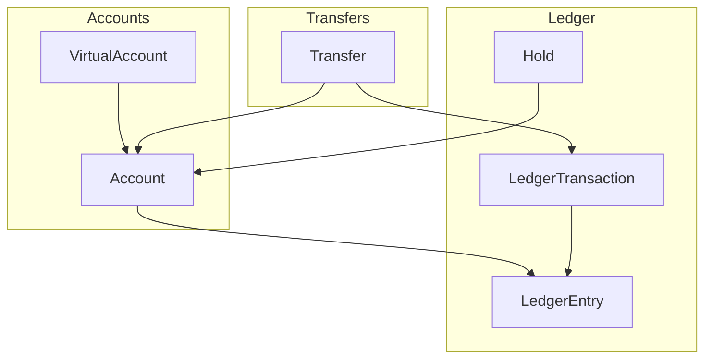
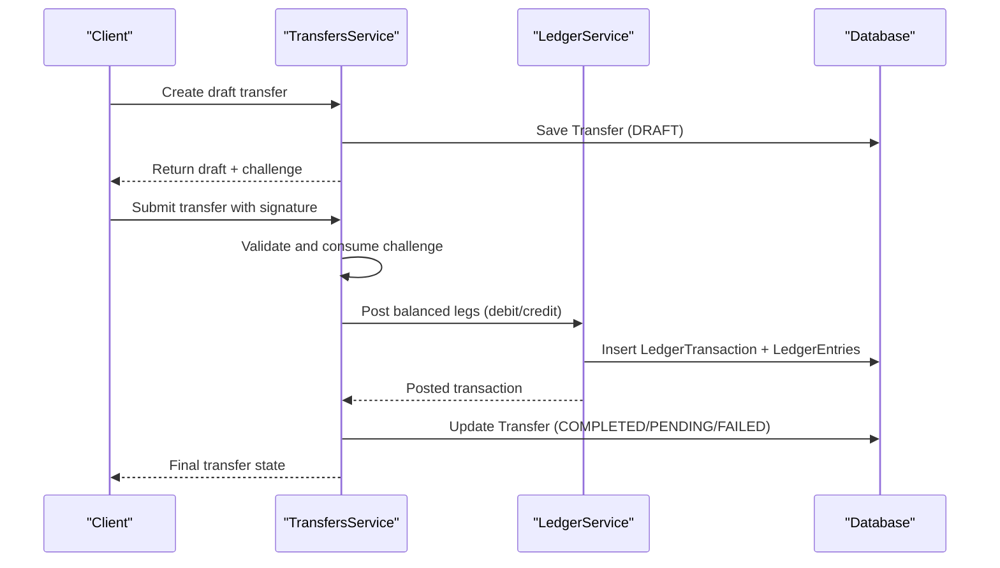
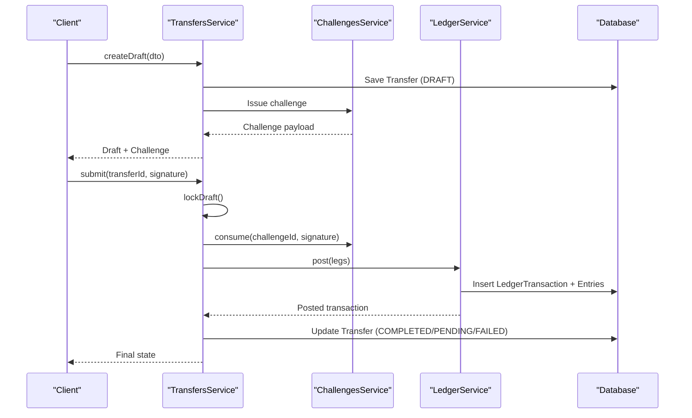
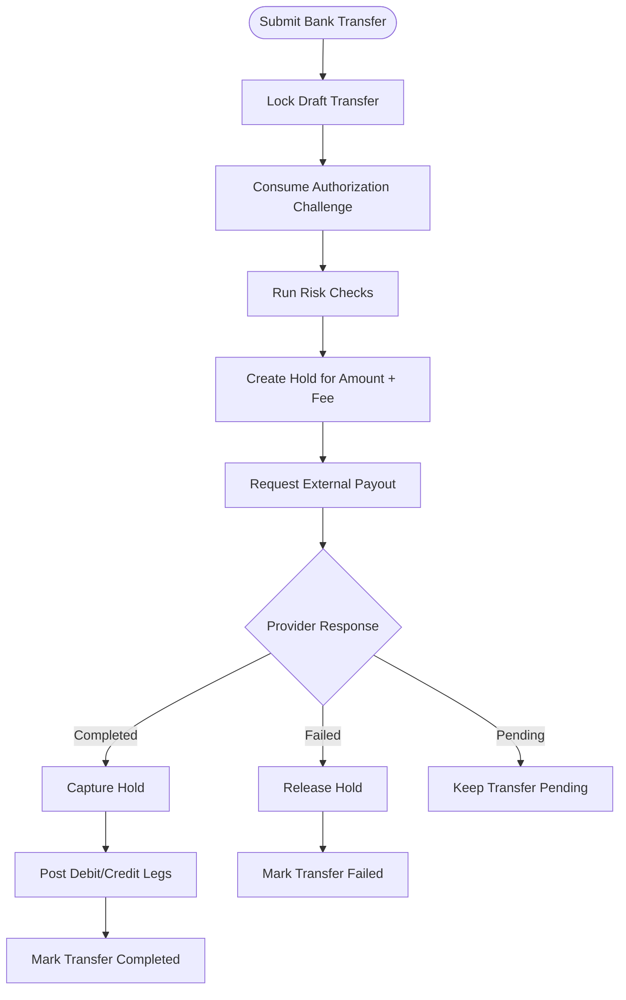
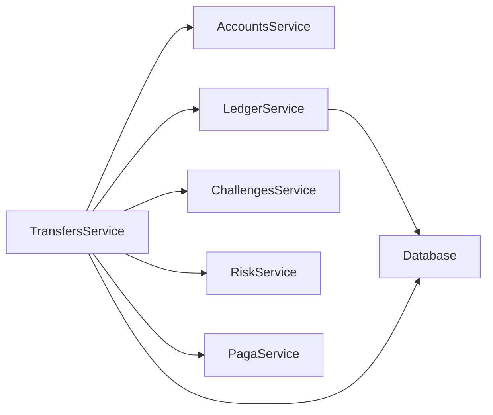

# Financial Entities

<cite>
**Referenced Files in This Document**
- [account.entity.ts](file://backend/src/accounts/account.entity.ts)
- [virtual-account.entity.ts](file://backend/src/accounts/virtual-account.entity.ts)
- [ledger-entry.entity.ts](file://backend/src/ledger/ledger-entry.entity.ts)
- [hold.entity.ts](file://backend/src/ledger/hold.entity.ts)
- [ledger-transaction.entity.ts](file://backend/src/ledger/ledger-transaction.entity.ts)
- [transfer.entity.ts](file://backend/src/transfers/transfer.entity.ts)
- [enums.ts](file://backend/src/common/enums.ts)
- [ledger.service.ts](file://backend/src/ledger/ledger.service.ts)
- [transfers.service.ts](file://backend/src/transfers/transfers.service.ts)
</cite>

## Table of Contents
1. [Introduction](#introduction)
2. [Project Structure](#project-structure)
3. [Core Components](#core-components)
4. [Architecture Overview](#architecture-overview)
5. [Detailed Component Analysis](#detailed-component-analysis)
6. [Dependency Analysis](#dependency-analysis)
7. [Performance Considerations](#performance-considerations)
8. [Troubleshooting Guide](#troubleshooting-guide)
9. [Conclusion](#conclusion)

## Introduction
This document describes the financial data model that implements double-entry accounting for wallet management, receiving funds, transaction reserves, and transfer lifecycle management. It focuses on the following entities:
- Account and VirtualAccount for wallet and receiving account representation
- LedgerEntry for debits and credits that maintain balance consistency
- Hold for temporary fund blocking and reserves
- Transfer for end-to-end transaction lifecycle with state transitions and audit trails
- LedgerTransaction as the immutable ledger header for posted transactions

The design ensures that every movement of value is recorded as balanced debit and credit entries, balances are derived from entries rather than stored, and holds reduce available balance without changing posted balances until captured.

## Project Structure
The financial domain spans several modules:
- Accounts module defines core accounts and virtual receiving accounts
- Ledger module defines the double-entry ledger, transaction headers, and hold reservations
- Transfers module orchestrates transfer workflows, integrates with risk, challenges, and external payout providers
- Common enums define shared state machines and types used across entities and services

**Diagram sources**
- [account.entity.ts:4-27](file://backend/src/accounts/account.entity.ts#L4-L27)
- [virtual-account.entity.ts:3-30](file://backend/src/accounts/virtual-account.entity.ts#L3-L30)
- [ledger-transaction.entity.ts:4-27](file://backend/src/ledger/ledger-transaction.entity.ts#L4-L27)
- [ledger-entry.entity.ts:4-28](file://backend/src/ledger/ledger-entry.entity.ts#L4-L28)
- [hold.entity.ts:4-31](file://backend/src/ledger/hold.entity.ts#L4-L31)
- [transfer.entity.ts:11-75](file://backend/src/transfers/transfer.entity.ts#L11-L75)

**Section sources**
- [account.entity.ts:4-27](file://backend/src/accounts/account.entity.ts#L4-L27)
- [virtual-account.entity.ts:3-30](file://backend/src/accounts/virtual-account.entity.ts#L3-L30)
- [ledger-entry.entity.ts:4-28](file://backend/src/ledger/ledger-entry.entity.ts#L4-L28)
- [hold.entity.ts:4-31](file://backend/src/ledger/hold.entity.ts#L4-L31)
- [ledger-transaction.entity.ts:4-27](file://backend/src/ledger/ledger-transaction.entity.ts#L4-L27)
- [transfer.entity.ts:11-75](file://backend/src/transfers/transfer.entity.ts#L11-L75)

## Core Components
This section summarizes the primary financial entities and their roles.

- Account
  - Represents a financial account with owner type, account type (wallet, merchant balance, system pool, fee income), currency, and status.
  - Used by ledger operations to derive balances and enforce business rules based on account type.

- VirtualAccount
  - Represents a bank-facing receiving account linked to a user and an internal Account.
  - Provides stable identifiers like account number and provider reference for inbound funding flows.

- LedgerTransaction
  - Immutable header for a posted double-entry transaction.
  - Includes idempotency key, type, reference, status, and metadata.

- LedgerEntry
  - Individual debit or credit line item belonging to a LedgerTransaction and an Account.
  - Stores direction, amount, and currency; balances are derived from these rows.

- Hold
  - Temporary reservation against an Account’s available balance.
  - Can be released or captured; capture converts the reservation into a real movement when paired with ledger posting.

- Transfer
  - High-level workflow entity tracking intent, parties, amounts, fees, and lifecycle state.
  - Bridges user actions, risk checks, challenge consumption, and ledger postings.

**Section sources**
- [account.entity.ts:4-27](file://backend/src/accounts/account.entity.ts#L4-L27)
- [virtual-account.entity.ts:3-30](file://backend/src/accounts/virtual-account.entity.ts#L3-L30)
- [ledger-transaction.entity.ts:4-27](file://backend/src/ledger/ledger-transaction.entity.ts#L4-L27)
- [ledger-entry.entity.ts:4-28](file://backend/src/ledger/ledger-entry.entity.ts#L4-L28)
- [hold.entity.ts:4-31](file://backend/src/ledger/hold.entity.ts#L4-L31)
- [transfer.entity.ts:11-75](file://backend/src/transfers/transfer.entity.ts#L11-L75)

## Architecture Overview
The financial architecture enforces double-entry accounting through a service-driven pipeline:
- TransfersService orchestrates transfer creation, validation, risk checks, and state transitions.
- LedgerService posts balanced transactions, computes balances from entries, and manages holds.
- Accounts provide the canonical set of financial ledgers, including wallets and system accounts.
- VirtualAccount connects external bank receiving channels to internal accounts.

**Diagram sources**
- [transfers.service.ts:54-190](file://backend/src/transfers/transfers.service.ts#L54-L190)
- [transfers.service.ts:193-217](file://backend/src/transfers/transfers.service.ts#L193-L217)
- [transfers.service.ts:238-270](file://backend/src/transfers/transfers.service.ts#L238-L270)
- [ledger.service.ts:86-178](file://backend/src/ledger/ledger.service.ts#L86-L178)

## Detailed Component Analysis

### Account Entity
Purpose:
- Defines the canonical financial accounts used for all movements.
- Supports different owners (user, merchant, system) and account types (wallet, merchant balance, system pool, fee income).
- Status controls whether an account can participate in transactions.

Key attributes:
- Identifier, owner type, owner id, account type, currency, status, created timestamp.

Validation and behavior:
- Active status required for posting and holding.
- Account type determines normal debit/credit direction for balance derivation.

Relationships:
- Referenced by LedgerEntry and Hold for balance and reserve calculations.
- VirtualAccount links external receiving accounts to an internal Account.

**Section sources**
- [account.entity.ts:4-27](file://backend/src/accounts/account.entity.ts#L4-L27)
- [enums.ts:28-45](file://backend/src/common/enums.ts#L28-L45)

### VirtualAccount Entity
Purpose:
- Represents a bank-facing receiving account tied to a user and an internal Account.
- Enables inbound funding via bank channels while keeping internal accounting consistent.

Key attributes:
- User identifier, linked Account identifier, unique account number, bank name, provider reference, status, created timestamp.

Validation and behavior:
- Unique account number per virtual account.
- Status indicates operational state of the receiving channel.

Relationships:
- Links to User and Account; used by external integrations to route inbound funds to the correct internal Account.

**Section sources**
- [virtual-account.entity.ts:3-30](file://backend/src/accounts/virtual-account.entity.ts#L3-L30)

### LedgerEntry Entity
Purpose:
- Records individual debits and credits within a double-entry transaction.
- Ensures that each transaction has at least two legs and total debits equal total credits.

Key attributes:
- Transaction identifier, Account identifier, direction (debit/credit), amount, currency, created timestamp.

Validation and behavior:
- Direction must match account type semantics enforced by LedgerService.
- Amounts are positive integers representing minor units.

Relationships:
- Belongs to a LedgerTransaction and an Account.
- Balances are derived by summing signed amounts per Account.

**Section sources**
- [ledger-entry.entity.ts:4-28](file://backend/src/ledger/ledger-entry.entity.ts#L4-L28)
- [ledger.service.ts:86-178](file://backend/src/ledger/ledger.service.ts#L86-L178)

### Hold Entity
Purpose:
- Temporarily blocks funds by reserving an amount against an Account’s available balance.
- Supports release (undo reservation) and capture (convert reservation into actual movement).

Key attributes:
- Account identifier, reserved amount, reference, status, expiration time, settlement time, created timestamp.

Validation and behavior:
- Only active holds count toward held balance.
- Capture requires pairing with a subsequent ledger posting to move funds.

Relationships:
- Tied to an Account; consumed by transfers during bank payouts.

**Section sources**
- [hold.entity.ts:4-31](file://backend/src/ledger/hold.entity.ts#L4-L31)
- [ledger.service.ts:233-280](file://backend/src/ledger/ledger.service.ts#L233-L280)

### LedgerTransaction Entity
Purpose:
- Serves as the immutable header for a posted double-entry transaction.
- Provides idempotency guarantees and audit context.

Key attributes:
- Unique idempotency key, transaction type, reference, status, metadata, created timestamp.

Validation and behavior:
- Idempotency key prevents duplicate postings.
- Status reflects posting outcome; typically posted once per key.

Relationships:
- One-to-many with LedgerEntry rows.

**Section sources**
- [ledger-transaction.entity.ts:4-27](file://backend/src/ledger/ledger-transaction.entity.ts#L4-L27)
- [ledger.service.ts:86-178](file://backend/src/ledger/ledger.service.ts#L86-L178)

### Transfer Entity
Purpose:
- Tracks the full lifecycle of a transfer, including intent, participants, amounts, fees, and state transitions.
- Integrates with challenges for authorization and risk checks before posting.

Key attributes:
- Idempotency key, type, status, source and destination accounts, challenge id, initiator user id, recipient details, amount, fee, currency, provider reference, failure reason, metadata, timestamps.

Validation and behavior:
- State machine: DRAFT -> PENDING -> COMPLETED/FAILED/REVERSED.
- Requires challenge consumption before execution.
- Risk checks applied pre-execution.

Relationships:
- References Accounts, Challenges, and triggers LedgerTransaction postings.

**Section sources**
- [transfer.entity.ts:11-75](file://backend/src/transfers/transfer.entity.ts#L11-L75)
- [enums.ts:81-94](file://backend/src/common/enums.ts#L81-L94)
- [transfers.service.ts:54-190](file://backend/src/transfers/transfers.service.ts#L54-L190)
- [transfers.service.ts:193-217](file://backend/src/transfers/transfers.service.ts#L193-L217)

#### Transfer Lifecycle Sequence

**Diagram sources**
- [transfers.service.ts:54-190](file://backend/src/transfers/transfers.service.ts#L54-L190)
- [transfers.service.ts:193-217](file://backend/src/transfers/transfers.service.ts#L193-L217)
- [transfers.service.ts:238-270](file://backend/src/transfers/transfers.service.ts#L238-L270)
- [ledger.service.ts:86-178](file://backend/src/ledger/ledger.service.ts#L86-L178)

#### Bank Transfer Flow with Holds

**Diagram sources**
- [transfers.service.ts:326-363](file://backend/src/transfers/transfers.service.ts#L326-L363)
- [transfers.service.ts:403-463](file://backend/src/transfers/transfers.service.ts#L403-L463)
- [transfers.service.ts:465-487](file://backend/src/transfers/transfers.service.ts#L465-L487)
- [ledger.service.ts:233-280](file://backend/src/ledger/ledger.service.ts#L233-L280)

## Dependency Analysis
The financial domain exhibits clear separation of concerns:
- TransfersService depends on AccountsService, LedgerService, ChallengesService, RiskService, and external PagaService.
- LedgerService encapsulates balance derivation, idempotent posting, and hold management.
- Entities are thin persistence models; business logic resides in services.

**Diagram sources**
- [transfers.service.ts:41-52](file://backend/src/transfers/transfers.service.ts#L41-L52)
- [ledger.service.ts:72-78](file://backend/src/ledger/ledger.service.ts#L72-L78)

**Section sources**
- [transfers.service.ts:41-52](file://backend/src/transfers/transfers.service.ts#L41-L52)
- [ledger.service.ts:72-78](file://backend/src/ledger/ledger.service.ts#L72-L78)

## Performance Considerations
- Balance derivation: Balances are computed from LedgerEntry sums rather than stored columns, ensuring consistency but requiring aggregation queries.
- Row locking: Account rows are locked during posting and hold operations to prevent race conditions and ensure authoritative balance snapshots.
- Idempotency: Both LedgerTransaction and Transfer use idempotency keys to avoid duplicate postings and safe retries.
- Pagination: Queries for account entries and transfer lists limit results to bounded sizes to control memory and latency.

[No sources needed since this section provides general guidance]

## Troubleshooting Guide
Common issues and resolutions:
- Unbalanced ledger transaction: Occurs when total debits do not equal total credits. Ensure every posting includes balanced legs.
- Insufficient balance: Posting attempts fail if next balance would go negative or below held amount. Verify available balance considering active holds.
- Account not active: Operations require accounts to be active; frozen or closed accounts cannot post or hold.
- Duplicate idempotency key: Reusing the same key returns existing records; ensure unique keys per intended operation.
- Challenge mismatch: Submission fails if the challenge payload does not match the transfer amount or is not bound to the transfer.
- External payout failures: Bank transfers may fail after hold creation; the system releases the hold and marks the transfer failed.

**Section sources**
- [ledger.service.ts:86-178](file://backend/src/ledger/ledger.service.ts#L86-L178)
- [ledger.service.ts:180-208](file://backend/src/ledger/ledger.service.ts#L180-L208)
- [ledger.service.ts:233-280](file://backend/src/ledger/ledger.service.ts#L233-L280)
- [transfers.service.ts:465-487](file://backend/src/transfers/transfers.service.ts#L465-L487)

## Conclusion
The financial model implements robust double-entry accounting with clear separation between intent (Transfer), immutable audit trail (LedgerTransaction + LedgerEntry), and temporary reservations (Hold). Account and VirtualAccount entities provide the foundation for wallet and receiving functionality. Services enforce critical validations such as balanced legs, sufficient available balance, and active account states. The design supports reliable workflows for internal transfers, merchant payments, and bank payouts with comprehensive auditability and idempotency.

[No sources needed since this section summarizes without analyzing specific files]