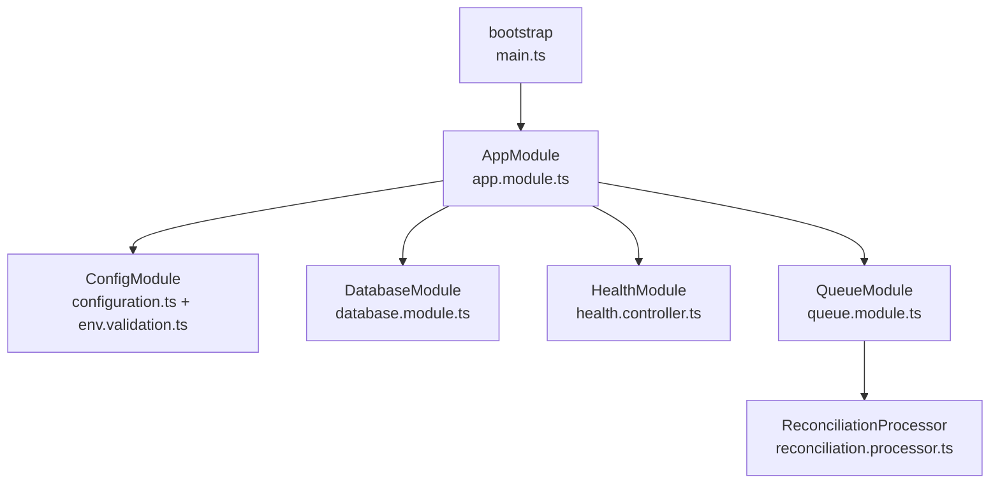
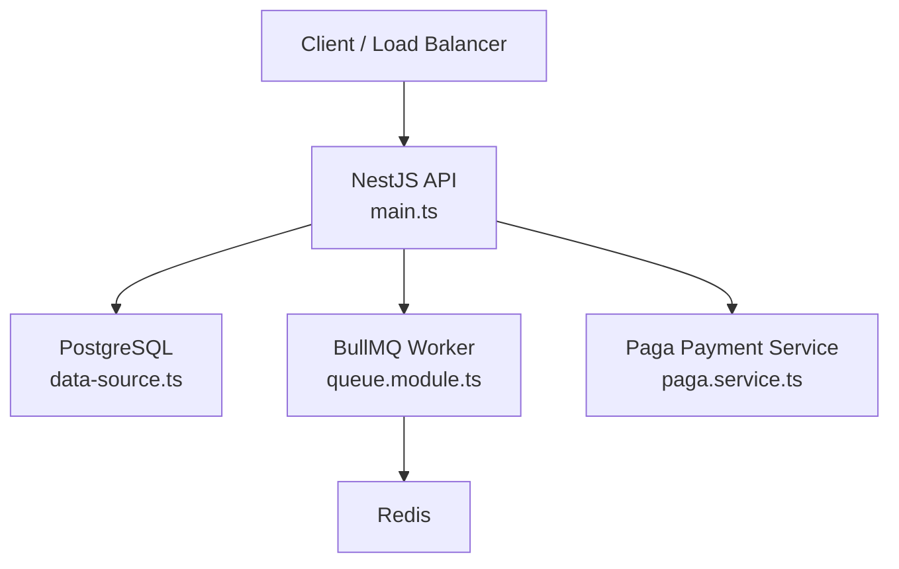
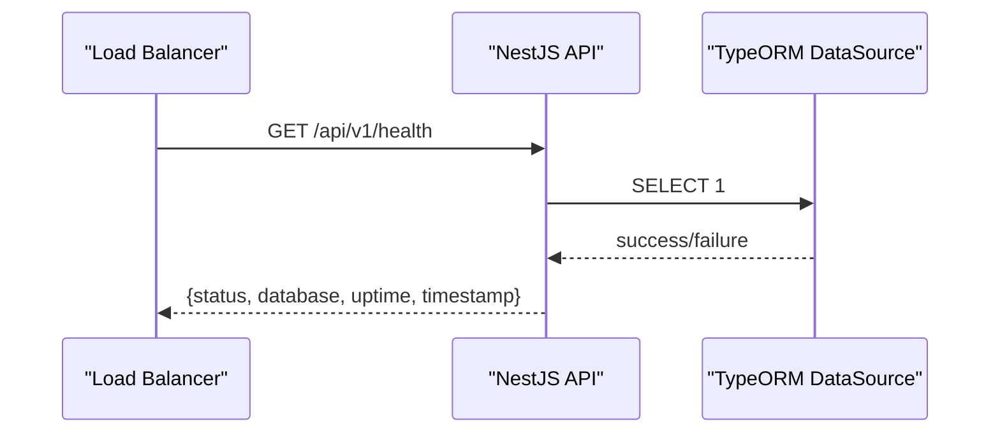
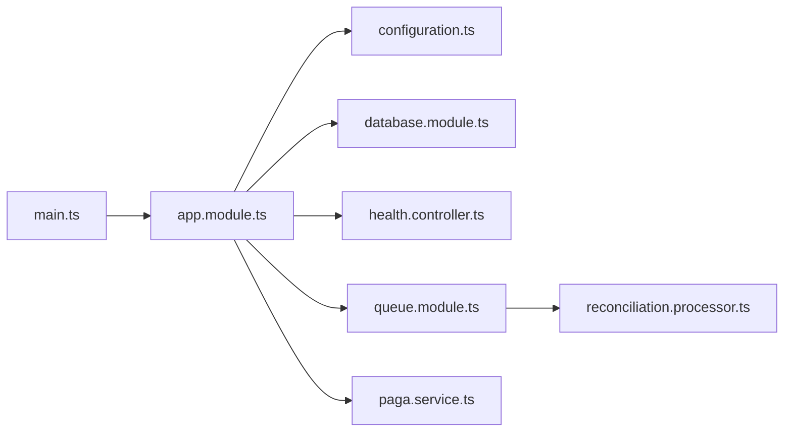

# Deployment Guide

<cite>
**Referenced Files in This Document**
- [main.ts](file://backend/src/main.ts)
- [app.module.ts](file://backend/src/app.module.ts)
- [configuration.ts](file://backend/src/config/configuration.ts)
- [env.validation.ts](file://backend/src/config/env.validation.ts)
- [data-source.ts](file://backend/src/database/data-source.ts)
- [database.config.ts](file://backend/src/database/database.config.ts)
- [database.module.ts](file://backend/src/database/database.module.ts)
- [health.controller.ts](file://backend/src/health/health.controller.ts)
- [queue.module.ts](file://backend/src/queue/queue.module.ts)
- [reconciliation.processor.ts](file://backend/src/queue/reconciliation.processor.ts)
- [paga.service.ts](file://backend/src/paga/paga.service.ts)
- [package.json](file://backend/package.json)
</cite>

## Table of Contents
1. [Introduction](#introduction)
2. [Project Structure](#project-structure)
3. [Core Components](#core-components)
4. [Architecture Overview](#architecture-overview)
5. [Detailed Component Analysis](#detailed-component-analysis)
6. [Dependency Analysis](#dependency-analysis)
7. [Performance Considerations](#performance-considerations)
8. [Troubleshooting Guide](#troubleshooting-guide)
9. [Conclusion](#conclusion)
10. [Appendices](#appendices)

## Introduction
This deployment guide provides production-ready instructions for deploying the Vireo Finance backend. It covers environment configuration (database, Redis, API secrets), containerization and orchestration concepts, CI/CD pipeline setup, monitoring and logging, scaling strategies, rollback and disaster recovery procedures, and troubleshooting guidance. The application is a NestJS service exposing REST APIs under a global prefix, with PostgreSQL as the primary data store, Redis-backed job queues via BullMQ, and integrations to third-party payment services.

## Project Structure
The backend is organized by feature modules under src/, with shared infrastructure in config, database, health, queue, and common directories. Key runtime entry points include the bootstrap file and the root module that wires configuration, database connectivity, and feature modules.

**Diagram sources**
- [main.ts:7-21](file://backend/src/main.ts#L7-L21)
- [app.module.ts:21-45](file://backend/src/app.module.ts#L21-L45)
- [configuration.ts:65-121](file://backend/src/config/configuration.ts#L65-L121)
- [env.validation.ts:1-11](file://backend/src/config/env.validation.ts#L1-L11)
- [database.module.ts:6-16](file://backend/src/database/database.module.ts#L6-L16)
- [health.controller.ts:5-25](file://backend/src/health/health.controller.ts#L5-L25)
- [queue.module.ts:8-31](file://backend/src/queue/queue.module.ts#L8-L31)
- [reconciliation.processor.ts:7-41](file://backend/src/queue/reconciliation.processor.ts#L7-L41)

**Section sources**
- [main.ts:7-21](file://backend/src/main.ts#L7-L21)
- [app.module.ts:21-45](file://backend/src/app.module.ts#L21-L45)

## Core Components
- Application bootstrap and HTTP server
  - Global API prefix, validation pipe, CORS enabled, port from configuration.
- Configuration and environment validation
  - Centralized configuration loader with typed AppConfig and required variables enforced in production.
- Database integration
  - TypeORM DataSource configured via module factory; migrations are managed separately.
- Health endpoint
  - Liveness/readiness probe supporting Kubernetes or external monitors.
- Background jobs
  - BullMQ worker initialized with Redis connection; periodic reconciliation job scheduled on startup.

**Section sources**
- [main.ts:7-21](file://backend/src/main.ts#L7-L21)
- [configuration.ts:1-121](file://backend/src/config/configuration.ts#L1-L121)
- [env.validation.ts:1-11](file://backend/src/config/env.validation.ts#L1-L11)
- [database.module.ts:6-16](file://backend/src/database/database.module.ts#L6-L16)
- [health.controller.ts:5-25](file://backend/src/health/health.controller.ts#L5-L25)
- [queue.module.ts:8-31](file://backend/src/queue/queue.module.ts#L8-L31)
- [reconciliation.processor.ts:7-41](file://backend/src/queue/reconciliation.processor.ts#L7-L41)

## Architecture Overview
The system exposes an HTTP API, persists state in PostgreSQL, uses Redis for job queues, and integrates with external payment services.

**Diagram sources**
- [main.ts:7-21](file://backend/src/main.ts#L7-L21)
- [data-source.ts:7-20](file://backend/src/database/data-source.ts#L7-L20)
- [queue.module.ts:8-31](file://backend/src/queue/queue.module.ts#L8-L31)
- [paga.service.ts:393-469](file://backend/src/paga/paga.service.ts#L393-L469)

## Detailed Component Analysis

### Environment Configuration
- Configuration model
  - Typed AppConfig defines all settings including database, JWT, OTP/challenge TTLs, Redis, Paga credentials, risk limits, and notification channels.
- Production validation
  - In production mode, missing required variables cause startup failure to prevent insecure deployments.
- Environment variables
  - All values are sourced from process.env with sensible defaults for development.

Recommended production variables:
- Database: DB_HOST, DB_PORT, DB_USER, DB_PASSWORD, DB_NAME, DB_SSL
- Redis: REDIS_HOST, REDIS_PORT
- JWT: JWT_SECRET, JWT_EXPIRES_IN
- App: NODE_ENV, PORT, APP_BASE_URL
- Paga: PAGA_BUSINESS_BASE_URL, PAGA_COLLECT_BASE_URL, PAGA_API_KEY, PAGA_API_SECRET, PAGA_HASH_KEY, PAGA_WEBHOOK_SECRET
- Risk: RISK_TIER0_DAILY_LIMIT, RISK_TIER1_DAILY_LIMIT, RISK_TIER2_DAILY_LIMIT, RISK_SINGLE_TRANSFER_LIMIT, RISK_NEW_PAYEE_LIMIT, RISK_VELOCITY_COUNT, RISK_VELOCITY_WINDOW_MINUTES
- Notifications: NOTIFICATIONS_SMS_ENABLED, NOTIFICATIONS_SMS_GATEWAY_URL, NOTIFICATIONS_SMS_API_KEY, NOTIFICATIONS_SMS_SENDER_ID, NOTIFICATIONS_PUSH_ENABLED

**Section sources**
- [configuration.ts:1-121](file://backend/src/config/configuration.ts#L1-L121)
- [env.validation.ts:1-11](file://backend/src/config/env.validation.ts#L1-L11)

### Database Setup and Migrations
- Data source configuration
  - TypeORM DataSource is created with Postgres driver, SSL toggle, entity/migration discovery paths, and migration table name.
- Module-based configuration
  - DatabaseModule uses a factory to build DataSourceOptions from ConfigService, enabling consistent configuration across the app.
- Migration management
  - Use provided npm scripts to run, generate, and revert migrations against the configured data source.

Operational notes:
- Ensure migrations run before serving traffic.
- Keep synchronize disabled in production.
- Enable SSL when connecting to managed databases.

**Section sources**
- [data-source.ts:1-20](file://backend/src/database/data-source.ts#L1-L20)
- [database.config.ts:1-22](file://backend/src/database/database.config.ts#L1-L22)
- [database.module.ts:1-16](file://backend/src/database/database.module.ts#L1-L16)
- [package.json:18-20](file://backend/package.json#L18-L20)

### Redis and Background Jobs
- BullMQ integration
  - QueueModule configures BullMQ using Redis host/port from configuration and registers the reconciliation queue.
- Reconciliation processor
  - On initialization, schedules a recurring job every 5 minutes with a stable jobId to avoid duplicates.
- Scaling workers
  - Run multiple instances of the worker process to increase throughput; use Redis clustering or a managed Redis service for reliability.

**Section sources**
- [queue.module.ts:8-31](file://backend/src/queue/queue.module.ts#L8-L31)
- [reconciliation.processor.ts:7-41](file://backend/src/queue/reconciliation.processor.ts#L7-L41)

### Third-Party Integrations (Paga)
- Base URLs and credentials
  - Business and collect endpoints, API key/secret, hash key, and webhook secret are read from configuration.
- Error handling
  - Network and non-OK responses are wrapped into domain-specific exceptions with contextual logs.
- Callback URL construction
  - Uses APP_BASE_URL to construct webhook callback path.

**Section sources**
- [configuration.ts:91-98](file://backend/src/config/configuration.ts#L91-L98)
- [paga.service.ts:393-469](file://backend/src/paga/paga.service.ts#L393-L469)

### Health Checks and Monitoring
- Health endpoint
  - GET /api/v1/health returns status, database connectivity, uptime, and timestamp.
- Readiness vs liveness
  - Use this endpoint for both probes; consider adding Redis checks for readiness if needed.

**Diagram sources**
- [health.controller.ts:5-25](file://backend/src/health/health.controller.ts#L5-L25)
- [main.ts:9-20](file://backend/src/main.ts#L9-L20)

**Section sources**
- [health.controller.ts:5-25](file://backend/src/health/health.controller.ts#L5-L25)

## Dependency Analysis
High-level runtime dependencies:
- NestJS framework and modules
- TypeORM and PostgreSQL driver
- BullMQ and ioredis for background jobs
- External payment provider SDK via HTTP calls

**Diagram sources**
- [main.ts:7-21](file://backend/src/main.ts#L7-L21)
- [app.module.ts:21-45](file://backend/src/app.module.ts#L21-L45)
- [configuration.ts:65-121](file://backend/src/config/configuration.ts#L65-L121)
- [database.module.ts:6-16](file://backend/src/database/database.module.ts#L6-L16)
- [health.controller.ts:5-25](file://backend/src/health/health.controller.ts#L5-L25)
- [queue.module.ts:8-31](file://backend/src/queue/queue.module.ts#L8-L31)
- [reconciliation.processor.ts:7-41](file://backend/src/queue/reconciliation.processor.ts#L7-L41)
- [paga.service.ts:393-469](file://backend/src/paga/paga.service.ts#L393-L469)

**Section sources**
- [app.module.ts:21-45](file://backend/src/app.module.ts#L21-L45)

## Performance Considerations
- Database
  - Use connection pooling tuned to workload; enable SSL for managed Postgres; ensure proper indexes on high-traffic tables; monitor slow queries.
- Redis
  - Use managed Redis with persistence and memory policies; tune maxmemory and eviction policy; monitor latency and throughput.
- Queues
  - Scale worker replicas horizontally; set concurrency per worker based on CPU/memory; use dedicated Redis for queues in production.
- API
  - Enable compression at the reverse proxy; cache static assets; keep payload sizes small; leverage pagination and field selection where applicable.
- Observability
  - Add structured logging and metrics collection; expose Prometheus-compatible metrics; integrate with alerting rules for error rates and latency.

[No sources needed since this section provides general guidance]

## Troubleshooting Guide
Common issues and resolutions:
- Missing required environment variables in production
  - Symptom: Startup fails with validation error indicating missing keys.
  - Resolution: Set JWT_SECRET, DB_HOST, DB_USER, DB_NAME and any other required variables.
- Database connectivity failures
  - Symptom: Health endpoint reports degraded status; errors during migrations.
  - Resolution: Verify DB_HOST, DB_PORT, DB_USER, DB_PASSWORD, DB_NAME, and DB_SSL; check network ACLs and firewall rules.
- Redis connection issues
  - Symptom: Queue initialization fails or jobs do not run.
  - Resolution: Confirm REDIS_HOST and REDIS_PORT; verify Redis availability and authentication if enabled.
- Paga integration errors
  - Symptom: Requests fail with gateway exceptions or webhook callbacks not received.
  - Resolution: Validate base URLs, API keys, and hash key; ensure APP_BASE_URL is correct and webhooks route is reachable.

**Section sources**
- [env.validation.ts:1-11](file://backend/src/config/env.validation.ts#L1-L11)
- [health.controller.ts:5-25](file://backend/src/health/health.controller.ts#L5-L25)
- [queue.module.ts:8-31](file://backend/src/queue/queue.module.ts#L8-L31)
- [paga.service.ts:393-469](file://backend/src/paga/paga.service.ts#L393-L469)

## Conclusion
By following this guide, you can deploy the Vireo Finance backend securely and reliably in production. Ensure all environment variables are correctly configured, run migrations before serving traffic, configure health probes, and scale components according to load. Implement robust CI/CD pipelines, observability, and backup strategies to maintain operational excellence.

[No sources needed since this section summarizes without analyzing specific files]

## Appendices

### Containerization Strategy
- Build stage
  - Install dependencies, compile TypeScript, and produce a minimal runtime image.
- Runtime stage
  - Run the compiled Node.js process with non-root user and read-only filesystem where possible.
- Entrypoint
  - Execute the production start script that runs the compiled main process.

Example commands (conceptual):
- Build: pnpm build
- Start: node dist/main.js

**Section sources**
- [package.json:7-11](file://backend/package.json#L7-L11)
- [main.ts:18-21](file://backend/src/main.ts#L18-L21)

### Orchestration with Kubernetes
- Deployments
  - One Deployment for the API service and one for the worker(s).
- Probes
  - Liveness and readiness probes pointing to GET /api/v1/health.
- Secrets and ConfigMaps
  - Store sensitive values (JWT_SECRET, DB credentials, Paga keys) in Kubernetes Secrets; mount as environment variables.
- Horizontal Pod Autoscaler
  - Scale based on CPU/memory or custom metrics like queue depth.
- Services and Ingress
  - Expose the API via a ClusterIP Service and Ingress controller with TLS termination.

[No sources needed since this section provides general guidance]

### CI/CD Pipeline Setup
- Stages
  - Lint and typecheck, unit tests, build artifacts, push images, deploy to staging, smoke tests, promote to production.
- Security
  - Scan dependencies and container images; enforce branch protection and signed commits.
- Rollout strategy
  - Blue/green or rolling updates with automated rollback on failed health checks.

[No sources needed since this section provides general guidance]

### Backup and Disaster Recovery
- Database backups
  - Schedule regular logical backups (e.g., pg_dump) and binary snapshots; retain according to compliance requirements.
- Restore procedure
  - Validate backups periodically; test restore in isolated environments; document RTO/RPO targets.
- Data consistency
  - Ensure migrations are applied consistently across environments; version control schema changes.

[No sources needed since this section provides general guidance]

### Rollback Procedures
- Application rollback
  - Re-deploy previous image tag; verify health endpoints and critical flows.
- Database rollback
  - If necessary, run targeted migration reversals; coordinate with QA to validate data integrity.
- Feature flags
  - Use feature toggles to disable risky features without full rollback.

[No sources needed since this section provides general guidance]