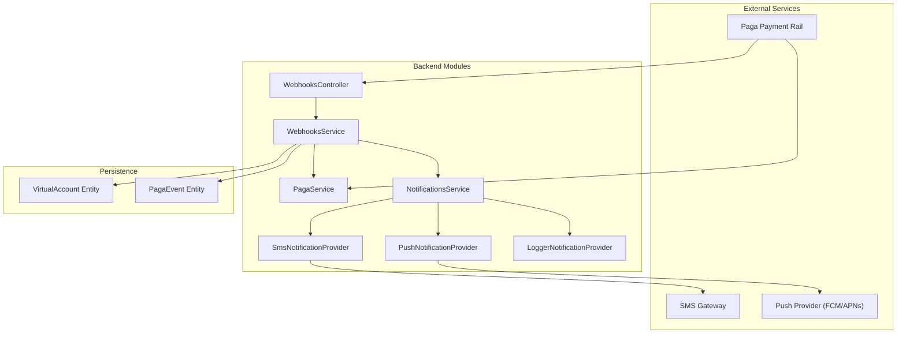
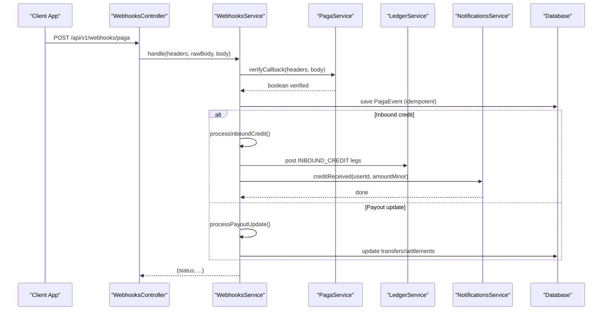
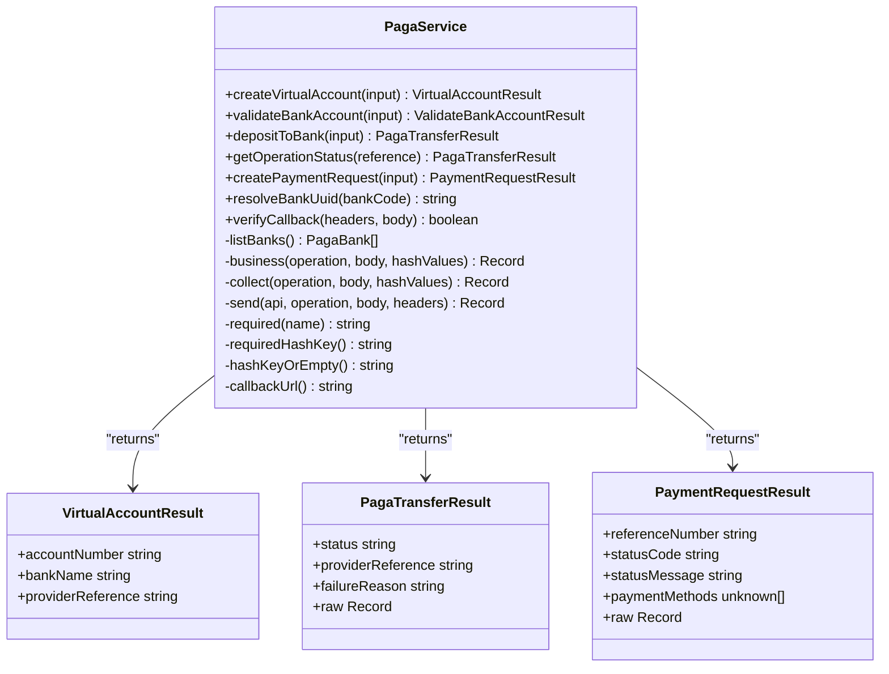
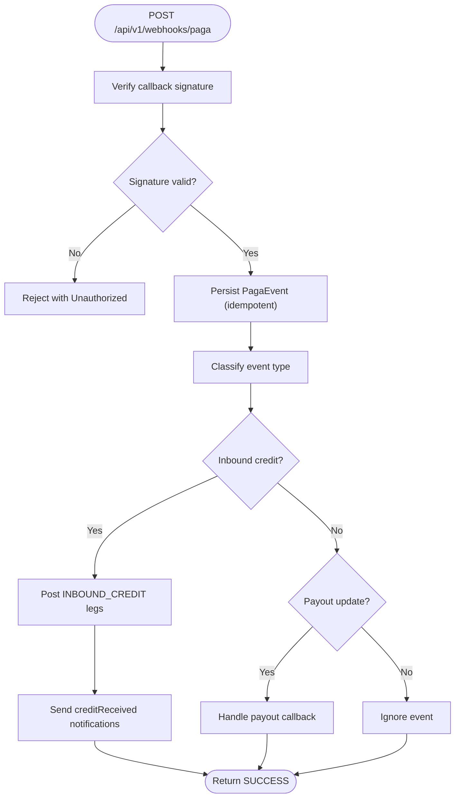
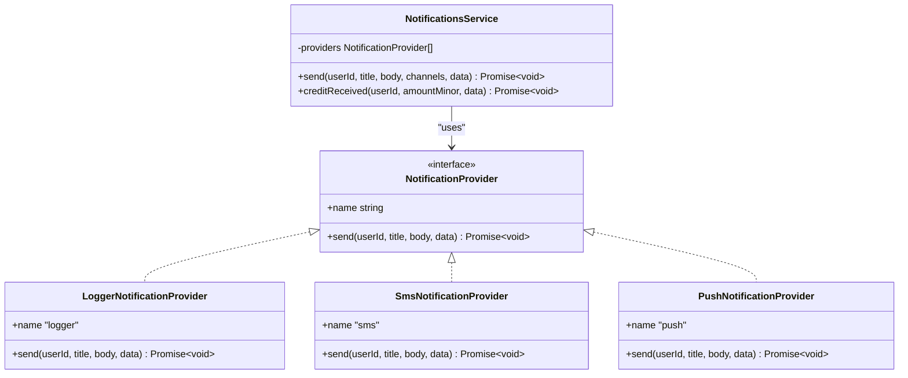
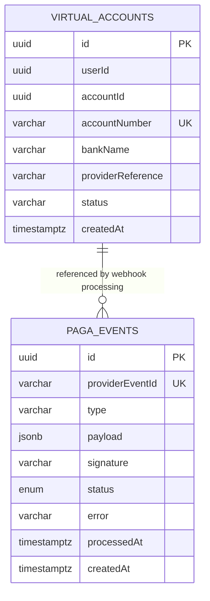
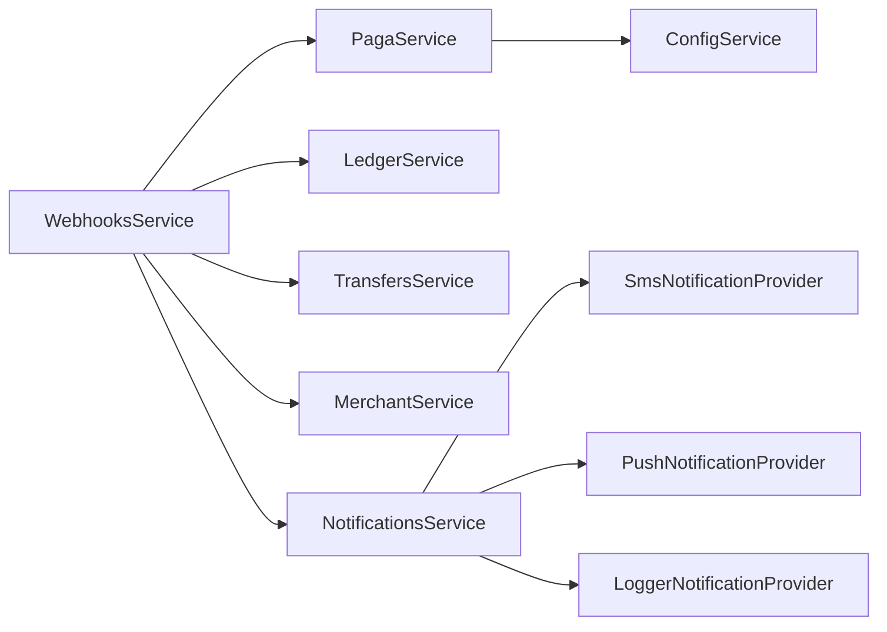

# External Integrations

<cite>
**Referenced Files in This Document**
- [paga.service.ts](file://backend/src/paga/paga.service.ts)
- [paga.types.ts](file://backend/src/paga/paga.types.ts)
- [webhooks.controller.ts](file://backend/src/webhooks/webhooks.controller.ts)
- [webhooks.service.ts](file://backend/src/webhooks/webhooks.service.ts)
- [paga-event.entity.ts](file://backend/src/webhooks/paga-event.entity.ts)
- [virtual-account.entity.ts](file://backend/src/accounts/virtual-account.entity.ts)
- [notifications.service.ts](file://backend/src/notifications/notifications.service.ts)
- [notification-provider.interface.ts](file://backend/src/notifications/notification-provider.interface.ts)
- [sms.provider.ts](file://backend/src/notifications/providers/sms.provider.ts)
- [push.provider.ts](file://backend/src/notifications/providers/push.provider.ts)
- [logger.provider.ts](file://backend/src/notifications/providers/logger.provider.ts)
- [configuration.ts](file://backend/src/config/configuration.ts)
</cite>

## Table of Contents
1. [Introduction](#introduction)
2. [Project Structure](#project-structure)
3. [Core Components](#core-components)
4. [Architecture Overview](#architecture-overview)
5. [Detailed Component Analysis](#detailed-component-analysis)
6. [Dependency Analysis](#dependency-analysis)
7. [Performance Considerations](#performance-considerations)
8. [Troubleshooting Guide](#troubleshooting-guide)
9. [Conclusion](#conclusion)

## Introduction
This document explains the external service integrations in Vireo Finance, focusing on:
- Paga payment rail integration for deposits, withdrawals, virtual account management, and webhook handling
- Notification system architecture supporting SMS, push notifications, and in-app channels with an extensible provider interface
- Webhook processing for payment confirmations, status updates, and asynchronous event handling
- Error handling, retry strategies, monitoring approaches, configuration options, API versioning considerations, and fallback behavior when external services are unavailable

The goal is to provide both a high-level architectural view and detailed implementation guidance for developers integrating or maintaining these external dependencies.

## Project Structure
The relevant backend modules for external integrations are organized as follows:
- `backend/src/paga`: Paga payment rail client and types
- `backend/src/webhooks`: Webhook controller and service for Paga callbacks
- `backend/src/notifications`: Notification orchestration and provider implementations
- `backend/src/config`: Configuration schema and environment mapping
- `backend/src/accounts` and `backend/src/webhooks` entities used by webhook processing

**Diagram sources**
- [paga.service.ts:33-470](file://backend/src/paga/paga.service.ts#L33-L470)
- [webhooks.controller.ts:5-19](file://backend/src/webhooks/webhooks.controller.ts#L5-L19)
- [webhooks.service.ts:16-151](file://backend/src/webhooks/webhooks.service.ts#L16-L151)
- [notifications.service.ts:7-77](file://backend/src/notifications/notifications.service.ts#L7-L77)
- [sms.provider.ts:6-57](file://backend/src/notifications/providers/sms.provider.ts#L6-L57)
- [push.provider.ts:6-54](file://backend/src/notifications/providers/push.provider.ts#L6-L54)
- [logger.provider.ts:4-19](file://backend/src/notifications/providers/logger.provider.ts#L4-L19)
- [virtual-account.entity.ts:3-30](file://backend/src/accounts/virtual-account.entity.ts#L3-L30)
- [paga-event.entity.ts:4-33](file://backend/src/webhooks/paga-event.entity.ts#L4-L33)

**Section sources**
- [paga.service.ts:33-470](file://backend/src/paga/paga.service.ts#L33-L470)
- [webhooks.controller.ts:5-19](file://backend/src/webhooks/webhooks.controller.ts#L5-L19)
- [webhooks.service.ts:16-151](file://backend/src/webhooks/webhooks.service.ts#L16-L151)
- [notifications.service.ts:7-77](file://backend/src/notifications/notifications.service.ts#L7-L77)
- [configuration.ts:27-52](file://backend/src/config/configuration.ts#L27-L52)

## Core Components
- PagaService: Encapsulates all outbound calls to Paga’s business and collect APIs, including authentication, hashing, error normalization, bank resolution, and callback URL generation.
- WebhooksController/WebhooksService: Receives Paga webhooks, verifies signatures, persists events idempotently, routes inbound credits and payout updates, posts ledger entries, and triggers notifications.
- NotificationsService: Orchestrates multi-channel notifications through pluggable providers (SMS, push, logger/in-app).
- Providers: Concrete implementations for each channel; SMS and push integrate with external gateways, logger provides local tracing.
- Configuration: Centralized schema mapping environment variables for Paga endpoints, credentials, hash keys, and notification toggles.

Key responsibilities:
- PagaService: API calls, signature computation, error mapping, bank cache, callback URL construction.
- WebhooksService: Signature verification, event persistence, routing logic, ledger posting, notification dispatch.
- NotificationsService: Channel selection, parallel delivery, failure logging.
- Providers: Channel-specific sending logic and configuration checks.

**Section sources**
- [paga.service.ts:33-470](file://backend/src/paga/paga.service.ts#L33-L470)
- [webhooks.service.ts:16-151](file://backend/src/webhooks/webhooks.service.ts#L16-L151)
- [notifications.service.ts:7-77](file://backend/src/notifications/notifications.service.ts#L7-L77)
- [sms.provider.ts:6-57](file://backend/src/notifications/providers/sms.provider.ts#L6-L57)
- [push.provider.ts:6-54](file://backend/src/notifications/providers/push.provider.ts#L6-L54)
- [logger.provider.ts:4-19](file://backend/src/notifications/providers/logger.provider.ts#L4-L19)
- [configuration.ts:27-52](file://backend/src/config/configuration.ts#L27-L52)

## Architecture Overview
The integration architecture centers around three flows:
1. Outbound payments and virtual account creation via PagaService
2. Inbound webhook processing via WebhooksController/WebhooksService
3. Multi-channel notifications via NotificationsService and its providers

**Diagram sources**
- [webhooks.controller.ts:9-18](file://backend/src/webhooks/webhooks.controller.ts#L9-L18)
- [webhooks.service.ts:30-151](file://backend/src/webhooks/webhooks.service.ts#L30-L151)
- [paga.service.ts:240-315](file://backend/src/paga/paga.service.ts#L240-L315)

## Detailed Component Analysis

### Paga Payment Rail Integration
PagaService implements:
- Virtual account creation via collect API
- Bank account validation and deposit initiation via business API
- Payment request creation via collect API
- Operation status polling
- Bank code resolution with caching
- Callback URL generation using appBaseUrl
- Signature verification for incoming webhooks

**Diagram sources**
- [paga.service.ts:40-210](file://backend/src/paga/paga.service.ts#L40-L210)
- [paga.types.ts:1-71](file://backend/src/paga/paga.types.ts#L1-L71)

Key behaviors:
- Authentication: Basic auth for collect; principal/credentials headers for business
- Hashing: SHA-512 over concatenated values plus shared key; supports header-based and body-based hashes
- Error handling: Network errors mapped to BadGatewayException; non-zero response codes mapped to PagaApiError and then normalized
- Bank resolution: Accepts UUID or resolves via banks list with 24-hour cache
- Callback URL: Built from appBaseUrl and fixed path `/api/v1/webhooks/paga`

Configuration requirements:
- `PAGA_BUSINESS_BASE_URL`, `PAGA_COLLECT_BASE_URL`
- `PAGA_API_KEY`, `PAGA_API_SECRET`
- `PAGA_HASH_KEY` or `PAGA_WEBHOOK_SECRET`
- `APP_BASE_URL`

API versioning:
- The current webhook endpoint is `/api/v1/webhooks/paga`. If Paga changes their API surface, maintain backward compatibility by versioning controllers and routing accordingly.

Fallback strategies:
- For network failures, PagaService throws BadGatewayException; callers should implement retries at the caller layer (e.g., transfers or merchant settlement flows)
- For non-zero response codes, operations return or throw normalized errors; callers can treat them as failed states and optionally poll later

Monitoring:
- Errors are logged with context (operation, status, message)
- Event payload and signature are persisted for auditability

**Section sources**
- [paga.service.ts:33-470](file://backend/src/paga/paga.service.ts#L33-L470)
- [paga.types.ts:1-71](file://backend/src/paga/paga.types.ts#L1-L71)
- [configuration.ts:91-98](file://backend/src/config/configuration.ts#L91-L98)

### Webhook Processing and Asynchronous Events
WebhooksController exposes `/api/v1/webhooks/paga` and delegates to WebhooksService.handle.

Processing flow:
1. Verify callback signature using PagaService.verifyCallback
2. Extract provider event ID and type
3. Persist event idempotently (unique constraint on providerEventId)
4. Route to inbound credit or payout update handlers
5. Post ledger entries for inbound credits
6. Notify users via NotificationsService
7. Update transfer/settlement state for payout updates

**Diagram sources**
- [webhooks.controller.ts:9-18](file://backend/src/webhooks/webhooks.controller.ts#L9-L18)
- [webhooks.service.ts:30-151](file://backend/src/webhooks/webhooks.service.ts#L30-L151)

Idempotency and reliability:
- Unique index on `providerEventId` prevents duplicate processing
- Event status transitions: RECEIVED -> PROCESSED or IGNORED; FAILED on exceptions
- Error messages truncated and stored for inspection

Asynchronous handling:
- Current implementation processes synchronously within the HTTP request. For high throughput, consider offloading heavy work (ledger posting, notifications) to background jobs while still acknowledging receipt quickly.

Retry mechanisms:
- Database unique violation is handled gracefully; duplicates are ignored
- For transient failures during processing, wrap processing in a retry policy at the caller level or introduce a queue processor with exponential backoff

Monitoring:
- Event payload, signature, and error fields are persisted for debugging
- Logs capture failures and outcomes

**Section sources**
- [webhooks.controller.ts:9-18](file://backend/src/webhooks/webhooks.controller.ts#L9-L18)
- [webhooks.service.ts:30-151](file://backend/src/webhooks/webhooks.service.ts#L30-L151)
- [paga-event.entity.ts:4-33](file://backend/src/webhooks/paga-event.entity.ts#L4-L33)

### Notification System Architecture
NotificationsService coordinates multiple providers:
- LoggerNotificationProvider: Always enabled, logs notifications for development/debugging
- SmsNotificationProvider: Conditional on config; requires phone number in data
- PushNotificationProvider: Conditional on config; requires device token in data

**Diagram sources**
- [notification-provider.interface.ts:1-10](file://backend/src/notifications/notification-provider.interface.ts#L1-L10)
- [notifications.service.ts:7-77](file://backend/src/notifications/notifications.service.ts#L7-L77)
- [logger.provider.ts:4-19](file://backend/src/notifications/providers/logger.provider.ts#L4-L19)
- [sms.provider.ts:6-57](file://backend/src/notifications/providers/sms.provider.ts#L6-L57)
- [push.provider.ts:6-54](file://backend/src/notifications/providers/push.provider.ts#L6-L54)

Delivery semantics:
- Parallel delivery via Promise.allSettled ensures one failing provider does not block others
- Failed deliveries are logged but do not fail the overall send operation
- Channels can be enabled/disabled per call; default includes in-app

Extensibility:
- Implement NotificationProvider interface to add new channels (e.g., email)
- Register provider in module and include in constructor wiring

Configuration:
- `NOTIFICATIONS_SMS_ENABLED`, `NOTIFICATIONS_SMS_GATEWAY_URL`, `NOTIFICATIONS_SMS_API_KEY`, `NOTIFICATIONS_SMS_SENDER_ID`
- `NOTIFICATIONS_PUSH_ENABLED`

**Section sources**
- [notifications.service.ts:7-77](file://backend/src/notifications/notifications.service.ts#L7-L77)
- [notification-provider.interface.ts:1-10](file://backend/src/notifications/notification-provider.interface.ts#L1-L10)
- [sms.provider.ts:6-57](file://backend/src/notifications/providers/sms.provider.ts#L6-L57)
- [push.provider.ts:6-54](file://backend/src/notifications/providers/push.provider.ts#L6-L54)
- [logger.provider.ts:4-19](file://backend/src/notifications/providers/logger.provider.ts#L4-L19)
- [configuration.ts:110-120](file://backend/src/config/configuration.ts#L110-L120)

### Data Models and Relationships

**Diagram sources**
- [virtual-account.entity.ts:3-30](file://backend/src/accounts/virtual-account.entity.ts#L3-L30)
- [paga-event.entity.ts:4-33](file://backend/src/webhooks/paga-event.entity.ts#L4-L33)

**Section sources**
- [virtual-account.entity.ts:3-30](file://backend/src/accounts/virtual-account.entity.ts#L3-L30)
- [paga-event.entity.ts:4-33](file://backend/src/webhooks/paga-event.entity.ts#L4-L33)

## Dependency Analysis
External dependencies and internal coupling:
- PagaService depends on ConfigService and crypto utilities; it encapsulates HTTP calls to Paga
- WebhooksService depends on PagaService, LedgerService, TransfersService, MerchantService, NotificationsService, and repositories
- NotificationsService depends on provider implementations and ConfigService
- Providers depend on ConfigService and external gateways (SMS/Push)

**Diagram sources**
- [paga.service.ts:33-470](file://backend/src/paga/paga.service.ts#L33-L470)
- [webhooks.service.ts:16-151](file://backend/src/webhooks/webhooks.service.ts#L16-L151)
- [notifications.service.ts:7-77](file://backend/src/notifications/notifications.service.ts#L7-L77)

Coupling and cohesion:
- High cohesion within PagaService for payment rail concerns
- WebhooksService orchestrates cross-cutting concerns (ledger, transfers, merchants, notifications)
- NotificationsService isolates channel-specific logic behind a stable interface

Potential circular dependencies:
- None observed among analyzed modules; ensure future additions avoid cycles by keeping services thin and relying on interfaces where possible

External integration points:
- Paga REST APIs (business and collect)
- SMS gateway (placeholder)
- Push provider (FCM/APNs placeholder)

**Section sources**
- [paga.service.ts:33-470](file://backend/src/paga/paga.service.ts#L33-L470)
- [webhooks.service.ts:16-151](file://backend/src/webhooks/webhooks.service.ts#L16-L151)
- [notifications.service.ts:7-77](file://backend/src/notifications/notifications.service.ts#L7-L77)

## Performance Considerations
- Bank list caching: PagaService caches bank metadata for 24 hours to reduce external calls
- Parallel notification delivery: NotificationsService uses Promise.allSettled to deliver across channels concurrently
- Minimal JSON parsing overhead: PagaService parses responses and normalizes errors efficiently
- Idempotent event processing: Database unique constraints prevent duplicate work

Optimization opportunities:
- Introduce background job queues for webhook processing to decouple acknowledgment from heavy work
- Add circuit breaker patterns for external calls to Paga and notification providers
- Cache frequently accessed reference data (e.g., bank codes) with TTL and invalidation strategy

[No sources needed since this section provides general guidance]

## Troubleshooting Guide
Common issues and diagnostics:
- Invalid webhook signature: Ensure `PAGA_HASH_KEY` or `PAGA_WEBHOOK_SECRET` is configured and matches Paga’s expectation; check header vs body hash variants
- Missing base URLs: Verify `PAGA_BUSINESS_BASE_URL`, `PAGA_COLLECT_BASE_URL`, and `APP_BASE_URL`; missing values cause BadGatewayException
- Unsupported bank code: Confirm bank code exists in Paga’s bank list or pass UUID directly; check logs for “Unsupported bank code”
- SMS disabled or missing phone: Ensure `NOTIFICATIONS_SMS_ENABLED=true` and include phone in notification data
- Push disabled or missing token: Ensure `NOTIFICATIONS_PUSH_ENABLED=true` and include pushToken in notification data
- Duplicate webhook events: Expected due to provider retries; unique constraint on `providerEventId` ensures idempotency
- Ledger posting failures: Inspect event.error field and transaction logs; use idempotency keys to avoid double postings

Debugging techniques:
- Enable verbose logging in providers and PagaService to trace outbound requests and responses
- Inspect persisted PagaEvent payloads and signatures for correctness
- Use health check endpoints to validate service readiness and dependency connectivity
- Simulate webhook payloads locally with known hashes to validate signature verification logic

**Section sources**
- [paga.service.ts:393-438](file://backend/src/paga/paga.service.ts#L393-L438)
- [webhooks.service.ts:30-70](file://backend/src/webhooks/webhooks.service.ts#L30-L70)
- [sms.provider.ts:31-55](file://backend/src/notifications/providers/sms.provider.ts#L31-L55)
- [push.provider.ts:25-51](file://backend/src/notifications/providers/push.provider.ts#L25-L51)
- [paga-event.entity.ts:9-29](file://backend/src/webhooks/paga-event.entity.ts#L9-L29)

## Conclusion
Vireo Finance’s external integrations are structured around clear boundaries:
- PagaService abstracts payment rail interactions with robust error handling and signature verification
- WebhooksService provides secure, idempotent processing of payment events and integrates with ledger, transfers, and notifications
- NotificationsService offers a flexible, extensible multi-channel notification system

For production hardening:
- Add retry policies and circuit breakers for external dependencies
- Offload heavy webhook processing to background jobs
- Enhance monitoring with metrics and alerts for failed external calls and webhook processing
- Maintain API versioning discipline for webhook endpoints and external API contracts

[No sources needed since this section summarizes without analyzing specific files]