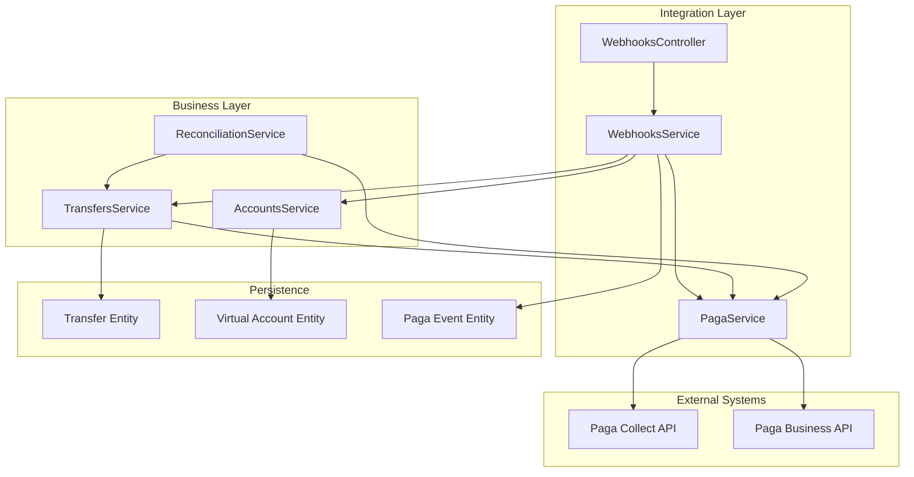
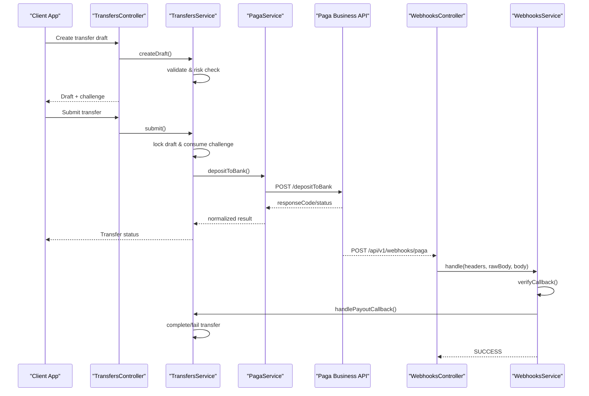
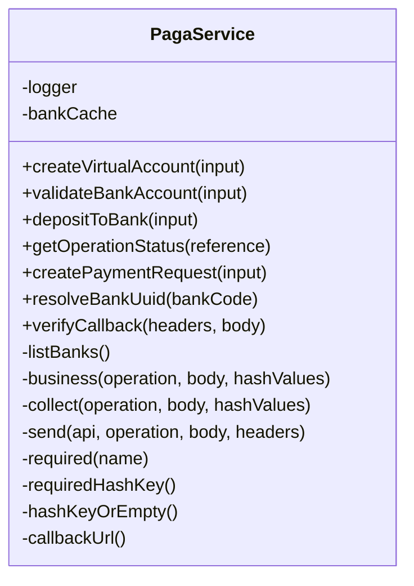
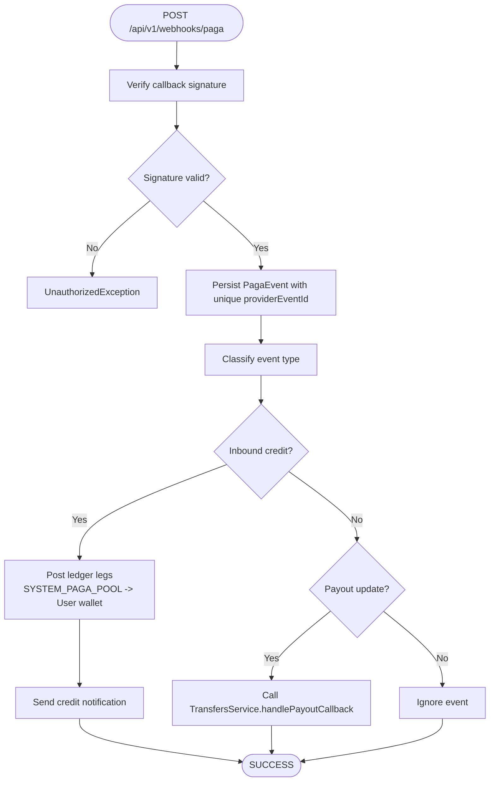
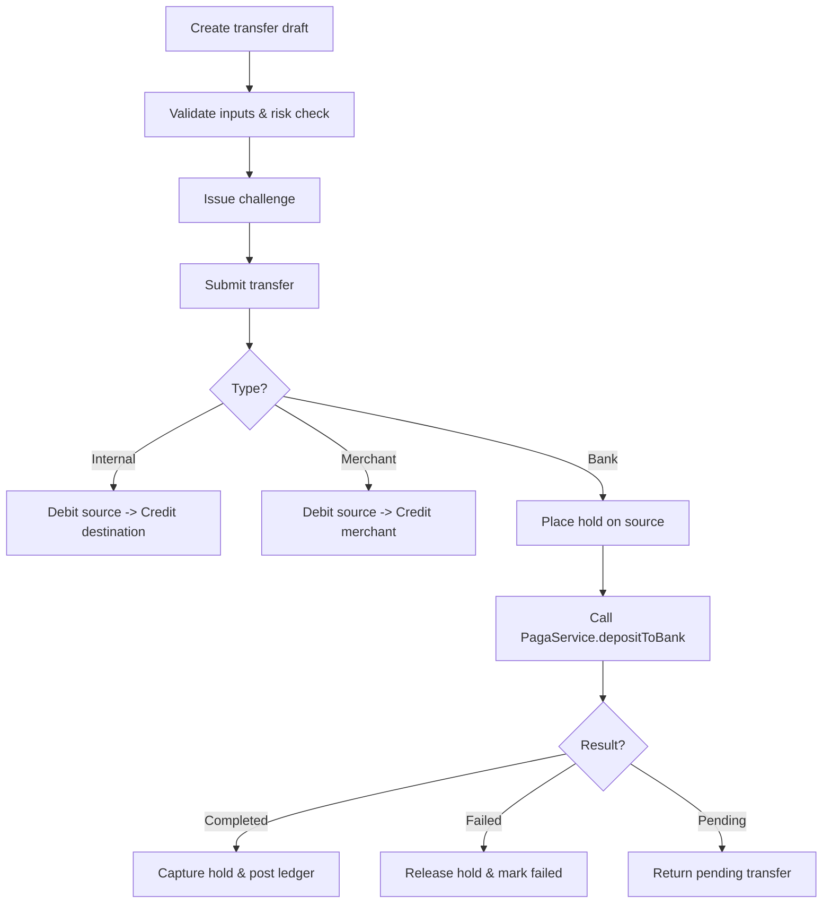
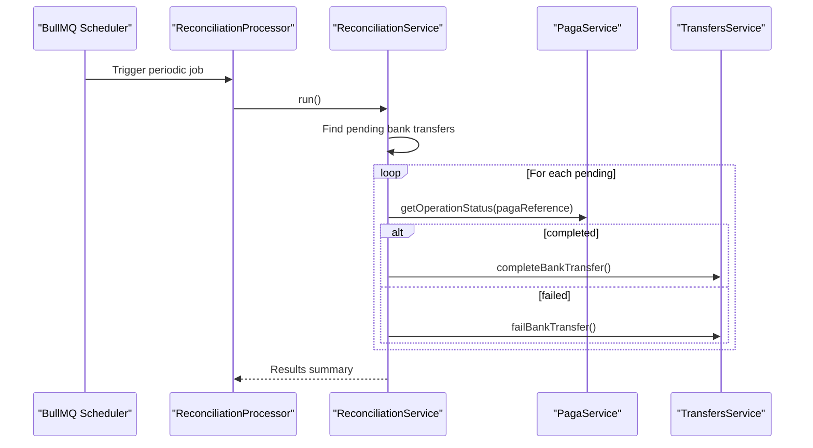
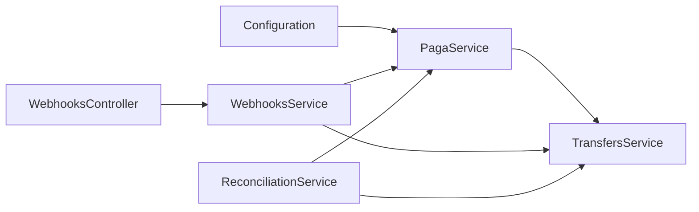

# Paga Payment Integration

<cite>
**Referenced Files in This Document**
- [paga.service.ts](file://backend/src/paga/paga.service.ts)
- [paga.types.ts](file://backend/src/paga/paga.types.ts)
- [paga.module.ts](file://backend/src/paga/paga.module.ts)
- [webhooks.controller.ts](file://backend/src/webhooks/webhooks.controller.ts)
- [webhooks.service.ts](file://backend/src/webhooks/webhooks.service.ts)
- [transfers.service.ts](file://backend/src/transfers/transfers.service.ts)
- [accounts.service.ts](file://backend/src/accounts/accounts.service.ts)
- [configuration.ts](file://backend/src/config/configuration.ts)
- [paga-event.entity.ts](file://backend/src/webhooks/paga-event.entity.ts)
- [transfer.entity.ts](file://backend/src/transfers/transfer.entity.ts)
- [virtual-account.entity.ts](file://backend/src/accounts/virtual-account.entity.ts)
- [enums.ts](file://backend/src/common/enums.ts)
- [constants.ts](file://backend/src/common/constants.ts)
- [reconciliation.service.ts](file://backend/src/reconciliation/reconciliation.service.ts)
- [reconciliation.processor.ts](file://backend/src/queue/reconciliation.processor.ts)
</cite>

## Table of Contents
1. [Introduction](#introduction)
2. [Project Structure](#project-structure)
3. [Core Components](#core-components)
4. [Architecture Overview](#architecture-overview)
5. [Detailed Component Analysis](#detailed-component-analysis)
6. [Dependency Analysis](#dependency-analysis)
7. [Performance Considerations](#performance-considerations)
8. [Troubleshooting Guide](#troubleshooting-guide)
9. [Conclusion](#conclusion)
10. [Appendices](#appendices)

## Introduction
This document explains the Paga payment rail integration used by the application to process deposits, withdrawals, virtual account management, and balance-related operations. It covers API endpoints exposed internally, authentication with Paga’s APIs, request/response formats, error handling, transaction lifecycle, webhook processing, retry and reconciliation mechanisms, configuration options, rate limiting considerations, monitoring approaches, and troubleshooting guidance.

## Project Structure
The Paga integration is implemented as a NestJS module that exposes service methods for external integrations and internal business flows. Webhooks are handled through a dedicated controller and service. Transfers orchestrate bank payouts via Paga and reconcile outcomes. Configuration is centralized and environment-driven.

**Diagram sources**
- [paga.service.ts:33-470](file://backend/src/paga/paga.service.ts#L33-L470)
- [webhooks.controller.ts:5-19](file://backend/src/webhooks/webhooks.controller.ts#L5-L19)
- [webhooks.service.ts:16-150](file://backend/src/webhooks/webhooks.service.ts#L16-L150)
- [transfers.service.ts:40-652](file://backend/src/transfers/transfers.service.ts#L40-L652)
- [accounts.service.ts:9-103](file://backend/src/accounts/accounts.service.ts#L9-L103)
- [reconciliation.service.ts:10-49](file://backend/src/reconciliation/reconciliation.service.ts#L10-L49)
- [paga-event.entity.ts:4-33](file://backend/src/webhooks/paga-event.entity.ts#L4-L33)
- [transfer.entity.ts:11-75](file://backend/src/transfers/transfer.entity.ts#L11-L75)
- [virtual-account.entity.ts:3-30](file://backend/src/accounts/virtual-account.entity.ts#L3-L30)

**Section sources**
- [paga.module.ts:1-9](file://backend/src/paga/paga.module.ts#L1-L9)
- [configuration.ts:27-34](file://backend/src/config/configuration.ts#L27-L34)

## Core Components
- PagaService: Encapsulates all calls to Paga’s collect and business APIs, including authentication, hashing, error mapping, bank resolution, and callback verification.
- WebhooksController/WebhooksService: Receives Paga callbacks, verifies signatures, persists events, and routes them to appropriate handlers (inbound credits and payout updates).
- TransfersService: Orchestrates transfer creation, validation, holds, and Paga payouts; handles completion/failure transitions and integrates with ledger and risk checks.
- AccountsService: Manages user wallets, merchant accounts, and virtual account records.
- ReconciliationService/Processor: Periodically polls Paga for pending transfers and reconciles status changes.

Key responsibilities:
- Authentication: Basic auth for collect, principal/credentials/hash headers for business.
- Request signing: SHA-512 hash over concatenated values plus shared key.
- Callback verification: Supports header-based or body-based hashes.
- Idempotency: Enforced at transfer draft creation and event processing.
- Status normalization: Maps provider statuses to internal states.

**Section sources**
- [paga.service.ts:23-470](file://backend/src/paga/paga.service.ts#L23-L470)
- [webhooks.controller.ts:5-19](file://backend/src/webhooks/webhooks.controller.ts#L5-L19)
- [webhooks.service.ts:16-150](file://backend/src/webhooks/webhooks.service.ts#L16-L150)
- [transfers.service.ts:40-652](file://backend/src/transfers/transfers.service.ts#L40-L652)
- [accounts.service.ts:9-103](file://backend/src/accounts/accounts.service.ts#L9-L103)
- [reconciliation.service.ts:10-49](file://backend/src/reconciliation/reconciliation.service.ts#L10-L49)

## Architecture Overview
The integration follows a layered architecture:
- Controller layer: Webhook endpoint receives Paga notifications.
- Service layer: Validates, processes, and coordinates business logic.
- External API layer: PagaService abstracts HTTP calls and authentication.
- Persistence layer: Entities store transfers, virtual accounts, and webhook events.
- Background jobs: Reconciliation processor runs periodic checks against Paga.

**Diagram sources**
- [transfers.service.ts:54-363](file://backend/src/transfers/transfers.service.ts#L54-L363)
- [paga.service.ts:110-173](file://backend/src/paga/paga.service.ts#L110-L173)
- [webhooks.controller.ts:9-18](file://backend/src/webhooks/webhooks.controller.ts#L9-L18)
- [webhooks.service.ts:30-150](file://backend/src/webhooks/webhooks.service.ts#L30-L150)

## Detailed Component Analysis

### PagaService
Responsibilities:
- Virtual account creation via collect API.
- Bank account validation and bank UUID resolution.
- Deposit to bank via business API.
- Operation status polling.
- Payment request creation.
- Callback signature verification.
- Base URL construction and credential management.

Authentication and signing:
- Collect API uses Basic authorization built from apiKey:apiSecret.
- Business API uses principal, credentials, and a SHA-512 hash header computed from operation-specific values and a shared hash key.
- Hash key is read from configured hashKey or webhookSecret.

Error handling:
- Network errors map to BadGatewayException.
- Non-zero response codes throw PagaApiError, which is caught and mapped to domain failures where appropriate.

Status normalization:
- Internal statuses are 'pending', 'completed', 'failed'.
- Provider statuses are mapped using common success/failure sets.

**Diagram sources**
- [paga.service.ts:33-470](file://backend/src/paga/paga.service.ts#L33-L470)

**Section sources**
- [paga.service.ts:40-210](file://backend/src/paga/paga.service.ts#L40-L210)
- [paga.service.ts:212-344](file://backend/src/paga/paga.service.ts#L212-L344)
- [paga.service.ts:346-470](file://backend/src/paga/paga.service.ts#L346-L470)
- [paga.types.ts:1-71](file://backend/src/paga/paga.types.ts#L1-L71)

### WebhooksController and WebhooksService
Responsibilities:
- Receive Paga webhooks at /api/v1/webhooks/paga.
- Verify callback signatures using PagaService.verifyCallback.
- Persist events with unique providerEventId to ensure idempotency.
- Route inbound credits to ledger posting and notifications.
- Route payout updates to TransfersService and MerchantService.

**Diagram sources**
- [webhooks.controller.ts:9-18](file://backend/src/webhooks/webhooks.controller.ts#L9-L18)
- [webhooks.service.ts:30-150](file://backend/src/webhooks/webhooks.service.ts#L30-L150)
- [paga.service.ts:240-315](file://backend/src/paga/paga.service.ts#L240-L315)
- [constants.ts:3-4](file://backend/src/common/constants.ts#L3-L4)

**Section sources**
- [webhooks.controller.ts:5-19](file://backend/src/webhooks/webhooks.controller.ts#L5-L19)
- [webhooks.service.ts:16-150](file://backend/src/webhooks/webhooks.service.ts#L16-L150)
- [paga-event.entity.ts:4-33](file://backend/src/webhooks/paga-event.entity.ts#L4-L33)

### TransfersService
Responsibilities:
- Create transfer drafts with idempotency keys and challenges.
- Validate recipients and amounts; perform risk checks.
- Execute internal and merchant transfers synchronously.
- Execute bank transfers by placing holds and calling Paga depositToBank.
- Handle payout callbacks to complete or fail transfers.
- Manage hold capture/release and ledger postings.

**Diagram sources**
- [transfers.service.ts:54-363](file://backend/src/transfers/transfers.service.ts#L54-L363)
- [transfer.entity.ts:11-75](file://backend/src/transfers/transfer.entity.ts#L11-L75)

**Section sources**
- [transfers.service.ts:54-363](file://backend/src/transfers/transfers.service.ts#L54-L363)
- [transfers.service.ts:382-487](file://backend/src/transfers/transfers.service.ts#L382-L487)
- [transfers.dto.ts:6-54](file://backend/src/transfers/dto/transfers.dto.ts#L6-L54)

### AccountsService
Responsibilities:
- Create and retrieve user wallets and merchant balance accounts.
- Create and manage virtual accounts linked to users and underlying accounts.

**Section sources**
- [accounts.service.ts:9-103](file://backend/src/accounts/accounts.service.ts#L9-L103)
- [virtual-account.entity.ts:3-30](file://backend/src/accounts/virtual-account.entity.ts#L3-L30)

### ReconciliationService and Processor
Responsibilities:
- Poll Paga for pending bank transfers and update internal status accordingly.
- Count failed webhook events for monitoring.
- Scheduled job runs every 5 minutes via BullMQ.

**Diagram sources**
- [reconciliation.processor.ts:19-40](file://backend/src/queue/reconciliation.processor.ts#L19-L40)
- [reconciliation.service.ts:19-49](file://backend/src/reconciliation/reconciliation.service.ts#L19-L49)
- [paga.service.ts:157-173](file://backend/src/paga/paga.service.ts#L157-L173)
- [transfers.service.ts:403-487](file://backend/src/transfers/transfers.service.ts#L403-L487)

**Section sources**
- [reconciliation.service.ts:10-49](file://backend/src/reconciliation/reconciliation.service.ts#L10-L49)
- [reconciliation.processor.ts:1-42](file://backend/src/queue/reconciliation.processor.ts#L1-L42)

## Dependency Analysis
- PagaService depends on ConfigService for base URLs, API keys, secrets, and hash keys.
- WebhooksService depends on PagaService for signature verification and on TransfersService/MerchantService for outcome handling.
- TransfersService depends on PagaService for bank payouts and on LedgerService/RiskService for financial integrity and controls.
- ReconciliationService depends on PagaService and TransfersService to align internal state with provider state.

**Diagram sources**
- [configuration.ts:91-98](file://backend/src/config/configuration.ts#L91-L98)
- [paga.service.ts:393-470](file://backend/src/paga/paga.service.ts#L393-L470)
- [webhooks.service.ts:16-150](file://backend/src/webhooks/webhooks.service.ts#L16-L150)
- [transfers.service.ts:40-652](file://backend/src/transfers/transfers.service.ts#L40-L652)
- [reconciliation.service.ts:10-49](file://backend/src/reconciliation/reconciliation.service.ts#L10-L49)

**Section sources**
- [paga.module.ts:1-9](file://backend/src/paga/paga.module.ts#L1-L9)
- [enums.ts:81-115](file://backend/src/common/enums.ts#L81-L115)

## Performance Considerations
- Bank list caching: The bank list is cached for 24 hours to reduce repeated lookups.
- Minimal payload hashing: SHA-512 computation is performed only on required fields.
- Batch reconciliation: Reconciliation processes up to 100 pending transfers per run.
- Avoid redundant network calls: Use provider-provided references to minimize polling.

Recommendations:
- Monitor Paga API latency and error rates.
- Tune reconciliation interval based on volume and SLAs.
- Consider adding exponential backoff for transient network errors if not already present.

[No sources needed since this section provides general guidance]

## Troubleshooting Guide
Common issues and resolutions:
- Network timeouts or connectivity failures:
  - Symptom: BadGatewayException thrown when calling Paga APIs.
  - Action: Check network connectivity, DNS, and firewall rules; review logs for detailed error messages.
- Authentication failures:
  - Symptom: Unauthorized or invalid credentials errors from Paga.
  - Action: Ensure PAGA_API_KEY, PAGA_API_SECRET, and APP_BASE_URL are correctly set; verify hashKey or webhookSecret configuration.
- Invalid webhook signatures:
  - Symptom: UnauthorizedException in webhook handler.
  - Action: Confirm PAGA_HASH_KEY or PAGA_WEBHOOK_SECRET matches Paga’s configuration; ensure headers x-paga-hash and x-paga-hash-parameters are present when applicable.
- Transaction reconciliation mismatches:
  - Symptom: Pending transfers remain unresolved.
  - Action: Run reconciliation job manually; inspect failed webhook events; verify provider references stored in transfers.
- Virtual account creation failures:
  - Symptom: Missing persistent account number.
  - Action: Validate input userId/name/phone; check Paga collect API responses; confirm callback URL is reachable.

Operational checks:
- Verify environment variables:
  - PAGA_BUSINESS_BASE_URL, PAGA_COLLECT_BASE_URL, PAGA_API_KEY, PAGA_API_SECRET, PAGA_HASH_KEY, PAGA_WEBHOOK_SECRET, APP_BASE_URL.
- Inspect persistence:
  - PagaEvent entity for received/processed/failed/ignored events.
  - Transfer entity for status, failureReason, and provider reference.
  - VirtualAccount entity for active mappings.

**Section sources**
- [paga.service.ts:393-470](file://backend/src/paga/paga.service.ts#L393-L470)
- [webhooks.service.ts:30-69](file://backend/src/webhooks/webhooks.service.ts#L30-L69)
- [paga-event.entity.ts:4-33](file://backend/src/webhooks/paga-event.entity.ts#L4-L33)
- [transfer.entity.ts:11-75](file://backend/src/transfers/transfer.entity.ts#L11-L75)
- [virtual-account.entity.ts:3-30](file://backend/src/accounts/virtual-account.entity.ts#L3-L30)
- [configuration.ts:91-98](file://backend/src/config/configuration.ts#L91-L98)

## Conclusion
The Paga integration provides robust support for deposits, withdrawals, virtual accounts, and payment requests. It emphasizes secure authentication, idempotent processing, comprehensive error handling, and reliable reconciliation. Proper configuration, monitoring, and troubleshooting practices ensure stable operation across environments.

[No sources needed since this section summarizes without analyzing specific files]

## Appendices

### API Endpoints and Operations
- Virtual account creation:
  - Internal method: PagaService.createVirtualAccount
  - Purpose: Register a persistent account for inbound funding.
- Bank account validation:
  - Internal method: PagaService.validateBankAccount
  - Purpose: Validate recipient details before initiating payouts.
- Deposit to bank (withdrawal):
  - Internal method: PagaService.depositToBank
  - Purpose: Initiate bank transfers to external accounts.
- Operation status polling:
  - Internal method: PagaService.getOperationStatus
  - Purpose: Query provider status for pending operations.
- Payment request creation:
  - Internal method: PagaService.createPaymentRequest
  - Purpose: Create collection requests for payers.

**Section sources**
- [paga.service.ts:40-210](file://backend/src/paga/paga.service.ts#L40-L210)
- [paga.types.ts:1-71](file://backend/src/paga/paga.types.ts#L1-L71)

### Authentication Mechanism
- Collect API:
  - Authorization: Basic(base64(apiKey:apiSecret))
  - Hash: SHA-512 over concatenated values plus hashKey
- Business API:
  - Headers: principal=apiKey, credentials=apiSecret, hash=SHA-512(values+hashKey)
- Webhook verification:
  - Supports header-based hash (x-paga-hash with parameters) or body-based hash field.

**Section sources**
- [paga.service.ts:346-391](file://backend/src/paga/paga.service.ts#L346-L391)
- [paga.service.ts:240-315](file://backend/src/paga/paga.service.ts#L240-L315)

### Request/Response Formats
- Inputs and outputs are defined in paga.types.ts:
  - CreateVirtualAccountInput/VirtualAccountResult
  - ValidateBankAccountInput/ValidateBankAccountResult
  - DepositToBankInput/PagaTransferResult
  - PaymentRequestInput/PaymentRequestResult
- Status normalization:
  - Internal statuses: pending, completed, failed
  - Mapping functions convert provider statuses to internal states.

**Section sources**
- [paga.types.ts:1-71](file://backend/src/paga/paga.types.ts#L1-L71)
- [paga.service.ts:487-501](file://backend/src/paga/paga.service.ts#L487-L501)

### Transaction Lifecycle
- Draft creation:
  - Validate inputs, risk checks, issue challenge, persist draft with idempotency key.
- Submission:
  - Lock draft, consume challenge, execute transfer logic.
- Bank transfers:
  - Place hold, call Paga depositToBank, handle immediate result or await webhook.
- Completion/Failure:
  - Capture/release holds, post ledger entries, update transfer status.

**Section sources**
- [transfers.service.ts:54-363](file://backend/src/transfers/transfers.service.ts#L54-L363)
- [transfers.service.ts:403-487](file://backend/src/transfers/transfers.service.ts#L403-L487)

### Retry Mechanisms and Timeout Handling
- Network errors:
  - Mapped to BadGatewayException; callers should implement retries with backoff.
- Asynchronous outcomes:
  - Pending transfers rely on webhooks and reconciliation polling.
- Reconciliation:
  - Runs every 5 minutes to resolve pending transfers.

**Section sources**
- [paga.service.ts:393-438](file://backend/src/paga/paga.service.ts#L393-L438)
- [reconciliation.processor.ts:19-40](file://backend/src/queue/reconciliation.processor.ts#L19-L40)

### Idempotency Patterns
- Transfer drafts:
  - Unique idempotencyKey prevents duplicate creations.
- Webhook events:
  - Unique providerEventId ensures single processing even on duplicates.
- Ledger postings:
  - Idempotency keys used when posting ledger transactions.

**Section sources**
- [transfers.service.ts:54-75](file://backend/src/transfers/transfers.service.ts#L54-L75)
- [webhooks.service.ts:30-69](file://backend/src/webhooks/webhooks.service.ts#L30-L69)
- [paga-event.entity.ts:9-11](file://backend/src/webhooks/paga-event.entity.ts#L9-L11)

### Configuration Options
- Environment variables:
  - PAGA_BUSINESS_BASE_URL, PAGA_COLLECT_BASE_URL, PAGA_API_KEY, PAGA_API_SECRET, PAGA_HASH_KEY, PAGA_WEBHOOK_SECRET, APP_BASE_URL.
- Risk limits and velocity settings also influence transfer flows.

**Section sources**
- [configuration.ts:91-108](file://backend/src/config/configuration.ts#L91-L108)

### Rate Limiting Considerations
- Current implementation does not include explicit rate limiting around Paga API calls.
- Recommendations:
  - Add client-side throttling or queue-based concurrency control.
  - Monitor Paga API response codes and implement adaptive backoff.

[No sources needed since this section provides general guidance]

### Monitoring Approaches
- Log Paga API errors and network failures.
- Track failed webhook events count via reconciliation service.
- Observe pending transfer counts and reconciliation results.

**Section sources**
- [paga.service.ts:411-428](file://backend/src/paga/paga.service.ts#L411-L428)
- [reconciliation.service.ts:44-48](file://backend/src/reconciliation/reconciliation.service.ts#L44-L48)

### Code Examples (Conceptual)
- Creating a transfer:
  - Call TransfersService.createDraft with type, amount, idempotencyKey, deviceId, and recipient details.
- Checking transaction status:
  - Use TransfersService.get or poll via PagaService.getOperationStatus for provider-level status.
- Handling webhooks:
  - Implement POST /api/v1/webhooks/paga; verify signature; route to ledger posting or payout update.

[No sources needed since this section provides conceptual examples]