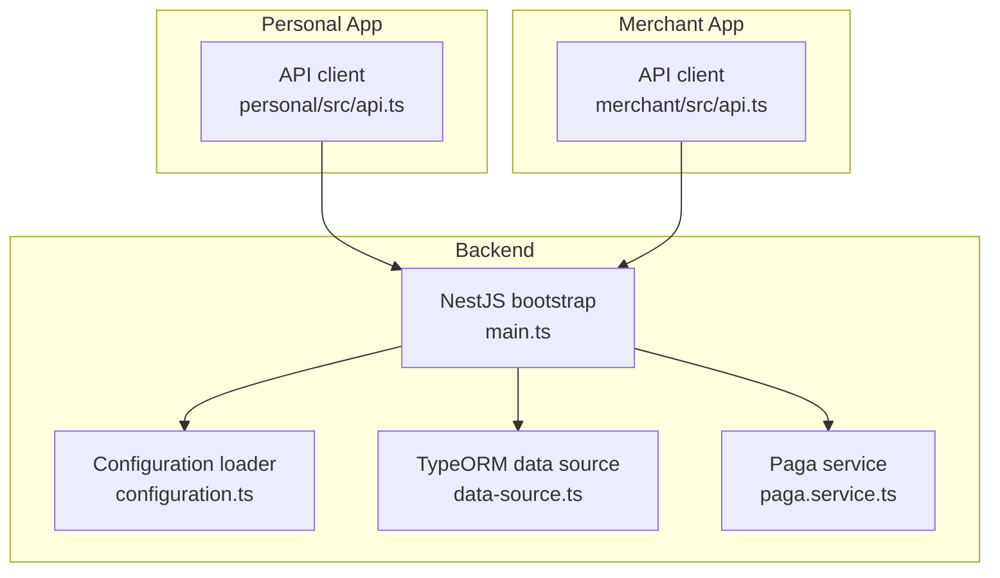
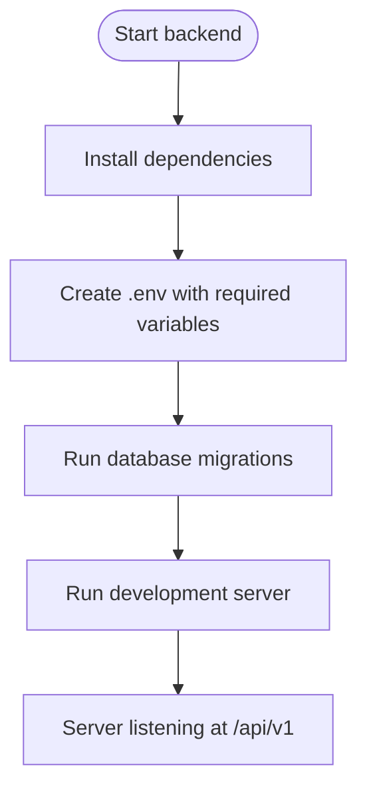
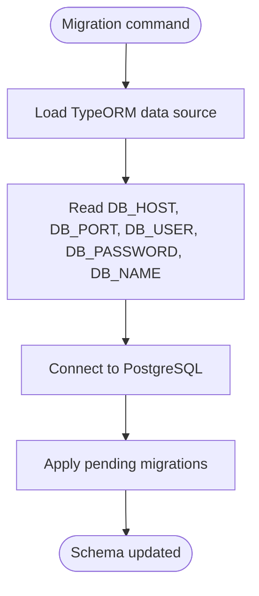
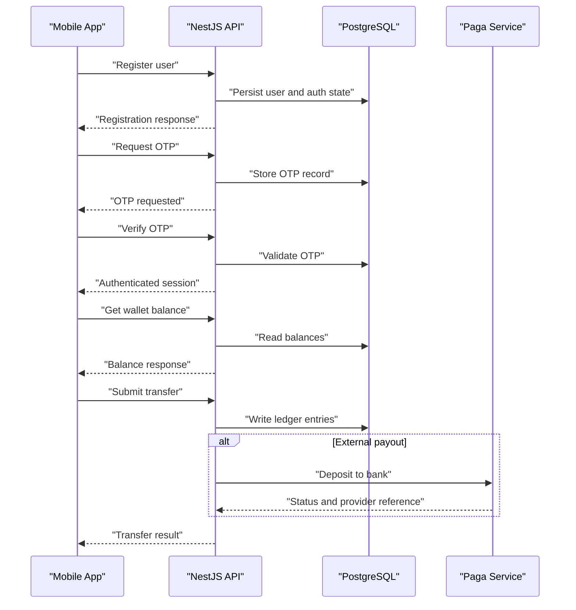

# Getting Started

<cite>
**Referenced Files in This Document**
- [backend/package.json](file://backend/package.json)
- [personal/package.json](file://personal/package.json)
- [merchant/package.json](file://merchant/package.json)
- [backend/src/config/configuration.ts](file://backend/src/config/configuration.ts)
- [backend/src/config/env.validation.ts](file://backend/src/config/env.validation.ts)
- [backend/src/database/data-source.ts](file://backend/src/database/data-source.ts)
- [backend/src/main.ts](file://backend/src/main.ts)
- [backend/src/paga/paga.service.ts](file://backend/src/paga/paga.service.ts)
- [personal/src/api.ts](file://personal/src/api.ts)
- [merchant/src/api.ts](file://merchant/src/api.ts)
</cite>

## Table of Contents
1. [Introduction](#introduction)
2. [Prerequisites](#prerequisites)
3. [Project Structure](#project-structure)
4. [Environment Configuration](#environment-configuration)
5. [Install and Run the Backend Server](#install-and-run-the-backend-server)
6. [Install and Run the Personal Banking App](#install-and-run-the-personal-banking-app)
7. [Install and Run the Merchant Dashboard App](#install-and-run-the-merchant-dashboard-app)
8. [Database Migrations](#database-migrations)
9. [Verification Steps](#verification-steps)
10. [Basic Usage Examples](#basic-usage-examples)
11. [Troubleshooting Guide](#troubleshooting-guide)
12. [Conclusion](#conclusion)

## Introduction
This guide helps you set up Vireo Finance locally for development. You will install dependencies, configure environment variables, run migrations, start the backend server, and launch the personal banking and merchant dashboard mobile apps. The project uses:
- A NestJS backend with PostgreSQL and Redis
- Paga payment integration
- Expo-based React Native apps for personal and merchant experiences

## Prerequisites
Before starting, ensure your machine has the following installed:
- Node.js and a package manager (pnpm is used by the backend; npm or yarn can be used for the Expo apps)
- PostgreSQL running locally or accessible remotely
- Redis running locally or accessible remotely
- Expo CLI for building and running the mobile apps
- Android Studio with an emulator or a physical Android device for the personal and merchant apps
- Xcode and iOS tools if you plan to run the iOS versions of the apps

You do not need production-grade credentials to start local development. The configuration supports defaults for local testing, but Paga-related features require valid API keys and base URLs.

## Project Structure
The repository contains three main application areas:
- `backend/`: NestJS server with authentication, ledger, transfers, KYC, merchants, webhooks, and Paga integration
- `personal/`: Personal banking app built with Expo and React Native
- `merchant/`: Merchant dashboard app built with Expo and React Native

**Diagram sources**
- [backend/src/main.ts:7-24](file://backend/src/main.ts#L7-L24)
- [backend/src/config/configuration.ts:65-121](file://backend/src/config/configuration.ts#L65-L121)
- [backend/src/database/data-source.ts:7-20](file://backend/src/database/data-source.ts#L7-L20)
- [backend/src/paga/paga.service.ts:34-469](file://backend/src/paga/paga.service.ts#L34-L469)
- [personal/src/api.ts:3-13](file://personal/src/api.ts#L3-L13)
- [merchant/src/api.ts:3-13](file://merchant/src/api.ts#L3-L13)

**Section sources**
- [backend/package.json:1-21](file://backend/package.json#L1-L21)
- [personal/package.json:1-13](file://personal/package.json#L1-L13)
- [merchant/package.json:1-13](file://merchant/package.json#L1-L13)

## Environment Configuration
The backend loads settings from environment variables through a typed configuration module. Key configuration areas include:
- Application port and base URL
- PostgreSQL connection details
- JWT secret and token expiry
- OTP and challenge TTLs
- Redis host and port
- Paga business and collect base URLs, API key, API secret, hash key, and webhook secret
- Risk limits and notification provider flags

### Required and Recommended Variables
| Variable | Purpose | Default or Notes |
|---|---|---|
| `NODE_ENV` | Development or production mode | `development` |
| `PORT` | Backend HTTP port | `3000` |
| `APP_BASE_URL` | Base URL used for Paga callbacks | `http://localhost:3000` |
| `DB_HOST` | PostgreSQL host | `localhost` |
| `DB_PORT` | PostgreSQL port | `5432` |
| `DB_USER` | PostgreSQL username | `postgres` |
| `DB_PASSWORD` | PostgreSQL password | `postgres` |
| `DB_NAME` | PostgreSQL database name | `vireo` |
| `DB_SSL` | Enable PostgreSQL SSL | `false` |
| `JWT_SECRET` | Secret for signing tokens | `dev-only-change-me` |
| `OTP_TTL_SECONDS` | OTP lifetime | `300` |
| `CHALLENGE_TTL_SECONDS` | Challenge lifetime | `120` |
| `REDIS_HOST` | Redis host | `localhost` |
| `REDIS_PORT` | Redis port | `6379` |
| `PAGA_BUSINESS_BASE_URL` | Paga Business API base URL | Empty string |
| `PAGA_COLLECT_BASE_URL` | Paga Collect API base URL | Empty string |
| `PAGA_API_KEY` | Paga API key | Empty string |
| `PAGA_API_SECRET` | Paga API secret | Empty string |
| `PAGA_HASH_KEY` | Paga signature hash key | Empty string |
| `PAGA_WEBHOOK_SECRET` | Fallback webhook secret | Empty string |

For production, the validation layer enforces that `JWT_SECRET`, `DB_HOST`, `DB_USER`, and `DB_NAME` are present when `NODE_ENV=production`.

### Mobile App API Base URL
Both mobile apps use an environment variable for the backend URL:
- `EXPO_PUBLIC_API_BASE_URL`
- Default fallback: `http://localhost:3050/api/v1`

If you run the backend on port `3000`, update this variable so the apps point to `http://localhost:3000/api/v1`.

**Section sources**
- [backend/src/config/configuration.ts:1-121](file://backend/src/config/configuration.ts#L1-L121)
- [backend/src/config/env.validation.ts:1-11](file://backend/src/config/env.validation.ts#L1-L11)
- [personal/src/api.ts:3-13](file://personal/src/api.ts#L3-L13)
- [merchant/src/api.ts:3-13](file://merchant/src/api.ts#L3-L13)

## Install and Run the Backend Server
The backend is a NestJS application using TypeORM, BullMQ, ioredis, and PostgreSQL.

### Installation
1. Open a terminal in the `backend` directory.
2. Install dependencies:
   - If using pnpm: `pnpm install`
   - If using npm: `npm install`
3. Create a `.env` file in `backend/` with the required variables described in the Environment Configuration section.

### Running the Backend
- Development with hot reload:
  - `pnpm start:dev`
- Build and run in production mode:
  - `pnpm build`
  - `pnpm start:prod`

The server starts with CORS enabled, applies global validation, sets the API prefix to `/api/v1`, and logs the listening address.

**Diagram sources**
- [backend/package.json:7-20](file://backend/package.json#L7-L20)
- [backend/src/main.ts:7-24](file://backend/src/main.ts#L7-L24)

**Section sources**
- [backend/package.json:1-21](file://backend/package.json#L1-L21)
- [backend/src/main.ts:7-24](file://backend/src/main.ts#L7-L24)

## Install and Run the Personal Banking App
The personal app is an Expo-based React Native application.

### Installation
1. Open a terminal in the `personal` directory.
2. Install dependencies:
   - `npm install`
3. Configure the backend URL:
   - Set `EXPO_PUBLIC_API_BASE_URL=http://localhost:3000/api/v1` in your environment or Expo config.
   - Alternatively, edit the API client default if needed.

### Running the Personal App
- Start Expo:
  - `npm start`
- Run on Android:
  - `npm run android`
- Run on iOS:
  - `npm run ios`
- Run on web:
  - `npm run web`

The app’s API client connects to the backend using the configured base URL and exposes methods for authentication, wallet balance, transactions, transfers, and KYC.

**Section sources**
- [personal/package.json:1-33](file://personal/package.json#L1-L33)
- [personal/src/api.ts:3-95](file://personal/src/api.ts#L3-L95)

## Install and Run the Merchant Dashboard App
The merchant app is also an Expo-based React Native application. It includes camera and QR-related dependencies for merchant flows.

### Installation
1. Open a terminal in the `merchant` directory.
2. Install dependencies:
   - `npm install`
3. Configure the backend URL:
   - Set `EXPO_PUBLIC_API_BASE_URL=http://localhost:3000/api/v1` in your environment or Expo config.

### Running the Merchant App
- Start Expo:
  - `npm start`
- Run on Android:
  - `npm run android`
- Run on iOS:
  - `npm run ios`
- Run on web:
  - `npm run web`

The merchant API client provides endpoints for merchant onboarding, profile, dashboard, orders, settlements, and authentication.

**Section sources**
- [merchant/package.json:1-37](file://merchant/package.json#L1-L37)
- [merchant/src/api.ts:3-96](file://merchant/src/api.ts#L3-L96)

## Database Migrations
The backend uses TypeORM migrations stored under `backend/src/migrations`. The data source is configured to load entities and migrations from the expected paths and disables automatic schema synchronization.

### Migration Commands
From the `backend` directory:
- Run pending migrations:
  - `pnpm migration:run`
- Revert the last migration:
  - `pnpm migration:revert`
- Generate a new migration:
  - `pnpm migration:generate`

These commands use the TypeORM data source configuration and read database settings from environment variables.

**Diagram sources**
- [backend/package.json:18-20](file://backend/package.json#L18-L20)
- [backend/src/database/data-source.ts:7-20](file://backend/src/database/data-source.ts#L7-L20)

**Section sources**
- [backend/package.json:18-20](file://backend/package.json#L18-L20)
- [backend/src/database/data-source.ts:1-20](file://backend/src/database/data-source.ts#L1-L20)

## Verification Steps
After installation, perform these checks to confirm the setup is working.

1. **Check the backend health endpoint**
   - Call `GET http://localhost:3000/api/v1/health`
   - Expected result: a successful JSON response indicating the service is alive.

2. **Verify database connectivity**
   - Ensure PostgreSQL is running and the configured database exists.
   - Confirm migrations ran without errors.

3. **Verify Redis connectivity**
   - Ensure Redis is running on the configured host and port.
   - Background jobs and queues depend on Redis.

4. **Test authentication flow**
   - Register a user through the personal or merchant app.
   - Request and verify an OTP.
   - Confirm the profile endpoint returns user data.

5. **Test Paga integration (optional)**
   - Provide `PAGA_BUSINESS_BASE_URL`, `PAGA_COLLECT_BASE_URL`, `PAGA_API_KEY`, `PAGA_API_SECRET`, and `PAGA_HASH_KEY`.
   - Test virtual account creation, bank account validation, deposit to bank, and webhook verification.

6. **Confirm mobile apps connect to the backend**
   - Update `EXPO_PUBLIC_API_BASE_URL` to match the running backend.
   - Verify that the apps can call `/api/v1/auth/*` endpoints.

**Section sources**
- [backend/src/main.ts:7-24](file://backend/src/main.ts#L7-L24)
- [backend/src/database/data-source.ts:7-20](file://backend/src/database/data-source.ts#L7-L20)
- [backend/src/paga/paga.service.ts:34-469](file://backend/src/paga/paga.service.ts#L34-L469)
- [personal/src/api.ts:3-95](file://personal/src/api.ts#L3-L95)
- [merchant/src/api.ts:3-96](file://merchant/src/api.ts#L3-L96)

## Basic Usage Examples
These examples show how to exercise core functionality after setup. They describe requests conceptually rather than including raw payloads.

### Authentication
- Register a user:
  - Method: `POST`
  - Path: `/api/v1/auth/register`
  - Body fields: phone, name, optional handle
- Request OTP:
  - Method: `POST`
  - Path: `/api/v1/auth/otp/request`
  - Body field: phone
- Verify OTP:
  - Method: `POST`
  - Path: `/api/v1/auth/otp/verify`
  - Body fields: phone, code
- Get current profile:
  - Method: `GET`
  - Path: `/api/v1/auth/me`

### Wallet and Transfers
- Get wallet balance:
  - Method: `GET`
  - Path: `/api/v1/ledger/balance`
- List transactions:
  - Method: `GET`
  - Path: `/api/v1/transfers`
  - Query parameter: limit
- Create transfer draft:
  - Method: `POST`
  - Path: `/api/v1/transfers/drafts`
  - Body fields: type, amount, idempotencyKey, deviceId, recipientPhone, recipientHandle, recipientUserId
- Submit signed transfer:
  - Method: `POST`
  - Path: `/api/v1/transfers/{transferId}/submit`
  - Body field: signature

### KYC
- Submit KYC:
  - Method: `POST`
  - Path: `/api/v1/kyc/submit`
  - Body fields: provider, payload
- Get KYC status:
  - Method: `GET`
  - Path: `/api/v1/kyc/me`

### Merchant Flows
- Onboard merchant:
  - Method: `POST`
  - Path: `/api/v1/merchants`
  - Body fields: businessName, handle, settlementBankCode, settlementAccountNumber, settlementAccountName
- Get merchant profile:
  - Method: `GET`
  - Path: `/api/v1/merchants/me`
- Get dashboard:
  - Method: `GET`
  - Path: `/api/v1/merchants/dashboard`
- Create order:
  - Method: `POST`
  - Path: `/api/v1/merchants/orders`
  - Body fields: amount, note
- List orders:
  - Method: `GET`
  - Path: `/api/v1/merchants/orders`
- Settle funds:
  - Method: `POST`
  - Path: `/api/v1/merchants/settlements`
  - Optional body field: amount
- List settlements:
  - Method: `GET`
  - Path: `/api/v1/merchants/settlements`

### Paga Integration
- Virtual account creation:
  - Uses the Paga Collect API
  - Requires configured Paga base URL, API key, API secret, and hash key
- Bank account validation:
  - Uses the Paga Business API
  - Returns account holder name and bank UUID
- Deposit to bank:
  - Uses the Paga Business API
  - Returns status, provider reference, and failure reason when applicable
- Webhook verification:
  - Verifies Paga callback signatures using configured hash key or webhook secret

**Diagram sources**
- [personal/src/api.ts:23-81](file://personal/src/api.ts#L23-L81)
- [merchant/src/api.ts:23-92](file://merchant/src/api.ts#L23-L92)
- [backend/src/paga/paga.service.ts:72-155](file://backend/src/paga/paga.service.ts#L72-L155)

**Section sources**
- [personal/src/api.ts:3-95](file://personal/src/api.ts#L3-L95)
- [merchant/src/api.ts:3-96](file://merchant/src/api.ts#L3-L96)
- [backend/src/paga/paga.service.ts:34-469](file://backend/src/paga/paga.service.ts#L34-L469)

## Troubleshooting Guide

### Backend Will Not Start
- Check that all required environment variables are present.
- In production mode, missing `JWT_SECRET`, `DB_HOST`, `DB_USER`, or `DB_NAME` will cause startup to fail.
- Verify the configured port is available.

### Database Connection Errors
- Ensure PostgreSQL is running and reachable.
- Confirm `DB_HOST`, `DB_PORT`, `DB_USER`, `DB_PASSWORD`, and `DB_NAME` match your database setup.
- If using SSL, set `DB_SSL=true` and adjust your database TLS configuration.
- Run migrations before expecting tables to exist.

### Redis Connection Errors
- Ensure Redis is running on the configured host and port.
- Check firewall rules if Redis is remote.
- Validate `REDIS_HOST` and `REDIS_PORT`.

### Paga Integration Failures
- Provide valid values for `PAGA_BUSINESS_BASE_URL`, `PAGA_COLLECT_BASE_URL`, `PAGA_API_KEY`, `PAGA_API_SECRET`, and `PAGA_HASH_KEY`.
- Missing Paga base URLs or credentials raise gateway-level errors.
- Webhook verification requires either `PAGA_HASH_KEY` or `PAGA_WEBHOOK_SECRET`.
- Callback URLs are derived from `APP_BASE_URL`; ensure it points to a reachable backend address.

### Mobile Apps Cannot Reach the Backend
- Set `EXPO_PUBLIC_API_BASE_URL` to the correct backend URL.
- The default fallback is `http://localhost:3050/api/v1`, which may differ from your actual backend port.
- Ensure CORS is allowed; the backend enables CORS during bootstrap.

### Migrations Fail
- Confirm the database user has permission to create and manage the migrations table.
- Check that the data source path matches the migration files.
- Use `pnpm migration:revert` to step back if only the last migration failed.

### Health Endpoint Returns an Error
- Confirm the server started successfully.
- Check logs for configuration or dependency failures.
- Verify the API prefix is `/api/v1`.

**Section sources**
- [backend/src/config/env.validation.ts:1-11](file://backend/src/config/env.validation.ts#L1-L11)
- [backend/src/database/data-source.ts:1-20](file://backend/src/database/data-source.ts#L1-L20)
- [backend/src/main.ts:7-24](file://backend/src/main.ts#L7-L24)
- [backend/src/paga/paga.service.ts:393-469](file://backend/src/paga/paga.service.ts#L393-L469)
- [personal/src/api.ts:3-13](file://personal/src/api.ts#L3-L13)
- [merchant/src/api.ts:3-13](file://merchant/src/api.ts#L3-L13)

## Conclusion
You now have the prerequisites, environment configuration, installation steps, migration commands, and verification procedures needed to run Vireo Finance locally. Use the basic usage examples to test authentication, wallet operations, transfers, KYC, merchant flows, and Paga integration. When issues arise, consult the troubleshooting guide and verify environment variables, database connectivity, Redis availability, and mobile app API configuration.