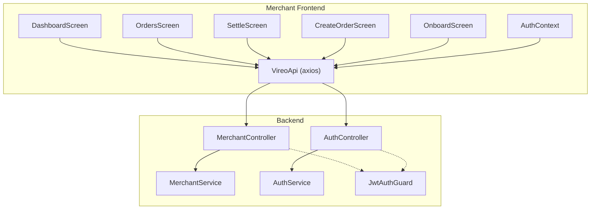
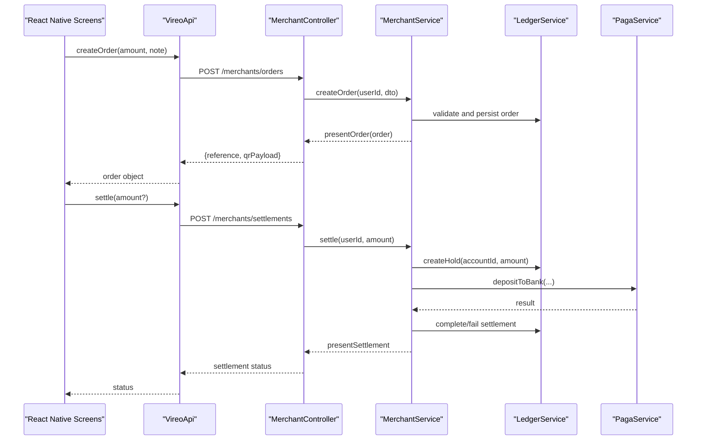
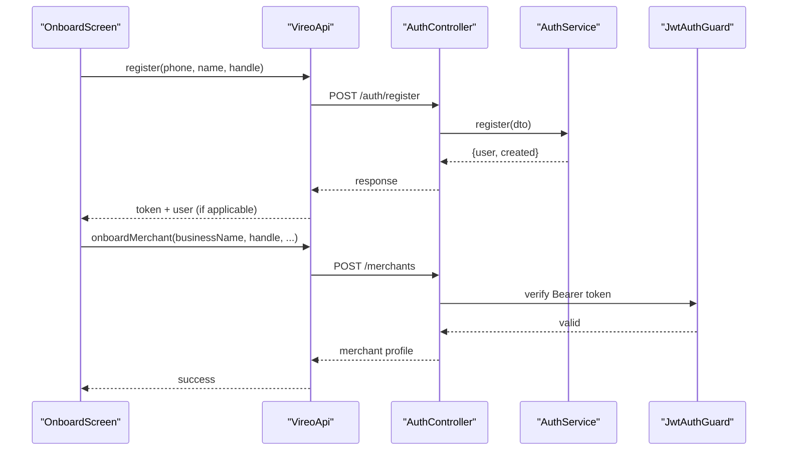
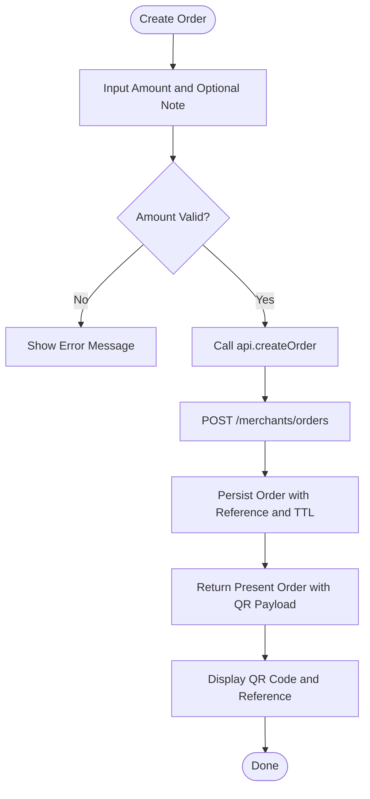
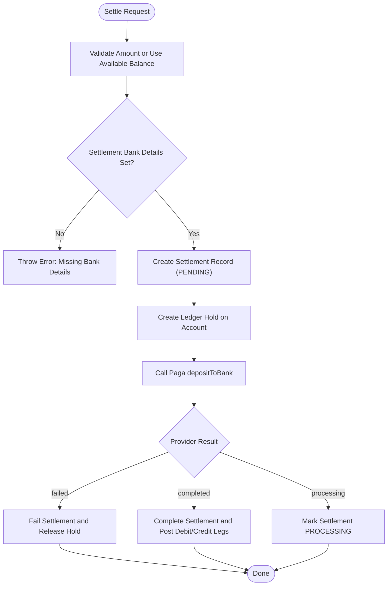
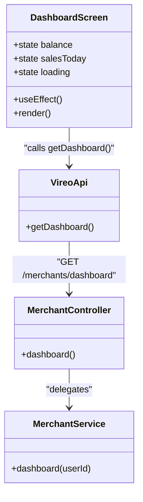
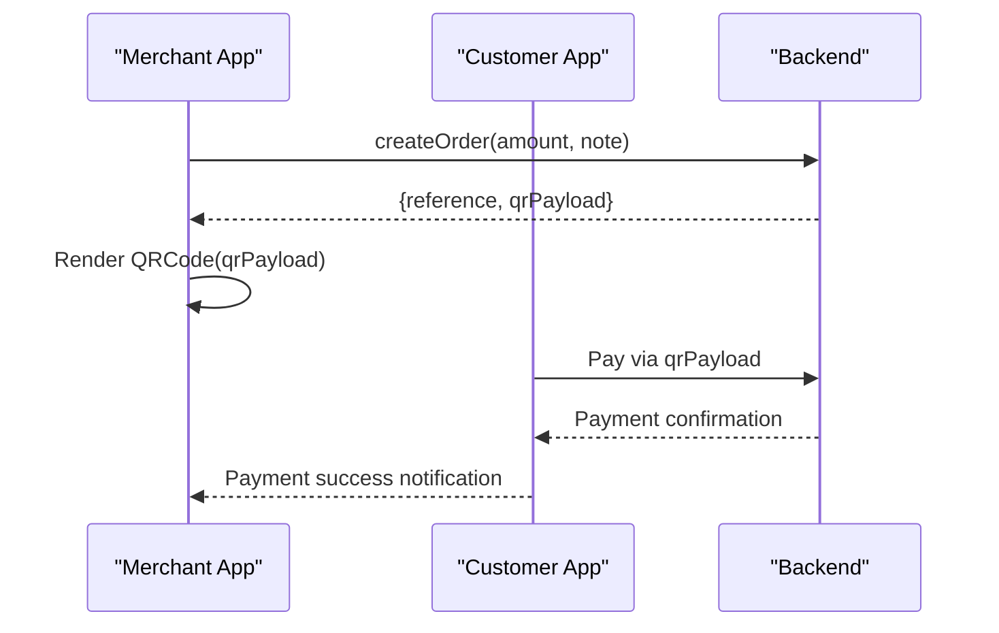
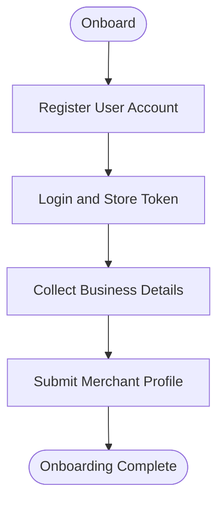
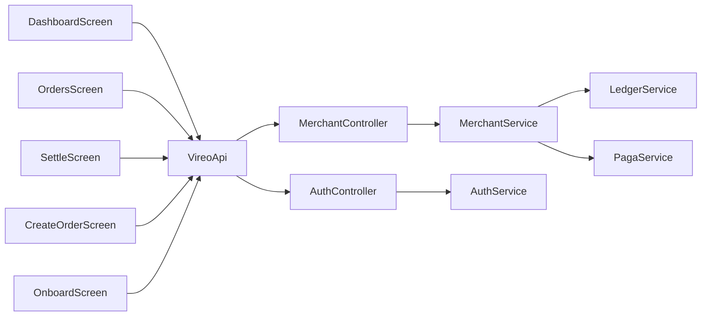

# Merchant Dashboard App

<cite>
**Referenced Files in This Document**   
- [DashboardScreen.tsx](file://merchant/src/screens/DashboardScreen.tsx)
- [OrdersScreen.tsx](file://merchant/src/screens/OrdersScreen.tsx)
- [SettleScreen.tsx](file://merchant/src/screens/SettleScreen.tsx)
- [CreateOrderScreen.tsx](file://merchant/src/screens/CreateOrderScreen.tsx)
- [OnboardScreen.tsx](file://merchant/src/screens/OnboardScreen.tsx)
- [AuthContext.tsx](file://merchant/src/contexts/AuthContext.tsx)
- [api.ts](file://merchant/src/api.ts)
- [merchant.controller.ts](file://backend/src/merchant/merchant.controller.ts)
- [merchant.service.ts](file://backend/src/merchant/merchant.service.ts)
- [merchant.dto.ts](file://backend/src/merchant/dto/merchant.dto.ts)
- [auth.controller.ts](file://backend/src/auth/auth.controller.ts)
- [auth.service.ts](file://backend/src/auth/auth.service.ts)
- [jwt-auth.guard.ts](file://backend/src/common/guards/jwt-auth.guard.ts)
- [current-user.decorator.ts](file://backend/src/common/decorators/current-user.decorator.ts)
</cite>

## Table of Contents
1. [Introduction](#introduction)
2. [Project Structure](#project-structure)
3. [Core Components](#core-components)
4. [Architecture Overview](#architecture-overview)
5. [Detailed Component Analysis](#detailed-component-analysis)
6. [Dependency Analysis](#dependency-analysis)
7. [Performance Considerations](#performance-considerations)
8. [Troubleshooting Guide](#troubleshooting-guide)
9. [Conclusion](#conclusion)

## Introduction
This document explains the Merchant Dashboard React Native application and its backend integration for merchant operations. It covers:
- Merchant-specific authentication flow using phone-based OTP and JWT tokens
- Order management system for creating, listing, and tracking payment orders
- Settlement processing workflows to transfer funds to bank accounts
- Dashboard analytics interface showing balances and sales metrics
- Onboarding flow for new merchants including business details and settlement configuration
- Payment acceptance via QR codes generated from order payloads
- API integration patterns, error handling strategies, and data visualization components
- Guidelines for business-focused UI design, performance optimization for large datasets, and external payment system integration

## Project Structure
The project is organized into a React Native frontend under `merchant/` and a NestJS backend under `backend/`. The frontend screens implement user-facing flows, while the backend exposes REST endpoints for authentication, merchant onboarding, order management, and settlements.

**Diagram sources**
- [DashboardScreen.tsx:1-63](file://merchant/src/screens/DashboardScreen.tsx#L1-L63)
- [OrdersScreen.tsx:1-60](file://merchant/src/screens/OrdersScreen.tsx#L1-L60)
- [SettleScreen.tsx:1-57](file://merchant/src/screens/SettleScreen.tsx#L1-L57)
- [CreateOrderScreen.tsx:1-69](file://merchant/src/screens/CreateOrderScreen.tsx#L1-L69)
- [OnboardScreen.tsx:1-73](file://merchant/src/screens/OnboardScreen.tsx#L1-L73)
- [AuthContext.tsx:1-55](file://merchant/src/contexts/AuthContext.tsx#L1-L55)
- [api.ts:1-96](file://merchant/src/api.ts#L1-L96)
- [merchant.controller.ts:1-47](file://backend/src/merchant/merchant.controller.ts#L1-L47)
- [merchant.service.ts:1-384](file://backend/src/merchant/merchant.service.ts#L1-L384)
- [auth.controller.ts:1-50](file://backend/src/auth/auth.controller.ts#L1-L50)
- [auth.service.ts:1-209](file://backend/src/auth/auth.service.ts#L1-L209)
- [jwt-auth.guard.ts:1-31](file://backend/src/common/guards/jwt-auth.guard.ts#L1-L31)

**Section sources**
- [DashboardScreen.tsx:1-63](file://merchant/src/screens/DashboardScreen.tsx#L1-L63)
- [OrdersScreen.tsx:1-60](file://merchant/src/screens/OrdersScreen.tsx#L1-L60)
- [SettleScreen.tsx:1-57](file://merchant/src/screens/SettleScreen.tsx#L1-L57)
- [CreateOrderScreen.tsx:1-69](file://merchant/src/screens/CreateOrderScreen.tsx#L1-L69)
- [OnboardScreen.tsx:1-73](file://merchant/src/screens/OnboardScreen.tsx#L1-L73)
- [AuthContext.tsx:1-55](file://merchant/src/contexts/AuthContext.tsx#L1-L55)
- [api.ts:1-96](file://merchant/src/api.ts#L1-L96)
- [merchant.controller.ts:1-47](file://backend/src/merchant/merchant.controller.ts#L1-L47)
- [merchant.service.ts:1-384](file://backend/src/merchant/merchant.service.ts#L1-L384)
- [auth.controller.ts:1-50](file://backend/src/auth/auth.controller.ts#L1-L50)
- [auth.service.ts:1-209](file://backend/src/auth/auth.service.ts#L1-L209)
- [jwt-auth.guard.ts:1-31](file://backend/src/common/guards/jwt-auth.guard.ts#L1-L31)

## Core Components
- Authentication Context: Provides token and user state, login/logout methods, and integrates with the API client to set or clear Authorization headers.
- API Client: A centralized axios instance that manages base URL, token injection, and merchant/auth endpoints.
- Screens:
  - Dashboard: Shows available balance, held amount, currency, sales today, and navigation actions.
  - Orders: Lists recent orders with reference, merchant name, status, and amount.
  - Create Order: Accepts amount and optional note, creates an order, and displays a QR code payload for customer payment.
  - Settle: Allows partial or full settlement to bank account, shows status and errors.
  - Onboard: Registers a merchant account and collects business details for KYB/settlement setup.

Key responsibilities:
- AuthContext maintains session state and propagates token to API requests.
- VireoApi encapsulates all HTTP calls and provides typed methods for merchant operations.
- Screens handle UI state, user input, and display results/errors.

**Section sources**
- [AuthContext.tsx:1-55](file://merchant/src/contexts/AuthContext.tsx#L1-L55)
- [api.ts:1-96](file://merchant/src/api.ts#L1-L96)
- [DashboardScreen.tsx:1-63](file://merchant/src/screens/DashboardScreen.tsx#L1-L63)
- [OrdersScreen.tsx:1-60](file://merchant/src/screens/OrdersScreen.tsx#L1-L60)
- [CreateOrderScreen.tsx:1-69](file://merchant/src/screens/CreateOrderScreen.tsx#L1-L69)
- [SettleScreen.tsx:1-57](file://merchant/src/screens/SettleScreen.tsx#L1-L57)
- [OnboardScreen.tsx:1-73](file://merchant/src/screens/OnboardScreen.tsx#L1-L73)

## Architecture Overview
The merchant dashboard follows a layered architecture:
- Presentation Layer: React Native screens render UI and manage local state.
- Service Layer: VireoApi abstracts HTTP interactions and token management.
- Backend Controllers: Expose REST endpoints protected by JWT guard.
- Business Logic: MerchantService orchestrates ledger operations, holds, and payouts via Paga.

**Diagram sources**
- [CreateOrderScreen.tsx:20-31](file://merchant/src/screens/CreateOrderScreen.tsx#L20-L31)
- [SettleScreen.tsx:18-29](file://merchant/src/screens/SettleScreen.tsx#L18-L29)
- [api.ts:74-87](file://merchant/src/api.ts#L74-L87)
- [merchant.controller.ts:32-45](file://backend/src/merchant/merchant.controller.ts#L32-L45)
- [merchant.service.ts:81-100](file://backend/src/merchant/merchant.service.ts#L81-L100)
- [merchant.service.ts:160-224](file://backend/src/merchant/merchant.service.ts#L160-L224)

## Detailed Component Analysis

### Merchant Authentication Flow
The merchant authentication uses phone registration and OTP verification to obtain a JWT access token. The token is stored in context and injected into subsequent requests.

Notes:
- Registration may return a token if the flow includes immediate login; otherwise, OTP verification is used to obtain a token.
- Device registration endpoints are available for biometric signature support but not wired in the current merchant screens.

**Diagram sources**
- [OnboardScreen.tsx:18-45](file://merchant/src/screens/OnboardScreen.tsx#L18-L45)
- [api.ts:23-51](file://merchant/src/api.ts#L23-L51)
- [auth.controller.ts:11-36](file://backend/src/auth/auth.controller.ts#L11-L36)
- [auth.service.ts:39-71](file://backend/src/auth/auth.service.ts#L39-L71)
- [jwt-auth.guard.ts:13-29](file://backend/src/common/guards/jwt-auth.guard.ts#L13-L29)

**Section sources**
- [OnboardScreen.tsx:1-73](file://merchant/src/screens/OnboardScreen.tsx#L1-L73)
- [api.ts:1-96](file://merchant/src/api.ts#L1-L96)
- [auth.controller.ts:1-50](file://backend/src/auth/auth.controller.ts#L1-L50)
- [auth.service.ts:1-209](file://backend/src/auth/auth.service.ts#L1-L209)
- [jwt-auth.guard.ts:1-31](file://backend/src/common/guards/jwt-auth.guard.ts#L1-L31)

### Order Management System
Merchants can create payment orders and list them. Orders include references, amounts, statuses, and QR payloads for customer payments.

**Diagram sources**
- [CreateOrderScreen.tsx:20-31](file://merchant/src/screens/CreateOrderScreen.tsx#L20-L31)
- [api.ts:74-77](file://merchant/src/api.ts#L74-L77)
- [merchant.controller.ts:32-35](file://backend/src/merchant/merchant.controller.ts#L32-L35)
- [merchant.service.ts:81-100](file://backend/src/merchant/merchant.service.ts#L81-L100)

Listing orders retrieves up to 100 recent orders sorted by creation date.

**Section sources**
- [CreateOrderScreen.tsx:1-69](file://merchant/src/screens/CreateOrderScreen.tsx#L1-L69)
- [OrdersScreen.tsx:1-60](file://merchant/src/screens/OrdersScreen.tsx#L1-L60)
- [api.ts:74-82](file://merchant/src/api.ts#L74-L82)
- [merchant.controller.ts:27-35](file://backend/src/merchant/merchant.controller.ts#L27-L35)
- [merchant.service.ts:102-110](file://backend/src/merchant/merchant.service.ts#L102-L110)

### Settlement Processing Workflow
Settlements move funds from the merchant’s ledger account to a bank account via Paga. The process involves validation, hold creation, payout request, and ledger posting upon completion.

**Diagram sources**
- [SettleScreen.tsx:18-29](file://merchant/src/screens/SettleScreen.tsx#L18-L29)
- [api.ts:84-87](file://merchant/src/api.ts#L84-L87)
- [merchant.controller.ts:42-45](file://backend/src/merchant/merchant.controller.ts#L42-L45)
- [merchant.service.ts:160-224](file://backend/src/merchant/merchant.service.ts#L160-L224)
- [merchant.service.ts:261-340](file://backend/src/merchant/merchant.service.ts#L261-L340)

**Section sources**
- [SettleScreen.tsx:1-57](file://merchant/src/screens/SettleScreen.tsx#L1-L57)
- [api.ts:84-92](file://merchant/src/api.ts#L84-L92)
- [merchant.controller.ts:37-45](file://backend/src/merchant/merchant.controller.ts#L37-L45)
- [merchant.service.ts:160-340](file://backend/src/merchant/merchant.service.ts#L160-L340)

### Dashboard Analytics Interface
The dashboard aggregates balance and sales metrics:
- Available and held balances with currency
- Sales today total amount and count
- Recent orders list

**Diagram sources**
- [DashboardScreen.tsx:19-24](file://merchant/src/screens/DashboardScreen.tsx#L19-L24)
- [api.ts:69-72](file://merchant/src/api.ts#L69-L72)
- [merchant.controller.ts:22-25](file://backend/src/merchant/merchant.controller.ts#L22-L25)
- [merchant.service.ts:124-158](file://backend/src/merchant/merchant.service.ts#L124-L158)

**Section sources**
- [DashboardScreen.tsx:1-63](file://merchant/src/screens/DashboardScreen.tsx#L1-L63)
- [api.ts:69-72](file://merchant/src/api.ts#L69-L72)
- [merchant.controller.ts:22-25](file://backend/src/merchant/merchant.controller.ts#L22-L25)
- [merchant.service.ts:124-158](file://backend/src/merchant/merchant.service.ts#L124-L158)

### Payment Acceptance Mechanisms
Payment acceptance is implemented via QR codes generated from order payloads. Customers scan the QR to pay against the order reference.

**Diagram sources**
- [CreateOrderScreen.tsx:43-48](file://merchant/src/screens/CreateOrderScreen.tsx#L43-L48)
- [merchant.service.ts:357-371](file://backend/src/merchant/merchant.service.ts#L357-L371)

**Section sources**
- [CreateOrderScreen.tsx:1-69](file://merchant/src/screens/CreateOrderScreen.tsx#L1-L69)
- [merchant.service.ts:357-371](file://backend/src/merchant/merchant.service.ts#L357-L371)

### Merchant Onboarding Flow
Onboarding registers a merchant profile and optionally sets settlement bank details.

**Diagram sources**
- [OnboardScreen.tsx:18-45](file://merchant/src/screens/OnboardScreen.tsx#L18-L45)
- [api.ts:23-62](file://merchant/src/api.ts#L23-L62)
- [merchant.controller.ts:12-15](file://backend/src/merchant/merchant.controller.ts#L12-L15)
- [merchant.service.ts:42-67](file://backend/src/merchant/merchant.service.ts#L42-L67)

**Section sources**
- [OnboardScreen.tsx:1-73](file://merchant/src/screens/OnboardScreen.tsx#L1-L73)
- [api.ts:23-62](file://merchant/src/api.ts#L23-L62)
- [merchant.controller.ts:12-15](file://backend/src/merchant/merchant.controller.ts#L12-L15)
- [merchant.service.ts:42-67](file://backend/src/merchant/merchant.service.ts#L42-L67)

### Biometric Signature Implementation and Device-less Payments
Device registration endpoints exist for registering public keys and attestation tokens, supporting future biometric signatures. However, the current merchant screens do not call these endpoints. To enable device-less payments:
- Integrate device registration during onboarding or first login
- Attach deviceId to JWT payload when issuing tokens
- Enforce device checks in guards or middleware for sensitive operations

Current availability:
- Device registration endpoint exists at `/auth/devices`
- Device listing and revocation endpoints exist
- Merchant screens do not yet integrate device registration

**Section sources**
- [api.ts:43-51](file://merchant/src/api.ts#L43-L51)
- [auth.controller.ts:32-48](file://backend/src/auth/auth.controller.ts#L32-L48)
- [auth.service.ts:129-160](file://backend/src/auth/auth.service.ts#L129-L160)

## Dependency Analysis
The frontend depends on the backend through well-defined REST endpoints. The backend enforces authentication via JWT guard and delegates business logic to services.

**Diagram sources**
- [DashboardScreen.tsx:1-63](file://merchant/src/screens/DashboardScreen.tsx#L1-L63)
- [OrdersScreen.tsx:1-60](file://merchant/src/screens/OrdersScreen.tsx#L1-L60)
- [SettleScreen.tsx:1-57](file://merchant/src/screens/SettleScreen.tsx#L1-L57)
- [CreateOrderScreen.tsx:1-69](file://merchant/src/screens/CreateOrderScreen.tsx#L1-L69)
- [OnboardScreen.tsx:1-73](file://merchant/src/screens/OnboardScreen.tsx#L1-L73)
- [api.ts:1-96](file://merchant/src/api.ts#L1-L96)
- [merchant.controller.ts:1-47](file://backend/src/merchant/merchant.controller.ts#L1-L47)
- [merchant.service.ts:1-384](file://backend/src/merchant/merchant.service.ts#L1-L384)
- [auth.controller.ts:1-50](file://backend/src/auth/auth.controller.ts#L1-L50)
- [auth.service.ts:1-209](file://backend/src/auth/auth.service.ts#L1-L209)

**Section sources**
- [api.ts:1-96](file://merchant/src/api.ts#L1-L96)
- [merchant.controller.ts:1-47](file://backend/src/merchant/merchant.controller.ts#L1-L47)
- [merchant.service.ts:1-384](file://backend/src/merchant/merchant.service.ts#L1-L384)
- [auth.controller.ts:1-50](file://backend/src/auth/auth.controller.ts#L1-L50)
- [auth.service.ts:1-209](file://backend/src/auth/auth.service.ts#L1-L209)

## Performance Considerations
- Pagination and Limits:
  - Orders and settlements lists cap at 100 items; consider implementing cursor-based pagination for larger datasets.
- Data Formatting:
  - Backend formats monetary values using minor units; ensure consistent formatting in the frontend to avoid unnecessary conversions.
- Network Efficiency:
  - Cache dashboard responses locally to reduce repeated calls.
  - Debounce search/filter inputs on orders and settlements lists.
- Rendering Optimization:
  - Use FlatList with proper keyExtractor and item separators for large lists.
  - Avoid re-renders by memoizing expensive computations and separating UI components.
- Error Handling:
  - Surface user-friendly messages and retry options for transient network failures.
- External Integrations:
  - Handle asynchronous settlement callbacks robustly; poll settlement status or use webhooks where possible.

[No sources needed since this section provides general guidance]

## Troubleshooting Guide
Common issues and resolutions:
- Authentication Errors:
  - Missing or invalid bearer token: Ensure token is set in API client and refreshed after login.
  - Invalid or expired token: Re-login and update token in context.
- Validation Errors:
  - Invalid amount format: Ensure amounts match expected decimal pattern.
  - Missing settlement bank details: Prompt merchant to configure bank code and account number.
- Settlement Failures:
  - Provider rejection: Review failure reason and adjust settlement parameters.
  - Insufficient available balance: Prevent settlement attempts exceeding available balance.
- Network Issues:
  - Retry failed requests with exponential backoff.
  - Log request/response payloads for debugging without exposing sensitive data.

**Section sources**
- [jwt-auth.guard.ts:13-29](file://backend/src/common/guards/jwt-auth.guard.ts#L13-L29)
- [merchant.dto.ts:1-48](file://backend/src/merchant/dto/merchant.dto.ts#L1-L48)
- [merchant.service.ts:160-224](file://backend/src/merchant/merchant.service.ts#L160-L224)
- [SettleScreen.tsx:18-29](file://merchant/src/screens/SettleScreen.tsx#L18-L29)

## Conclusion
The Merchant Dashboard app provides a comprehensive interface for merchant operations including authentication, order management, settlement processing, and analytics. The backend enforces secure access via JWT and implements robust business logic for ledger operations and external payouts. Future enhancements should integrate device registration for biometric signatures and improve scalability with pagination and caching strategies.

[No sources needed since this section summarizes without analyzing specific files]