# Mobile Applications

<cite>
**Referenced Files in This Document**
- [personal/App.tsx](file://personal/App.tsx)
- [merchant/App.tsx](file://merchant/App.tsx)
- [personal/src/contexts/AuthContext.tsx](file://personal/src/contexts/AuthContext.tsx)
- [merchant/src/contexts/AuthContext.tsx](file://merchant/src/contexts/AuthContext.tsx)
- [personal/src/api.ts](file://personal/src/api.ts)
- [merchant/src/api.ts](file://merchant/src/api.ts)
- [personal/src/screens/RegisterScreen.tsx](file://personal/src/screens/RegisterScreen.tsx)
- [personal/src/screens/OtpVerifyScreen.tsx](file://personal/src/screens/OtpVerifyScreen.tsx)
- [personal/src/screens/WalletScreen.tsx](file://personal/src/screens/WalletScreen.tsx)
- [personal/src/screens/SendScreen.tsx](file://personal/src/screens/SendScreen.tsx)
- [personal/src/screens/TransactionsScreen.tsx](file://personal/src/screens/TransactionsScreen.tsx)
- [personal/src/screens/KycScreen.tsx](file://personal/src/screens/KycScreen.tsx)
- [merchant/src/screens/OnboardScreen.tsx](file://merchant/src/screens/OnboardScreen.tsx)
- [merchant/src/screens/DashboardScreen.tsx](file://merchant/src/screens/DashboardScreen.tsx)
- [merchant/src/screens/CreateOrderScreen.tsx](file://merchant/src/screens/CreateOrderScreen.tsx)
- [merchant/src/screens/OrdersScreen.tsx](file://merchant/src/screens/OrdersScreen.tsx)
- [merchant/src/screens/SettleScreen.tsx](file://merchant/src/screens/SettleScreen.tsx)
</cite>

## Table of Contents
1. [Introduction](#introduction)
2. [Project Structure](#project-structure)
3. [Core Components](#core-components)
4. [Architecture Overview](#architecture-overview)
5. [Detailed Component Analysis](#detailed-component-analysis)
6. [Dependency Analysis](#dependency-analysis)
7. [Performance Considerations](#performance-considerations)
8. [Troubleshooting Guide](#troubleshooting-guide)
9. [Conclusion](#conclusion)
10. [Appendices](#appendices)

## Introduction
This document provides comprehensive documentation for the dual React Native mobile applications: Personal Banking App and Merchant Dashboard App. It explains the architecture, navigation structure, authentication context, API integration patterns, and screen implementations for user flows such as registration, OTP verification, KYC, transfers, merchant onboarding, order management, settlement processing, and analytics dashboard. It also documents the biometric signature implementation using device secure storage, challenge-response authentication flow, and security best practices. Finally, it includes guidelines for responsive design, accessibility compliance, and cross-platform compatibility considerations.

## Project Structure
The repository contains two independent React Native applications under personal and merchant directories, each with its own entry point, screens, contexts, and API client. Both apps share similar architectural patterns but serve different user roles.

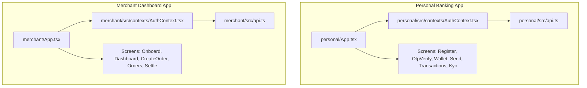

**Diagram sources**
- [personal/App.tsx:1-59](file://personal/App.tsx#L1-L59)
- [merchant/App.tsx:1-54](file://merchant/App.tsx#L1-L54)
- [personal/src/contexts/AuthContext.tsx:1-55](file://personal/src/contexts/AuthContext.tsx#L1-L55)
- [merchant/src/contexts/AuthContext.tsx:1-55](file://merchant/src/contexts/AuthContext.tsx#L1-L55)
- [personal/src/api.ts:1-95](file://personal/src/api.ts#L1-L95)
- [merchant/src/api.ts:1-96](file://merchant/src/api.ts#L1-L96)

**Section sources**
- [personal/App.tsx:1-59](file://personal/App.tsx#L1-L59)
- [merchant/App.tsx:1-54](file://merchant/App.tsx#L1-L54)

## Core Components
- Authentication Contexts: Provide token, user state, login/logout, and setToken methods to both apps.
- API Clients: Axios-based clients that encapsulate endpoints for auth, ledger, transfers, kyc (personal), and merchant operations (merchant).
- Navigation: Stack navigators conditionally render screens based on authentication state.
- Screens: Implement user flows for registration, OTP verification, wallet management, transfers, KYC (personal), and merchant onboarding, orders, settlements (merchant).

Key responsibilities:
- AuthContext: Centralizes authentication state and persists tokens via API client.
- VireoApi: Encapsulates HTTP requests, sets Authorization headers, and exposes typed methods for domain features.
- Screen components: Manage local UI state, call API methods, handle errors, and navigate between screens.

**Section sources**
- [personal/src/contexts/AuthContext.tsx:1-55](file://personal/src/contexts/AuthContext.tsx#L1-L55)
- [merchant/src/contexts/AuthContext.tsx:1-55](file://merchant/src/contexts/AuthContext.tsx#L1-L55)
- [personal/src/api.ts:1-95](file://personal/src/api.ts#L1-L95)
- [merchant/src/api.ts:1-96](file://merchant/src/api.ts#L1-L96)

## Architecture Overview
Both apps follow a layered architecture:
- Presentation Layer: React Native screens and navigation.
- State Layer: React Context for authentication state.
- Data Layer: Axios-based API clients calling backend REST endpoints.

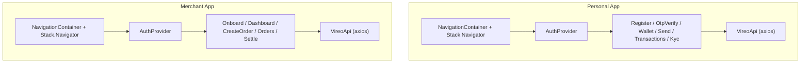

**Diagram sources**
- [personal/App.tsx:1-59](file://personal/App.tsx#L1-L59)
- [merchant/App.tsx:1-54](file://merchant/App.tsx#L1-L54)
- [personal/src/contexts/AuthContext.tsx:1-55](file://personal/src/contexts/AuthContext.tsx#L1-L55)
- [merchant/src/contexts/AuthContext.tsx:1-55](file://merchant/src/contexts/AuthContext.tsx#L1-L55)
- [personal/src/api.ts:1-95](file://personal/src/api.ts#L1-L95)
- [merchant/src/api.ts:1-96](file://merchant/src/api.ts#L1-L96)

## Detailed Component Analysis

### Personal Banking App

#### Navigation and Entry Point
- The app wraps the UI with SafeAreaProvider and AuthProvider, then renders a stack navigator.
- Conditional routing shows Register and OtpVerify when no token exists; otherwise, Wallet, Send, Transactions, and Kyc are available.

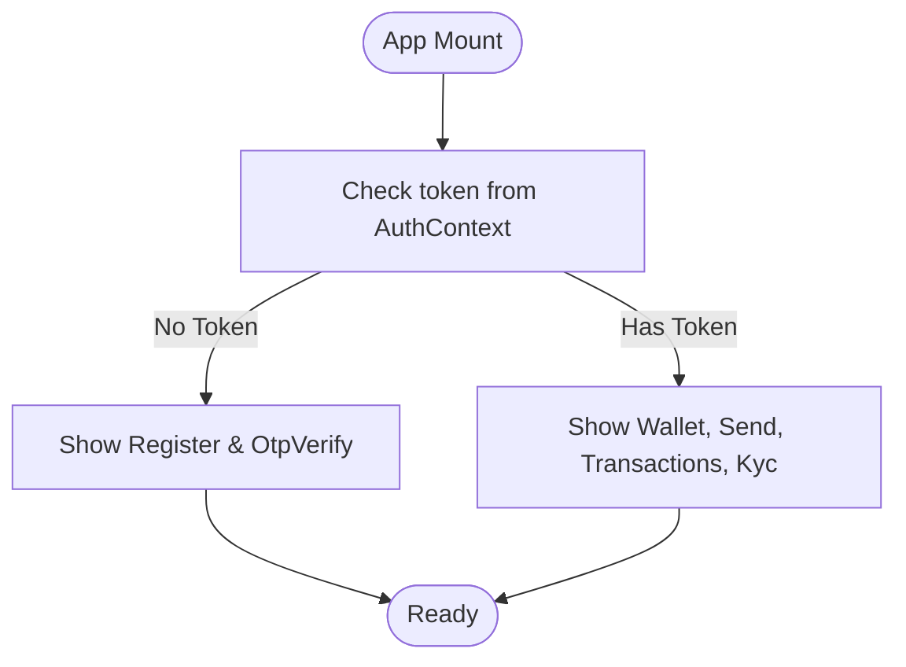

**Diagram sources**
- [personal/App.tsx:16-46](file://personal/App.tsx#L16-L46)

**Section sources**
- [personal/App.tsx:1-59](file://personal/App.tsx#L1-L59)

#### Authentication Flow
- Registration: Collects phone, name, optional handle; calls register endpoint; stores token and user via AuthContext.
- OTP Verification: Requests OTP and verifies code; upon success, stores access token and user via AuthContext.

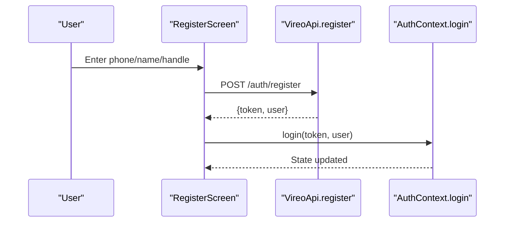

**Diagram sources**
- [personal/src/screens/RegisterScreen.tsx:16-31](file://personal/src/screens/RegisterScreen.tsx#L16-L31)
- [personal/src/contexts/AuthContext.tsx:20-24](file://personal/src/contexts/AuthContext.tsx#L20-L24)
- [personal/src/api.ts:23-26](file://personal/src/api.ts#L23-L26)

**Section sources**
- [personal/src/screens/RegisterScreen.tsx:1-73](file://personal/src/screens/RegisterScreen.tsx#L1-L73)
- [personal/src/screens/OtpVerifyScreen.tsx:1-81](file://personal/src/screens/OtpVerifyScreen.tsx#L1-L81)
- [personal/src/contexts/AuthContext.tsx:1-55](file://personal/src/contexts/AuthContext.tsx#L1-L55)
- [personal/src/api.ts:23-36](file://personal/src/api.ts#L23-L36)

#### Wallet Management
- Displays welcome message, balance, and quick actions to send money, view transactions, and submit KYC.
- Fetches balance via getWalletBalance and updates UI accordingly.

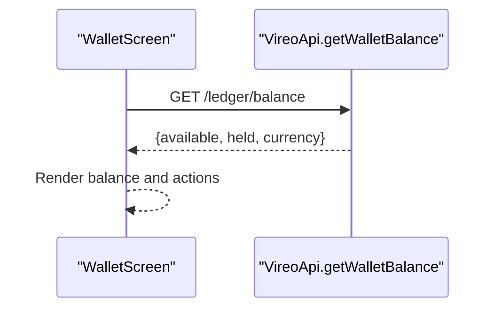

**Diagram sources**
- [personal/src/screens/WalletScreen.tsx:19-21](file://personal/src/screens/WalletScreen.tsx#L19-L21)
- [personal/src/api.ts:53-56](file://personal/src/api.ts#L53-L56)

**Section sources**
- [personal/src/screens/WalletScreen.tsx:1-54](file://personal/src/screens/WalletScreen.tsx#L1-L54)
- [personal/src/api.ts:53-56](file://personal/src/api.ts#L53-L56)

#### Transfers and Biometric Signature Flow
- Creates transfer draft with type, amount, idempotency key, and device ID.
- Server returns a challenge; client signs payload hash using device secure hardware (biometric-unlocked key).
- Submits signed transfer to complete transaction.

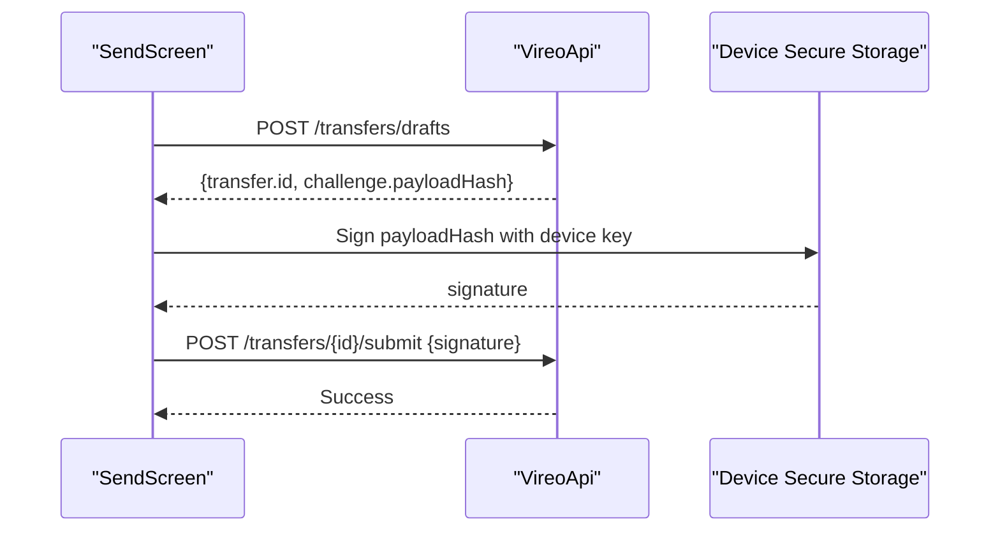

**Diagram sources**
- [personal/src/screens/SendScreen.tsx:23-41](file://personal/src/screens/SendScreen.tsx#L23-L41)
- [personal/src/screens/SendScreen.tsx:43-60](file://personal/src/screens/SendScreen.tsx#L43-L60)
- [personal/src/api.ts:63-81](file://personal/src/api.ts#L63-L81)

**Section sources**
- [personal/src/screens/SendScreen.tsx:1-90](file://personal/src/screens/SendScreen.tsx#L1-L90)
- [personal/src/api.ts:63-81](file://personal/src/api.ts#L63-L81)

#### Transactions List
- Fetches and displays recent transfers with recipient info, type, status, and amount.

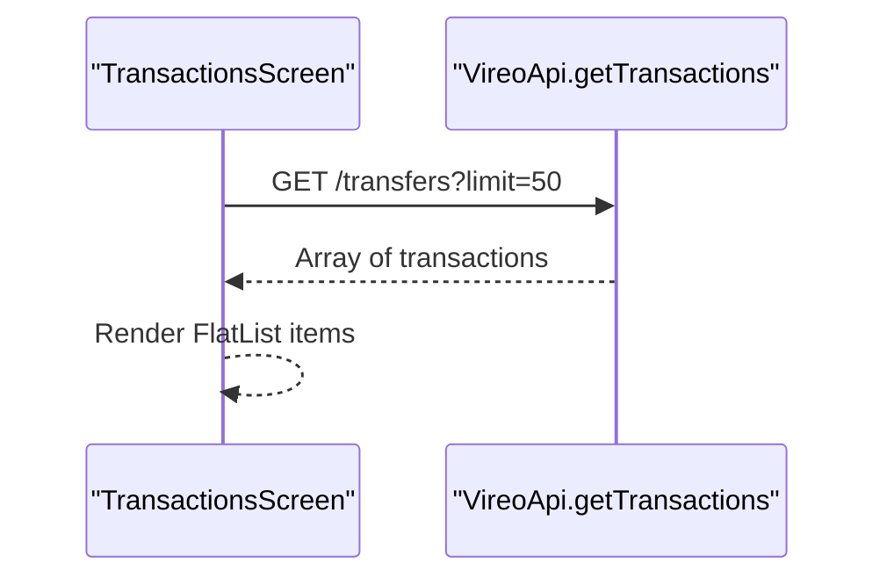

**Diagram sources**
- [personal/src/screens/TransactionsScreen.tsx:16-18](file://personal/src/screens/TransactionsScreen.tsx#L16-L18)
- [personal/src/api.ts:58-61](file://personal/src/api.ts#L58-L61)

**Section sources**
- [personal/src/screens/TransactionsScreen.tsx:1-62](file://personal/src/screens/TransactionsScreen.tsx#L1-L62)
- [personal/src/api.ts:58-61](file://personal/src/api.ts#L58-L61)

#### KYC Submission and Status
- Allows provider selection and optional payload submission; checks KYC status.

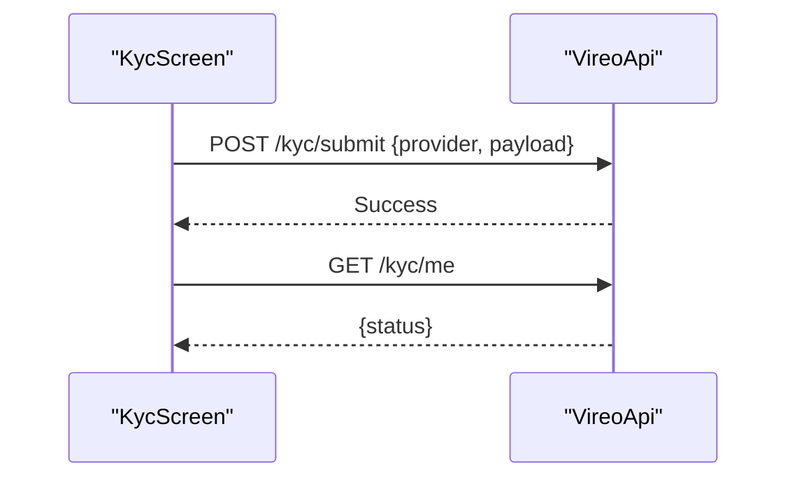

**Diagram sources**
- [personal/src/screens/KycScreen.tsx:19-30](file://personal/src/screens/KycScreen.tsx#L19-L30)
- [personal/src/screens/KycScreen.tsx:32-42](file://personal/src/screens/KycScreen.tsx#L32-L42)
- [personal/src/api.ts:83-91](file://personal/src/api.ts#L83-L91)

**Section sources**
- [personal/src/screens/KycScreen.tsx:1-73](file://personal/src/screens/KycScreen.tsx#L1-L73)
- [personal/src/api.ts:83-91](file://personal/src/api.ts#L83-L91)

### Merchant Dashboard App

#### Navigation and Entry Point
- Wraps UI with SafeAreaProvider and AuthProvider; conditionally shows Onboard or main screens (Dashboard, CreateOrder, Orders, Settle).

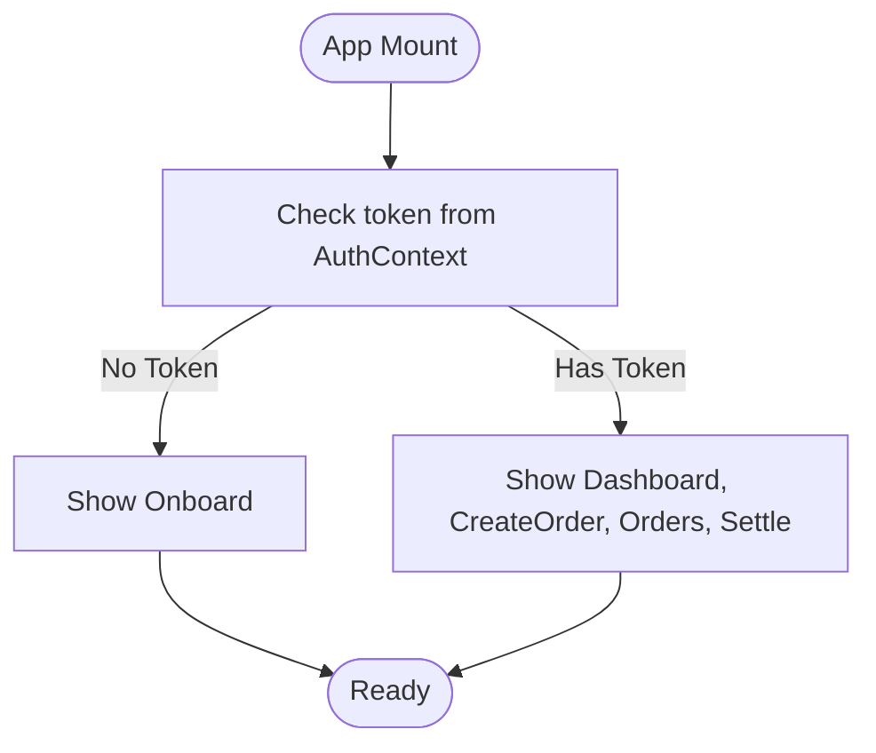

**Diagram sources**
- [merchant/App.tsx:15-41](file://merchant/App.tsx#L15-L41)

**Section sources**
- [merchant/App.tsx:1-54](file://merchant/App.tsx#L1-L54)

#### Merchant Onboarding
- Registers merchant account and collects business details including settlement bank information.

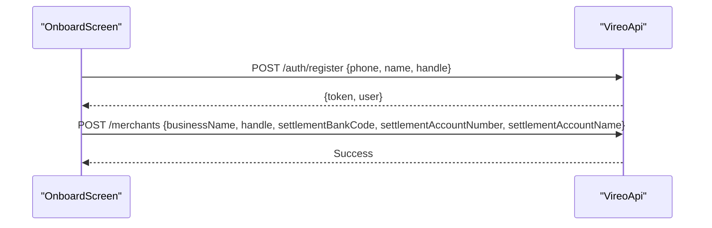

**Diagram sources**
- [merchant/src/screens/OnboardScreen.tsx:18-45](file://merchant/src/screens/OnboardScreen.tsx#L18-L45)
- [merchant/src/api.ts:23-26](file://merchant/src/api.ts#L23-L26)
- [merchant/src/api.ts:53-62](file://merchant/src/api.ts#L53-L62)

**Section sources**
- [merchant/src/screens/OnboardScreen.tsx:1-73](file://merchant/src/screens/OnboardScreen.tsx#L1-L73)
- [merchant/src/api.ts:23-26](file://merchant/src/api.ts#L23-L26)
- [merchant/src/api.ts:53-62](file://merchant/src/api.ts#L53-L62)

#### Analytics Dashboard
- Fetches dashboard data including balance and sales today; presents cards and action buttons.

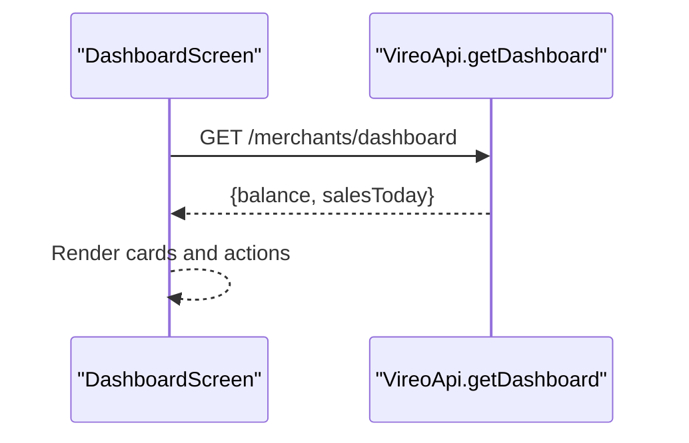

**Diagram sources**
- [merchant/src/screens/DashboardScreen.tsx:19-24](file://merchant/src/screens/DashboardScreen.tsx#L19-L24)
- [merchant/src/api.ts:69-72](file://merchant/src/api.ts#L69-L72)

**Section sources**
- [merchant/src/screens/DashboardScreen.tsx:1-63](file://merchant/src/screens/DashboardScreen.tsx#L1-L63)
- [merchant/src/api.ts:69-72](file://merchant/src/api.ts#L69-L72)

#### Order Management
- Creates payment orders and generates QR payloads for customer payments; lists orders with reference, merchant name, status, and amount.

```mermaid
sequenceDiagram
participant Create as "CreateOrderScreen"
participant List as "OrdersScreen"
participant Api as "VireoApi"
Create->>Api : POST /merchants/orders {amount, note}
Api-->>Create : {qrPayload, reference}
List->>Api : GET /merchants/orders
Api-->>List : Array of orders
```

**Diagram sources**
- [merchant/src/screens/CreateOrderScreen.tsx:20-31](file://merchant/src/screens/CreateOrderScreen.tsx#L20-L31)
- [merchant/src/screens/OrdersScreen.tsx:16-18](file://merchant/src/screens/OrdersScreen.tsx#L16-L18)
- [merchant/src/api.ts:74-82](file://merchant/src/api.ts#L74-L82)

**Section sources**
- [merchant/src/screens/CreateOrderScreen.tsx:1-69](file://merchant/src/screens/CreateOrderScreen.tsx#L1-L69)
- [merchant/src/screens/OrdersScreen.tsx:1-60](file://merchant/src/screens/OrdersScreen.tsx#L1-L60)
- [merchant/src/api.ts:74-82](file://merchant/src/api.ts#L74-L82)

#### Settlement Processing
- Initiates settlement to bank with optional amount; shows status feedback.

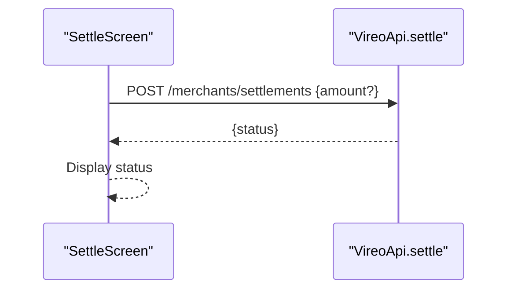

**Diagram sources**
- [merchant/src/screens/SettleScreen.tsx:18-29](file://merchant/src/screens/SettleScreen.tsx#L18-L29)
- [merchant/src/api.ts:84-87](file://merchant/src/api.ts#L84-L87)

**Section sources**
- [merchant/src/screens/SettleScreen.tsx:1-57](file://merchant/src/screens/SettleScreen.tsx#L1-L57)
- [merchant/src/api.ts:84-87](file://merchant/src/api.ts#L84-L87)

## Dependency Analysis
The apps depend on shared patterns:
- React Navigation for screen routing.
- React Context for authentication state.
- Axios for HTTP requests.
- Expo Status Bar and Safe Area Provider for platform UI consistency.

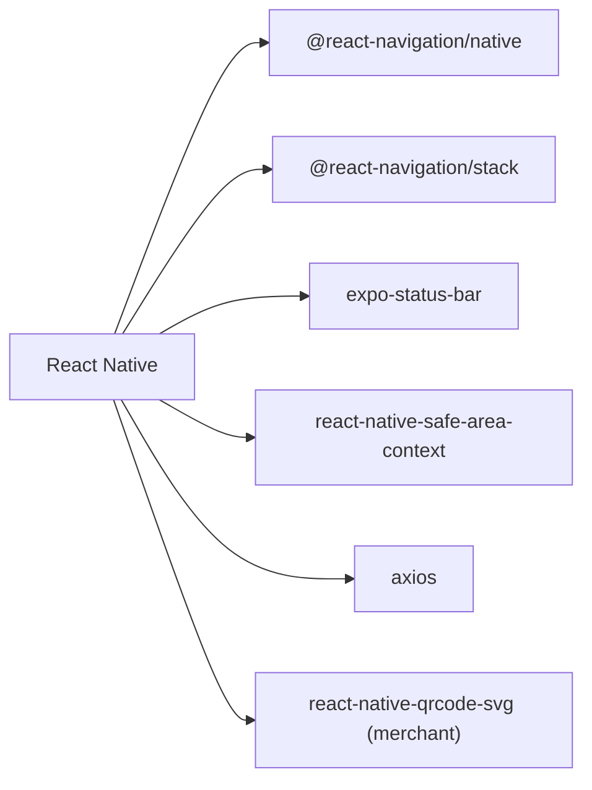

**Diagram sources**
- [personal/App.tsx:1-12](file://personal/App.tsx#L1-L12)
- [merchant/App.tsx:1-11](file://merchant/App.tsx#L1-L11)
- [merchant/src/screens/CreateOrderScreen.tsx:5](file://merchant/src/screens/CreateOrderScreen.tsx#L5)
- [personal/src/api.ts:1](file://personal/src/api.ts#L1)
- [merchant/src/api.ts:1](file://merchant/src/api.ts#L1)

**Section sources**
- [personal/App.tsx:1-12](file://personal/App.tsx#L1-L12)
- [merchant/App.tsx:1-11](file://merchant/App.tsx#L1-L11)
- [personal/src/api.ts:1](file://personal/src/api.ts#L1)
- [merchant/src/api.ts:1](file://merchant/src/api.ts#L1)

## Performance Considerations
- Minimize re-renders by memoizing expensive computations and using stable references in callbacks.
- Use pagination or limit parameters for list screens (e.g., transactions) to reduce payload size.
- Debounce input fields where appropriate to avoid excessive API calls.
- Cache static assets and consider using React Query or SWR for server state caching if needed.
- Optimize images and QR codes; ensure QR generation is only triggered when necessary.

[No sources needed since this section provides general guidance]

## Troubleshooting Guide
Common issues and resolutions:
- Authentication failures: Ensure token is correctly stored and Authorization header is set; verify environment variables for API base URL.
- Network errors: Check connectivity and CORS settings; validate request payloads and required fields.
- Biometric signature errors: Confirm device secure storage is accessible; ensure challenge payload hash matches expected format before signing.
- KYC submission errors: Validate provider and payload formats; check backend validation rules.
- Settlement errors: Verify settlement bank details and amounts; confirm merchant onboarding completion.

**Section sources**
- [personal/src/contexts/AuthContext.tsx:20-39](file://personal/src/contexts/AuthContext.tsx#L20-L39)
- [personal/src/api.ts:15-21](file://personal/src/api.ts#L15-L21)
- [personal/src/screens/SendScreen.tsx:43-60](file://personal/src/screens/SendScreen.tsx#L43-L60)
- [personal/src/screens/KycScreen.tsx:19-42](file://personal/src/screens/KycScreen.tsx#L19-L42)
- [merchant/src/screens/SettleScreen.tsx:18-29](file://merchant/src/screens/SettleScreen.tsx#L18-L29)

## Conclusion
The Personal Banking App and Merchant Dashboard App implement robust, modular architectures with clear separation of concerns across presentation, state, and data layers. They provide essential banking and merchant workflows, including secure biometric signatures and challenge-response flows. Following the outlined best practices for performance, accessibility, and cross-platform compatibility will enhance user experience and maintainability.

[No sources needed since this section summarizes without analyzing specific files]

## Appendices

### Biometric Signature Implementation Guidelines
- Use device secure storage to generate and store asymmetric keys unlocked by biometrics.
- Derive a public key and register it with the backend via registerDevice endpoint.
- For sensitive operations (e.g., transfers), sign challenge.payloadHash locally and submit signature to backend.
- Enforce minimum key lengths and supported algorithms per platform capabilities.
- Handle edge cases: biometric enrollment missing, device not supported, and signature verification failures.

**Section sources**
- [personal/src/api.ts:43-51](file://personal/src/api.ts#L43-L51)
- [personal/src/screens/SendScreen.tsx:43-60](file://personal/src/screens/SendScreen.tsx#L43-L60)

### Responsive Design and Accessibility Compliance
- Use scalable typography and spacing; test on various screen sizes and orientations.
- Ensure sufficient color contrast and readable text sizes.
- Provide accessible labels and roles for inputs and buttons.
- Support dynamic font scaling and system accessibility settings.
- Test with screen readers and keyboard navigation where applicable.

[No sources needed since this section provides general guidance]

### Cross-Platform Compatibility Considerations
- Leverage Expo Status Bar and Safe Area Provider for consistent UI across iOS and Android.
- Validate platform-specific behaviors for biometric APIs and secure storage.
- Use conditional logic for platform differences in QR rendering and device capabilities.
- Test thoroughly on both platforms to catch OS-specific quirks.

**Section sources**
- [personal/App.tsx:3-4](file://personal/App.tsx#L3-L4)
- [merchant/App.tsx:3-4](file://merchant/App.tsx#L3-L4)
- [merchant/src/screens/CreateOrderScreen.tsx:5](file://merchant/src/screens/CreateOrderScreen.tsx#L5)