# Personal Banking App

<cite>
**Referenced Files in This Document**
- [App.tsx](file://personal/App.tsx)
- [AuthContext.tsx](file://personal/src/contexts/AuthContext.tsx)
- [api.ts](file://personal/src/api.ts)
- [RegisterScreen.tsx](file://personal/src/screens/RegisterScreen.tsx)
- [OtpVerifyScreen.tsx](file://personal/src/screens/OtpVerifyScreen.tsx)
- [WalletScreen.tsx](file://personal/src/screens/WalletScreen.tsx)
- [SendScreen.tsx](file://personal/src/screens/SendScreen.tsx)
- [TransactionsScreen.tsx](file://personal/src/screens/TransactionsScreen.tsx)
- [KycScreen.tsx](file://personal/src/screens/KycScreen.tsx)
- [challenges.service.ts](file://backend/src/challenges/challenges.service.ts)
- [challenge.entity.ts](file://backend/src/challenges/challenge.entity.ts)
- [device.entity.ts](file://backend/src/auth/device.entity.ts)
- [crypto.ts](file://backend/src/common/crypto.ts)
- [agent.service.ts](file://backend/src/agent/agent.service.ts)
- [docs.md](file://docs.md)
</cite>

## Table of Contents
1. [Introduction](#introduction)
2. [Project Structure](#project-structure)
3. [Core Components](#core-components)
4. [Architecture Overview](#architecture-overview)
5. [Detailed Component Analysis](#detailed-component-analysis)
6. [Dependency Analysis](#dependency-analysis)
7. [Performance Considerations](#performance-considerations)
8. [Troubleshooting Guide](#troubleshooting-guide)
9. [Conclusion](#conclusion)
10. [Appendices](#appendices)

## Introduction
This document explains the Personal Banking React Native application, covering its navigation architecture, authentication context, screen flows, and integration with the backend for wallet management, transfers, KYC, and AI agent capabilities. It also documents biometric device key enrollment and challenge-response authorization patterns, API usage, error handling, state management, and guidelines for responsive design, accessibility, and cross-platform compatibility.

## Project Structure
The personal app is a React Native application using React Navigation for routing and a local AuthContext for session state. Screens are organized by user journey: registration, OTP verification, wallet overview, money transfer initiation, transaction history, and KYC submission. The app communicates with a NestJS backend through an Axios-based API client.

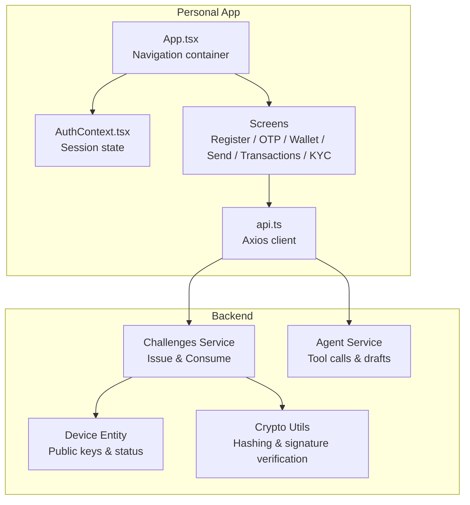

**Diagram sources**
- [App.tsx:1-59](file://personal/App.tsx#L1-L59)
- [AuthContext.tsx:1-55](file://personal/src/contexts/AuthContext.tsx#L1-L55)
- [api.ts:1-95](file://personal/src/api.ts#L1-L95)
- [challenges.service.ts:1-125](file://backend/src/challenges/challenges.service.ts#L1-L125)
- [device.entity.ts:1-35](file://backend/src/auth/device.entity.ts#L1-L35)
- [crypto.ts:1-84](file://backend/src/common/crypto.ts#L1-L84)
- [agent.service.ts:1-260](file://backend/src/agent/agent.service.ts#L1-L260)

**Section sources**
- [App.tsx:1-59](file://personal/App.tsx#L1-L59)
- [docs.md:1-20](file://docs.md#L1-L20)

## Core Components
- Navigation and routing: Stack navigator switches between unauthenticated screens (Register, OtpVerify) and authenticated screens (Wallet, Send, Transactions, Kyc).
- Authentication context: Holds token, user, loading state, and provides login/logout/setToken methods that update both UI state and the API client’s Authorization header.
- API client: Centralized Axios instance with base URL, token management, and typed endpoints for auth, ledger, transfers, KYC, and device registration.
- Screens: Each screen manages local state, calls the API client, updates UI, and navigates to other screens.

Key responsibilities:
- App.tsx orchestrates navigation and guards routes based on token presence.
- AuthContext.tsx centralizes session state and persists it via the API client.
- api.ts encapsulates HTTP requests and headers.
- Screens implement user workflows and error handling.

**Section sources**
- [App.tsx:14-46](file://personal/App.tsx#L14-L46)
- [AuthContext.tsx:15-45](file://personal/src/contexts/AuthContext.tsx#L15-L45)
- [api.ts:5-21](file://personal/src/api.ts#L5-L21)

## Architecture Overview
The app follows a layered approach:
- Presentation layer: React Native screens and React Navigation stack.
- State layer: Local component state plus global AuthContext.
- Data layer: Axios-based API client calling backend services.
- Backend services: Challenges service for secure authorization, Agent service for conversational banking tools, Ledger and Transfers for financial operations, and KYC endpoints.

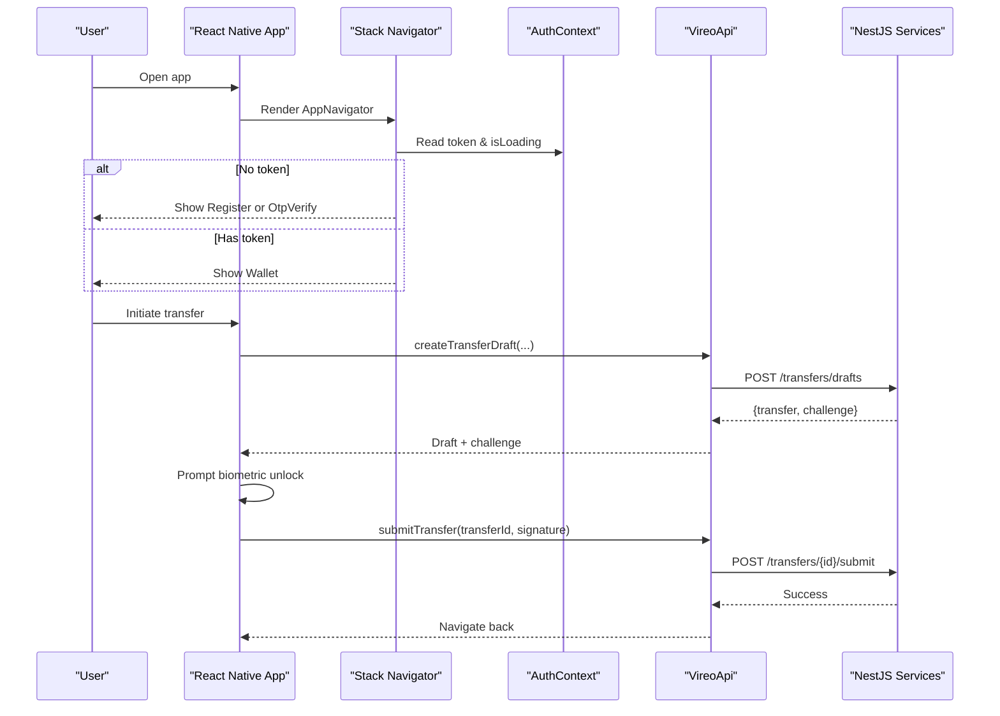

**Diagram sources**
- [App.tsx:16-46](file://personal/App.tsx#L16-L46)
- [SendScreen.tsx:23-60](file://personal/src/screens/SendScreen.tsx#L23-L60)
- [api.ts:63-81](file://personal/src/api.ts#L63-L81)
- [challenges.service.ts:39-111](file://backend/src/challenges/challenges.service.ts#L39-L111)

## Detailed Component Analysis

### Navigation and Routing
- Uses createStackNavigator with header hidden.
- Conditional rendering: if no token, show Register and OtpVerify; otherwise show Wallet, Send, Transactions, and Kyc.
- Loading state shows ActivityIndicator while AuthContext initializes.

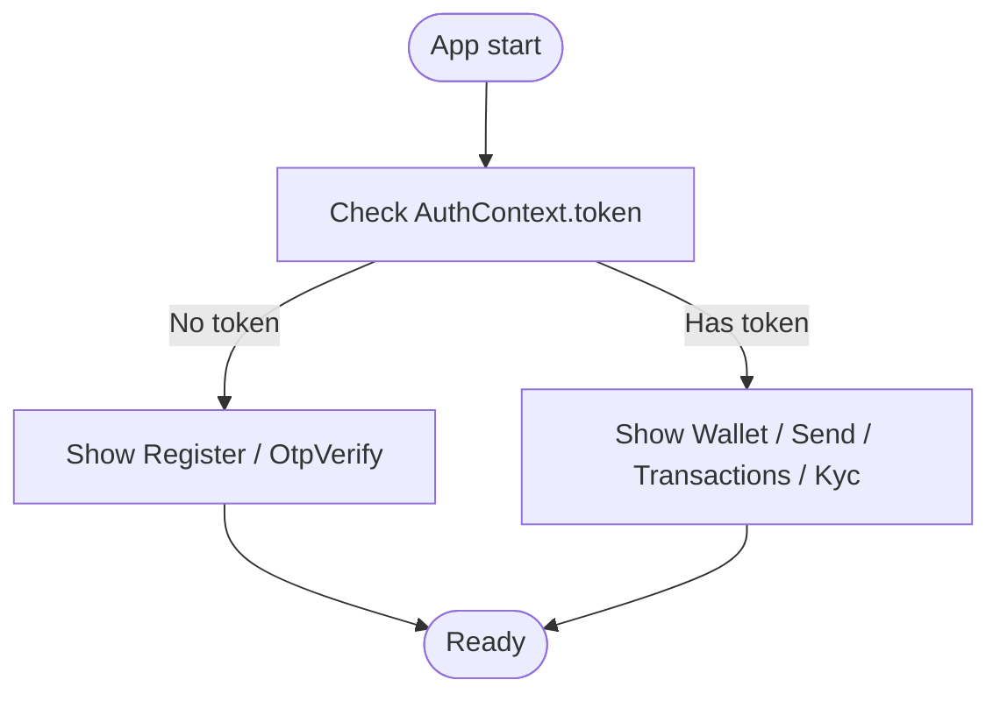

**Diagram sources**
- [App.tsx:16-46](file://personal/App.tsx#L16-L46)

**Section sources**
- [App.tsx:14-46](file://personal/App.tsx#L14-L46)

### Authentication Context Management
- Provides token, user, isLoading, login, logout, setToken.
- login sets local state and updates API client Authorization header.
- logout clears local state and removes Authorization header.
- setToken toggles API client header based on token presence.

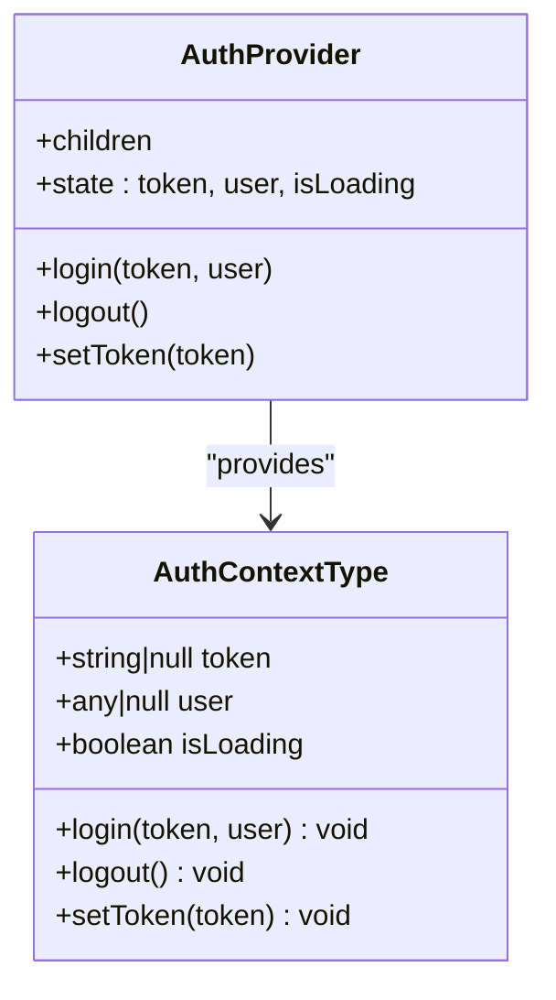

**Diagram sources**
- [AuthContext.tsx:4-11](file://personal/src/contexts/AuthContext.tsx#L4-L11)
- [AuthContext.tsx:15-45](file://personal/src/contexts/AuthContext.tsx#L15-L45)

**Section sources**
- [AuthContext.tsx:15-55](file://personal/src/contexts/AuthContext.tsx#L15-L55)

### API Integration Patterns
- Base URL configurable via environment variable; defaults to localhost development server.
- Token management via setToken/clearToken on Axios defaults.
- Endpoints:
  - Auth: register, requestOtp, verifyOtp, getProfile, registerDevice
  - Ledger: getWalletBalance
  - Transfers: getTransactions, createTransferDraft, submitTransfer
  - KYC: submitKyc, getKycStatus

Error handling:
- Screens catch network errors and display message from response.data.message when available.

**Section sources**
- [api.ts:1-95](file://personal/src/api.ts#L1-L95)
- [RegisterScreen.tsx:16-31](file://personal/src/screens/RegisterScreen.tsx#L16-L31)
- [OtpVerifyScreen.tsx:27-42](file://personal/src/screens/OtpVerifyScreen.tsx#L27-L42)

### Screen Implementations

#### Registration Flow
- Collects phone, name, optional handle.
- Calls register endpoint; on success, logs in via AuthContext.
- Displays errors and allows navigation to OTP verification.

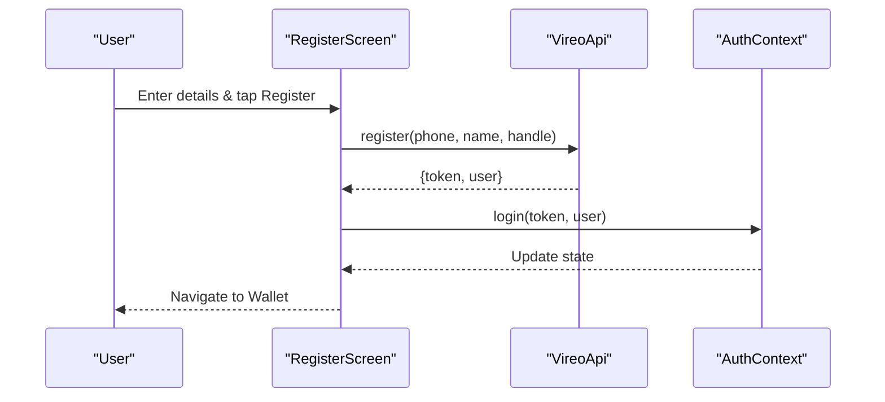

**Diagram sources**
- [RegisterScreen.tsx:16-31](file://personal/src/screens/RegisterScreen.tsx#L16-L31)
- [AuthContext.tsx:20-24](file://personal/src/contexts/AuthContext.tsx#L20-L24)
- [api.ts:23-26](file://personal/src/api.ts#L23-L26)

**Section sources**
- [RegisterScreen.tsx:1-73](file://personal/src/screens/RegisterScreen.tsx#L1-L73)

#### OTP Verification Flow
- Requests OTP then verifies code.
- On success, logs in via AuthContext.
- Handles errors and navigation.

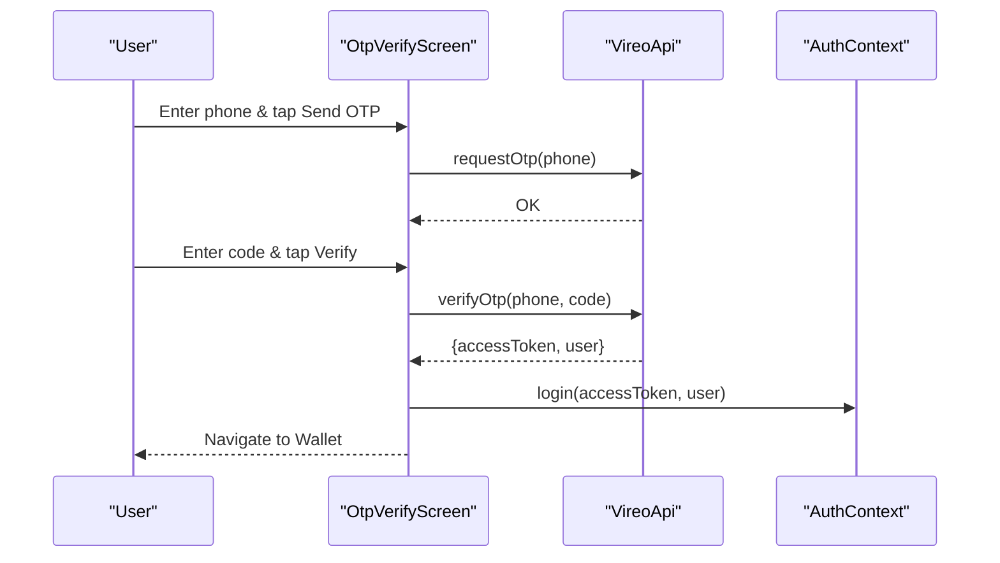

**Diagram sources**
- [OtpVerifyScreen.tsx:15-42](file://personal/src/screens/OtpVerifyScreen.tsx#L15-L42)
- [api.ts:28-36](file://personal/src/api.ts#L28-L36)
- [AuthContext.tsx:20-24](file://personal/src/contexts/AuthContext.tsx#L20-L24)

**Section sources**
- [OtpVerifyScreen.tsx:1-81](file://personal/src/screens/OtpVerifyScreen.tsx#L1-L81)

#### Wallet Overview
- Fetches balance on mount.
- Shows welcome message, available balance, and actions to send money, view transactions, and submit KYC.

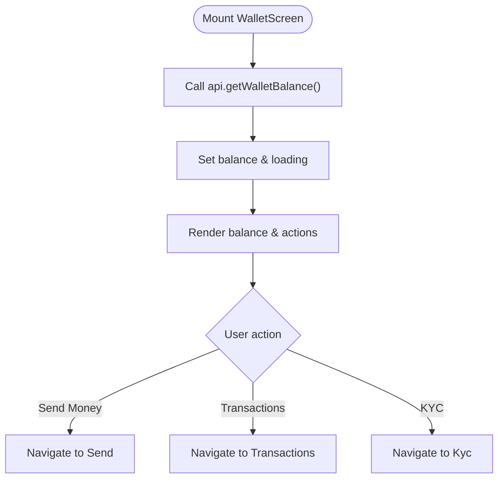

**Diagram sources**
- [WalletScreen.tsx:14-41](file://personal/src/screens/WalletScreen.tsx#L14-L41)
- [api.ts:53-56](file://personal/src/api.ts#L53-L56)

**Section sources**
- [WalletScreen.tsx:1-54](file://personal/src/screens/WalletScreen.tsx#L1-L54)

#### Transfer Initiation and Biometric Challenge-Response
- Creates a transfer draft with type, amount, idempotency key, device ID, and recipient info.
- Backend issues a cryptographic challenge bound to the payload hash.
- Client prompts biometric unlock to sign the challenge payload hash using the device’s secure hardware key.
- Submits the signed challenge to finalize the transfer.

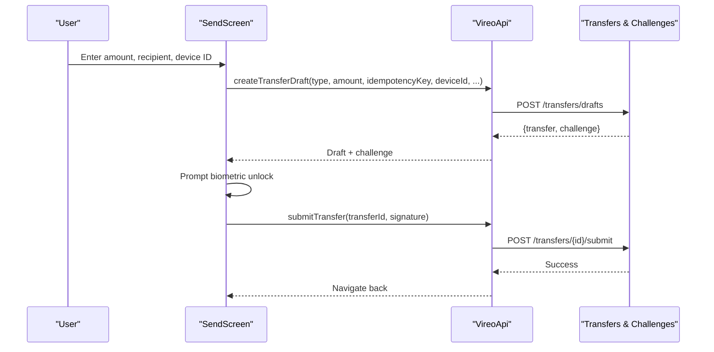

**Diagram sources**
- [SendScreen.tsx:23-60](file://personal/src/screens/SendScreen.tsx#L23-L60)
- [api.ts:63-81](file://personal/src/api.ts#L63-L81)
- [challenges.service.ts:39-111](file://backend/src/challenges/challenges.service.ts#L39-L111)

**Section sources**
- [SendScreen.tsx:1-90](file://personal/src/screens/SendScreen.tsx#L1-L90)
- [challenges.service.ts:39-111](file://backend/src/challenges/challenges.service.ts#L39-L111)

#### Transaction History
- Fetches recent transfers and renders them in a list.
- Shows loading indicator while fetching.

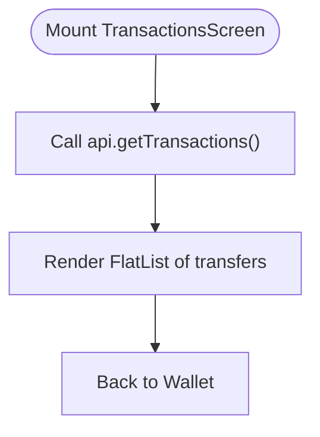

**Diagram sources**
- [TransactionsScreen.tsx:12-47](file://personal/src/screens/TransactionsScreen.tsx#L12-L47)
- [api.ts:58-61](file://personal/src/api.ts#L58-L61)

**Section sources**
- [TransactionsScreen.tsx:1-62](file://personal/src/screens/TransactionsScreen.tsx#L1-L62)

#### KYC Compliance Workflow
- Allows provider selection and optional payload submission.
- Submits KYC data and checks status.
- Displays errors and current status.

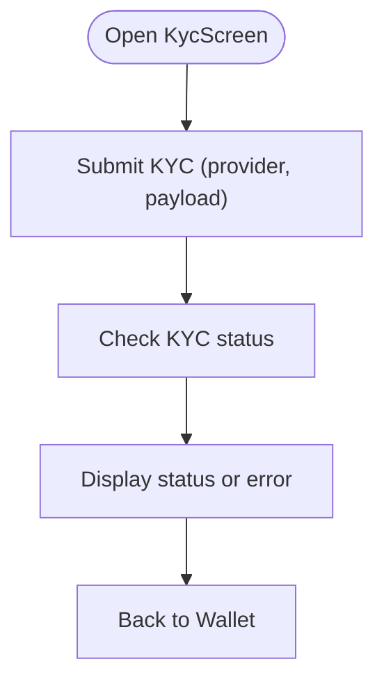

**Diagram sources**
- [KycScreen.tsx:19-42](file://personal/src/screens/KycScreen.tsx#L19-L42)
- [api.ts:83-91](file://personal/src/api.ts#L83-L91)

**Section sources**
- [KycScreen.tsx:1-73](file://personal/src/screens/KycScreen.tsx#L1-L73)

### Biometric Authentication and Device Secure Storage
- Device public key is generated in secure hardware and registered with the backend.
- Each sensitive operation uses a challenge-response flow:
  - Backend issues a challenge with a nonce, payload, and payload hash.
  - Client signs the payload hash using the device key unlocked by biometrics.
  - Backend verifies the signature against the stored public key and marks the challenge used.

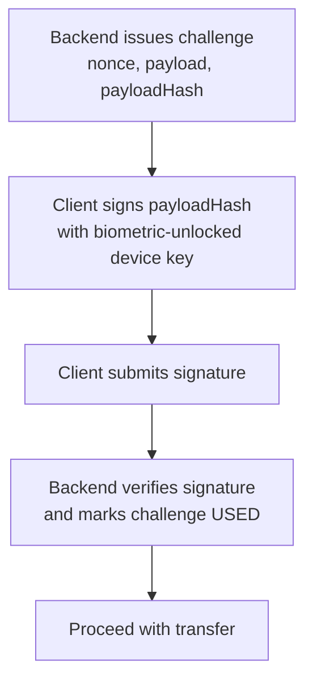

**Diagram sources**
- [challenges.service.ts:39-111](file://backend/src/challenges/challenges.service.ts#L39-L111)
- [device.entity.ts:1-35](file://backend/src/auth/device.entity.ts#L1-L35)
- [crypto.ts:68-84](file://backend/src/common/crypto.ts#L68-L84)

Security best practices:
- Use platform secure hardware (Secure Enclave/Keystore) for key generation and signing.
- Bind challenges to specific payloads and enforce short TTLs.
- Validate device status and algorithm before accepting signatures.
- Avoid libraries that only return boolean biometric results for authorization decisions.

**Section sources**
- [challenges.service.ts:39-111](file://backend/src/challenges/challenges.service.ts#L39-L111)
- [device.entity.ts:1-35](file://backend/src/auth/device.entity.ts#L1-L35)
- [crypto.ts:68-84](file://backend/src/common/crypto.ts#L68-L84)
- [docs.md:138-147](file://docs.md#L138-L147)

### AI Agent Integration
- The backend exposes an AgentService with narrow tools: get_balance, list_transactions, validate_recipient, create_transfer_draft, create_payment_request, explain_fee.
- The agent cannot move money directly; it creates drafts requiring user approval via biometric signing.
- Tool calls are audited per session.

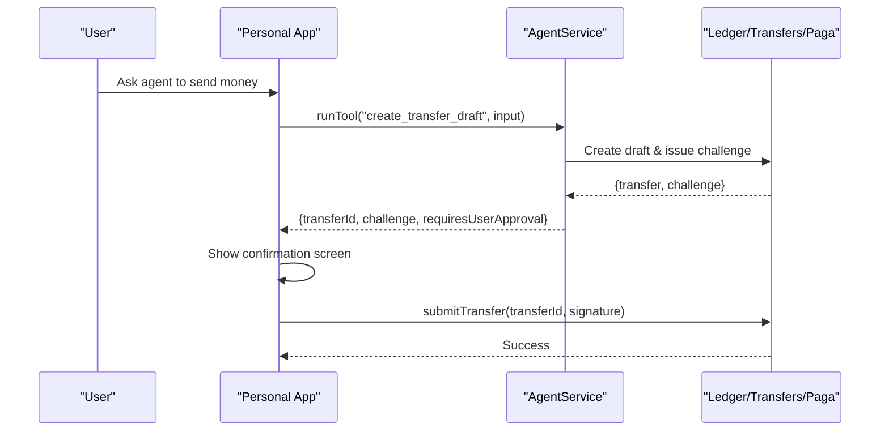

**Diagram sources**
- [agent.service.ts:57-113](file://backend/src/agent/agent.service.ts#L57-L113)
- [agent.service.ts:165-197](file://backend/src/agent/agent.service.ts#L165-L197)
- [docs.md:128-136](file://docs.md#L128-L136)

**Section sources**
- [agent.service.ts:1-260](file://backend/src/agent/agent.service.ts#L1-L260)
- [docs.md:128-136](file://docs.md#L128-L136)

## Dependency Analysis
- App.tsx depends on AuthContext and all screens.
- Screens depend on AuthContext and api.ts.
- api.ts depends on axios and environment variables.
- Backend services depend on TypeORM entities and shared crypto utilities.

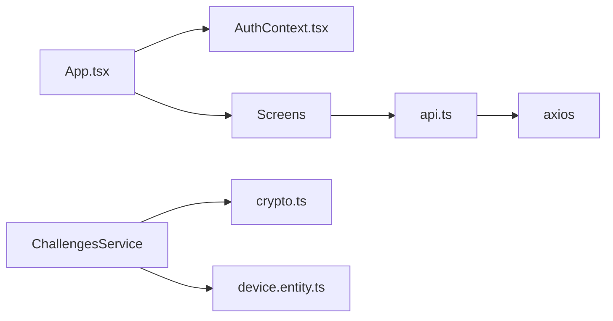

**Diagram sources**
- [App.tsx:1-12](file://personal/App.tsx#L1-L12)
- [AuthContext.tsx:1-3](file://personal/src/contexts/AuthContext.tsx#L1-L3)
- [api.ts:1-13](file://personal/src/api.ts#L1-L13)
- [challenges.service.ts:1-14](file://backend/src/challenges/challenges.service.ts#L1-L14)
- [device.entity.ts:1-3](file://backend/src/auth/device.entity.ts#L1-L3)
- [crypto.ts:1-9](file://backend/src/common/crypto.ts#L1-L9)

**Section sources**
- [App.tsx:1-12](file://personal/App.tsx#L1-L12)
- [api.ts:1-13](file://personal/src/api.ts#L1-L13)

## Performance Considerations
- Minimize re-renders by keeping state local where possible and using memoization for expensive computations.
- Debounce or throttle repeated API calls (e.g., search or auto-suggest features).
- Use pagination or limit parameters for lists like transactions.
- Cache static data (e.g., bank lists) on the backend to reduce latency.
- Keep network requests lightweight and avoid unnecessary payload sizes.

[No sources needed since this section provides general guidance]

## Troubleshooting Guide
Common issues and resolutions:
- Network errors: Ensure EXPO_PUBLIC_API_BASE_URL is correctly configured and reachable.
- Authentication failures: Confirm token is present and Authorization header is set via api.setToken.
- Invalid OTP: Verify phone number format and retry OTP request if necessary.
- Transfer submission fails: Ensure device ID matches a registered active device and signature corresponds to the challenge payload hash.
- KYC submission errors: Validate provider and payload fields; check backend responses for detailed messages.

**Section sources**
- [RegisterScreen.tsx:26-31](file://personal/src/screens/RegisterScreen.tsx#L26-L31)
- [OtpVerifyScreen.tsx:37-42](file://personal/src/screens/OtpVerifyScreen.tsx#L37-L42)
- [SendScreen.tsx:43-60](file://personal/src/screens/SendScreen.tsx#L43-L60)
- [KycScreen.tsx:25-42](file://personal/src/screens/KycScreen.tsx#L25-L42)

## Conclusion
The Personal Banking app integrates React Navigation, a centralized authentication context, and a robust API client to deliver a seamless user experience from registration through KYC to wallet management and transfers. Security is enforced via device-bound biometric signing and challenge-response authorization. The AI agent augments the UX by proposing actions but never executing them without explicit user approval. Following the outlined patterns ensures maintainability, security, and scalability.

[No sources needed since this section summarizes without analyzing specific files]

## Appendices

### Responsive Design Guidelines
- Use flex layouts and relative units to adapt to different screen sizes.
- Provide adequate touch targets and spacing for usability.
- Test on multiple devices and orientations.

[No sources needed since this section provides general guidance]

### Accessibility Compliance
- Add accessible labels and roles to interactive elements.
- Ensure sufficient color contrast and readable font sizes.
- Support screen readers and keyboard navigation where applicable.

[No sources needed since this section provides general guidance]

### Cross-Platform Compatibility
- Use React Native primitives consistently across iOS and Android.
- Handle platform-specific behaviors (e.g., biometric APIs) via conditional logic.
- Validate environment variables and API endpoints per platform configuration.

[No sources needed since this section provides general guidance]