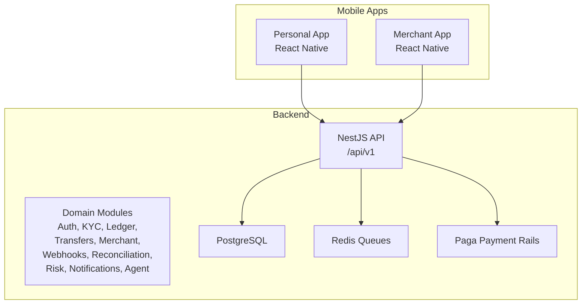
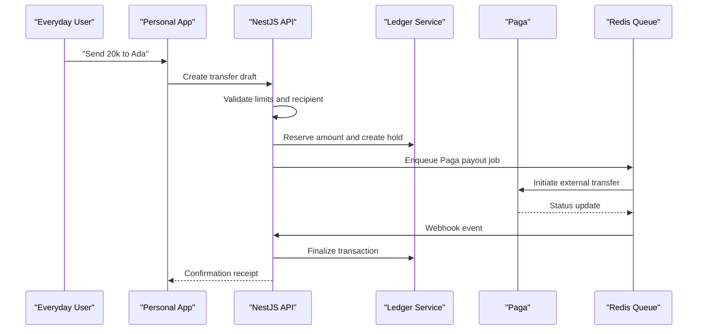
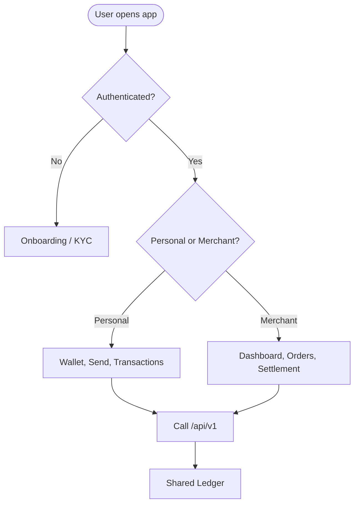
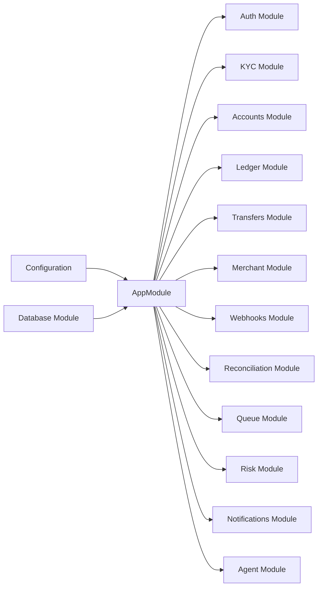

# Project Overview

<cite>
**Referenced Files in This Document**
- [docs.md](file://docs.md)
- [app.module.ts](file://backend/src/app.module.ts)
- [main.ts](file://backend/src/main.ts)
- [App.tsx (Personal)](file://personal/App.tsx)
- [App.tsx (Merchant)](file://merchant/App.tsx)
</cite>

## Table of Contents
1. [Introduction](#introduction)
2. [Project Structure](#project-structure)
3. [Core Components](#core-components)
4. [Architecture Overview](#architecture-overview)
5. [Detailed Component Analysis](#detailed-component-analysis)
6. [Dependency Analysis](#dependency-analysis)
7. [Performance Considerations](#performance-considerations)
8. [Troubleshooting Guide](#troubleshooting-guide)
9. [Conclusion](#conclusion)
10. [Appendices](#appendices)

## Introduction
Vireo Finance is a Nigerian banking product with a clear vision: money that responds to you, not to your devices. The platform offers two complementary sides:

- Vireo Personal: agentic personal banking where users manage money through an AI agent and approve every movement using their phone’s biometrics.
- Vireo Merchant: merchant services designed for device-less and biometric extremes, allowing customers to pay with face and voice at the till without needing a phone, card, or wallet.

Both sides share one ledger, one Paga integration, one KYC system, and one fraud engine. This shared foundation keeps balances consistent, reduces duplication, and makes it easier to operate, audit, and scale both consumer and merchant experiences from a single financial core.

The problem statement focuses on three pain points:
- Everyday banking apps are menu-heavy and make simple intents take too many taps.
- Some people cannot easily handle devices, cards, or PINs, or do not want to carry anything, so cash and cards fail them at the point of sale.
- Merchants lose sales and time to failed payments and wait too long for settlement.

The product goals emphasize speed, simplicity, cryptographic authorization, and compliance within Nigerian payments rules. Non-goals for v1 include lending, credit scoring, savings, investments, international transfers, multi-currency support, building proprietary biometric models from scratch, and fully autonomous agent payments without user approval.

**Section sources**
- [docs.md:5-37](file://docs.md#L5-L37)

## Project Structure
At a high level, the repository contains:

- Backend: A NestJS application exposing REST APIs under `/api/v1`. It wires together modules for accounts, authentication, KYC, ledger, transfers, merchants, webhooks, reconciliation, queues, risk, notifications, health checks, and an agent layer.
- Personal app: A React Native mobile application for everyday users, including registration, OTP verification, wallet view, sending money, transaction history, and KYC.
- Merchant app: A React Native mobile application for merchants, including onboarding, dashboard, order creation, order listing, and settlement.

**Diagram sources**
- [main.ts:7-21](file://backend/src/main.ts#L7-L21)
- [app.module.ts:21-43](file://backend/src/app.module.ts#L21-L43)
- [App.tsx (Personal):1-59](file://personal/App.tsx#L1-L59)
- [App.tsx (Merchant):1-54](file://merchant/App.tsx#L1-L54)

**Section sources**
- [main.ts:7-21](file://backend/src/main.ts#L7-L21)
- [app.module.ts:21-43](file://backend/src/app.module.ts#L21-L43)
- [App.tsx (Personal):1-59](file://personal/App.tsx#L1-L59)
- [App.tsx (Merchant):1-54](file://merchant/App.tsx#L1-L54)

## Core Components
The backend is organized as a modular NestJS application. The root module imports domain modules such as configuration, database, health, KYC, auth, accounts, ledger, challenges, risk, transfers, merchant, agent, webhooks, reconciliation, queue, and notifications. The bootstrap file sets global CORS, applies a validation pipe, prefixes all routes under `/api/v1`, reads the configured port, and starts the server.

Key responsibilities by area:

- Configuration and environment: Centralized config loading and validation.
- Database: PostgreSQL-backed persistence for entities and the double-entry ledger.
- Authentication and device security: Phone-based biometric signing and challenge handling.
- KYC: Identity verification and record management.
- Ledger: Double-entry accounting as the source of truth for balances and transactions.
- Transfers: Internal and external payment flows with holds, pending states, and completion logic.
- Merchant: Orders, settlements, and merchant-facing operations.
- Webhooks: Inbound events from Paga for deposits, payouts, and status updates.
- Reconciliation: Matching internal records with external statements.
- Queue: Background jobs for retries, settlement, and reconciliation tasks.
- Risk: Limits, velocity checks, anomaly flags, and step-up controls.
- Notifications: Alerts via push, SMS, and logging providers.
- Agent: Restricted tool layer that proposes actions but does not move money directly.

Target users include:

- Everyday users who want fast, simple banking.
- Device-averse customers who need to pay without carrying phones or cards.
- Small merchants who need reliable payments and timely settlement.
- Merchant staff operating tills.
- Operations and compliance teams monitoring disputes, audits, and risk.

**Section sources**
- [app.module.ts:21-43](file://backend/src/app.module.ts#L21-L43)
- [main.ts:7-21](file://backend/src/main.ts#L7-L21)
- [docs.md:39-81](file://docs.md#L39-L81)

## Architecture Overview
The architecture centers on a shared financial core behind a versioned API. Mobile clients call the backend, which coordinates with PostgreSQL, Redis queues, and Paga rails. The ledger is authoritative: internal moves are atomic, external calls are idempotent, and webhook-driven credits reconcile with queued jobs.

**Diagram sources**
- [docs.md:85-118](file://docs.md#L85-L118)
- [app.module.ts:21-43](file://backend/src/app.module.ts#L21-L43)
- [main.ts:7-21](file://backend/src/main.ts#L7-L21)

## Detailed Component Analysis

### Product Vision and Problem Statement
- Vision: Money should respond to you, not to your devices.
- Problems: Menu-heavy apps, biometric and device friction, and merchant settlement delays.
- Goals: Fast intent-driven banking, device-less merchant payments, cryptographic authorization, and regulatory compliance.
- Non-goals: Lending, investments, international transfers, multi-currency, building biometric models from scratch, and fully autonomous agent payments.

This framing guides feature prioritization and security design. For example, the agent can propose drafts but cannot sign or execute payments; the user’s device key remains the only authorization path.

**Section sources**
- [docs.md:14-37](file://docs.md#L14-L37)
- [docs.md:128-136](file://docs.md#L128-L136)

### Target Users
- Everyday user: Smartphone owner seeking fast, simple banking.
- Device-averse customer: Elderly, low-literacy, or no-device users who must pay without a phone or card.
- Small merchant: Shop, market stall, kiosk, or restaurant needing fast, reliable payments and settlement.
- Merchant staff: Cashiers operating the till.
- Operations and compliance: Internal team responsible for monitoring, disputes, and audit.

These personas shape the Personal and Merchant apps, the KYC flow, the risk engine, and the reconciliation processes.

**Section sources**
- [docs.md:39-47](file://docs.md#L39-L47)

### Dual-Platform Architecture
- Personal app: Provides registration, OTP verification, wallet view, sending money, transaction history, and KYC.
- Merchant app: Provides onboarding, dashboard, order creation, order listing, and settlement.

Both apps authenticate against the same backend and rely on the shared ledger, KYC, and risk systems.

**Diagram sources**
- [App.tsx (Personal):1-59](file://personal/App.tsx#L1-L59)
- [App.tsx (Merchant):1-54](file://merchant/App.tsx#L1-L54)
- [app.module.ts:21-43](file://backend/src/app.module.ts#L21-L43)

**Section sources**
- [App.tsx (Personal):1-59](file://personal/App.tsx#L1-L59)
- [App.tsx (Merchant):1-54](file://merchant/App.tsx#L1-L54)

### Shared Ledger, Paga Integration, KYC, and Fraud Engine
- One ledger: Double-entry accounting is the source of truth for balances and transactions. Internal moves are atomic; external moves use idempotency keys and status checks.
- One Paga integration: Virtual accounts, transfers, payouts, and webhooks are handled centrally.
- One KYC system: Identity verification supports both personal and merchant onboarding.
- One fraud engine: Limits, velocity checks, new payee/device rules, and anomaly flags protect both sides.

The product requirements document outlines how these components interact across sending, receiving, merchant payments, and future biometric flows.

**Section sources**
- [docs.md:7-12](file://docs.md#L7-L12)
- [docs.md:85-118](file://docs.md#L85-L118)
- [docs.md:158-171](file://docs.md#L158-L171)

### Technology Stack Overview
- Backend: TypeScript on NestJS.
- Database: PostgreSQL with a double-entry ledger.
- Queues and jobs: Redis with BullMQ for webhooks, retries, settlement, and reconciliation.
- Payments engine: Paga Business API and Collect API for virtual accounts, transfers, payouts, and webhooks.
- Mobile: React Native apps for Personal and Merchant, using key-signing biometrics.
- Agent service: LLM with a restricted tool layer calling backend APIs.
- Voice service (Phase 2+): Python service for speaker and spoof models.
- Biometric vendors (Phase 3): Certified liveness and matching provider.
- Risk engine: Limits, velocity checks, anomaly flags, and step-up controls.
- Observability: Audit logs, metrics, alerts, and admin console.

**Section sources**
- [docs.md:158-171](file://docs.md#L158-L171)

### Getting Started for Developers
To understand the repository structure and set up the project:

1. Explore the top-level directories:
   - `backend`: NestJS application with domain modules, entities, controllers, services, migrations, and configuration.
   - `personal`: React Native app for everyday users.
   - `merchant`: React Native app for merchants.
   - `docs.md`: Product requirements and roadmap.

2. Backend basics:
   - The application boots via the main entry file, enables CORS, applies a global validation pipe, prefixes routes under `/api/v1`, and listens on a configured port.
   - The root module wires configuration, database, health, KYC, auth, accounts, ledger, challenges, risk, transfers, merchant, agent, webhooks, reconciliation, queue, and notifications.

3. Mobile apps basics:
   - Both apps use React Navigation stacks and an authentication context.
   - Personal screens include register, OTP verify, wallet, send, transactions, and KYC.
   - Merchant screens include onboard, dashboard, create order, orders, and settle.

4. Environment and dependencies:
   - Install Node.js and a package manager compatible with the repository.
   - Configure environment variables for the backend, including database, Redis, Paga credentials, and API ports.
   - Run database migrations before starting the backend.
   - Start the backend and then run each mobile app according to its setup instructions.

5. Verify the API:
   - Confirm the backend is listening on the configured port.
   - Check the health endpoint if available.
   - Test basic endpoints for auth, KYC, and ledger access once implemented.

[No sources needed since this section provides general guidance]

## Dependency Analysis
The backend’s root module composes the system’s capabilities. High-level relationships:

- Configuration and database modules provide foundational services.
- Domain modules depend on the database and often on queues and risk services.
- Webhooks consume Paga events and update the ledger.
- Reconciliation compares internal records with external reports.
- Notifications alert users and operators about state changes.

**Diagram sources**
- [app.module.ts:21-43](file://backend/src/app.module.ts#L21-L43)

**Section sources**
- [app.module.ts:21-43](file://backend/src/app.module.ts#L21-L43)

## Performance Considerations
- Keep internal ledger transactions atomic to avoid inconsistent balances.
- Use idempotency keys for all external payment requests to prevent duplicates.
- Short-lived challenges and nonces reduce replay risk and improve throughput.
- Offload heavy work to Redis queues for retries, settlement, and reconciliation.
- Cache read-only data where safe, but never cache mutable balance state.
- Monitor webhook latency and failure rates; implement backoff and dead-letter handling.
- Profile database queries for frequent reads like transaction history and merchant dashboards.

[No sources needed since this section provides general guidance]

## Troubleshooting Guide
Common areas to inspect:

- Backend startup: Ensure the API prefix, CORS, validation pipe, and port are configured correctly.
- Environment variables: Validate required configuration values for database, Redis, Paga, and API settings.
- Webhooks: Verify signature validation, duplicate handling, and idempotent ledger updates.
- Reconciliation: Compare internal ledger entries with Paga statements and investigate mismatches.
- Queues: Check job retry policies, error logs, and dead-letter queues for stuck tasks.
- KYC and risk: Review enrollment failures, limit violations, and step-up decisions.
- Mobile apps: Confirm authentication tokens, navigation state, and API connectivity.

[No sources needed since this section provides general guidance]

## Conclusion
Vireo Finance brings a focused vision to Nigerian banking: money that responds to you, not to your devices. By sharing one ledger, one Paga integration, one KYC system, and one fraud engine across Personal and Merchant platforms, the project reduces complexity while enabling fast, secure, and compliant financial experiences. The MVP targets everyday users, device-averse customers, small merchants, and operations teams, with a phased roadmap toward device-less and biometric payments. For developers, the repository provides a clear modular backend and two React Native apps that map directly to the product’s core flows.

[No sources needed since this section summarizes without analyzing specific files]

## Appendices
- Roadmap highlights:
  - Phase 1: Core and Personal MVP.
  - Phase 2: Merchant MVP and agent depth.
  - Phase 3: Device-less and biometric extremes.
  - Phase 4: Scale and hardening.

**Section sources**
- [docs.md:215-225](file://docs.md#L215-L225)