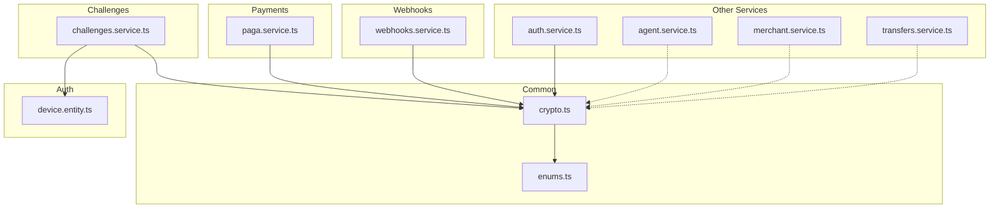
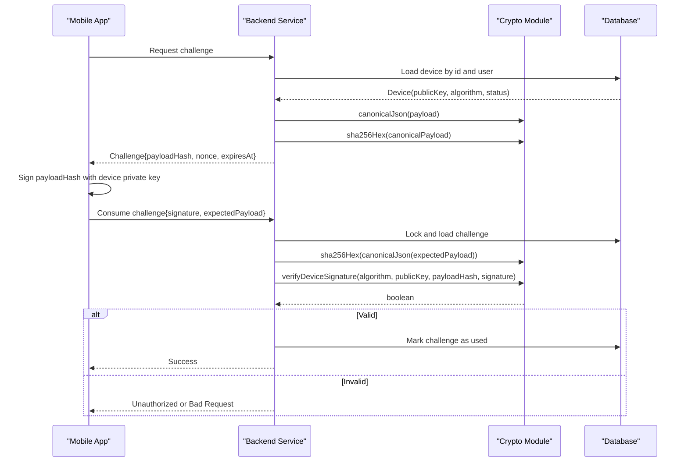
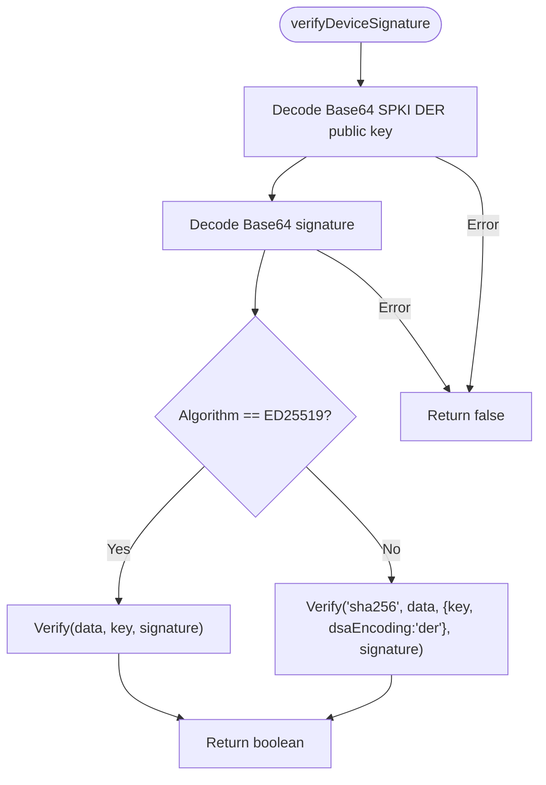
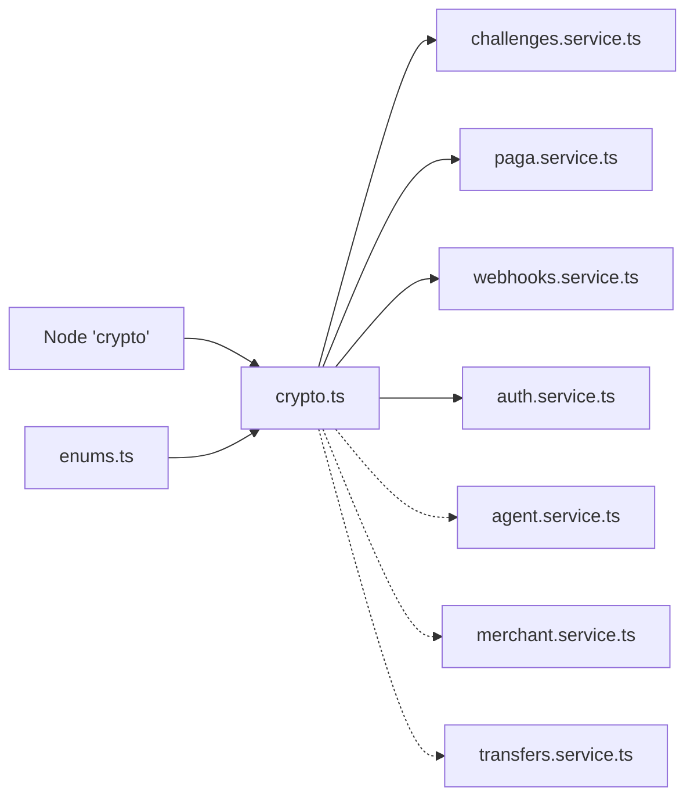

# Cryptographic Utilities

<cite>
**Referenced Files in This Document**
- [crypto.ts](file://backend/src/common/crypto.ts)
- [crypto.spec.ts](file://backend/src/common/crypto.spec.ts)
- [enums.ts](file://backend/src/common/enums.ts)
- [device.entity.ts](file://backend/src/auth/device.entity.ts)
- [challenges.service.ts](file://backend/src/challenges/challenges.service.ts)
- [paga.service.ts](file://backend/src/paga/paga.service.ts)
- [webhooks.service.ts](file://backend/src/webhooks/webhooks.service.ts)
- [auth.service.ts](file://backend/src/auth/auth.service.ts)
- [agent.service.ts](file://backend/src/agent/agent.service.ts)
- [merchant.service.ts](file://backend/src/merchant/merchant.service.ts)
- [transfers.service.ts](file://backend/src/transfers/transfers.service.ts)
- [docs.md](file://docs.md)
</cite>

## Table of Contents
1. [Introduction](#introduction)
2. [Project Structure](#project-structure)
3. [Core Components](#core-components)
4. [Architecture Overview](#architecture-overview)
5. [Detailed Component Analysis](#detailed-component-analysis)
6. [Dependency Analysis](#dependency-analysis)
7. [Performance Considerations](#performance-considerations)
8. [Troubleshooting Guide](#troubleshooting-guide)
9. [Conclusion](#conclusion)
10. [Appendices](#appendices)

## Introduction
This document explains Vireo Finance’s cryptographic utilities used to protect data integrity, authenticate device-originated actions, and support secure workflows across the backend services. The implementation focuses on:

- Signature verification using device public keys stored in the database and generated inside mobile secure hardware.
- Hashing functions for deterministic payloads and integrity checks.
- HMAC helpers for message authentication.
- Secure comparison utilities to prevent timing attacks.
- Canonical JSON serialization to ensure consistent hashing across clients and servers.

The supported signature algorithms are EdDSA (Ed25519) and ECDSA with SHA-256 (ES256). RSA is not implemented in the current codebase; if RSA is introduced later, it should follow the same key format and verification patterns documented here.

## Project Structure
The cryptographic utilities live under the common layer and are consumed by domain services such as challenges, payments, webhooks, and authentication flows. Device metadata, including the public key and algorithm, is persisted via a dedicated entity.

**Diagram sources**
- [crypto.ts:1-84](file://backend/src/common/crypto.ts#L1-L84)
- [enums.ts:23-26](file://backend/src/common/enums.ts#L23-L26)
- [device.entity.ts:1-34](file://backend/src/auth/device.entity.ts#L1-L34)
- [challenges.service.ts:1-126](file://backend/src/challenges/challenges.service.ts#L1-L126)
- [paga.service.ts:1-200](file://backend/src/paga/paga.service.ts#L1-L200)
- [webhooks.service.ts:1-200](file://backend/src/webhooks/webhooks.service.ts#L1-L200)
- [auth.service.ts:1-200](file://backend/src/auth/auth.service.ts#L1-L200)
- [agent.service.ts:1-200](file://backend/src/agent/agent.service.ts#L1-L200)
- [merchant.service.ts:1-200](file://backend/src/merchant/merchant.service.ts#L1-L200)
- [transfers.service.ts:1-200](file://backend/src/transfers/transfers.service.ts#L1-L200)

**Section sources**
- [crypto.ts:1-84](file://backend/src/common/crypto.ts#L1-L84)
- [enums.ts:23-26](file://backend/src/common/enums.ts#L23-L26)
- [device.entity.ts:1-34](file://backend/src/auth/device.entity.ts#L1-L34)
- [challenges.service.ts:1-126](file://backend/src/challenges/challenges.service.ts#L1-L126)

## Core Components
The cryptographic module provides:

- Deterministic hash functions: SHA-256 and SHA-512 hex digests.
- Random nonce generation for replay protection.
- HMAC-SHA256 helpers returning Base64 or hex encodings.
- Constant-time string comparison to mitigate timing attacks.
- Canonical JSON serialization ensuring stable payload hashes.
- Device signature verification supporting Ed25519 and ES256.

Key responsibilities:
- Provide safe primitives for all services to use instead of ad-hoc implementations.
- Centralize encoding formats and algorithm selection.
- Fail closed on invalid inputs during signature verification.

**Section sources**
- [crypto.ts:11-83](file://backend/src/common/crypto.ts#L11-L83)
- [crypto.spec.ts:11-94](file://backend/src/common/crypto.spec.ts#L11-L94)

## Architecture Overview
Device signatures are part of a challenge-response flow:

1. The server issues a challenge containing a canonicalized payload and its SHA-256 hash.
2. The mobile app signs the payload hash using a private key stored in secure hardware (Secure Enclave or Android Keystore), protected by biometrics.
3. The client returns the signature along with the challenge ID and expected payload.
4. The server verifies the payload hash matches the stored value and validates the signature against the registered device public key.

**Diagram sources**
- [challenges.service.ts:39-110](file://backend/src/challenges/challenges.service.ts#L39-L110)
- [crypto.ts:42-83](file://backend/src/common/crypto.ts#L42-L83)
- [device.entity.ts:13-21](file://backend/src/auth/device.entity.ts#L13-L21)

## Detailed Component Analysis

### Signature Verification with Device Public Keys
The signature verification function supports two algorithms:

- Ed25519: Uses raw data without an explicit digest parameter.
- ES256: Uses SHA-256 with DER-encoded signatures.

Public keys are loaded from Base64-encoded SPKI DER bytes. Signatures are provided as Base64 strings. Invalid inputs return false rather than throwing exceptions to simplify caller error handling.

**Diagram sources**
- [crypto.ts:68-83](file://backend/src/common/crypto.ts#L68-L83)
- [enums.ts:23-26](file://backend/src/common/enums.ts#L23-L26)

Security considerations:
- Always verify against the device’s registered public key, never trust arbitrary keys.
- Ensure the device is active and belongs to the authenticated user before verifying.
- Reject expired or already-used challenges.
- Use canonical JSON to guarantee deterministic hashing across platforms.

Usage example path:
- See how the challenge service loads the device, computes the expected payload hash, and calls the verifier: [challenges.service.ts:91-106](file://backend/src/challenges/challenges.service.ts#L91-L106).

**Section sources**
- [crypto.ts:61-83](file://backend/src/common/crypto.ts#L61-L83)
- [challenges.service.ts:91-106](file://backend/src/challenges/challenges.service.ts#L91-L106)
- [device.entity.ts:13-21](file://backend/src/auth/device.entity.ts#L13-L21)

### Hash Functions for Data Integrity
The module exposes:

- SHA-256 hex digest for compact, portable hashes.
- SHA-512 hex digest for higher security margins where needed.
- HMAC-SHA256 in both Base64 and hex encodings for message authentication.
- Safe constant-time comparison for secrets and tokens.

These functions are used throughout the system:

- Challenges compute and compare payload hashes.
- Payments use safe comparisons and SHA-512 for sensitive operations.
- Webhooks rely on SHA-256 for event integrity.

Example usage paths:
- Payload hashing and canonicalization: [challenges.service.ts:47-49](file://backend/src/challenges/challenges.service.ts#L47-L49), [challenges.service.ts:86-89](file://backend/src/challenges/challenges.service.ts#L86-L89).
- Payment-side safe comparison and hashing: [paga.service.ts:1-200](file://backend/src/paga/paga.service.ts#L1-L200).
- Webhook hashing: [webhooks.service.ts:1-200](file://backend/src/webhooks/webhooks.service.ts#L1-L200).

**Section sources**
- [crypto.ts:11-35](file://backend/src/common/crypto.ts#L11-L35)
- [challenges.service.ts:47-49](file://backend/src/challenges/challenges.service.ts#L47-L49)
- [challenges.service.ts:86-89](file://backend/src/challenges/challenges.service.ts#L86-L89)
- [paga.service.ts:1-200](file://backend/src/paga/paga.service.ts#L1-L200)
- [webhooks.service.ts:1-200](file://backend/src/webhooks/webhooks.service.ts#L1-L200)

### Encryption Helpers
There are no encryption helpers in the current cryptographic module. Sensitive data protection should be handled at the application boundary using platform-provided secure storage and transport-layer encryption. For future extensions:

- Prefer symmetric encryption (e.g., AES-GCM) for bulk data.
- Use asymmetric encryption only when necessary (e.g., encrypting small secrets with a server public key).
- Never implement custom cryptography; rely on well-audited libraries.

[No sources needed since this section provides general guidance]

### Key Format Specifications
- Public keys are stored as Base64-encoded SPKI DER.
- Signatures are provided as Base64 strings.
- Supported algorithms:
  - Ed25519 (ED25519)
  - ECDSA with SHA-256 (ES256)

RSA is not currently used. If added, prefer standard formats (SPKI DER for public keys, PKCS#1/PSS for signatures) and align with existing verification logic.

**Section sources**
- [device.entity.ts:13-21](file://backend/src/auth/device.entity.ts#L13-L21)
- [crypto.ts:68-83](file://backend/src/common/crypto.ts#L68-L83)
- [enums.ts:23-26](file://backend/src/common/enums.ts#L23-L26)

### Security Considerations
- Biometric-backed key generation occurs on-device in secure hardware; the backend only stores the public key.
- Device attestation states are tracked to detect compromised environments.
- Challenges enforce short TTLs, single-use semantics, and pessimistic locking to prevent replay and race conditions.
- All secret comparisons use constant-time equality.

**Section sources**
- [device.entity.ts:23-27](file://backend/src/auth/device.entity.ts#L23-L27)
- [challenges.service.ts:63-110](file://backend/src/challenges/challenges.service.ts#L63-L110)
- [crypto.ts:31-35](file://backend/src/common/crypto.ts#L31-L35)
- [docs.md:138-156](file://docs.md#L138-L156)

## Dependency Analysis
The cryptographic module depends on Node.js’ built-in crypto library and the shared enums for algorithm selection. It is consumed by multiple services that require hashing, HMAC, random nonces, and signature verification.

**Diagram sources**
- [crypto.ts:1-8](file://backend/src/common/crypto.ts#L1-L8)
- [enums.ts:23-26](file://backend/src/common/enums.ts#L23-L26)
- [challenges.service.ts:1-126](file://backend/src/challenges/challenges.service.ts#L1-L126)
- [paga.service.ts:1-200](file://backend/src/paga/paga.service.ts#L1-L200)
- [webhooks.service.ts:1-200](file://backend/src/webhooks/webhooks.service.ts#L1-L200)
- [auth.service.ts:1-200](file://backend/src/auth/auth.service.ts#L1-L200)
- [agent.service.ts:1-200](file://backend/src/agent/agent.service.ts#L1-L200)
- [merchant.service.ts:1-200](file://backend/src/merchant/merchant.service.ts#L1-L200)
- [transfers.service.ts:1-200](file://backend/src/transfers/transfers.service.ts#L1-L200)

**Section sources**
- [crypto.ts:1-8](file://backend/src/common/crypto.ts#L1-L8)
- [enums.ts:23-26](file://backend/src/common/enums.ts#L23-L26)

## Performance Considerations
- Prefer SHA-256 for most hashing needs; use SHA-512 only when required by compliance or threat model.
- Avoid unnecessary re-serialization; pass Buffers directly to hashing functions where possible.
- Reuse HMAC instances for streaming payloads to reduce memory pressure.
- Keep signature verification minimal and fail fast on malformed inputs.
- Use pessimistic locking only around critical sections like challenge consumption to avoid contention elsewhere.

[No sources needed since this section provides general guidance]

## Troubleshooting Guide
Common issues and resolutions:

- Invalid signature errors:
  - Ensure the client signed the exact payload hash returned by the server.
  - Confirm the device is active and belongs to the requesting user.
  - Check that the signature is Base64-encoded and the algorithm matches the device record.
  - Reference: [challenges.service.ts:91-106](file://backend/src/challenges/challenges.service.ts#L91-L106), [crypto.ts:68-83](file://backend/src/common/crypto.ts#L68-L83).

- Payload mismatch:
  - Verify the client sends the same payload structure expected by the server.
  - Ensure canonical JSON ordering is respected on the client side.
  - Reference: [challenges.service.ts:86-89](file://backend/src/challenges/challenges.service.ts#L86-L89), [crypto.ts:42-59](file://backend/src/common/crypto.ts#L42-L59).

- Expired or reused challenges:
  - Respect TTL and do not retry expired challenges.
  - Do not reuse challenge IDs; generate new ones per action.
  - Reference: [challenges.service.ts:77-84](file://backend/src/challenges/challenges.service.ts#L77-L84).

- Timing attack risks:
  - Always use safeEqual for comparing secrets or tokens.
  - Reference: [crypto.ts:31-35](file://backend/src/common/crypto.ts#L31-L35).

**Section sources**
- [challenges.service.ts:77-106](file://backend/src/challenges/challenges.service.ts#L77-L106)
- [crypto.ts:31-83](file://backend/src/common/crypto.ts#L31-L83)

## Conclusion
Vireo Finance’s cryptographic utilities provide a focused set of primitives for hashing, HMAC, secure comparison, canonical serialization, and device signature verification. The design emphasizes deterministic processing, strict input validation, and integration with mobile secure hardware through device public keys. By centralizing these operations, the system reduces risk surface area and ensures consistent security behavior across services. Future enhancements should continue to rely on standard algorithms and formats while avoiding custom cryptography.

[No sources needed since this section summarizes without analyzing specific files]

## Appendices

### Algorithms Summary
- SHA-256: Deterministic hex digest for integrity checks.
- SHA-512: Higher-margin digest for sensitive operations.
- HMAC-SHA256: Message authentication with Base64 or hex output.
- Ed25519: Fast, secure EdDSA signature verification.
- ES256: ECDSA with SHA-256 and DER-encoded signatures.

**Section sources**
- [crypto.ts:11-29](file://backend/src/common/crypto.ts#L11-L29)
- [crypto.ts:68-83](file://backend/src/common/crypto.ts#L68-L83)
- [enums.ts:23-26](file://backend/src/common/enums.ts#L23-L26)

### Testing Strategies
- Determinism tests for hashing and canonical JSON.
- Uniqueness tests for random nonces.
- Negative tests for invalid keys and signatures.
- Property-based tests for canonical JSON stability across nested structures.

Reference test coverage:
- Hashing determinism and length checks: [crypto.spec.ts:11-32](file://backend/src/common/crypto.spec.ts#L11-L32).
- Nonce uniqueness: [crypto.spec.ts:34-44](file://backend/src/common/crypto.spec.ts#L34-L44).
- HMAC determinism and sensitivity: [crypto.spec.ts:46-57](file://backend/src/common/crypto.spec.ts#L46-L57).
- Safe equality edge cases: [crypto.spec.ts:59-68](file://backend/src/common/crypto.spec.ts#L59-L68).
- Canonical JSON sorting and determinism: [crypto.spec.ts:70-81](file://backend/src/common/crypto.spec.ts#L70-L81).
- Signature verification failure path: [crypto.spec.ts:83-94](file://backend/src/common/crypto.spec.ts#L83-L94)

**Section sources**
- [crypto.spec.ts:11-94](file://backend/src/common/crypto.spec.ts#L11-L94)

### Mobile Integration Notes
- Private keys must remain in device secure hardware and never leave the device.
- Biometrics gate access to signing operations but are not used as authorization tokens.
- Device attestation helps detect rooted or emulated environments.
- Lost or compromised devices should be revoked promptly.

**Section sources**
- [docs.md:138-156](file://docs.md#L138-L156)
- [device.entity.ts:23-27](file://backend/src/auth/device.entity.ts#L23-L27)