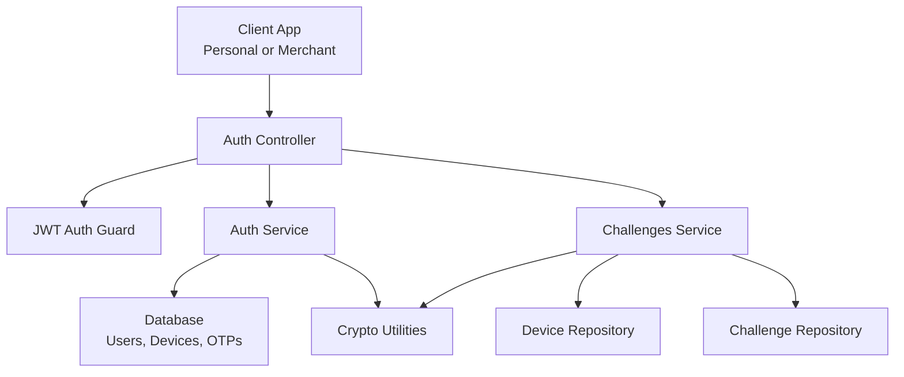
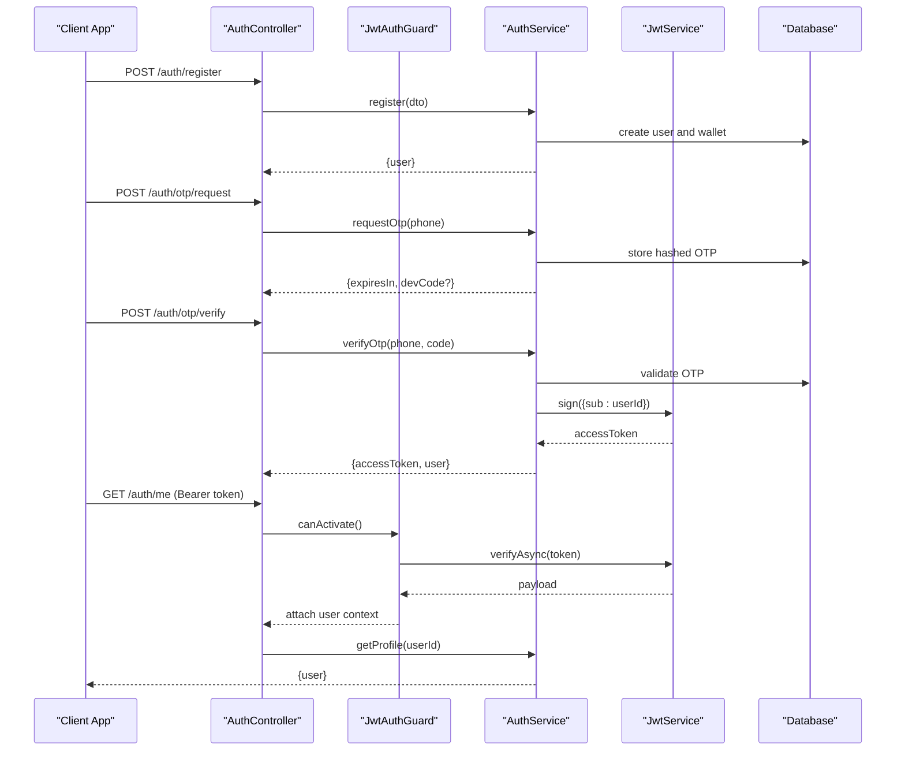
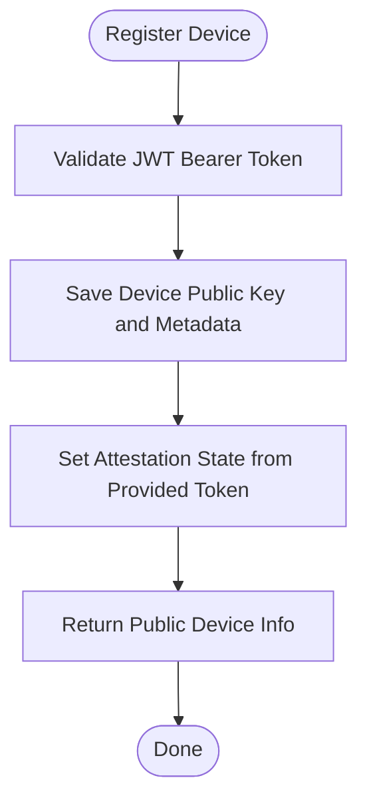
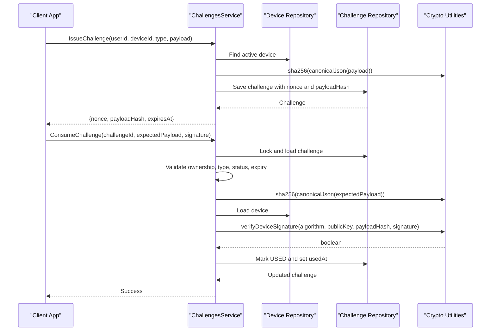
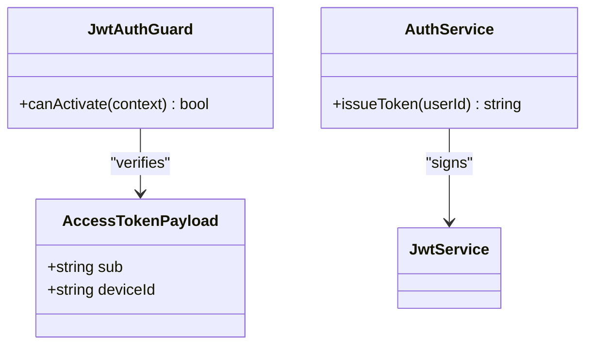
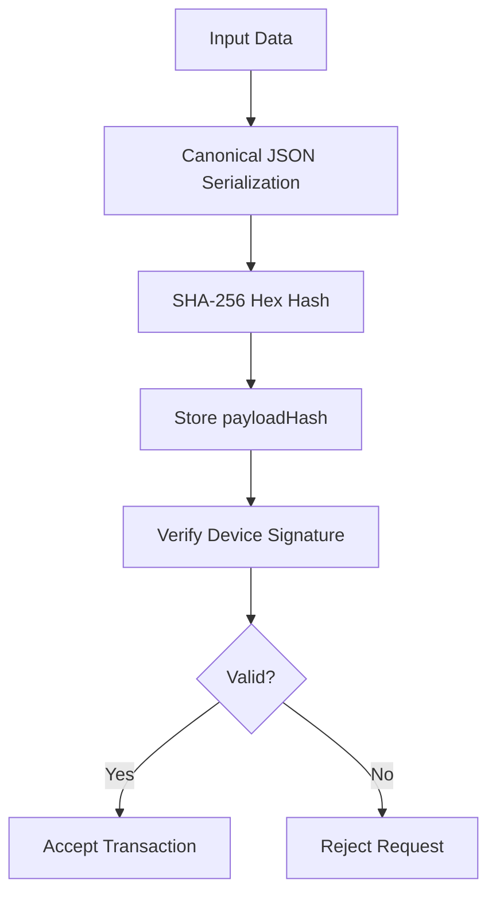
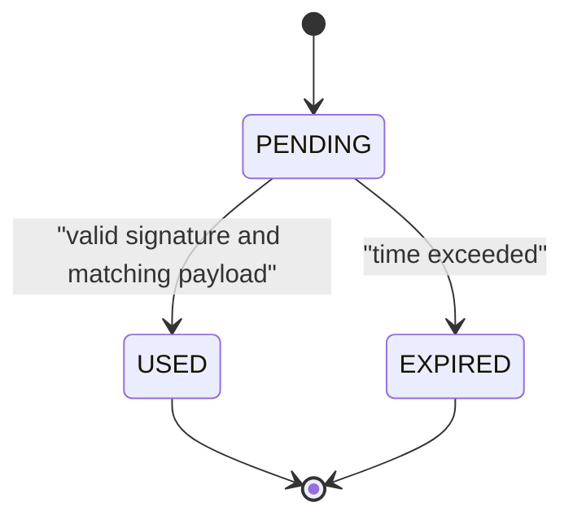
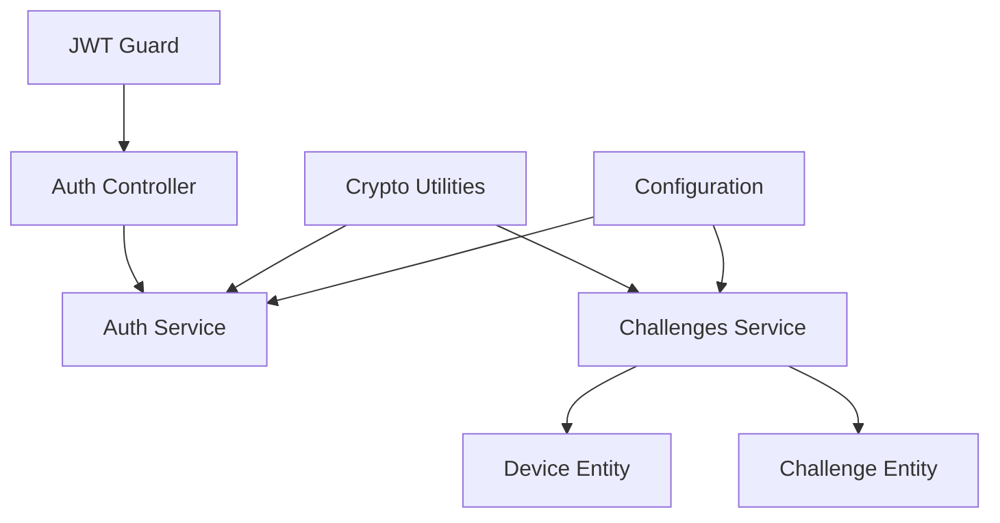

# Security Implementation

<cite>
**Referenced Files in This Document**
- [auth.service.ts](file://backend/src/auth/auth.service.ts)
- [auth.controller.ts](file://backend/src/auth/auth.controller.ts)
- [device.entity.ts](file://backend/src/auth/device.entity.ts)
- [jwt-auth.guard.ts](file://backend/src/common/guards/jwt-auth.guard.ts)
- [current-user.decorator.ts](file://backend/src/common/decorators/current-user.decorator.ts)
- [crypto.ts](file://backend/src/common/crypto.ts)
- [enums.ts](file://backend/src/common/enums.ts)
- [challenges.service.ts](file://backend/src/challenges/challenges.service.ts)
- [challenge.entity.ts](file://backend/src/challenges/challenge.entity.ts)
- [configuration.ts](file://backend/src/config/configuration.ts)
- [env.validation.ts](file://backend/src/config/env.validation.ts)
- [docs.md](file://docs.md)
</cite>

## Table of Contents
1. [Introduction](#introduction)
2. [Project Structure](#project-structure)
3. [Core Components](#core-components)
4. [Architecture Overview](#architecture-overview)
5. [Detailed Component Analysis](#detailed-component-analysis)
6. [Dependency Analysis](#dependency-analysis)
7. [Performance Considerations](#performance-considerations)
8. [Troubleshooting Guide](#troubleshooting-guide)
9. [Conclusion](#conclusion)
10. [Appendices](#appendices)

## Introduction
This document describes the security implementation for Vireo Finance’s backend authentication, device attestation, cryptographic utilities, and transaction authorization challenges. It explains how biometric-backed device keys are used with a challenge-response flow, how JWT tokens protect sessions, and how sensitive endpoints are guarded. It also provides best practices for input validation, SQL injection prevention, XSS protection, secure communication, key management, and audit trails.

## Project Structure
The security-relevant code is primarily located under:
- Authentication and device management: `backend/src/auth`
- Shared cryptography and guards: `backend/src/common`
- Transaction authorization challenges: `backend/src/challenges`
- Configuration and environment validation: `backend/src/config`
- Product-level security requirements: `docs.md`

**Diagram sources**
- [auth.controller.ts:1-49](file://backend/src/auth/auth.controller.ts#L1-L49)
- [jwt-auth.guard.ts:1-31](file://backend/src/common/guards/jwt-auth.guard.ts#L1-L31)
- [auth.service.ts:1-209](file://backend/src/auth/auth.service.ts#L1-L209)
- [challenges.service.ts:1-126](file://backend/src/challenges/challenges.service.ts#L1-L126)
- [crypto.ts:1-84](file://backend/src/common/crypto.ts#L1-L84)

**Section sources**
- [auth.controller.ts:1-49](file://backend/src/auth/auth.controller.ts#L1-L49)
- [auth.service.ts:1-209](file://backend/src/auth/auth.service.ts#L1-L209)
- [challenges.service.ts:1-126](file://backend/src/challenges/challenges.service.ts#L1-L126)
- [crypto.ts:1-84](file://backend/src/common/crypto.ts#L1-L84)
- [configuration.ts:1-122](file://backend/src/config/configuration.ts#L1-L122)
- [env.validation.ts:1-12](file://backend/src/config/env.validation.ts#L1-L12)
- [docs.md:138-156](file://docs.md#L138-L156)

## Core Components
- Authentication service handles user registration, OTP issuance and verification, JWT token issuance, and device lifecycle operations.
- JWT guard validates bearer tokens and attaches authenticated user context to requests.
- Cryptography utilities provide hashing, HMAC, safe comparison, canonical JSON serialization, and signature verification for device public keys.
- Challenges service issues short-lived, signed transaction authorizations bound to a specific device and payload hash.
- Configuration centralizes secrets, TTLs, and feature flags; environment validation enforces required production variables.

**Section sources**
- [auth.service.ts:24-177](file://backend/src/auth/auth.service.ts#L24-L177)
- [jwt-auth.guard.ts:9-30](file://backend/src/common/guards/jwt-auth.guard.ts#L9-L30)
- [crypto.ts:11-83](file://backend/src/common/crypto.ts#L11-L83)
- [challenges.service.ts:31-125](file://backend/src/challenges/challenges.service.ts#L31-L125)
- [configuration.ts:65-121](file://backend/src/config/configuration.ts#L65-L121)
- [env.validation.ts:1-12](file://backend/src/config/env.validation.ts#L1-L12)

## Architecture Overview
The system uses a layered security model:
- Public endpoints handle registration and OTP flows without prior authentication.
- Protected endpoints require a valid JWT bearer token validated by the guard.
- Sensitive transactions use a challenge-response mechanism where the client signs a server-provided payload hash using a device key generated in secure hardware.
- All cryptographic operations are centralized in shared utilities.

**Diagram sources**
- [auth.controller.ts:11-30](file://backend/src/auth/auth.controller.ts#L11-L30)
- [auth.service.ts:39-127](file://backend/src/auth/auth.service.ts#L39-L127)
- [jwt-auth.guard.ts:13-29](file://backend/src/common/guards/jwt-auth.guard.ts#L13-L29)

## Detailed Component Analysis

### Biometric Authentication Flow and Device Key Management
- Device keys are intended to be generated in secure hardware on the client side and protected by biometrics. The backend stores only the public key and metadata such as platform, algorithm, attestation state, and status.
- Device registration accepts a base64-encoded SPKI DER public key and optional attestation token. The attestation state is recorded but not verified server-side in this repository.
- Device listing and revocation are protected by JWT authentication.

**Diagram sources**
- [auth.controller.ts:32-48](file://backend/src/auth/auth.controller.ts#L32-L48)
- [auth.service.ts:129-160](file://backend/src/auth/auth.service.ts#L129-L160)
- [device.entity.ts:4-34](file://backend/src/auth/device.entity.ts#L4-L34)

**Section sources**
- [auth.controller.ts:32-48](file://backend/src/auth/auth.controller.ts#L32-L48)
- [auth.service.ts:129-160](file://backend/src/auth/auth.service.ts#L129-L160)
- [device.entity.ts:4-34](file://backend/src/auth/device.entity.ts#L4-L34)
- [docs.md:138-156](file://docs.md#L138-L156)

### Challenge-Response Mechanism and Signature Verification
- The server issues a challenge containing a nonce, payload, payload hash, type, and expiry. The client must sign the payload hash with its private key stored in secure hardware and return the signature along with expected payload.
- On consumption, the server verifies:
  - Challenge existence and ownership
  - Type match
  - Pending status and non-expiry
  - Payload hash equality against canonicalized expected payload
  - Device status active
  - Signature validity using the stored device public key and algorithm
- If all checks pass, the challenge is marked used with a timestamp.

**Diagram sources**
- [challenges.service.ts:39-111](file://backend/src/challenges/challenges.service.ts#L39-L111)
- [crypto.ts:42-83](file://backend/src/common/crypto.ts#L42-L83)
- [challenge.entity.ts:4-40](file://backend/src/challenges/challenge.entity.ts#L4-L40)

**Section sources**
- [challenges.service.ts:39-111](file://backend/src/challenges/challenges.service.ts#L39-L111)
- [crypto.ts:42-83](file://backend/src/common/crypto.ts#L42-L83)
- [challenge.entity.ts:4-40](file://backend/src/challenges/challenge.entity.ts#L4-L40)

### JWT Token Management and Session Handling
- Access tokens are issued with a subject claim representing the user ID.
- The JWT guard parses the Authorization header, expects a Bearer scheme, verifies the token, and attaches an authenticated user object including userId and optional deviceId.
- Tokens are configured via environment variables for secret and expiration.

**Diagram sources**
- [jwt-auth.guard.ts:4-29](file://backend/src/common/guards/jwt-auth.guard.ts#L4-L29)
- [auth.service.ts:170-172](file://backend/src/auth/auth.service.ts#L170-L172)
- [configuration.ts:77-80](file://backend/src/config/configuration.ts#L77-L80)

**Section sources**
- [jwt-auth.guard.ts:4-29](file://backend/src/common/guards/jwt-auth.guard.ts#L4-L29)
- [auth.service.ts:170-172](file://backend/src/auth/auth.service.ts#L170-L172)
- [configuration.ts:77-80](file://backend/src/config/configuration.ts#L77-L80)

### Cryptographic Utilities
- Hashing: SHA-256 and SHA-512 hex encoders.
- HMAC: Base64 and hex encoders for payloads.
- Safe comparison: Constant-time comparison utility.
- Canonical JSON: Deterministic serialization with recursive key sorting to ensure stable hashes across clients and servers.
- Signature verification: Supports ED25519 and ES256 algorithms using base64-encoded SPKI DER public keys and signatures.

**Diagram sources**
- [crypto.ts:11-83](file://backend/src/common/crypto.ts#L11-L83)
- [challenges.service.ts:47-103](file://backend/src/challenges/challenges.service.ts#L47-L103)

**Section sources**
- [crypto.ts:11-83](file://backend/src/common/crypto.ts#L11-L83)

### Security Guards, Decorators, and Middleware
- JWT guard enforces bearer token presence and validity before route handlers execute.
- Current user decorator extracts the authenticated user context attached by the guard.
- Controllers apply the guard to sensitive endpoints like profile retrieval and device management.

**Diagram sources**
- [jwt-auth.guard.ts:13-29](file://backend/src/common/guards/jwt-auth.guard.ts#L13-L29)
- [current-user.decorator.ts:3-12](file://backend/src/common/decorators/current-user.decorator.ts#L3-L12)
- [auth.controller.ts:26-48](file://backend/src/auth/auth.controller.ts#L26-L48)

**Section sources**
- [jwt-auth.guard.ts:13-29](file://backend/src/common/guards/jwt-auth.guard.ts#L13-L29)
- [current-user.decorator.ts:3-12](file://backend/src/common/decorators/current-user.decorator.ts#L3-L12)
- [auth.controller.ts:26-48](file://backend/src/auth/auth.controller.ts#L26-L48)

### Challenge System for Transaction Authorization
- Nonce generation: cryptographically random 32-byte hex nonce per challenge.
- Expiry handling: configurable TTL seconds; expired challenges are marked expired and rejected.
- Payload integrity: canonical JSON ensures deterministic hashing; mismatched expected payloads are rejected.
- Device binding: challenges are scoped to a specific user and device; revoked devices cannot consume challenges.
- Single-use enforcement: once consumed, challenges are marked used and cannot be reused.

**Diagram sources**
- [challenges.service.ts:47-111](file://backend/src/challenges/challenges.service.ts#L47-L111)
- [challenge.entity.ts:19-36](file://backend/src/challenges/challenge.entity.ts#L19-L36)
- [enums.ts:69-79](file://backend/src/common/enums.ts#L69-L79)

**Section sources**
- [challenges.service.ts:47-111](file://backend/src/challenges/challenges.service.ts#L47-L111)
- [challenge.entity.ts:19-36](file://backend/src/challenges/challenge.entity.ts#L19-L36)
- [enums.ts:69-79](file://backend/src/common/enums.ts#L69-L79)

## Dependency Analysis
Security components depend on shared configuration and database repositories:
- Auth service depends on JWT service, config service, and repositories for users, devices, and OTPs.
- Challenges service depends on device and challenge repositories and crypto utilities.
- Guards depend on JWT service for token verification.
- Configuration centralizes secrets and TTLs; environment validation enforces required production variables.

**Diagram sources**
- [auth.service.ts:24-37](file://backend/src/auth/auth.service.ts#L24-L37)
- [challenges.service.ts:31-37](file://backend/src/challenges/challenges.service.ts#L31-L37)
- [jwt-auth.guard.ts:9-11](file://backend/src/common/guards/jwt-auth.guard.ts#L9-L11)
- [configuration.ts:65-121](file://backend/src/config/configuration.ts#L65-L121)

**Section sources**
- [auth.service.ts:24-37](file://backend/src/auth/auth.service.ts#L24-L37)
- [challenges.service.ts:31-37](file://backend/src/challenges/challenges.service.ts#L31-L37)
- [jwt-auth.guard.ts:9-11](file://backend/src/common/guards/jwt-auth.guard.ts#L9-L11)
- [configuration.ts:65-121](file://backend/src/config/configuration.ts#L65-L121)

## Performance Considerations
- Use short-lived challenges with strict TTLs to reduce replay windows.
- Prefer ED25519 for faster signature verification when supported by devices.
- Avoid logging sensitive payloads or signatures; log only non-sensitive identifiers and outcomes.
- Database queries should include appropriate indexes on foreign keys and frequently filtered columns (e.g., userId, nonce).
- Consider rate limiting on OTP endpoints and challenge issuance to mitigate abuse.

[No sources needed since this section provides general guidance]

## Troubleshooting Guide
Common issues and resolutions:
- Invalid or expired JWT: Ensure the Authorization header uses the Bearer scheme and that the token has not expired. Check JWT secret configuration.
- Missing bearer token: Confirm the client sends the Authorization header correctly.
- OTP invalid or expired: Verify phone normalization and that the OTP has not been consumed or exceeded attempt limits.
- Challenge payload mismatch: Ensure the client computes the payload hash using canonical JSON with sorted keys.
- Invalid device signature: Confirm the device public key matches the stored key and that the correct algorithm is used.
- Device revoked: Revoke and re-register the device if necessary.

**Section sources**
- [jwt-auth.guard.ts:18-28](file://backend/src/common/guards/jwt-auth.guard.ts#L18-L28)
- [auth.service.ts:73-127](file://backend/src/auth/auth.service.ts#L73-L127)
- [challenges.service.ts:63-111](file://backend/src/challenges/challenges.service.ts#L63-L111)

## Conclusion
Vireo Finance’s backend implements a robust security model combining JWT-based session management, device-bound cryptographic challenges, and centralized cryptographic utilities. The challenge-response flow ensures that sensitive transactions are authorized by keys generated in secure hardware and signed by the user’s biometric-protected device. Proper configuration, environment validation, and guard-based access control further strengthen the system. Future enhancements should include server-side attestation verification, comprehensive input validation, SQL injection prevention, XSS protection, and detailed audit logging.

[No sources needed since this section summarizes without analyzing specific files]

## Appendices

### Security Best Practices
- Input validation: Validate and sanitize all inputs at controller boundaries; reject malformed data early.
- SQL injection prevention: Use parameterized queries via TypeORM repositories; avoid raw SQL concatenation.
- XSS protection: Escape outputs and enforce Content Security Policy on any web-facing endpoints.
- Secure communication: Enforce HTTPS/TLS for all client-server communication; configure database SSL based on environment.
- Key management: Rotate JWT secrets regularly; never commit secrets to version control; use environment variables or secret managers.
- Audit trails: Log authentication events, device registrations, challenge issuance and consumption, and failures with correlation IDs while avoiding sensitive data exposure.

**Section sources**
- [configuration.ts:69-80](file://backend/src/config/configuration.ts#L69-L80)
- [env.validation.ts:1-12](file://backend/src/config/env.validation.ts#L1-L12)
- [docs.md:138-156](file://docs.md#L138-L156)