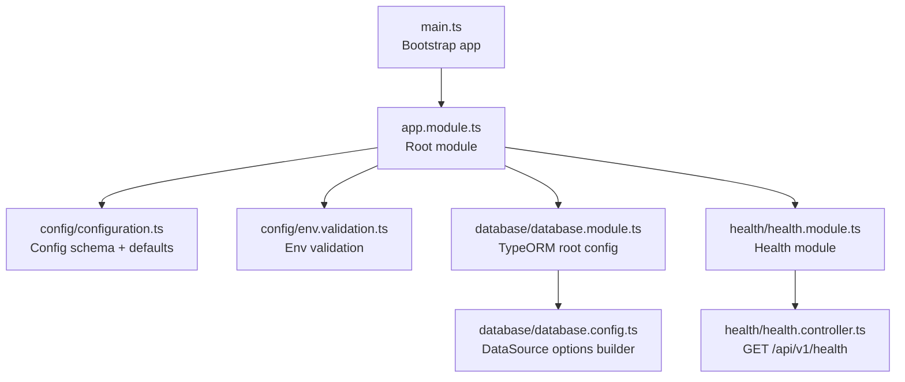
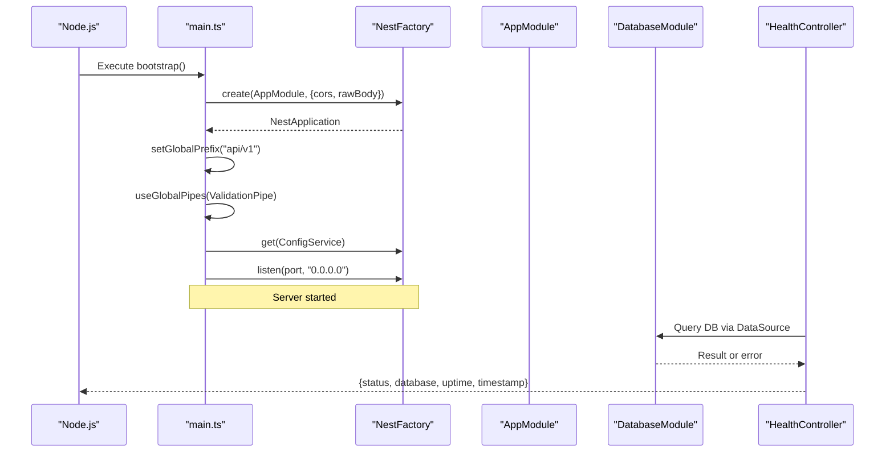
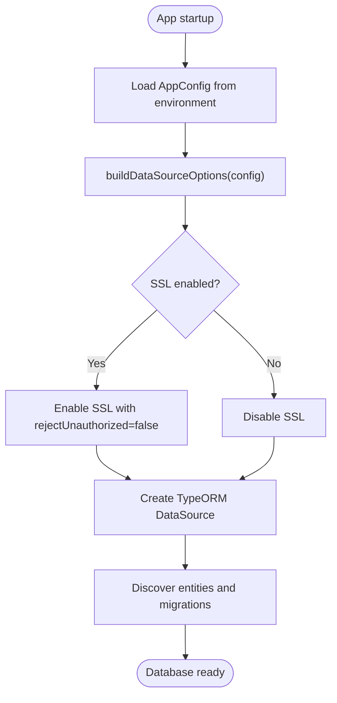
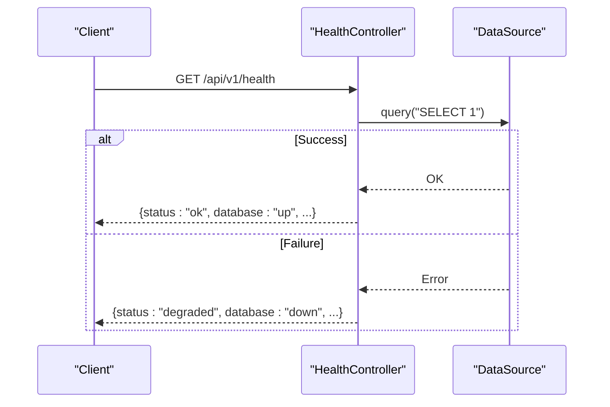
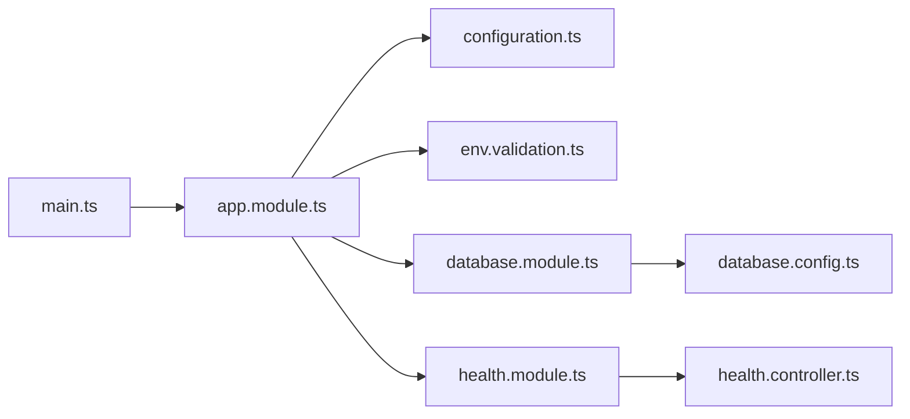

# Core Infrastructure

<cite>
**Referenced Files in This Document**
- [main.ts](file://backend/src/main.ts)
- [app.module.ts](file://backend/src/app.module.ts)
- [configuration.ts](file://backend/src/config/configuration.ts)
- [env.validation.ts](file://backend/src/config/env.validation.ts)
- [database.config.ts](file://backend/src/database/database.config.ts)
- [data-source.ts](file://backend/src/database/data-source.ts)
- [database.module.ts](file://backend/src/database/database.module.ts)
- [health.controller.ts](file://backend/src/health/health.controller.ts)
- [health.module.ts](file://backend/src/health/health.module.ts)
- [package.json](file://backend/package.json)
</cite>

## Table of Contents
1. [Introduction](#introduction)
2. [Project Structure](#project-structure)
3. [Core Components](#core-components)
4. [Architecture Overview](#architecture-overview)
5. [Detailed Component Analysis](#detailed-component-analysis)
6. [Dependency Analysis](#dependency-analysis)
7. [Performance Considerations](#performance-considerations)
8. [Troubleshooting Guide](#troubleshooting-guide)
9. [Conclusion](#conclusion)

## Introduction
This document explains the core infrastructure layer of Vireo Finance’s NestJS backend. It covers application bootstrap, module organization, configuration management, database connection setup with TypeORM, environment validation, health checks, and operational concerns such as logging, error handling, performance, memory management, and monitoring. It also provides guidance on extending the application with new modules and configuring different environments (development, staging, production).

## Project Structure
The backend is a NestJS application organized by feature modules under `backend/src`. The core infrastructure lives in:
- Application entrypoint and global setup
- Root module wiring all feature modules
- Configuration and environment validation
- Database module and TypeORM configuration
- Health check endpoint for readiness/liveness probes

**Diagram sources**
- [main.ts:7-24](file://backend/src/main.ts#L7-L24)
- [app.module.ts:21-45](file://backend/src/app.module.ts#L21-L45)
- [configuration.ts:1-122](file://backend/src/config/configuration.ts#L1-L122)
- [env.validation.ts:1-12](file://backend/src/config/env.validation.ts#L1-L12)
- [database.module.ts:6-16](file://backend/src/database/database.module.ts#L6-L16)
- [database.config.ts:5-22](file://backend/src/database/database.config.ts#L5-L22)
- [health.module.ts:4-7](file://backend/src/health/health.module.ts#L4-L7)
- [health.controller.ts:5-25](file://backend/src/health/health.controller.ts#L5-L25)

**Section sources**
- [main.ts:1-25](file://backend/src/main.ts#L1-L25)
- [app.module.ts:1-46](file://backend/src/app.module.ts#L1-L46)

## Core Components
- Bootstrap and global middleware: The application creates the NestJS instance, enables CORS, sets a global API prefix, applies a strict validation pipe, reads the port from configuration, and starts listening.
- Root module: Registers the configuration module with validation, imports the database module, and wires all feature modules.
- Configuration: Strongly typed configuration object loaded from environment variables with safe parsing helpers and sensible defaults.
- Environment validation: Enforces required variables in production to prevent runtime failures.
- Database: Global TypeORM DataSource configured via async factory using ConfigService; entities and migrations are auto-discovered.
- Health check: Exposes an endpoint that verifies database connectivity and returns status, uptime, and timestamp.

**Section sources**
- [main.ts:7-24](file://backend/src/main.ts#L7-L24)
- [app.module.ts:21-45](file://backend/src/app.module.ts#L21-L45)
- [configuration.ts:1-122](file://backend/src/config/configuration.ts#L1-L122)
- [env.validation.ts:1-12](file://backend/src/config/env.validation.ts#L1-L12)
- [database.module.ts:6-16](file://backend/src/database/database.module.ts#L6-L16)
- [database.config.ts:5-22](file://backend/src/database/database.config.ts#L5-L22)
- [health.controller.ts:5-25](file://backend/src/health/health.controller.ts#L5-L25)

## Architecture Overview
At runtime, the bootstrap function initializes NestJS, configures global settings, and starts the HTTP server. The root module composes the application graph by importing feature modules and enabling configuration and database access globally.

**Diagram sources**
- [main.ts:7-24](file://backend/src/main.ts#L7-L24)
- [app.module.ts:21-45](file://backend/src/app.module.ts#L21-L45)
- [database.module.ts:6-16](file://backend/src/database/database.module.ts#L6-L16)
- [health.controller.ts:9-24](file://backend/src/health/health.controller.ts#L9-L24)

## Detailed Component Analysis

### Application Bootstrap and Global Setup
- Creates the NestJS application with CORS enabled and raw body parsing.
- Sets a global route prefix `/api/v1`.
- Applies a global ValidationPipe that whitelists DTO fields, forbids non-whitelisted properties, and transforms payloads.
- Reads the port from configuration and listens on all interfaces.

Operational notes:
- Logging during bootstrap uses the NestJS Logger.
- For structured logging or custom formatting, integrate a logger provider at this stage.

**Section sources**
- [main.ts:7-24](file://backend/src/main.ts#L7-L24)

### Module Organization Pattern
- The root AppModule imports:
  - Configuration module with validation and typed defaults
  - Database module (global TypeORM setup)
  - Feature modules: accounts, agent, auth, challenges, kyc, ledger, merchant, notifications, queue, reconciliation, risk, transfers, webhooks, and health
- This pattern keeps features cohesive and allows cross-cutting concerns (auth guards, interceptors, pipes) to be applied globally or per-module.

Extending with a new module:
- Create a feature folder with controller, service, entity, and module files.
- Register the module in AppModule imports.
- If it needs global access to TypeORM, ensure DatabaseModule is already imported at the root.

**Section sources**
- [app.module.ts:21-45](file://backend/src/app.module.ts#L21-L45)

### Configuration Management System
- Configuration interface defines strongly typed settings for environment, database, JWT, OTP, challenge TTLs, Redis, Paga integration, risk limits, and notification providers.
- Safe parsing helpers convert strings to numbers and booleans with fallbacks.
- Defaults allow local development without mandatory env vars, while production enforces critical values.

Environment variable mapping highlights:
- Database host, port, credentials, name, SSL flag
- JWT secret and expiration
- Redis host and port
- Paga business/collect base URLs, API keys, webhook secret
- Risk tier daily limits and velocity parameters
- Notification toggles and gateway details

Configuration loading:
- ConfigModule.forRoot is configured with load and validate functions.
- All services can inject ConfigService to read typed configuration.

**Section sources**
- [configuration.ts:1-122](file://backend/src/config/configuration.ts#L1-L122)
- [app.module.ts:21-27](file://backend/src/app.module.ts#L21-L27)

### Environment Variable Validation
- In production, validates presence of JWT_SECRET, DB_HOST, DB_USER, DB_NAME.
- Throws an error if any required variable is missing, preventing startup with incomplete configuration.

Best practices:
- Keep sensitive values out of source control.
- Use separate .env files per environment and CI secrets for deployment.

**Section sources**
- [env.validation.ts:1-12](file://backend/src/config/env.validation.ts#L1-L12)

### Database Connection Setup with TypeORM
- DatabaseModule is marked global so any feature module can inject DataSource or repositories.
- Uses TypeOrmModule.forRootAsync to build DataSourceOptions from ConfigService.
- Auto-discovers entities and migrations; disables synchronize in production.
- Enables selective logging for errors, warnings, and migrations.

CLI migration commands:
- Run, revert, and generate migrations using the provided scripts.

Alternative standalone DataSource:
- data-source.ts provides a standalone DataSource for CLI tools, reading directly from process.env.

**Diagram sources**
- [database.config.ts:5-22](file://backend/src/database/database.config.ts#L5-L22)
- [database.module.ts:6-16](file://backend/src/database/database.module.ts#L6-L16)
- [data-source.ts:7-20](file://backend/src/database/data-source.ts#L7-L20)

**Section sources**
- [database.module.ts:6-16](file://backend/src/database/database.module.ts#L6-L16)
- [database.config.ts:5-22](file://backend/src/database/database.config.ts#L5-L22)
- [data-source.ts:1-21](file://backend/src/database/data-source.ts#L1-L21)
- [package.json:18-20](file://backend/package.json#L18-L20)

### Health Check Endpoints
- GET /api/v1/health returns:
  - status: ok or degraded
  - database: up or down
  - uptime: seconds since process start
  - timestamp: ISO string
- Internally executes a simple query against the database to verify connectivity.

Use cases:
- Liveness probe: container orchestrators can call this endpoint to determine if the process is alive.
- Readiness probe: combined with other checks (e.g., Redis, external APIs) to gate traffic until dependencies are ready.

**Diagram sources**
- [health.controller.ts:5-25](file://backend/src/health/health.controller.ts#L5-L25)

**Section sources**
- [health.controller.ts:5-25](file://backend/src/health/health.controller.ts#L5-L25)
- [health.module.ts:4-7](file://backend/src/health/health.module.ts#L4-L7)

### Error Handling Strategies
- Global ValidationPipe ensures request bodies conform to DTOs and strips unknown fields.
- Services use NestJS Logger for contextual logs.
- No global exception filter is defined in the analyzed files; consider adding one to standardize error responses and map domain exceptions to HTTP codes.

Recommendations:
- Add a GlobalExceptionFilter to catch unhandled exceptions and return consistent error envelopes.
- Centralize domain-specific exceptions and map them to appropriate HTTP statuses.

**Section sources**
- [main.ts:10-16](file://backend/src/main.ts#L10-L16)

### Logging Configuration
- NestJS Logger is used across services and providers.
- TypeORM logging is configured to include errors, warnings, and migrations.
- For production-grade structured logging, integrate a transport (e.g., Winston, Pino) and configure the NestLoggerFactory.

**Section sources**
- [database.config.ts:19-20](file://backend/src/database/database.config.ts#L19-L20)

### Application Lifecycle Management
- The bootstrap function performs initialization steps before listening.
- To add lifecycle hooks:
  - On application shutdown: register graceful shutdown handlers to close queues, flush logs, and release resources.
  - On application start: warm caches, preconnect to external services, or run background tasks.

Example patterns:
- Use NestJS lifecycle events or Node.js process signals to coordinate shutdown.
- Ensure database connections and queues are closed cleanly.

[No sources needed since this section provides general guidance]

## Dependency Analysis
The following diagram shows how the core infrastructure components depend on each other.

**Diagram sources**
- [main.ts:1-25](file://backend/src/main.ts#L1-L25)
- [app.module.ts:1-46](file://backend/src/app.module.ts#L1-L46)
- [configuration.ts:1-122](file://backend/src/config/configuration.ts#L1-L122)
- [env.validation.ts:1-12](file://backend/src/config/env.validation.ts#L1-L12)
- [database.module.ts:1-17](file://backend/src/database/database.module.ts#L1-L17)
- [database.config.ts:1-23](file://backend/src/database/database.config.ts#L1-L23)
- [health.module.ts:1-8](file://backend/src/health/health.module.ts#L1-L8)
- [health.controller.ts:1-26](file://backend/src/health/health.controller.ts#L1-L26)

**Section sources**
- [app.module.ts:1-46](file://backend/src/app.module.ts#L1-L46)

## Performance Considerations
- Connection pooling: TypeORM uses pg driver defaults; tune pool size based on CPU cores and workload.
- Query optimization: Prefer repository methods and avoid N+1 queries; enable query logging selectively in development.
- Memory management:
  - Avoid large in-memory caches unless necessary; prefer Redis for shared state.
  - Monitor heap usage and set appropriate Node.js flags (e.g., max-old-space-size) in production.
- I/O efficiency:
  - Use queues for long-running tasks (BullMQ is available).
  - Batch operations where possible.
- Observability:
  - Add metrics endpoints and expose Prometheus metrics.
  - Integrate APM tools to trace requests and detect bottlenecks.

[No sources needed since this section provides general guidance]

## Troubleshooting Guide
Common issues and resolutions:
- Missing environment variables in production:
  - Symptom: Startup throws an error about missing required variables.
  - Resolution: Provide JWT_SECRET, DB_HOST, DB_USER, DB_NAME.
- Database connection failures:
  - Symptom: Health endpoint reports database down.
  - Resolution: Verify DB_HOST, DB_PORT, DB_USER, DB_PASSWORD, DB_NAME, and SSL settings.
- Migration problems:
  - Symptom: Schema mismatch or migration errors.
  - Resolution: Run migration:run, review generated migrations, and ensure synchronize is disabled in production.
- Validation errors:
  - Symptom: Requests rejected due to non-whitelisted fields.
  - Resolution: Align DTOs with client payloads or adjust ValidationPipe settings.

**Section sources**
- [env.validation.ts:1-12](file://backend/src/config/env.validation.ts#L1-L12)
- [health.controller.ts:9-24](file://backend/src/health/health.controller.ts#L9-L24)
- [package.json:18-20](file://backend/package.json#L18-L20)
- [main.ts:10-16](file://backend/src/main.ts#L10-L16)

## Conclusion
Vireo Finance’s core infrastructure follows a clean NestJS architecture: a minimal bootstrap, a root module that composes feature modules, strongly typed configuration with environment validation, and a global TypeORM setup. Health checks provide basic liveness/readiness signals. Extending the system involves creating feature modules and registering them at the root. For production, focus on secure configuration, robust error handling, structured logging, observability, and careful tuning of database pools and memory settings.