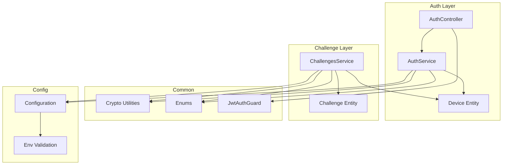
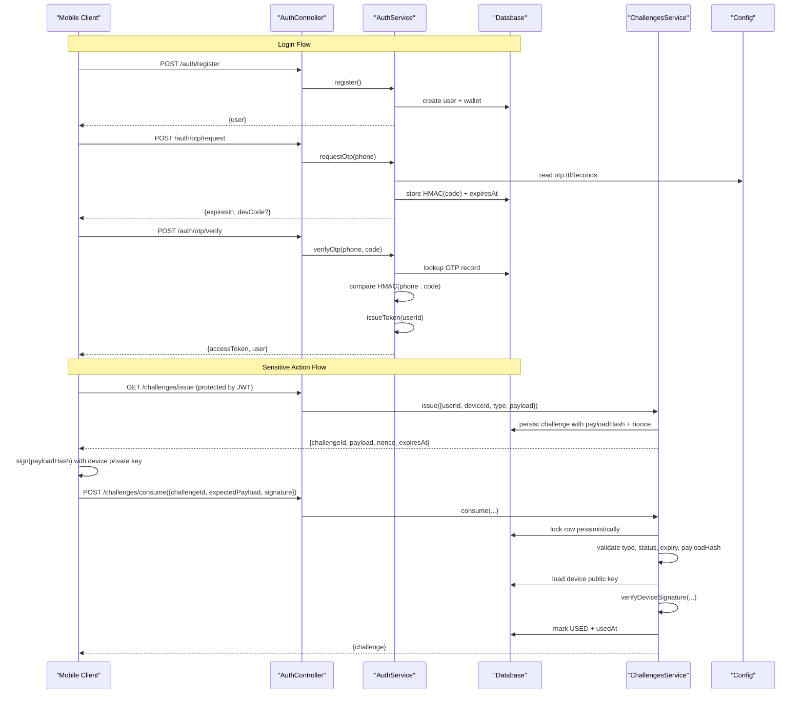
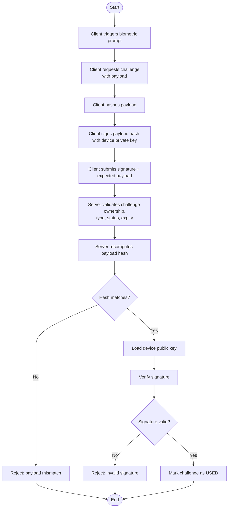
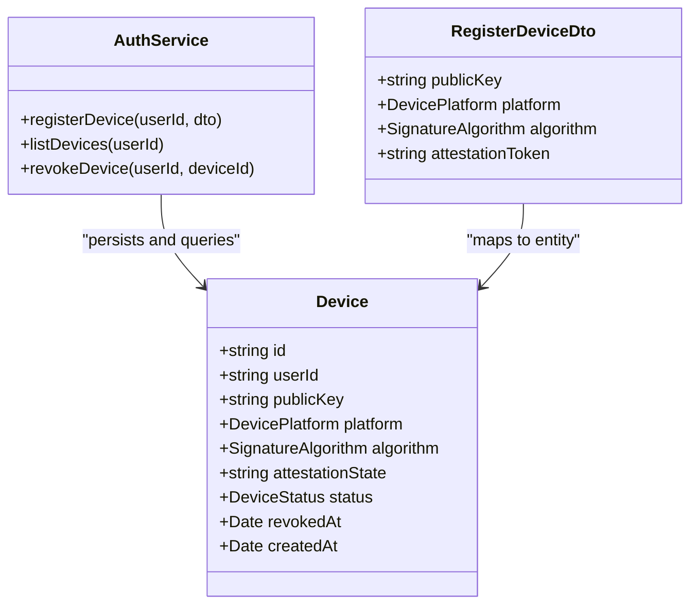
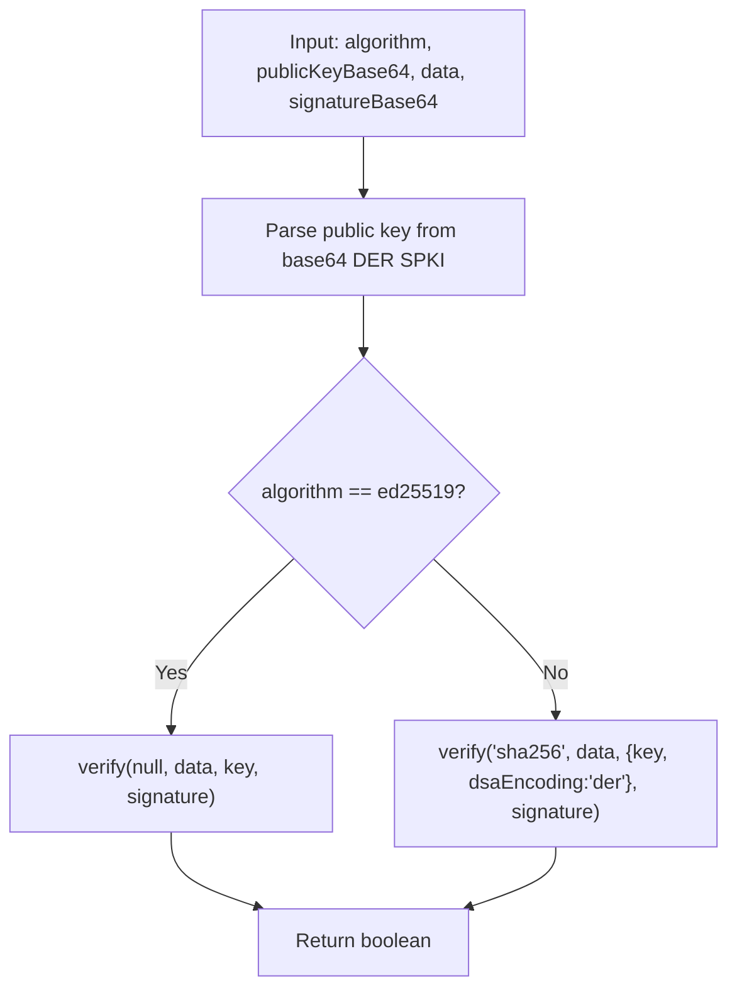
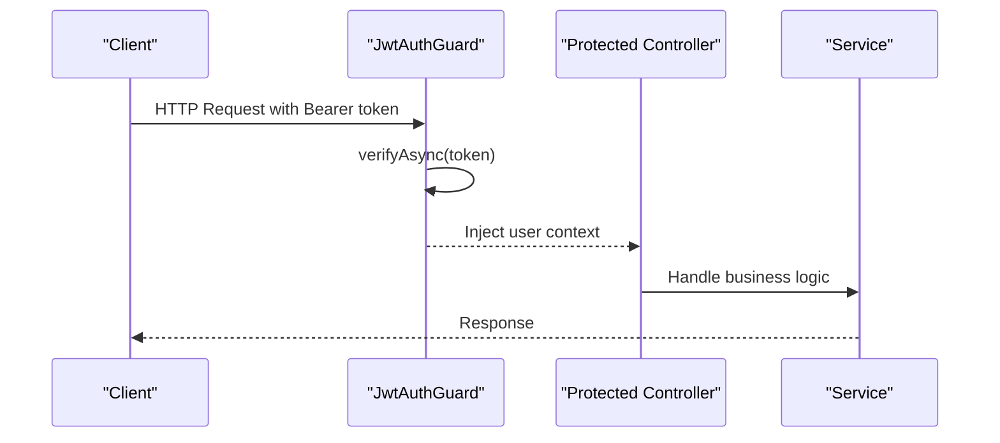
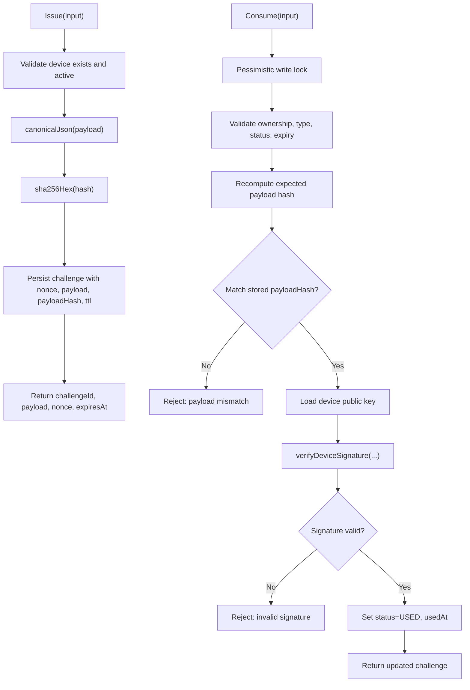
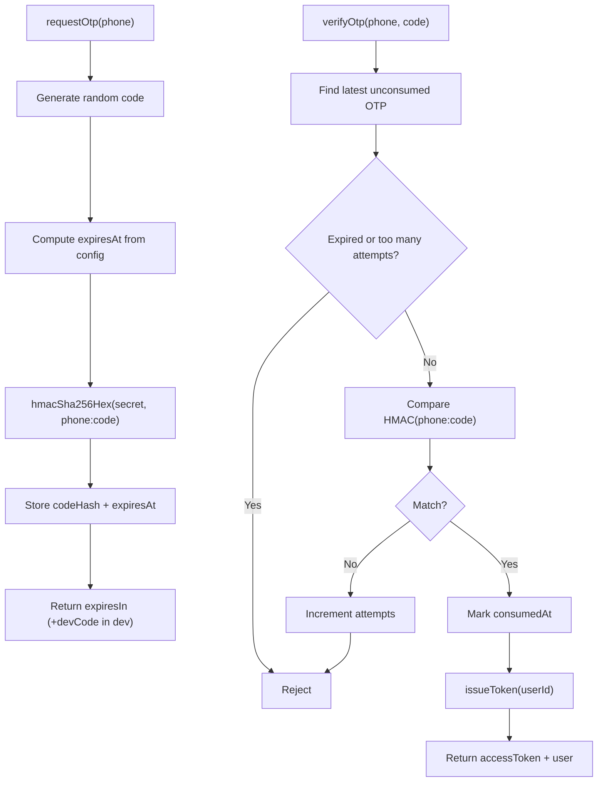
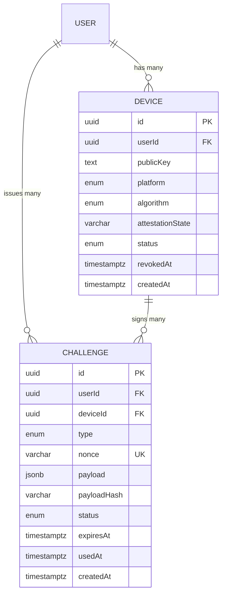
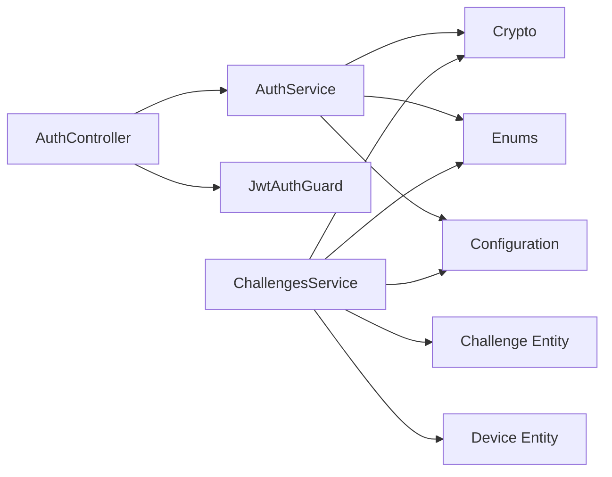

# Security Architecture

<cite>
**Referenced Files in This Document**
- [auth.service.ts](file://backend/src/auth/auth.service.ts)
- [auth.controller.ts](file://backend/src/auth/auth.controller.ts)
- [device.entity.ts](file://backend/src/auth/device.entity.ts)
- [challenge.entity.ts](file://backend/src/challenges/challenge.entity.ts)
- [challenges.service.ts](file://backend/src/challenges/challenges.service.ts)
- [crypto.ts](file://backend/src/common/crypto.ts)
- [enums.ts](file://backend/src/common/enums.ts)
- [jwt-auth.guard.ts](file://backend/src/common/guards/jwt-auth.guard.ts)
- [configuration.ts](file://backend/src/config/configuration.ts)
- [env.validation.ts](file://backend/src/config/env.validation.ts)
- [auth.dto.ts](file://backend/src/auth/dto/auth.dto.ts)
</cite>

## Table of Contents
1. [Introduction](#introduction)
2. [Project Structure](#project-structure)
3. [Core Components](#core-components)
4. [Architecture Overview](#architecture-overview)
5. [Detailed Component Analysis](#detailed-component-analysis)
6. [Dependency Analysis](#dependency-analysis)
7. [Performance Considerations](#performance-considerations)
8. [Troubleshooting Guide](#troubleshooting-guide)
9. [Conclusion](#conclusion)

## Introduction
This document explains the security architecture of Vireo Finance with a focus on:
- Biometric authentication flow via device-bound keys and challenge-response signing
- Device enrollment and key management
- Cryptographic primitives, signature verification, hashing, and encryption utilities
- JWT token lifecycle and bearer-based authorization
- Challenge-response pattern for sensitive operations
- Threat model coverage including replay attacks, man-in-the-middle (MITM), and credential theft
- Best practices, key rotation strategies, and audit logging recommendations

The backend is implemented in TypeScript using NestJS, TypeORM, and Node.js crypto. The mobile clients are responsible for biometric gating and private-key storage; the server validates signatures against stored public keys.

## Project Structure
Security-related code is primarily located under:
- Authentication and device management: `backend/src/auth`
- Challenge-response workflow: `backend/src/challenges`
- Cryptographic utilities and shared enums: `backend/src/common`
- JWT guard and configuration: `backend/src/common/guards`, `backend/src/config`

**Diagram sources**
- [auth.controller.ts:1-50](file://backend/src/auth/auth.controller.ts#L1-L50)
- [auth.service.ts:1-209](file://backend/src/auth/auth.service.ts#L1-L209)
- [device.entity.ts:1-35](file://backend/src/auth/device.entity.ts#L1-L35)
- [challenges.service.ts:1-126](file://backend/src/challenges/challenges.service.ts#L1-L126)
- [challenge.entity.ts:1-41](file://backend/src/challenges/challenge.entity.ts#L1-L41)
- [crypto.ts:1-84](file://backend/src/common/crypto.ts#L1-L84)
- [enums.ts:1-121](file://backend/src/common/enums.ts#L1-L121)
- [jwt-auth.guard.ts:1-31](file://backend/src/common/guards/jwt-auth.guard.ts#L1-L31)
- [configuration.ts:1-122](file://backend/src/config/configuration.ts#L1-L122)
- [env.validation.ts:1-12](file://backend/src/config/env.validation.ts#L1-L12)

**Section sources**
- [auth.controller.ts:1-50](file://backend/src/auth/auth.controller.ts#L1-L50)
- [auth.service.ts:1-209](file://backend/src/auth/auth.service.ts#L1-L209)
- [challenges.service.ts:1-126](file://backend/src/challenges/challenges.service.ts#L1-L126)
- [crypto.ts:1-84](file://backend/src/common/crypto.ts#L1-L84)
- [enums.ts:1-121](file://backend/src/common/enums.ts#L1-L121)
- [jwt-auth.guard.ts:1-31](file://backend/src/common/guards/jwt-auth.guard.ts#L1-L31)
- [configuration.ts:1-122](file://backend/src/config/configuration.ts#L1-L122)
- [env.validation.ts:1-12](file://backend/src/config/env.validation.ts#L1-L12)

## Core Components
- AuthService: User registration, OTP issuance/verification, device enrollment, device listing/revocation, and JWT issuance.
- ChallengesService: Issue and consume cryptographic challenges bound to payloads and devices.
- Crypto utilities: Hashing, HMAC, canonical JSON, random nonce generation, safe comparison, and device signature verification.
- JwtAuthGuard: Validates Bearer tokens and injects user context.
- Entities: Device and Challenge models store cryptographic state and challenge lifecycle.
- Configuration: Centralized environment-driven settings for JWT, OTP TTL, challenge TTL, and production checks.

Key responsibilities:
- Enforce that sensitive actions require a device-bound signature over a server-provided payload hash.
- Protect OTP secrets by storing HMACs rather than plaintext codes.
- Ensure challenges are single-use, time-bounded, and bound to both user and device.

**Section sources**
- [auth.service.ts:39-177](file://backend/src/auth/auth.service.ts#L39-L177)
- [challenges.service.ts:39-111](file://backend/src/challenges/challenges.service.ts#L39-L111)
- [crypto.ts:11-83](file://backend/src/common/crypto.ts#L11-L83)
- [jwt-auth.guard.ts:9-30](file://backend/src/common/guards/jwt-auth.guard.ts#L9-L30)
- [device.entity.ts:4-34](file://backend/src/auth/device.entity.ts#L4-L34)
- [challenge.entity.ts:4-40](file://backend/src/challenges/challenge.entity.ts#L4-L40)
- [configuration.ts:65-121](file://backend/src/config/configuration.ts#L65-L121)

## Architecture Overview
The security model combines three layers:
1. Session layer: JWT bearer tokens protect standard API access.
2. Credential layer: Phone OTP provides initial login and short-lived session establishment.
3. Authorization layer: Challenge-response with device-bound signatures protects high-value operations.

**Diagram sources**
- [auth.controller.ts:11-24](file://backend/src/auth/auth.controller.ts#L11-L24)
- [auth.service.ts:73-177](file://backend/src/auth/auth.service.ts#L73-L177)
- [challenges.service.ts:39-111](file://backend/src/challenges/challenges.service.ts#L39-L111)
- [configuration.ts:77-86](file://backend/src/config/configuration.ts#L77-L86)

## Detailed Component Analysis

### Biometric Authentication Flow
Biometrics gate access to the device’s secure enclave where the private key resides. The client uses the biometric prompt to unlock signing capability, then signs the server-provided payload hash. The server verifies the signature against the stored public key.

- Client-side:
  - Trigger biometric prompt to unlock signing.
  - Compute payload hash from the server-provided payload.
  - Sign the payload hash with the device private key.
  - Send signature along with challenge metadata.

- Server-side:
  - Validate challenge ownership, type, status, and expiry.
  - Recompute payload hash and compare with stored hash.
  - Verify signature using the device’s algorithm and public key.

**Diagram sources**
- [challenges.service.ts:39-111](file://backend/src/challenges/challenges.service.ts#L39-L111)
- [crypto.ts:68-83](file://backend/src/common/crypto.ts#L68-L83)

**Section sources**
- [challenges.service.ts:39-111](file://backend/src/challenges/challenges.service.ts#L39-L111)
- [crypto.ts:68-83](file://backend/src/common/crypto.ts#L68-L83)

### Device Enrollment and Key Management
Devices are enrolled after successful login. The client sends its public key and platform metadata. The server stores the base64-encoded SPKI DER public key and tracks attestation state and device status.

- Enrollment steps:
  - Client generates key pair in secure hardware.
  - Client calls device registration endpoint with public key, platform, and optional attestation token.
  - Server persists device record with default algorithm ED25519 unless specified.
  - Client can list and revoke devices.

- Security considerations:
  - Only active devices can be used for challenges.
  - Revoked devices cannot issue new challenges or consume existing ones.
  - Attestation state is recorded but not enforced here; it can be extended for stronger device provenance.

**Diagram sources**
- [device.entity.ts:4-34](file://backend/src/auth/device.entity.ts#L4-L34)
- [auth.service.ts:129-160](file://backend/src/auth/auth.service.ts#L129-L160)
- [auth.dto.ts:38-52](file://backend/src/auth/dto/auth.dto.ts#L38-L52)

**Section sources**
- [device.entity.ts:4-34](file://backend/src/auth/device.entity.ts#L4-L34)
- [auth.service.ts:129-160](file://backend/src/auth/auth.service.ts#L129-L160)
- [auth.dto.ts:38-52](file://backend/src/auth/dto/auth.dto.ts#L38-L52)

### Cryptographic Signing Mechanisms
The system supports two signature algorithms:
- EdDSA with curve Ed25519
- ECDSA with P-256 (ES256)

Verification logic:
- Loads the device’s public key from the database.
- Converts base64-encoded signature and data buffers appropriately.
- Verifies based on the algorithm stored with the device.

Hashing and utilities:
- SHA-256 and SHA-512 hex digests.
- HMAC-SHA256 in base64 and hex forms.
- Canonical JSON serialization for deterministic hashing.
- Random nonce generation for challenges.
- Timing-safe equality check for secret comparisons.

**Diagram sources**
- [crypto.ts:68-83](file://backend/src/common/crypto.ts#L68-L83)
- [enums.ts:23-26](file://backend/src/common/enums.ts#L23-L26)

**Section sources**
- [crypto.ts:11-83](file://backend/src/common/crypto.ts#L11-L83)
- [enums.ts:23-26](file://backend/src/common/enums.ts#L23-L26)

### JWT Token Lifecycle
JWTs are issued upon successful OTP verification and validated by the JWT guard for protected routes.

- Issuance:
  - After OTP verification, the server issues a JWT containing the user ID.
  - Expiration is configured via environment variables.

- Validation:
  - The guard expects a Bearer token in the Authorization header.
  - It decodes and verifies the token, attaching user context.

- Recommendations:
  - Include deviceId in the token when performing sensitive operations to bind sessions to devices.
  - Rotate JWT secrets regularly and enforce minimum lifetimes.

**Diagram sources**
- [jwt-auth.guard.ts:9-30](file://backend/src/common/guards/jwt-auth.guard.ts#L9-L30)
- [auth.service.ts:170-172](file://backend/src/auth/auth.service.ts#L170-L172)
- [configuration.ts:77-80](file://backend/src/config/configuration.ts#L77-L80)

**Section sources**
- [jwt-auth.guard.ts:9-30](file://backend/src/common/guards/jwt-auth.guard.ts#L9-L30)
- [auth.service.ts:170-172](file://backend/src/auth/auth.service.ts#L170-L172)
- [configuration.ts:77-80](file://backend/src/config/configuration.ts#L77-L80)

### Challenge-Response Authentication Pattern
The challenge-response pattern ensures that only the holder of the device’s private key can authorize sensitive actions.

- Issue phase:
  - Server computes a canonical JSON representation of the action payload and hashes it.
  - Stores challenge with nonce, payload, payload hash, type, and expiration.

- Consume phase:
  - Client signs the payload hash and returns the signature.
  - Server locks the challenge row, validates all constraints, recomputes payload hash, loads device public key, and verifies signature.
  - On success, marks the challenge as used and records usage timestamp.

**Diagram sources**
- [challenges.service.ts:39-111](file://backend/src/challenges/challenges.service.ts#L39-L111)
- [crypto.ts:42-59](file://backend/src/common/crypto.ts#L42-L59)
- [crypto.ts:68-83](file://backend/src/common/crypto.ts#L68-L83)

**Section sources**
- [challenges.service.ts:39-111](file://backend/src/challenges/challenges.service.ts#L39-L111)
- [challenge.entity.ts:4-40](file://backend/src/challenges/challenge.entity.ts#L4-L40)
- [crypto.ts:42-83](file://backend/src/common/crypto.ts#L42-L83)

### OTP and Credential Protection
OTP handling avoids storing plaintext codes:
- Codes are hashed using HMAC-SHA256 with a server secret and phone number as input.
- Verification compares the provided code’s HMAC with the stored hash.
- Attempts are tracked and limited to mitigate brute force.

**Diagram sources**
- [auth.service.ts:73-127](file://backend/src/auth/auth.service.ts#L73-L127)
- [auth.service.ts:174-177](file://backend/src/auth/auth.service.ts#L174-L177)
- [configuration.ts:81-83](file://backend/src/config/configuration.ts#L81-L83)

**Section sources**
- [auth.service.ts:73-127](file://backend/src/auth/auth.service.ts#L73-L127)
- [auth.service.ts:174-177](file://backend/src/auth/auth.service.ts#L174-L177)
- [configuration.ts:81-83](file://backend/src/config/configuration.ts#L81-L83)

### Data Models and Relationships

**Diagram sources**
- [device.entity.ts:4-34](file://backend/src/auth/device.entity.ts#L4-L34)
- [challenge.entity.ts:4-40](file://backend/src/challenges/challenge.entity.ts#L4-L40)

**Section sources**
- [device.entity.ts:4-34](file://backend/src/auth/device.entity.ts#L4-L34)
- [challenge.entity.ts:4-40](file://backend/src/challenges/challenge.entity.ts#L4-L40)

## Dependency Analysis
High-level dependencies among security components:

**Diagram sources**
- [auth.controller.ts:1-50](file://backend/src/auth/auth.controller.ts#L1-L50)
- [auth.service.ts:1-209](file://backend/src/auth/auth.service.ts#L1-L209)
- [challenges.service.ts:1-126](file://backend/src/challenges/challenges.service.ts#L1-L126)
- [crypto.ts:1-84](file://backend/src/common/crypto.ts#L1-L84)
- [enums.ts:1-121](file://backend/src/common/enums.ts#L1-L121)
- [configuration.ts:1-122](file://backend/src/config/configuration.ts#L1-L122)

**Section sources**
- [auth.controller.ts:1-50](file://backend/src/auth/auth.controller.ts#L1-L50)
- [auth.service.ts:1-209](file://backend/src/auth/auth.service.ts#L1-L209)
- [challenges.service.ts:1-126](file://backend/src/challenges/challenges.service.ts#L1-L126)
- [crypto.ts:1-84](file://backend/src/common/crypto.ts#L1-L84)
- [enums.ts:1-121](file://backend/src/common/enums.ts#L1-L121)
- [configuration.ts:1-122](file://backend/src/config/configuration.ts#L1-L122)

## Performance Considerations
- Use pessimistic locking for challenge consumption to prevent race conditions and double-spending of challenges.
- Prefer ED25519 for faster signature verification compared to ES256 when supported by devices.
- Cache device public keys per-user if frequent challenge consumption occurs, while ensuring cache invalidation on device revocation.
- Keep challenge TTLs short to reduce storage growth and limit replay windows.
- Avoid unnecessary JSON serialization overhead by reusing canonical JSON only where determinism is required.

[No sources needed since this section provides general guidance]

## Troubleshooting Guide
Common issues and mitigations:
- Invalid or expired OTP:
  - Ensure OTP has not expired and attempts are below the threshold.
  - Verify HMAC computation uses the same secret and normalized phone format.

- Payload mismatch during challenge consumption:
  - Confirm client computes payload hash from the exact payload returned by the server.
  - Ensure canonical JSON ordering is consistent on both sides; rely on server-provided payload hash.

- Invalid device signature:
  - Verify correct algorithm selection (ED25519 vs ES256).
  - Confirm public key is stored in base64 DER SPKI format.
  - Ensure signature is base64-encoded and corresponds to the payload hash bytes.

- Missing or invalid JWT:
  - Check Authorization header format: "Bearer <token>".
  - Validate token expiration and secret configuration.

- Environment misconfiguration:
  - In production, ensure required environment variables are set.
  - Review TTL values for OTP and challenges.

**Section sources**
- [auth.service.ts:73-127](file://backend/src/auth/auth.service.ts#L73-L127)
- [challenges.service.ts:63-111](file://backend/src/challenges/challenges.service.ts#L63-L111)
- [crypto.ts:68-83](file://backend/src/common/crypto.ts#L68-L83)
- [jwt-auth.guard.ts:13-29](file://backend/src/common/guards/jwt-auth.guard.ts#L13-L29)
- [env.validation.ts:1-12](file://backend/src/config/env.validation.ts#L1-L12)

## Conclusion
Vireo Finance’s security architecture combines:
- Biometric-gated device-bound signing for high-assurance authorization
- Challenge-response workflows with deterministic payload hashing and single-use constraints
- Secure OTP handling with HMAC-based storage and attempt limits
- JWT bearer-based session protection
- Robust cryptographic utilities and clear configuration boundaries

To strengthen the system further:
- Enforce device attestation at enrollment and periodically.
- Implement explicit key rotation workflows with graceful migration.
- Add comprehensive audit logging for authentication, device events, and challenge lifecycle.
- Integrate rate limiting and anomaly detection around OTP and challenge endpoints.
- Consider adding multi-device binding and device fingerprinting for enhanced risk scoring.

[No sources needed since this section summarizes without analyzing specific files]