# System Architecture

<cite>
**Referenced Files in This Document**   
- [docs.md](file://docs.md)
- [main.ts](file://backend/src/main.ts)
- [app.module.ts](file://backend/src/app.module.ts)
- [data-source.ts](file://backend/src/database/data-source.ts)
- [ledger.service.ts](file://backend/src/ledger/ledger.service.ts)
- [transfers.service.ts](file://backend/src/transfers/transfers.service.ts)
- [auth.service.ts](file://backend/src/auth/auth.service.ts)
- [paga.service.ts](file://backend/src/paga/paga.service.ts)
- [webhooks.service.ts](file://backend/src/webhooks/webhooks.service.ts)
- [reconciliation.processor.ts](file://backend/src/queue/reconciliation.processor.ts)
- [agent.service.ts](file://backend/src/agent/agent.service.ts)
- [backend/package.json](file://backend/package.json)
- [personal/package.json](file://personal/package.json)
- [merchant/package.json](file://merchant/package.json)
</cite>

## Table of Contents
1. [Introduction](#introduction)
2. [Project Structure](#project-structure)
3. [Core Components](#core-components)
4. [Architecture Overview](#architecture-overview)
5. [Detailed Component Analysis](#detailed-component-analysis)
6. [Dependency Analysis](#dependency-analysis)
7. [Performance Considerations](#performance-considerations)
8. [Security Model](#security-model)
9. [System Boundaries and Transfer Types](#system-boundaries-and-transfer-types)
10. [Scalability, Deployment Topology, and Infrastructure](#scalability-deployment-topology-and-infrastructure)
11. [Modular Monolith Organization](#modular-monolith-organization)
12. [Troubleshooting Guide](#troubleshooting-guide)
13. [Conclusion](#conclusion)

## Introduction
Vireo Finance is a Nigerian banking product with two mobile applications: Vireo Personal for agentic personal banking and Vireo Merchant for merchant payments. The system shares one backend ledger, one Paga payment integration, one KYC system, and one risk engine. Money movements are first recorded in a double-entry PostgreSQL ledger; external bank payouts go through Paga. Internal transfers between Vireo users do not touch external rails.

The product emphasizes biometric authorization, signed challenges, device key management, and an AI agent that proposes but does not execute money movements.

**Section sources**
- [docs.md:5-12](file://docs.md#L5-L12)
- [docs.md:158-171](file://docs.md#L158-L171)

## Project Structure
The repository contains three main application areas:

| Area | Purpose | Key files |
|---|---|---|
| Backend | NestJS monolith exposing REST APIs, managing the ledger, Paga integration, queues, webhooks, agents, merchants, KYC, and risk | `backend/src/main.ts`, `backend/src/app.module.ts`, domain modules under `backend/src` |
| Personal app | React Native Expo app for personal banking, onboarding, wallet, send flows, transactions, and agent interaction | `personal/App.tsx`, `personal/src/screens/*`, `personal/package.json` |
| Merchant app | React Native Expo app for merchant onboarding, QR payments, orders, dashboard, and settlement | `merchant/App.tsx`, `merchant/src/screens/*`, `merchant/package.json` |

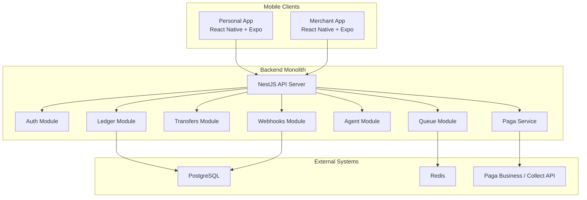

**Diagram sources**
- [main.ts:7-24](file://backend/src/main.ts#L7-L24)
- [app.module.ts:21-45](file://backend/src/app.module.ts#L21-L45)
- [data-source.ts:7-20](file://backend/src/database/data-source.ts#L7-L20)
- [reconciliation.processor.ts:7-41](file://backend/src/queue/reconciliation.processor.ts#L7-L41)
- [paga.service.ts:33-38](file://backend/src/paga/paga.service.ts#L33-L38)

**Section sources**
- [backend/package.json:2-38](file://backend/package.json#L2-L38)
- [personal/package.json:1-34](file://personal/package.json#L1-L34)
- [merchant/package.json:1-37](file://merchant/package.json#L1-L37)

## Core Components
The backend is organized as a modular NestJS application. The root module imports feature modules for configuration, database, health, KYC, authentication, accounts, ledger, challenges, risk, transfers, merchant, agent, webhooks, reconciliation, queue, and notifications.

Key responsibilities:

| Component | Responsibility |
|---|---|
| Bootstrap and global configuration | Creates the NestJS application, sets the API prefix, applies validation, reads port from configuration |
| Database module | Configures TypeORM with PostgreSQL, entities, migrations, and logging |
| Ledger module | Implements double-entry posting, balance derivation, holds, and account locking |
| Transfers module | Manages transfer drafts, challenge consumption, internal and merchant payments, and external bank payouts |
| Auth module | Handles registration, OTP login, JWT issuance, device public key registration, listing, and revocation |
| Paga service | Encapsulates virtual accounts, bank validation, payouts, status checks, payment requests, bank caching, callback verification, and request signing |
| Webhooks module | Verifies Paga callbacks, deduplicates events, credits inbound deposits, and updates payouts |
| Queue module | Runs periodic reconciliation jobs using BullMQ and Redis |
| Agent module | Provides read-only tools and draft creation while enforcing user approval before any money movement |

**Section sources**
- [main.ts:7-24](file://backend/src/main.ts#L7-L24)
- [app.module.ts:21-45](file://backend/src/app.module.ts#L21-L45)
- [data-source.ts:7-20](file://backend/src/database/data-source.ts#L7-L20)
- [ledger.service.ts:72-78](file://backend/src/ledger/ledger.service.ts#L72-L78)
- [transfers.service.ts:40-52](file://backend/src/transfers/transfers.service.ts#L40-L52)
- [auth.service.ts:24-37](file://backend/src/auth/auth.service.ts#L24-L37)
- [paga.service.ts:33-38](file://backend/src/paga/paga.service.ts#L33-L38)
- [webhooks.service.ts:16-28](file://backend/src/webhooks/webhooks.service.ts#L16-L28)
- [reconciliation.processor.ts:7-41](file://backend/src/queue/reconciliation.processor.ts#L7-L41)
- [agent.service.ts:23-33](file://backend/src/agent/agent.service.ts#L23-L33)

## Architecture Overview
At runtime, mobile clients call the NestJS API server. Authentication issues short-lived access tokens after phone OTP verification. Transactional operations use signed challenges bound to biometrically protected device keys. Money movements are posted to PostgreSQL via a double-entry ledger. External payouts go through Paga, with webhook-driven state updates. Background jobs reconcile pending transfers against Paga.

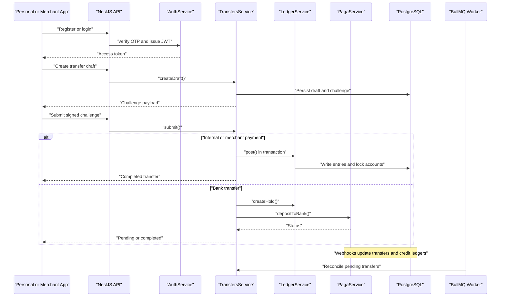

**Diagram sources**
- [auth.service.ts:73-127](file://backend/src/auth/auth.service.ts#L73-L127)
- [transfers.service.ts:54-190](file://backend/src/transfers/transfers.service.ts#L54-L190)
- [transfers.service.ts:193-217](file://backend/src/transfers/transfers.service.ts#L193-L217)
- [transfers.service.ts:238-363](file://backend/src/transfers/transfers.service.ts#L238-L363)
- [ledger.service.ts:80-178](file://backend/src/ledger/ledger.service.ts#L80-L178)
- [paga.service.ts:110-155](file://backend/src/paga/paga.service.ts#L110-L155)
- [webhooks.service.ts:30-70](file://backend/src/webhooks/webhooks.service.ts#L30-L70)
- [reconciliation.processor.ts:19-40](file://backend/src/queue/reconciliation.processor.ts#L19-L40)

## Detailed Component Analysis

### Ledger and Double-Entry Accounting
The ledger service is the financial source of truth. It enforces balanced legs, positive amounts, active accounts, sufficient available balance, and idempotent posting by idempotency key. Balances are derived from ledger entries rather than stored counters. Account rows are locked with `FOR UPDATE` to make derived balances authoritative during a transaction. Holds represent reservations used for external payouts.

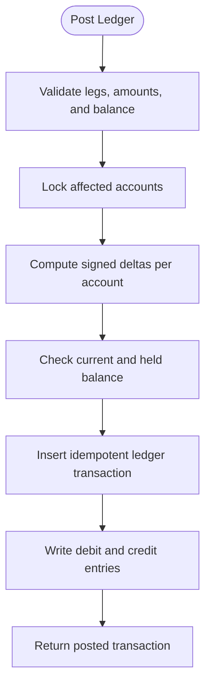

**Diagram sources**
- [ledger.service.ts:80-178](file://backend/src/ledger/ledger.service.ts#L80-L178)
- [ledger.service.ts:180-208](file://backend/src/ledger/ledger.service.ts#L180-L208)
- [ledger.service.ts:233-292](file://backend/src/ledger/ledger.service.ts#L233-L292)
- [ledger.service.ts:294-339](file://backend/src/ledger/ledger.service.ts#L294-L339)

**Section sources**
- [ledger.service.ts:17-30](file://backend/src/ledger/ledger.service.ts#L17-L30)
- [ledger.service.ts:72-78](file://backend/src/ledger/ledger.service.ts#L72-L78)
- [ledger.service.ts:80-178](file://backend/src/ledger/ledger.service.ts#L80-L178)
- [ledger.service.ts:180-208](file://backend/src/ledger/ledger.service.ts#L180-L208)
- [ledger.service.ts:233-292](file://backend/src/ledger/ledger.service.ts#L233-L292)
- [ledger.service.ts:294-339](file://backend/src/ledger/ledger.service.ts#L294-L339)

### Transfer Lifecycle
The transfers service supports internal transfers, merchant payments, and bank payouts. Drafts are created with a signed challenge. Submission consumes the challenge, runs risk checks, and follows different paths depending on transfer type.

- Internal transfers: single database transaction debits the sender and credits the recipient.
- Merchant payments: similar to internal transfers but also marks the merchant order paid.
- Bank transfers: reserves funds with a hold, calls Paga, then completes or fails based on provider response.

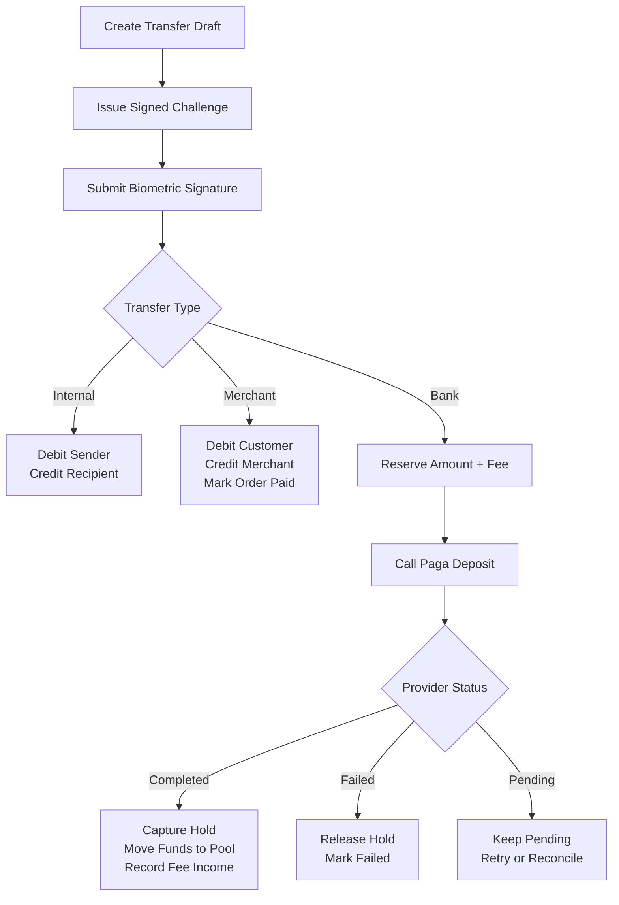

**Diagram sources**
- [transfers.service.ts:54-190](file://backend/src/transfers/transfers.service.ts#L54-L190)
- [transfers.service.ts:238-363](file://backend/src/transfers/transfers.service.ts#L238-L363)
- [transfers.service.ts:403-487](file://backend/src/transfers/transfers.service.ts#L403-L487)

**Section sources**
- [transfers.service.ts:40-52](file://backend/src/transfers/transfers.service.ts#L40-L52)
- [transfers.service.ts:54-190](file://backend/src/transfers/transfers.service.ts#L54-L190)
- [transfers.service.ts:193-217](file://backend/src/transfers/transfers.service.ts#L193-L217)
- [transfers.service.ts:238-363](file://backend/src/transfers/transfers.service.ts#L238-L363)
- [transfers.service.ts:403-487](file://backend/src/transfers/transfers.service.ts#L403-L487)

### Authentication and Device Key Management
Authentication combines phone OTP with JWT access tokens. Device enrollment stores a public key, platform, algorithm, attestation state, and status. Devices can be listed and revoked. Registration may provision a Paga virtual account for receiving funds.

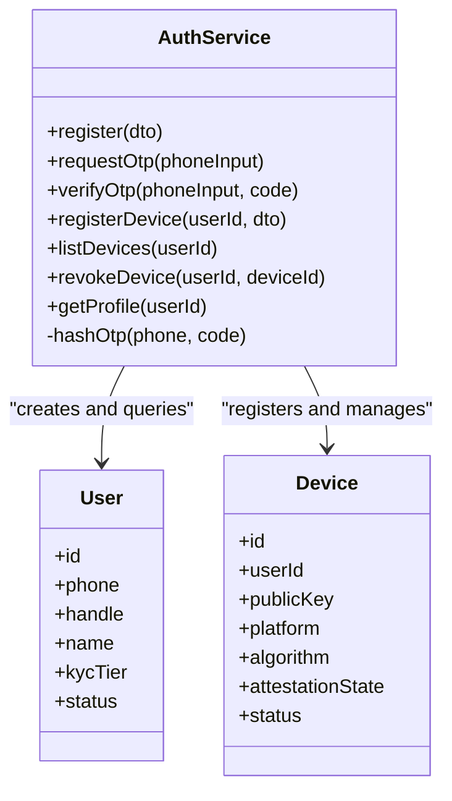

**Diagram sources**
- [auth.service.ts:24-37](file://backend/src/auth/auth.service.ts#L24-L37)
- [auth.service.ts:39-71](file://backend/src/auth/auth.service.ts#L39-L71)
- [auth.service.ts:73-127](file://backend/src/auth/auth.service.ts#L73-L127)
- [auth.service.ts:129-160](file://backend/src/auth/auth.service.ts#L129-L160)
- [auth.service.ts:170-177](file://backend/src/auth/auth.service.ts#L170-L177)

**Section sources**
- [auth.service.ts:39-71](file://backend/src/auth/auth.service.ts#L39-L71)
- [auth.service.ts:73-127](file://backend/src/auth/auth.service.ts#L73-L127)
- [auth.service.ts:129-160](file://backend/src/auth/auth.service.ts#L129-L160)
- [auth.service.ts:170-177](file://backend/src/auth/auth.service.ts#L170-L177)

### Paga Integration and Webhooks
The Paga service encapsulates business and collect API calls, bank resolution, virtual account provisioning, payout submission, status polling, payment requests, and callback verification. Callbacks are verified using SHA-512 hashes over documented fields and a shared hash key. Webhooks persist events, avoid duplicates, credit inbound deposits, and route payout updates to transfers or settlements.

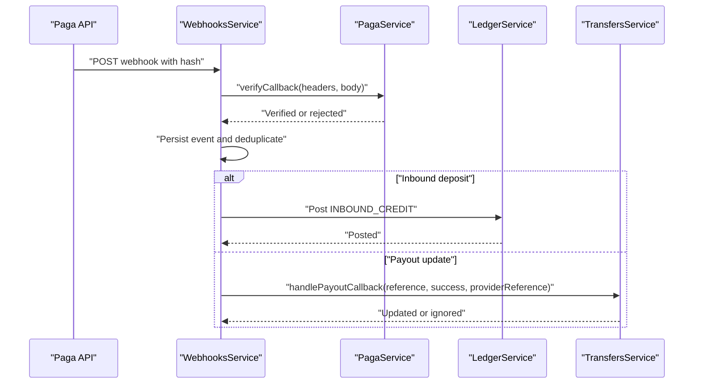

**Diagram sources**
- [paga.service.ts:40-70](file://backend/src/paga/paga.service.ts#L40-L70)
- [paga.service.ts:72-108](file://backend/src/paga/paga.service.ts#L72-L108)
- [paga.service.ts:110-173](file://backend/src/paga/paga.service.ts#L110-L173)
- [paga.service.ts:240-315](file://backend/src/paga/paga.service.ts#L240-L315)
- [webhooks.service.ts:30-70](file://backend/src/webhooks/webhooks.service.ts#L30-L70)
- [webhooks.service.ts:85-150](file://backend/src/webhooks/webhooks.service.ts#L85-L150)

**Section sources**
- [paga.service.ts:33-38](file://backend/src/paga/paga.service.ts#L33-L38)
- [paga.service.ts:40-70](file://backend/src/paga/paga.service.ts#L40-L70)
- [paga.service.ts:110-173](file://backend/src/paga/paga.service.ts#L110-L173)
- [paga.service.ts:240-315](file://backend/src/paga/paga.service.ts#L240-L315)
- [webhooks.service.ts:30-70](file://backend/src/webhooks/webhooks.service.ts#L30-L70)
- [webhooks.service.ts:85-150](file://backend/src/webhooks/webhooks.service.ts#L85-L150)

### Queues and Reconciliation
The queue module uses BullMQ with Redis. A reconciliation processor registers a repeating job every five minutes and delegates work to the reconciliation service. This helps recover from missed or delayed webhooks and stale payout statuses.

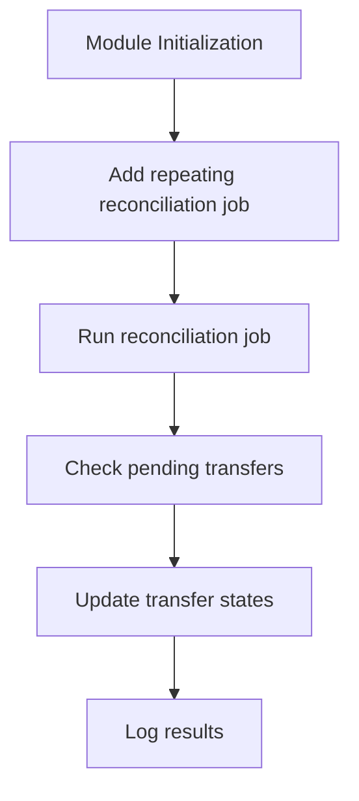

**Diagram sources**
- [reconciliation.processor.ts:7-41](file://backend/src/queue/reconciliation.processor.ts#L7-L41)

**Section sources**
- [reconciliation.processor.ts:7-41](file://backend/src/queue/reconciliation.processor.ts#L7-L41)

### AI Agent Service
The agent service exposes a restricted tool layer. Tools include reading balances, listing transactions, validating recipients, creating transfer drafts, creating payment requests, and explaining fees. The agent cannot directly move money; it creates drafts that require user approval through a signed challenge. Tool calls are audited with session context.

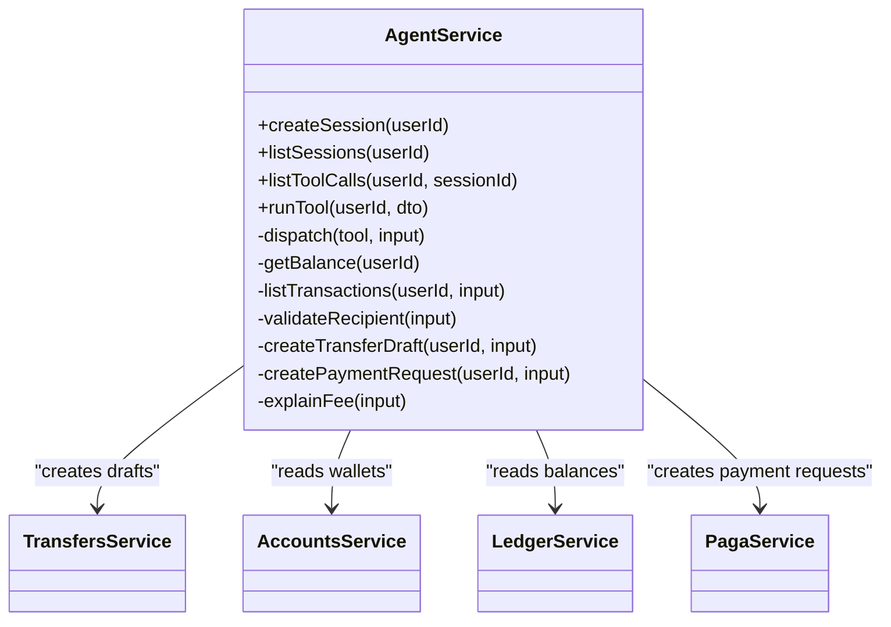

**Diagram sources**
- [agent.service.ts:23-33](file://backend/src/agent/agent.service.ts#L23-L33)
- [agent.service.ts:35-90](file://backend/src/agent/agent.service.ts#L35-L90)
- [agent.service.ts:92-113](file://backend/src/agent/agent.service.ts#L92-L113)
- [agent.service.ts:165-197](file://backend/src/agent/agent.service.ts#L165-L197)
- [agent.service.ts:199-240](file://backend/src/agent/agent.service.ts#L199-L240)

**Section sources**
- [agent.service.ts:23-33](file://backend/src/agent/agent.service.ts#L23-L33)
- [agent.service.ts:35-90](file://backend/src/agent/agent.service.ts#L35-L90)
- [agent.service.ts:92-113](file://backend/src/agent/agent.service.ts#L92-L113)
- [agent.service.ts:165-197](file://backend/src/agent/agent.service.ts#L165-L197)
- [agent.service.ts:199-240](file://backend/src/agent/agent.service.ts#L199-L240)

## Dependency Analysis
The backend depends on:

- PostgreSQL via TypeORM for entities, migrations, and transactions.
- Redis via BullMQ for background jobs.
- Paga Business and Collect APIs for virtual accounts, payouts, bank validation, and payment requests.
- Mobile apps for client-side biometric signing and UI flows.
- Notification providers for alerts (logger, push, SMS).

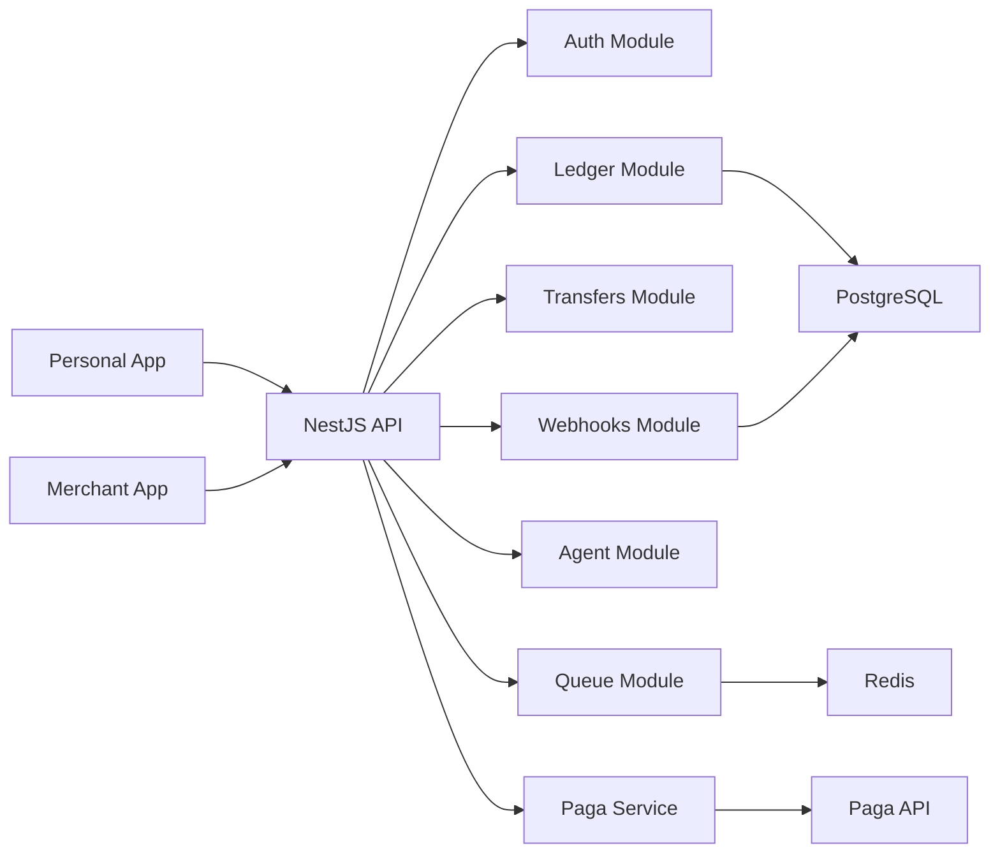

**Diagram sources**
- [app.module.ts:21-45](file://backend/src/app.module.ts#L21-L45)
- [data-source.ts:7-20](file://backend/src/database/data-source.ts#L7-L20)
- [reconciliation.processor.ts:7-41](file://backend/src/queue/reconciliation.processor.ts#L7-L41)
- [paga.service.ts:33-38](file://backend/src/paga/paga.service.ts#L33-L38)

**Section sources**
- [backend/package.json:22-38](file://backend/package.json#L22-L38)
- [app.module.ts:21-45](file://backend/src/app.module.ts#L21-L45)

## Performance Considerations
- Use PostgreSQL row-level locks (`FOR UPDATE`) around account balances to prevent race conditions during concurrent postings.
- Keep internal transfers atomic within a single database transaction.
- Prefer idempotency keys for all money-related operations to tolerate retries safely.
- Cache Paga bank metadata briefly to reduce external API calls.
- Offload long-running or periodic work such as reconciliation to BullMQ workers.
- Limit query result sizes and paginate where needed, as seen in balance and entry queries.
- Avoid storing mutable balances; derive them from immutable ledger entries.

[No sources needed since this section provides general guidance]

## Security Model
The security model centers on device-bound cryptographic signing and strict separation between proposal and authorization.

Key elements:

- **Biometric authentication:** Phone biometrics unlock secure hardware-backed keys. The app generates a key pair and registers the public key with the backend.
- **Device key management:** Devices store public keys, algorithms, attestation state, and status. Devices can be listed and revoked.
- **Cryptographic signing:** Transactions are authorized by signing a challenge containing transfer details, nonce, and expiry. The backend verifies the signature and binds the challenge to the transfer.
- **JWT-based sessions:** After OTP verification, the backend issues a JWT access token for authenticated API calls.
- **Risk controls:** Pre-checks and post-draft checks enforce limits, velocity rules, new payee restrictions, and channel-aware policies.
- **Audit trails:** Agent tool calls, transfer drafts, challenges, and webhook events are persisted for compliance and debugging.

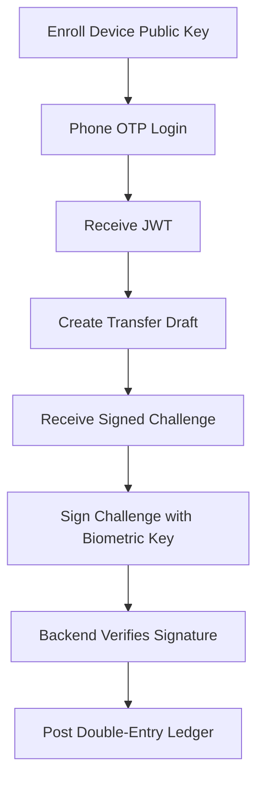

**Diagram sources**
- [auth.service.ts:129-160](file://backend/src/auth/auth.service.ts#L129-L160)
- [auth.service.ts:73-127](file://backend/src/auth/auth.service.ts#L73-L127)
- [transfers.service.ts:177-190](file://backend/src/transfers/transfers.service.ts#L177-L190)
- [transfers.service.ts:510-536](file://backend/src/transfers/transfers.service.ts#L510-L536)
- [agent.service.ts:165-197](file://backend/src/agent/agent.service.ts#L165-L197)

**Section sources**
- [docs.md:138-147](file://docs.md#L138-L147)
- [docs.md:186-193](file://docs.md#L186-L193)
- [auth.service.ts:129-160](file://backend/src/auth/auth.service.ts#L129-L160)
- [transfers.service.ts:510-536](file://backend/src/transfers/transfers.service.ts#L510-L536)

## System Boundaries and Transfer Types
System boundaries determine whether money moves internally or leaves the system.

| Boundary | Behavior | Ledger impact | External rail |
|---|---|---|---|
| Internal transfer | Between Vireo users | Debit sender, credit recipient | None |
| Merchant payment | Customer pays merchant order | Debit customer, credit merchant | None |
| Bank transfer | Customer pays external bank account | Reserve funds, then move to Paga pool and record fee income | Paga Business API |
| Inbound deposit | External payer sends to virtual account | Debit Paga pool, credit customer account | Paga Collect webhook |

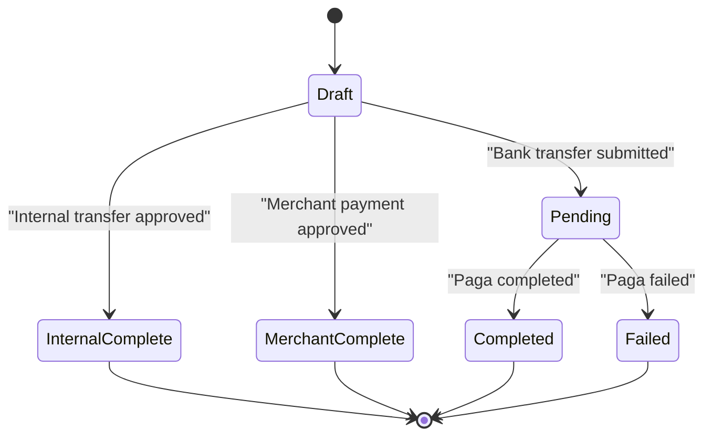

**Diagram sources**
- [transfers.service.ts:238-363](file://backend/src/transfers/transfers.service.ts#L238-L363)
- [webhooks.service.ts:85-150](file://backend/src/webhooks/webhooks.service.ts#L85-L150)

**Section sources**
- [docs.md:85-118](file://docs.md#L85-L118)
- [transfers.service.ts:238-363](file://backend/src/transfers/transfers.service.ts#L238-L363)
- [webhooks.service.ts:85-150](file://backend/src/webhooks/webhooks.service.ts#L85-L150)

## Scalability, Deployment Topology, and Infrastructure
Recommended deployment topology:

- **Application servers:** One or more NestJS instances behind a load balancer.
- **Database:** Managed PostgreSQL with connection pooling, backups, and SSL enabled when required.
- **Cache and queues:** Dedicated Redis instance for BullMQ jobs and optional short-term caches.
- **External integrations:** Paga Business and Collect endpoints configured via environment variables.
- **Observability:** Structured logs, metrics, alerting, and audit tables for agent tool calls, transfers, challenges, and webhook events.
- **Mobile clients:** Expo-based React Native apps distributed through standard channels.

Infrastructure requirements:

| Resource | Requirement |
|---|---|
| PostgreSQL | Entities, migrations, transactions, and audit data |
| Redis | BullMQ queues and worker coordination |
| Paga credentials | API key, secret, hash key, base URLs, and webhook secret |
| Environment configuration | Port, database settings, app base URL, OTP TTL, and Paga endpoints |
| Storage | Encrypted storage for sensitive records and audit logs |
| Monitoring | Health checks, error rates, webhook failures, and reconciliation outcomes |

**Section sources**
- [main.ts:7-24](file://backend/src/main.ts#L7-L24)
- [data-source.ts:5-20](file://backend/src/database/data-source.ts#L5-L20)
- [reconciliation.processor.ts:19-40](file://backend/src/queue/reconciliation.processor.ts#L19-L40)
- [paga.service.ts:393-469](file://backend/src/paga/paga.service.ts#L393-L469)

## Modular Monolith Organization
The backend follows a modular monolith pattern. Each domain area is a NestJS module with its own controllers, services, entities, DTOs, and tests where applicable. Shared concerns live in common utilities, decorators, guards, constants, enums, and configuration.

Representative modules:

| Module | Domain |
|---|---|
| `accounts` | Wallets and virtual accounts |
| `agent` | AI agent sessions and tool-call audit |
| `auth` | Registration, OTP, JWT, devices |
| `challenges` | Signed challenges for approvals |
| `common` | Crypto helpers, constants, enums, guards, decorators |
| `config` | Configuration loading and environment validation |
| `database` | DataSource, money utilities, and migration setup |
| `health` | Health check endpoint |
| `kyc` | KYC records and service |
| `ledger` | Double-entry ledger, holds, balances |
| `merchant` | Merchants, orders, settlements |
| `notifications` | Logger, push, SMS providers |
| `paga` | Paga integration |
| `queue` | BullMQ queue module and processors |
| `reconciliation` | Periodic reconciliation logic |
| `risk` | Risk checks and limits |
| `transfers` | Transfer lifecycle and execution |
| `users` | User entity |
| `webhooks` | Paga webhook handling |

This structure keeps high cohesion within domains while allowing cross-module dependencies through NestJS dependency injection.

**Section sources**
- [app.module.ts:21-45](file://backend/src/app.module.ts#L21-L45)
- [backend/package.json:2-6](file://backend/package.json#L2-L6)

## Troubleshooting Guide
Common operational issues and their likely locations:

| Symptom | Likely cause | Where to investigate |
|---|---|---|
| Duplicate webhook processing | Missing unique constraint or missing provider event ID | Webhook persistence and deduplication |
| Invalid webhook rejection | Incorrect hash key or mismatched fields | Paga callback verification |
| Stuck bank transfer | Provider timeout or missing callback | Transfer pending state and reconciliation |
| Insufficient balance errors | Negative delta or held funds exceeding available balance | Ledger posting and holds |
| Device not found or revoked | Device key not registered or revoked | Auth device management |
| Unknown agent tool | Invalid tool name in agent request | Agent dispatch logic |
| Paga network failure | Misconfigured base URL, credentials, or transient outage | Paga service and logs |

**Section sources**
- [webhooks.service.ts:30-70](file://backend/src/webhooks/webhooks.service.ts#L30-L70)
- [paga.service.ts:240-315](file://backend/src/paga/paga.service.ts#L240-L315)
- [transfers.service.ts:403-487](file://backend/src/transfers/transfers.service.ts#L403-L487)
- [ledger.service.ts:80-178](file://backend/src/ledger/ledger.service.ts#L80-L178)
- [auth.service.ts:129-160](file://backend/src/auth/auth.service.ts#L129-L160)
- [agent.service.ts:92-113](file://backend/src/agent/agent.service.ts#L92-L113)

## Conclusion
Vireo Finance implements a secure, ledger-first architecture. Internal and merchant payments are fast, atomic, and confined to the system. External bank transfers introduce third-party risk managed through holds, idempotency, webhooks, and reconciliation. The modular monolith cleanly separates domains while sharing infrastructure. Biometric device signing ensures that only the user can authorize money movements, and the AI agent remains a proposal layer without direct execution rights.

[No sources needed since this section summarizes without analyzing specific files]