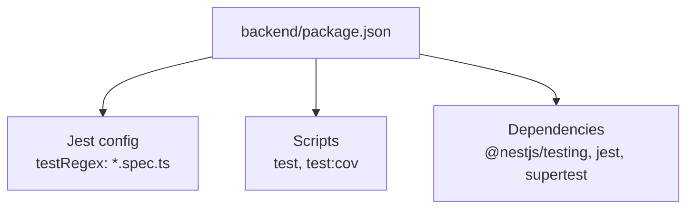
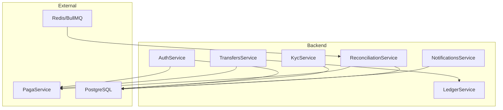
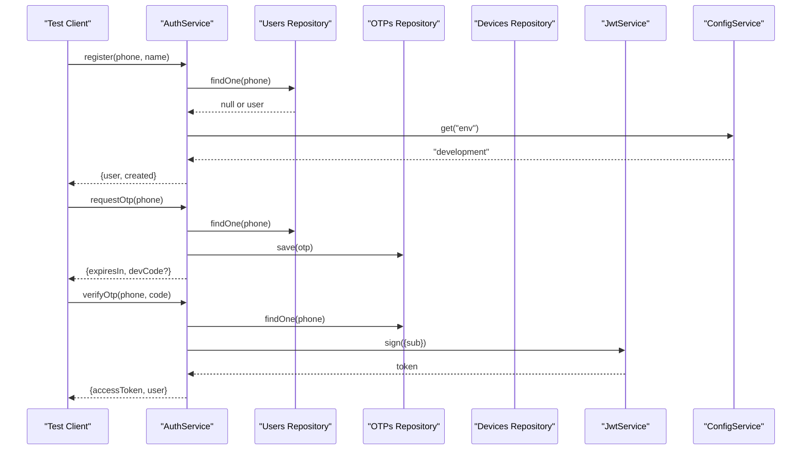
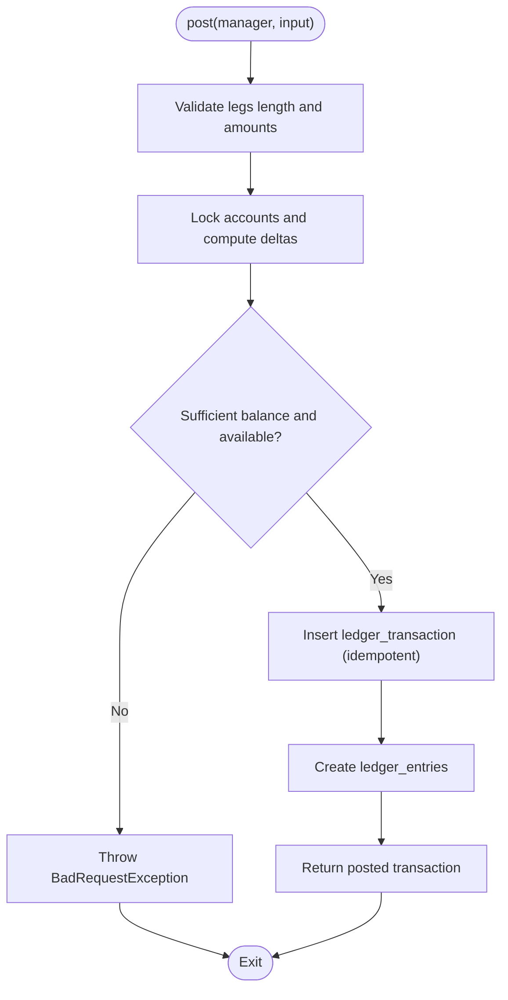
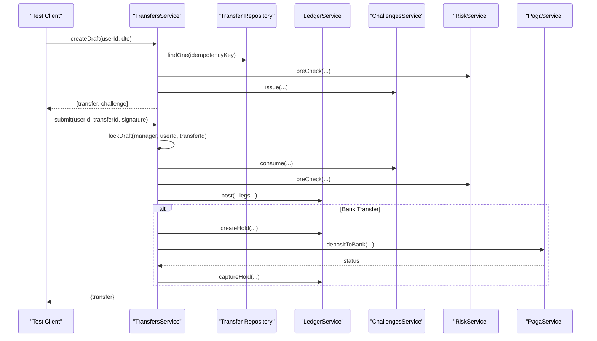
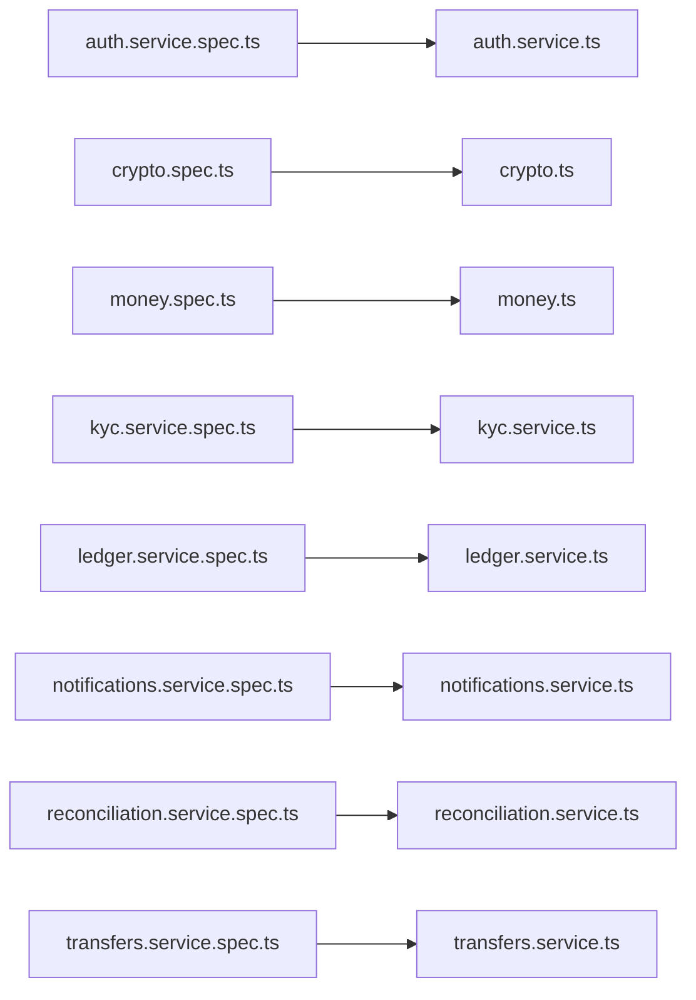

# Testing Strategy

<cite>
**Referenced Files in This Document**
- [package.json](file://backend/package.json)
- [docs.md](file://docs.md)
- [auth.service.spec.ts](file://backend/src/auth/auth.service.spec.ts)
- [auth.service.ts](file://backend/src/auth/auth.service.ts)
- [crypto.spec.ts](file://backend/src/common/crypto.spec.ts)
- [crypto.ts](file://backend/src/common/crypto.ts)
- [money.spec.ts](file://backend/src/database/money.spec.ts)
- [money.ts](file://backend/src/database/money.ts)
- [kyc.service.spec.ts](file://backend/src/kyc/kyc.service.spec.ts)
- [kyc.service.ts](file://backend/src/kyc/kyc.service.ts)
- [ledger.service.spec.ts](file://backend/src/ledger/ledger.service.spec.ts)
- [ledger.service.ts](file://backend/src/ledger/ledger.service.ts)
- [notifications.service.spec.ts](file://backend/src/notifications/notifications.service.spec.ts)
- [notifications.service.ts](file://backend/src/notifications/notifications.service.ts)
- [reconciliation.service.spec.ts](file://backend/src/reconciliation/reconciliation.service.spec.ts)
- [reconciliation.service.ts](file://backend/src/reconciliation/reconciliation.service.ts)
- [transfers.service.spec.ts](file://backend/src/transfers/transfers.service.spec.ts)
- [transfers.service.ts](file://backend/src/transfers/transfers.service.ts)
</cite>

## Table of Contents
1. Introduction
2. Project Structure
3. Core Components
4. Architecture Overview
5. Detailed Component Analysis
6. Dependency Analysis
7. Performance Considerations
8. Troubleshooting Guide
9. Conclusion

## Introduction
This document defines the testing strategy for Vireo Finance’s backend development workflow. It covers unit tests for services, integration-style tests for critical business logic, and end-to-end guidance for financial flows such as transfers, KYC, reconciliation, and biometric authorization. It also documents testing patterns used across the codebase, including mocking strategies, test data management, assertion libraries, and approaches for asynchronous queue processing and external integrations. The goal is to ensure accuracy and consistency of double-entry ledger calculations, robust handling of biometric authentication, and reliable behavior under load and failure conditions.

## Project Structure
The backend uses NestJS with Jest and Supertest configured for TypeScript. Tests are colocated next to their source files using the .spec.ts naming convention. Coverage is collected into a coverage directory. Key configuration lives in package.json, which includes Jest settings, scripts, and dependencies.

**Diagram sources**
- [package.json:63-79](file://backend/package.json#L63-L79)

**Section sources**
- [package.json:1-81](file://backend/package.json#L1-L81)

## Core Components
This section summarizes the core components that drive the testing strategy and how they are validated in the codebase.

- Authentication and device key management: AuthService handles user registration, OTP issuance and verification, device registration and revocation, and JWT token issuance. Tests mock repositories, DataSource, JwtService, ConfigService, and external services to validate flows and error paths.
- Cryptographic utilities: crypto.ts provides hashing, HMAC, safe comparison, canonical JSON, and device signature verification. Tests assert determinism, uniqueness, and safety properties.
- Money arithmetic: money.ts enforces minor-unit precision and positive amounts. Tests cover parsing, formatting, and validation.
- KYC service: KycService manages KYC submission, verification, status queries, and pending lists. Tests assert state transitions and error handling.
- Ledger service: LedgerService implements double-entry posting, holds, balance derivation, and account locking. Tests simulate database queries and verify idempotency, balancing, and insufficient-balance checks.
- Transfers service: TransfersService orchestrates internal, merchant, and bank transfers, challenges, risk checks, holds, and Paga callbacks. Tests validate draft locking, enum values, and constants.
- Notifications service: NotificationsService dispatches notifications via multiple providers and formats amounts. Tests assert provider calls and formatting.
- Reconciliation service: ReconciliationService polls provider status and updates transfer states. Tests assert completion/failure paths and skipped cases.

**Section sources**
- [auth.service.ts:24-209](file://backend/src/auth/auth.service.ts#L24-L209)
- [auth.service.spec.ts:56-239](file://backend/src/auth/auth.service.spec.ts#L56-L239)
- [crypto.ts:1-84](file://backend/src/common/crypto.ts#L1-L84)
- [crypto.spec.ts:1-95](file://backend/src/common/crypto.spec.ts#L1-L95)
- [money.ts:1-34](file://backend/src/database/money.ts#L1-L34)
- [money.spec.ts:1-51](file://backend/src/database/money.spec.ts#L1-L51)
- [kyc.service.ts:9-122](file://backend/src/kyc/kyc.service.ts#L9-L122)
- [kyc.service.spec.ts:16-189](file://backend/src/kyc/kyc.service.spec.ts#L16-L189)
- [ledger.service.ts:72-341](file://backend/src/ledger/ledger.service.ts#L72-L341)
- [ledger.service.spec.ts:90-185](file://backend/src/ledger/ledger.service.spec.ts#L90-L185)
- [transfers.service.ts:40-652](file://backend/src/transfers/transfers.service.ts#L40-L652)
- [transfers.service.spec.ts:41-133](file://backend/src/transfers/transfers.service.spec.ts#L41-L133)
- [notifications.service.ts:7-78](file://backend/src/notifications/notifications.service.ts#L7-L78)
- [notifications.service.spec.ts:11-53](file://backend/src/notifications/notifications.service.spec.ts#L11-L53)
- [reconciliation.service.ts:10-51](file://backend/src/reconciliation/reconciliation.service.ts#L10-L51)
- [reconciliation.service.spec.ts:14-135](file://backend/src/reconciliation/reconciliation.service.spec.ts#L14-L135)

## Architecture Overview
The testing strategy aligns with the system architecture described in the product requirements. Financial operations are centered on a double-entry ledger, with external rails (Paga), queues (BullMQ/Redis), and mobile clients performing biometric signing. Tests focus on isolating these layers while validating critical invariants like balanced entries, idempotency, and correct state transitions.

[No sources needed since this diagram shows conceptual workflow, not actual code structure]

## Detailed Component Analysis

### Authentication and Biometric Authorization Testing
AuthService validates user registration, OTP issuance and verification, device registration and revocation, and JWT issuance. Tests use Jest mocks for TypeORM repositories, DataSource transactions, JwtService, ConfigService, AccountsService, and PagaService. They assert success paths, error conditions, and environment-specific behavior (e.g., dev OTP codes).

Key testing patterns:
- Mocking repositories and DataSource.transaction to isolate persistence and transactional behavior.
- Verifying OTP hashing and expiration behavior.
- Ensuring device lifecycle operations update entity state correctly.
- Using ConfigService mocks to control environment-dependent behavior.

**Diagram sources**
- [auth.service.spec.ts:56-239](file://backend/src/auth/auth.service.spec.ts#L56-L239)
- [auth.service.ts:39-177](file://backend/src/auth/auth.service.ts#L39-L177)

**Section sources**
- [auth.service.spec.ts:56-239](file://backend/src/auth/auth.service.spec.ts#L56-L239)
- [auth.service.ts:39-177](file://backend/src/auth/auth.service.ts#L39-L177)

### Cryptographic Utilities Testing
Crypto tests validate deterministic hashing, unique nonces, HMAC correctness, safe string comparison, canonical JSON ordering, and device signature verification robustness. These tests ensure cryptographic primitives behave predictably and securely.

Testing highlights:
- Deterministic outputs for fixed inputs.
- Uniqueness guarantees for random values.
- Safe equality to prevent timing attacks.
- Canonical JSON ensures consistent payload hashing.

**Section sources**
- [crypto.spec.ts:1-95](file://backend/src/common/crypto.spec.ts#L1-L95)
- [crypto.ts:11-84](file://backend/src/common/crypto.ts#L11-L84)

### Money Arithmetic Testing
Money tests cover parsing human-readable amounts into minor units, formatting minor units back to major currency strings, and asserting positivity. This ensures all monetary operations avoid floating-point errors and enforce strict validation.

Testing highlights:
- Parsing whole and decimal amounts.
- Whitespace trimming and invalid input rejection.
- Formatting negative and zero values.
- Positive amount assertions.

**Section sources**
- [money.spec.ts:1-51](file://backend/src/database/money.spec.ts#L1-L51)
- [money.ts:1-34](file://backend/src/database/money.ts#L1-L34)

### KYC Workflow Testing
KYC tests validate submission, verification, status retrieval, and listing of pending records. They assert state transitions, tier validation, and user status changes upon verification or rejection.

Testing highlights:
- Preventing duplicate pending submissions.
- Validating tier constraints.
- Updating user status based on KYC outcome.
- Ordering and filtering of pending records.

**Section sources**
- [kyc.service.spec.ts:16-189](file://backend/src/kyc/kyc.service.spec.ts#L16-L189)
- [kyc.service.ts:16-122](file://backend/src/kyc/kyc.service.ts#L16-L122)

### Double-Entry Ledger Testing
Ledger tests simulate database interactions through a custom EntityManager mock. They verify:
- Balanced multi-leg transactions.
- Insufficient balance and available balance checks.
- Single-leg rejection.
- Idempotent transaction insertion.
- Balance derivation from net and held amounts.

**Diagram sources**
- [ledger.service.spec.ts:90-185](file://backend/src/ledger/ledger.service.spec.ts#L90-L185)
- [ledger.service.ts:86-178](file://backend/src/ledger/ledger.service.ts#L86-L178)

**Section sources**
- [ledger.service.spec.ts:90-185](file://backend/src/ledger/ledger.service.spec.ts#L90-L185)
- [ledger.service.ts:86-178](file://backend/src/ledger/ledger.service.ts#L86-L178)

### Transfers Orchestration Testing
Transfers tests validate draft locking, enum values, and constants. The service coordinates challenge consumption, risk checks, ledger postings, holds, and Paga callbacks. Tests demonstrate best practices for mocking repositories and asserting state transitions.

Key scenarios:
- Draft locking rejects non-draft or missing transfers.
- Internal, merchant, and bank transfer execution paths.
- Idempotency keys and reference binding.
- Hold capture/release during bank transfer completion/failure.

**Diagram sources**
- [transfers.service.spec.ts:55-113](file://backend/src/transfers/transfers.service.spec.ts#L55-L113)
- [transfers.service.ts:238-363](file://backend/src/transfers/transfers.service.ts#L238-L363)

**Section sources**
- [transfers.service.spec.ts:41-133](file://backend/src/transfers/transfers.service.spec.ts#L41-L133)
- [transfers.service.ts:54-363](file://backend/src/transfers/transfers.service.ts#L54-L363)

### Notifications Dispatch Testing
Notifications tests assert provider selection and message formatting. They verify that creditReceived constructs proper messages and invokes the logger provider.

Testing highlights:
- Provider instantiation and conditional inclusion.
- Minor unit formatting for display.
- Provider send method invocation.

**Section sources**
- [notifications.service.spec.ts:11-53](file://backend/src/notifications/notifications.service.spec.ts#L11-L53)
- [notifications.service.ts:7-78](file://backend/src/notifications/notifications.service.ts#L7-L78)

### Reconciliation Job Testing
Reconciliation tests validate polling of pending bank transfers, provider status resolution, and subsequent completion or failure updates. They also assert skipping transfers without provider references and counting failed events.

Testing highlights:
- Pending transfer iteration and provider status checks.
- Delegation to TransfersService for state transitions.
- Failed event counting.

**Section sources**
- [reconciliation.service.spec.ts:14-135](file://backend/src/reconciliation/reconciliation.service.spec.ts#L14-L135)
- [reconciliation.service.ts:19-51](file://backend/src/reconciliation/reconciliation.service.ts#L19-L51)

## Dependency Analysis
The following diagram maps test dependencies between services and their collaborators. It highlights how tests isolate external systems by mocking repositories and services.

**Diagram sources**
- [auth.service.spec.ts:1-240](file://backend/src/auth/auth.service.spec.ts#L1-L240)
- [crypto.spec.ts:1-95](file://backend/src/common/crypto.spec.ts#L1-L95)
- [money.spec.ts:1-51](file://backend/src/database/money.spec.ts#L1-L51)
- [kyc.service.spec.ts:1-190](file://backend/src/kyc/kyc.service.spec.ts#L1-L190)
- [ledger.service.spec.ts:1-186](file://backend/src/ledger/ledger.service.spec.ts#L1-L186)
- [notifications.service.spec.ts:1-54](file://backend/src/notifications/notifications.service.spec.ts#L1-L54)
- [reconciliation.service.spec.ts:1-136](file://backend/src/reconciliation/reconciliation.service.spec.ts#L1-L136)
- [transfers.service.spec.ts:1-134](file://backend/src/transfers/transfers.service.spec.ts#L1-L134)

**Section sources**
- [auth.service.spec.ts:1-240](file://backend/src/auth/auth.service.spec.ts#L1-L240)
- [crypto.spec.ts:1-95](file://backend/src/common/crypto.spec.ts#L1-L95)
- [money.spec.ts:1-51](file://backend/src/database/money.spec.ts#L1-L51)
- [kyc.service.spec.ts:1-190](file://backend/src/kyc/kyc.service.spec.ts#L1-L190)
- [ledger.service.spec.ts:1-186](file://backend/src/ledger/ledger.service.spec.ts#L1-L186)
- [notifications.service.spec.ts:1-54](file://backend/src/notifications/notifications.service.spec.ts#L1-L54)
- [reconciliation.service.spec.ts:1-136](file://backend/src/reconciliation/reconciliation.service.spec.ts#L1-L136)
- [transfers.service.spec.ts:1-134](file://backend/src/transfers/transfers.service.spec.ts#L1-L134)

## Performance Considerations
- Use in-memory mocks for repositories and services to keep unit tests fast and deterministic.
- Avoid real network calls; mock external services like PagaService and Redis-backed queues.
- For ledger-heavy tests, simulate query results rather than running migrations or connecting to a live database.
- Keep test datasets minimal but representative of edge cases (insufficient balance, unbalanced legs, expired challenges).
- When adding integration tests, prefer isolated test databases and clear setup/teardown to avoid cross-test interference.

[No sources needed since this section provides general guidance]

## Troubleshooting Guide
Common issues and resolutions:
- Flaky OTP tests: Ensure ConfigService mocks return expected TTL and environment values; verify hash computation matches implementation.
- Ledger assertion failures: Confirm mocked query responses include correct net and held values; ensure FOR UPDATE simulation returns expected rows.
- Reconciliation skips: Verify test fixtures include pagaReference when expecting provider status checks.
- Notification provider mismatches: Ensure constructor arguments match provider types; check conditional provider inclusion logic.

**Section sources**
- [auth.service.spec.ts:147-204](file://backend/src/auth/auth.service.spec.ts#L147-L204)
- [ledger.service.spec.ts:19-76](file://backend/src/ledger/ledger.service.spec.ts#L19-L76)
- [reconciliation.service.spec.ts:83-116](file://backend/src/reconciliation/reconciliation.service.spec.ts#L83-L116)
- [notifications.service.spec.ts:11-43](file://backend/src/notifications/notifications.service.spec.ts#L11-L43)

## Conclusion
The testing strategy emphasizes isolation, determinism, and strong assertions around financial invariants. Unit tests validate core services with comprehensive mocks, ensuring correctness of authentication, KYC, ledger operations, transfers, notifications, and reconciliation. By adhering to these patterns—mocking external dependencies, enforcing precise money arithmetic, and verifying state transitions—the codebase maintains reliability and security for financial operations. Future work should expand integration and end-to-end tests for API endpoints and asynchronous queue processing, while maintaining performance and clarity.

[No sources needed since this section summarizes without analyzing specific files]